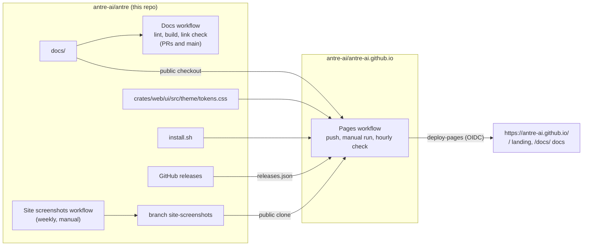

# Antre Docs

The published documentation at <https://antre-ai.github.io/docs/> is built with Astro from the Markdown files in `docs/src/`, with a Pagefind full-text index. It is served under the `/docs` base path, so internal links go through `withBase()` (`src/lib/docs.ts`).

## Local development

```bash
cd docs
npm ci
npm run dev
```

## Production build

```bash
cd docs
npm run build
npm run preview
```

`npm run build` writes `docs/dist/` (Astro, then the Pagefind index).

## How the docs are published

The docs live here because they change with the code; the public site does not.
<https://antre-ai.github.io/> is served by the separate repository
[`antre-ai/antre-ai.github.io`](https://github.com/antre-ai/antre-ai.github.io),
which holds the landing page and builds itself:



- Nothing in this repo pushes to the site and no secret is involved: the
  Pages workflow checks out this public repo read-only.
- A merged docs change goes live at the next hourly check (it skips when
  `main`, the latest release and the site repo are unchanged), or at once by
  running the Pages workflow by hand in the site repo, which also accepts a
  branch, tag or commit of this repo to preview.
- The site also serves `install.sh` from the root of this repo and builds
  `releases.json` (the update checker's manifest) from this repo's releases.
- The landing page shows real app screenshots. `.github/workflows/site-screenshots.yml`
  builds the gateway every Monday (or on demand), injects a demo conversation in the
  web UI (no LLM involved) and captures it with
  `crates/web/ui/e2e/site-screenshots/site.screens.js`, then force-pushes the PNGs as a
  single commit to the `site-screenshots` branch. The site's next hourly check picks
  them up. To capture locally against a running gateway:
  `ANTRE_SITE_SCREENSHOTS_URL=http://127.0.0.1:13131 npx playwright test -c playwright.site-screenshots.config.cjs`
  in `crates/web/ui` (PNGs land in `target/site-screenshots/`).
- The docs are built with the base path `/docs` and links go through
  `withBase()`. The Docs workflow here checks them in that layout on every
  pull request.
- A custom domain is the `SITE_DOMAIN` variable of the site repo; the docs
  read the same variable at build time for their `site` URL.

The previous setup (a `gh-pages` branch of this repo with a `docs.moltis.org`
CNAME, and the Cloudflare-hosted `website/`) is gone.
