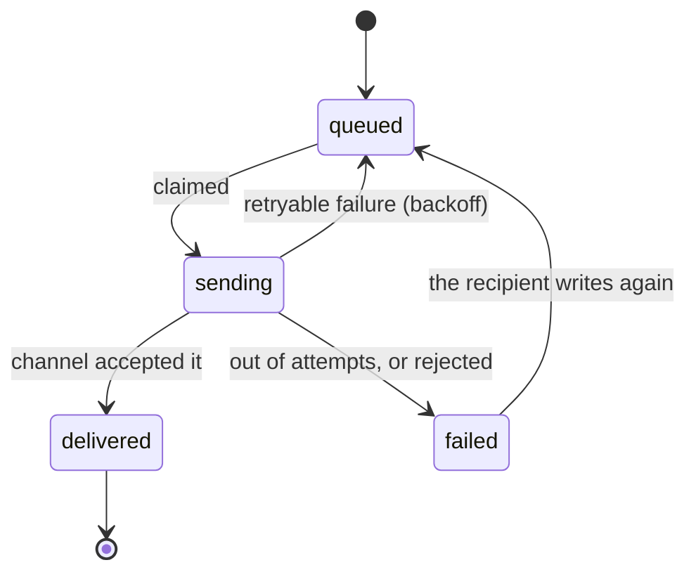

# Reliable Delivery and Session Lanes

Antre does not drop replies silently, and it never runs two turns on the same
session at once. This page explains how replies reach channels, what happens
when a channel fails, and how turns for one session wait their turn.

## Channel replies go through an outbox

When a run answers a channel message (Telegram, Discord, Slack, Signal and the
others), the answer is saved to an outbox in `antre.db` before it is sent.
This covers final answers, activity logbooks, terminal error messages, results
of background sub-agents and the transcript of a voice reply that could not be
sent.

Each delivery moves through these states:



- **Retries.** A send that fails because of the network, a rate limit, a
  channel that is still starting, or no outbound at all is retried with
  exponential backoff and jitter: 2 s, 4 s, 8 s... up to 10 minutes between
  attempts, 8 attempts in total by default.
- **Order.** Replies to the same chat (and thread) go out in the order they
  were produced. A reply waits while an earlier one to that chat is still
  queued or being sent. Other chats are not held up.
- **Restarts.** A reply that was being sent when Antre stopped is sent again
  at startup. A send can therefore be repeated once after a crash, but it is
  never lost.
- **Isolation.** Each send has its own deadline (30 s by default). A chat
  whose API never answers delays only its own replies.
- **Failures are visible.** When a reply cannot be delivered, the web UI gets
  a `delivery` event, and the reaction on the user's message turns to ❌. The
  reply is kept. When that person writes again, the failed reply is sent first,
  starting with "(Resent: this reply could not be delivered earlier.)".
- **Retention.** Delivered and failed records are deleted after 7 days.

If the outbox database itself cannot be written, the reply is still sent once
without a record and a warning is logged.

Web UI replies do not use the outbox: the session history is their durable
copy. A browser that reconnects loads them from there.

### Configuration

```toml
[chat.delivery]
max_attempts = 8                   # Send attempts before a reply is reported as failed
initial_retry_secs = 2             # First retry delay; doubles on each attempt
max_retry_secs = 600               # Retry delay ceiling
attempt_timeout_secs = 30          # A send slower than this counts as failed
retention_days = 7                 # How long delivered/failed records are kept
announce_background_tasks = true   # Post unread background sub-agent results to the parent session
```

### The `delivery` event

Each outcome is broadcast on the `delivery` WebSocket topic:

```json
{
  "id": 42,
  "sessionKey": "telegram:bot:12345",
  "runId": "run-…",
  "kind": "reply",
  "state": "failed",
  "attempts": 8,
  "error": "channel operation unavailable: …",
  "channelType": "telegram",
  "preview": "first 120 characters of the message…",
  "redelivered": false
}
```

`kind` is `reply`, `error`, `logbook` or `notice`. `state` is `queued` (a retry
is scheduled), `delivered` or `failed`.

### Metrics

- `antre_delivery_enqueued_total{kind}`
- `antre_delivery_attempts_total{kind,status,channel}`, where `status` is
  `delivered`, `retry` or `failed`

## One run per session

Each session has one lane. At most one run uses it at a time; everything else
waits in the session's queue, in arrival order. In `collect` queue mode the
queued messages are merged into one turn.

- **Messages sent while a run is active** are queued. The web UI and channels
  show them as queued.
- **Synchronous callers** (cron agent turns, webhooks, `sessions_send` with
  `wait_for_reply`, external agents) wait in the same queue and get their own
  answer when their turn has run. Their turn is never merged with other queued
  messages. If the queue is cleared, they get an error.
- **A run waiting for a provider quota** (see
  [Rate limits and quotas](rate-limits.md)) keeps the lane while it waits.
  Messages sent meanwhile are queued behind it. When the quota resets, the
  parked run resumes first. Cancelling the wait lets the queued messages run.
- **Messages added from outside a run** (`chat.inject`, background sub-agent
  results) wait for the active run to finish. They never land in the middle of
  a turn.

## Background sub-agents report back

A `spawn_agent` call with `nonblocking: true` keeps running after the turn that
started it ends. When it finishes, its result is posted to the parent session
as an assistant message, unless the parent already read it with
`spawn_result`. The message is shown as a notice in the web UI and sent to the
session's channel through the outbox. A result is posted only once, and only
after the parent's current turn ends. Results longer than 8,000 characters are
cut; the full text stays available through `spawn_result` until the task
expires. A cancelled task posts nothing.

Set `chat.delivery.announce_background_tasks = false` to turn this off.

## `chat.inject`

The `chat.inject` RPC appends an assistant message to a session without running
the agent:

```json
{ "sessionKey": "main", "text": "Deploy finished.", "title": "Deploy" }
```

It waits for the session's active turn and adds the message to the history. The
agent sees it on the next turn. The message is also shown in the web UI and
sent to the session's bound channel.

## Memory prefetch has a deadline

Before each private turn, Antre searches long-term memory for context. Memory
is one store shared by all agents, so a locked database or an embedding service
that hangs would otherwise stall every agent's turns. If the search takes more
than 5 seconds, the turn goes on without recalled context, and the prefetch is
skipped for the next 60 seconds. The memory tools that the agent calls itself
are not affected.
