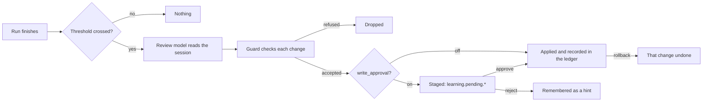

# Learning Loop

Antre can learn from finished conversations. After a busy session, a cheap
model reads the chat and proposes changes to your personal skills and memory.
A curator keeps the skill library small by aging out skills you no longer use.
Every change is recorded in a ledger, and you can undo any single change.

The loop is **off by default**. When you turn it on, changes wait for your
approval unless you switch approval off.

```toml
[learning]
enabled = true
```

## How it works



### The review

A review runs when a session crosses a threshold since its last review: 10
user turns or 10 tool calls by default (`learning.review.every_user_turns`,
`every_tool_calls`). It runs in the background after the run ends. If you send
another message in that session, the review is cancelled so it never competes
with you.

The review sends one request:

- a fixed system prompt, identical on every call, so providers can cache it;
- your personal skill index, the full text of skills loaded in the session,
  `MEMORY.md` and `memory/user-preferences.md`, and recently rejected changes;
- the conversation: recent turns verbatim, older turns condensed, capped at
  about 12,000 tokens.

The model answers with at most `max_changes` changes (3 by default): patch a
skill that was loaded, patch another skill whose class of task fits, add a
topical `references/`, `templates/` or `scripts/` file to a skill, or create a
new class-level skill. Facts about your environment go to `MEMORY.md`;
preferences about you go to `memory/user-preferences.md`. `USER.md` is never
touched, because Antre manages it from your settings.

### Which model

1. `learning.model`, when set (a registry id such as
   `anthropic::claude-haiku-5-5`).
2. The [model catalog](model-catalog.md)'s utility model for the session's
   provider, when that model is configured. The catalog curates cheap models for
   Anthropic, OpenAI, Gemini, Groq, DeepSeek and Z.AI Coding.
3. The session's own model.

### The guard

The prompt asks the model to follow strict rules, inspired by Hermes Agent's
background review. The guard enforces the ones that can be checked, so a
model that ignores them cannot fill the library with noise:

- **Session artifacts are refused.** No new skill named `fix-…`, `debug-…`,
  `…-today`, with an issue number or a date. No support file named per
  incident.
- **Incident narration is refused.** No issue or PR numbers, no dates. The rule
  must stand without the story.
- **Negative claims and environment failures are refused.** "X is broken",
  "command not found", "not installed": they turn into refusals the agent cites
  long after the problem is fixed. Capture the fix instead.
- **Size limits.** Memory notes are kept to 600 characters, skill edits to
  6,000 and new skills to 12,000.
- **No duplicates.** A note already present in the file is dropped.
- **No deletions by the review.** Only the curator archives, and archives are
  restorable.
- **Secrets and prompt injection are refused.** The reviewed chat may contain
  tool output from the web. Text that looks like a credential (API key
  prefixes, private keys) or an injection phrase never reaches a skill or
  memory.
- **Scope.** Only personal skills (`<data_dir>/skills/`) can change. A new
  skill cannot shadow a project, installed or plugin skill. Locked skills are
  never touched. Memory targets follow `memory.agent_write_mode`.

### Approval

With `write_approval = true` (the default), changes are staged under
`<data_dir>/learning/pending/`. Each staged change records the hash of its
target. If the file changed since, approval is refused and you can reject the
change or wait for a new review. Rejected changes are remembered, and later
reviews are told not to propose them again.

### The ledger

Every applied change appends one line to `<data_dir>/learning/ledger.jsonl`.
Each line records who made the change (review, curator or you), what it did,
the target, and the hashes of the file before and after. The contents are kept
once each under `<data_dir>/learning/blobs/`.

Rolling back an entry restores the file as it was before that entry. Entries
before and after it stay in place. A rollback is refused when the file changed
after the entry, so it never discards a later edit; roll back the later entries
first. A rollback is itself a ledger entry.

### The curator

The curator ages personal skills by their last use, taken from the skill usage
telemetry:

| Last use | State |
|----------|-------|
| Within `stale_after_days` (14) | active |
| Older | stale |
| Older than `archive_after_days` (30) | archived |

Archived skills move to `<data_dir>/learning/archive/`, out of the agent's
sight. Each archive is a ledger entry, so rolling it back restores the skill. A
skill used again turns active.

The clock of a skill never starts before the curator first saw it, so turning
the curator on does not archive an old library at once. The first scheduled run
waits one `interval_hours` (a week). After that, runs happen at most once per
interval and only after `min_idle_hours` without chat activity. Pinned skills
are never aged. Locked skills are skipped by both the review and the curator.

With `consolidate = true`, a curator run also asks the learning model to merge
overlapping narrow skills into class-level umbrellas. A merge rewrites or
creates the umbrella and archives the absorbed skills, as one group of changes
that follows `write_approval`.

## RPC

The `learning.*` methods let a client show and act on learned changes. There is
no web UI for them yet.

| Method | Scope | Parameters | Returns |
|--------|-------|------------|---------|
| `learning.status` | read | — | Switches, pending count, ledger size, last curator run, stale, pinned and locked skills |
| `learning.pending.list` | read | — | `pending`: each change with `stale`, a unified `diff` and any `problem` |
| `learning.pending.get` | read | `id` | One pending change |
| `learning.pending.approve` | write | `id` | The ledger `entry` |
| `learning.pending.reject` | write | `id`, optional `note` | `rejected: true` |
| `learning.ledger.list` | read | optional `skill`, `limit` (50, max 500) | `entries`, newest first, each with `reverted_by` |
| `learning.ledger.diff` | read | `id` | The `diff` recorded by an entry |
| `learning.ledger.rollback` | write | `id`, optional `reason` | The rollback `entry` |
| `learning.skill.set` | write | `name`, `pinned` and/or `locked` | The new flags |
| `learning.review.run` | write | `sessionKey` | Review report, whatever the thresholds say |
| `learning.curator.run` | write | optional `dryRun` | Curator report |

Each change broadcasts a `learning` event with a `kind` (`review`, `approved`,
`rejected`, `rolled_back`, `curator`, `consolidation`) and the details.

## Files

| Path under `<data_dir>` | Content |
|-------------------------|---------|
| `learning/ledger.jsonl` | Append-only mutation ledger |
| `learning/blobs/` | File versions, stored once each by sha256 |
| `learning/pending/` | Staged changes, one JSON file each |
| `learning/rejected.jsonl` | Rejected changes, used as hints |
| `learning/archive/` | Archived skills |
| `learning/curator.json` | Curator schedule, skill states, pins and locks |
| `learning/review-state.json` | How far each session has been reviewed |

## Metrics

With the `metrics` feature, the loop records:

- `antre_learning_reviews_total{success}` and
  `antre_learning_review_duration_seconds`;
- `antre_learning_proposals_total{kind}`, where `kind` is applied, staged,
  refused, duplicate or failed;
- `antre_learning_decisions_total{operation}` and
  `antre_learning_rollbacks_total`;
- `antre_learning_curator_runs_total{variant}` and
  `antre_learning_curator_transitions_total{kind}`.

## Credits

The review rules, the curator's aging thresholds and the ledger design follow
[Hermes Agent](https://github.com/NousResearch/hermes-agent) (MIT): its
`agent/background_review.py`, `agent/curator.py` and `tools/skill_ledger.py`.
