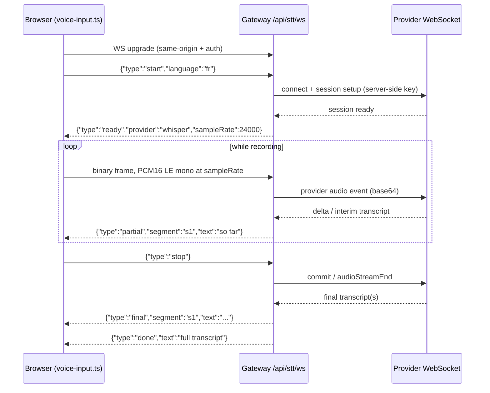

# Realtime Speech-to-Text Plan

## Summary

Add streaming speech-to-text so the web UI shows the transcript while the user
speaks, instead of recording a clip and waiting for one transcription call.
The first two streaming providers are OpenAI (Realtime API, transcription
session) and Google Gemini (Live API, `gemini-3.5-transcribe-live`).

Clip transcription stays as it is. Streaming is an extra capability of a
provider, used only when the active provider supports it, and the UI falls back
to the clip flow whenever a stream cannot start or fails mid-way.

Today `docs/src/voice.md` lists the OpenAI Realtime models as reference only,
because Moltis has no streaming path. This plan removes that limitation.

## Goals and Non-Goals

Goals:

- Live partial transcript in the chat while recording (mic button, push-to-talk
  and VAD conversation mode).
- Same end result as today: the final transcript is sent as a chat message.
- Provider API keys never reach the browser.
- A provider-agnostic streaming trait in `moltis-voice`, next to `SttProvider`.

Non-goals (later work):

- Speech-to-speech (Realtime conversation models answering by voice).
- Streaming STT for channels (Telegram, Discord voice notes are clips anyway).
- Native apps (macOS, iOS): they can reuse the same WebSocket later.
- Local streaming backends (whisper.cpp stream, sherpa-onnx online).

## Architecture



### Why a gateway relay

Both providers accept browser connections only with a short-lived token (OpenAI
client secrets, Gemini ephemeral tokens). A gateway relay keeps one code path
for both, keeps keys server-side, reuses Moltis auth, and lets the gateway
enforce limits. The cost is one extra hop of audio traffic, negligible for
mono PCM16 (48 KB/s at 24 kHz).

### Transport: a dedicated WebSocket

`GET /api/stt/ws`, modelled on `/api/terminal/ws`:

- Same-origin check on `Origin` (CSWSH protection), header/cookie auth via
  `websocket_header_authenticated`, rejected with 401/403 before upgrade.
- Binary frames carry audio, text frames carry JSON control messages. Audio
  does not go through the main `/ws/chat` RPC socket: base64 in JSON RPC adds
  33% and would queue behind chat events.
- One stream per socket. The browser opens the socket when recording starts and
  closes it after `done`.

Client to gateway:

| Message | Meaning |
| --- | --- |
| `{"type":"start","provider"?,"language"?,"prompt"?}` | Open the provider stream. Defaults come from `voice.stt`. |
| binary frame | PCM16 little-endian mono at the `sampleRate` from `ready`. |
| `{"type":"stop"}` | End of audio, flush the final transcript. |
| `{"type":"cancel"}` | Drop everything, no final transcript. |

Gateway to client:

| Message | Meaning |
| --- | --- |
| `{"type":"ready","provider","model","sampleRate"}` | Provider session is open, start sending audio. |
| `{"type":"speechStarted"}` | Provider VAD heard speech (when supported). |
| `{"type":"partial","segment","text"}` | Current text of an open segment. Replaces the previous partial of that segment. |
| `{"type":"final","segment","text"}` | Settled text of a segment. |
| `{"type":"done","text"}` | Stream closed, `text` is all finals joined. |
| `{"type":"error","code","message","fallback"}` | Stream failed. `fallback: true` tells the UI to use the clip flow. |

The gateway announces the sample rate so the browser resamples once, in the
AudioWorklet, and the gateway forwards audio without DSP: OpenAI takes
24 kHz PCM16, Gemini 16 kHz.

### Streaming trait (`crates/voice/src/stt/streaming/`)

```rust
#[async_trait]
pub trait StreamingSttProvider: Send + Sync {
    fn id(&self) -> SttProviderId;
    fn model(&self) -> &str;
    fn input_sample_rate(&self) -> u32;
    async fn open(&self, request: StreamingSttRequest) -> Result<StreamingSttSession>;
}

pub struct StreamingSttSession {
    pub input: mpsc::Sender<StreamingSttInput>,      // Audio(Bytes) | Finish
    pub events: mpsc::Receiver<StreamingSttEvent>,   // SpeechStarted | Partial | Final | Error | Closed
}
```

Each provider runs one tokio task that owns the provider WebSocket
(`tokio-tungstenite`, already a workspace dependency) and translates between
the two channels and the provider protocol. Bounded channels give
backpressure. The trait normalises partial semantics: OpenAI sends deltas, the
OpenAI adapter accumulates them per `item_id`; Gemini sends the utterance so
far, which already matches.

`SttProvider` stays unchanged. A provider that supports both is two small
structs sharing a config.

### Providers

OpenAI (`voice.stt.whisper`, provider id `whisper`, reusing its key and
`base_url` resolution):

- `wss://api.openai.com/v1/realtime?intent=transcription`, `Authorization:
  Bearer`.
- `session.update` with `session.type = "transcription"`,
  `audio.input.format = {type: "audio/pcm", rate: 24000}`,
  `audio.input.transcription = {model, language|languages, prompt}`,
  `turn_detection: null` (the client decides when the turn ends, which matches
  push-to-talk and the existing browser VAD).
- Audio: `input_audio_buffer.append`. Stop: `input_audio_buffer.commit`, then
  wait for `conversation.item.input_audio_transcription.completed`.
- Events used: `...transcription.delta`, `...completed`, `...failed`, `error`.
- Default realtime model: `gpt-live-transcribe` (OpenAI's documented
  WebSocket transcription model). `gpt-realtime-whisper` and
  `gpt-4o(-mini)-transcribe` remain selectable. OpenAI's model page lists
  `gpt-realtime-whisper` under `v1/realtime/transcription_sessions` only, so
  it is tested manually before being advertised as working.

Gemini (`voice.stt.gemini`, the section added by the Gemini clip transcription
PR, same key and names):

- `wss://generativelanguage.googleapis.com/ws/google.ai.generativelanguage.v1beta.GenerativeService.BidiGenerateContent`,
  key in the `x-goog-api-key` header rather than the query string so it does
  not end up in proxy logs.
- `setup: {model: "models/<model>", inputAudioTranscription: {}}`, wait for
  `setupComplete`.
- Audio: `realtimeInput.audio` with `mimeType: "audio/pcm;rate=16000"`.
  Stop: `realtimeInput.audioStreamEnd`, flush after the last `ACTIVITY_END` or
  a 2.5 s grace timeout.
- `serverContent.interimInputTranscription` maps to `partial`,
  `serverContent.inputTranscription` to `final`, `voiceActivity` to
  `speechStarted`. Frames are JSON in binary messages.
- Default realtime model: `gemini-3.5-transcribe-live`.

## Configuration

```toml
[voice.stt]
streaming = true          # use streaming when the active provider supports it
max_stream_seconds = 300  # hard cap per stream, the gateway closes after it

[voice.stt.whisper]
realtime_model = "gpt-live-transcribe"     # optional, this is the default

[voice.stt.gemini]
realtime_model = "gemini-3.5-transcribe-live"
```

- `realtime_model` is separate from `model`: the clip and streaming models
  differ for both providers, and a user may want e.g. `gpt-4o-transcribe` for
  clips and `gpt-live-transcribe` live.
- `stt.status` gains `streaming: {available, provider, model}` so the UI
  decides at load time.
- Settings > Voice: the OpenAI (and later Gemini) modal gets a "Realtime
  model" field, replacing the "Realtime models are reference only" note.
  `streaming` and `max_stream_seconds` are set in `moltis.toml`.
- Updated together: `crates/config/src/schema/voice.rs`, `validate.rs`
  (`build_schema_map`), `template.rs`,
  `docs/src/voice.md`.

## Web UI

- `voice-input.ts`: on recording start, if `streaming.available`, open
  `/api/stt/ws`, send `start`, and on `ready` connect an `AudioWorkletNode`
  that converts the mic stream to mono PCM16 at `sampleRate` and posts ~100 ms
  frames. A `MediaRecorder` keeps recording the clip in parallel, as today.
- The existing "transcribing" bubble becomes a live bubble: finals in normal
  text, the current partial in muted text. On `done`, the full text is sent
  through the existing `sendTranscribedMessage` path, so the message, the STT
  provider footer and the session behave exactly as with clip transcription.
- VAD conversation mode stays on clip transcription in the first PR: its
  recorder runs between utterances, so streaming it would bill silence, and
  opening the stream on detected speech would cut the first syllables. A
  follow-up can keep a short pre-roll in the capture worklet and open one
  stream per utterance.
- The stream client lives in `src/voice/live-transcription.ts`; the
  AudioWorklet is a static file (`/assets/js/pcm-capture-worklet.js`) because
  the app CSP forbids `blob:` scripts. It buffers audio until `ready`, so
  speech said while connecting is not lost.

### Fallback to clip transcription

The UI falls back to uploading the parallel clip through the existing
`/api/sessions/<key>/upload?transcribe=true` flow when:

- the socket or provider connection fails before `ready` (network, auth,
  provider down, unknown model),
- an `error` with `fallback: true` arrives mid-stream,
- `done` arrives with an empty transcript while the clip has audio.

The clip is discarded when the stream succeeds. Because the clip is recorded
anyway, fallback costs one extra request and no lost speech. Errors are shown
in the bubble, as today.

## Limits and Security

- Auth and CSWSH: same checks as the terminal socket; the route sits under
  `/api/`, so the existing `Api` throttle scope and vault/auth middleware apply.
- One active stream per socket; the gateway also caps concurrent streams per
  client IP (default 2) to bound provider spend.
- `max_stream_seconds` and an idle timeout (no audio for 30 s) close the
  provider stream and send `error` with `fallback: false`.
- Binary frames larger than 64 KiB, or audio before `ready`, close the socket
  with a protocol error.
- Keys are `Secret<String>`, exposed only when building the provider request
  header; never logged, never sent to the browser.
- Provider URLs are fixed per provider (plus the existing `base_url` override
  for OpenAI-compatible servers), never taken from the client.

## Observability

- `tracing::instrument` on stream open and relay; `info!` on open/close with
  provider, model, duration and byte counts; `warn!` on provider errors.
- Metrics (gateway `metrics` feature): streams by provider and outcome,
  duration, relayed audio bytes.

## Testing

- `moltis-voice`: each provider tested against a mock WebSocket server
  (`tokio-tungstenite` on a local listener, base URL overridden): setup
  message shape, audio framing, delta accumulation, final flush on `Finish`,
  provider `error`, connection drop, Gemini grace timeout (paused tokio time).
- Gateway: socket handler tests for auth rejection, cross-origin rejection,
  protocol errors, limits, and a full relay against the mock provider.
- Config: schema map, validation and template tests for the new fields.
- Playwright: a spec with a fake streaming provider (mock STT behind a test
  config) checking live partials, the final message, and the fallback to clip
  upload when the socket fails.

## Rollout and Dependencies

- A feature-request issue summarising this plan goes first, as
  `CONTRIBUTING.md` asks for larger architectural changes.
- PR 1: streaming trait, gateway relay, web UI live transcript and fallback,
  config, docs, and the OpenAI provider.
- PR 2: Gemini streaming provider. It depends on the Gemini clip transcription
  PR for `voice.stt.gemini` and `SttProviderId::Gemini`, and is rebased on it
  once it lands.
- `streaming` defaults to `true`: users of OpenAI or Gemini STT get live
  transcription on upgrade, with clip fallback if anything goes wrong.

## Open Questions

1. Send on stop (current behaviour) or put the live transcript into the chat
   input for editing before sending? This plan keeps auto-send, matching the
   clip flow; an "edit before send" option could follow.
2. Should channels (e.g. a future phone/voice channel) reuse
   `StreamingSttProvider`? The trait is designed to allow it, but nothing is
   wired here.
