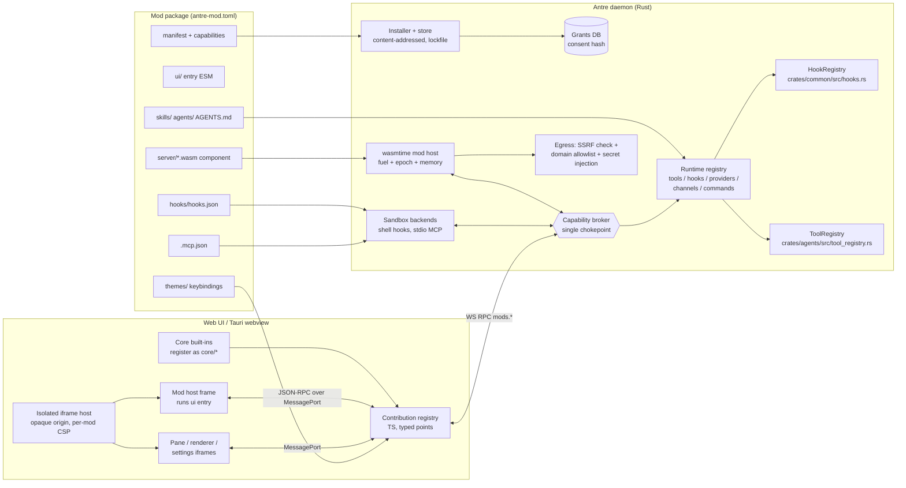

# Antre mod SDK — design spec

Status: draft, 2026-11-28. Docs only; no code in this branch.
Roadmap: phase 6 "Mods et extensions" (`plans/roadmap/roadmap.html`, ≈ 4–6 weeks).
Research inputs (in the main checkout, `plans/research/`, untracked):
`compare-hermes.md` §10 and §13 items 3–4, `compare-oss-landscape.md` §7,
`compare-openclaw.md` §5 and §15, `compare-claude.md` §5–6.

Open questions raised while writing this are in `plans/questions.md`
(main checkout), each with the default this spec uses.

---

## 1. Why

Today an Antre (ex-Moltis) user can extend the agent in four unrelated ways,
and none of them reaches the UI:

| Mechanism | Where | Limits |
|---|---|---|
| Shell hooks (`HOOK.md` + command) | `crates/plugins/src/shell_hook.rs`, discovery in `hook_discovery.rs`, types in `crates/common/src/hooks.rs` | Own wire format (exit 1 blocks, `{"action":"modify"}` on stdout, `shell_hook.rs:1-9`); full user authority; 17 events of which `MessageSending`, `MessageSent` and `GatewayStop` are never dispatched (`compare-claude.md` §5) |
| Skills (`SKILL.md`) | `crates/skills/` (105 bundled in `src/assets/`) | Prompt text only. Safety scan is warn-only (`safety.rs:3-6`). Install pins a commit SHA fetched *separately* from the tarball of `HEAD` (`install.rs:142-150`), so the recorded pin can differ from the installed content |
| MCP servers | `crates/mcp/` | Tools only from the UI's point of view; stdio servers are unsandboxed native processes |
| WASM tool components | `wit/moltis-tool.wit`, `wit/moltis-http.wit`, `crates/tools/src/wasm_*.rs`, components in `crates/wasm-tools/` | Three first-party components (calc, web_fetch, web_search) registered at startup (`crates/gateway/src/server/prepare_core/post_state.rs:783`); no install path, no hooks, no providers or channels |

The web UI has no extension point: the slash menu is a fixed array
(`crates/web/ui/src/pages/chat/slash-commands.ts:76-89`), palette commands
are built by one function (`stores/command-store.ts:63`), settings sections
are a static list (`pages/SettingsPage.tsx:60`), routes come from Rust
(`routes.ts:3-10`).

Every serious competitor has a mod story, and each one has a weakness the
fork can avoid:

- **Hermes**: the core registers its own surfaces through the same registry
  as plugins (good), but desktop plugins run with full renderer authority
  and there are four separate plugin systems (`compare-hermes.md` §10).
- **OpenCode V2**: one package with server and GUI entry points, all
  non-core features as built-in plugins on the public SDK, but in-process
  and unsandboxed (`compare-oss-landscape.md` §7).
- **OpenClaw**: ~65 register points, but about half of 723 advisories are
  policy-bypass paths, plus install path traversal and a bundled hook that
  could hijack the agent (`compare-openclaw.md` §15 rows 4 and 12).
- **Jan** (Worker per extension, permissions with risk levels) and **MCP
  Apps** (`ui://` resources in sandboxed iframes with JSON-RPC over
  postMessage) show the isolation shape for UI code.

## 2. Goals and non-goals

### Goals

1. **One SDK, used by the core.** Every UI surface and runtime extension
   point is a typed contribution in a registry. Built-in features register
   through the same API as third-party mods (OpenCode rule; Hermes §13.3).
2. **One package.** A mod is one folder with one manifest. It can carry a
   server part (WASM component), a UI part (web code), skills, agents,
   hooks, MCP servers, themes and keybindings.
3. **Isolated by default.** UI code runs in opaque-origin sandboxed iframes
   and talks to the host through a capability-checked RPC. Server code runs
   as wasmtime components with fuel, epoch and memory limits. Native code
   (shell hooks, stdio MCP servers) is an explicit high-risk capability.
4. **Consent that cannot be bypassed.** A capability manifest is granted
   once by a human; an update that widens it re-prompts; non-interactive
   installs grant nothing (Hermes §13.4).
5. **Compatible.** Read `SKILL.md`, `AGENTS.md`, the Claude Code plugin
   layout and `.mcp.json` natively; accept Claude Code hook JSON; import
   OpenClaw and Hermes extensions where only data has to move.
6. **Pleasant to author.** Local dev mode with hot reload, a typed TS SDK,
   a Rust/WIT SDK, attributed diagnostics, a bundled `create-mod` skill so
   the agent can write and repair mods (Hermes §10 "Agent writes its own
   mods", Letta in `compare-oss-landscape.md` §7).

### Non-goals (v1)

- Native (unsandboxed) JS plugins in the main page. Even trusted local mods
  go through the iframe host; the core's own built-ins are the only
  in-process contributors.
- UI mods in the gpui desktop client (`apps/desktop/`). gpui renders no
  HTML; the roadmap moves desktop to a Tauri shell (phase 5). Runtime mods
  (tools, hooks, providers, channels) work for every client because they
  run in the daemon. See question Q3.
- UI mods on the Swift apps (`apps/ios`, `apps/macos`): same reason.
- A payment/marketplace layer, ratings, or a hosted build service.
- Python or Node server-side mods. Server logic is WASM; anything else is a
  stdio MCP server under the `exec` capability.
- TUI widgets (Hermes has them; Antre has no TUI).
- Stable API forever. The SDK is versioned (`sdk = "0.x"`) and the host
  refuses mods built for an incompatible major; we prefer attributed
  diagnostics and a safe mode over freezing the API early (Letta).

## 3. Architecture



Two registries, one model:

- **UI contribution registry** (TypeScript, in the page). Typed points for
  panes, status bar, composer, renderers, palette, keybindings, themes,
  settings pages. Core built-ins call it directly; mods call it through the
  RPC bridge, which validates and forwards to the same functions.
- **Runtime registry** (Rust, in the daemon). Typed points for tools, hook
  handlers, middleware, providers, channels, server commands, skills,
  agents, MCP servers. Core built-ins register directly; mod components are
  wrapped by adapters that implement the existing traits (`AgentTool`,
  `HookHandler`, `LlmProvider` at `crates/agents/src/model/stream.rs:87`,
  `ChannelPlugin` at `crates/channels/src/plugin.rs:569`).

Every authority decision goes through **one capability broker** in the
daemon. The UI registry enforces nothing on its own beyond shape checks; it
asks the broker. This is the direct answer to OpenClaw's "path X could skip
policy Y" class (`compare-openclaw.md` §15 row 4).

## 4. Contribution registry

### 4.1 Identity and lifecycle

- **Mod id**: `<publisher>.<name>`, lowercase, `[a-z0-9-]`, e.g.
  `acme.github-prs`. The publisher segment is bound to a signing key in the
  registry (§7). `core` and `antre` are reserved.
- **Contribution id**: `<mod-id>/<local-id>`, e.g.
  `acme.github-prs/refresh`. Core built-ins use `core/<local-id>`
  (`core/compact`, `core/settings.voice`, `core/renderer.exec`).
- **Disposer**: every `register*` call returns a disposer. TS:
  `() => void` (idempotent). Rust: a `Registration` guard whose `Drop`
  unregisters, plus an explicit `dispose()`. Unloading a mod drops all its
  guards; the registry asserts that nothing with the mod's prefix remains
  (leak check in tests).
- **Collisions**: ids are unique. A mod may *replace* a core contribution
  only through an explicit `replaces = "core/renderer.exec"` field, which
  needs the `ui.override` capability and is shown at consent time. Without
  it, a duplicate id is rejected with a diagnostic attributed to the mod.
- **Ordering**: contributions that stack (status items, composer actions,
  hook handlers, middleware) carry an integer `priority` (higher first, the
  convention of `HookHandler::priority`, `crates/common/src/hooks.rs:306`);
  ties break on id for determinism.
- **Activation**: contributions declared statically in the manifest are
  visible before any mod code runs (palette entries, keybindings, slash
  commands, settings page titles, tool schemas). Mod code is started lazily
  on first use of one of its contributions, or at startup when the mod
  declares `activation = "startup"` (VS Code activation events). This keeps
  startup time flat as mods accumulate (OpenClaw §15 row 1, stalls).

### 4.2 UI extension points

"Kind" says how the contribution is rendered: **data** (the host renders
it, no mod code runs in the hot path), **frame** (an isolated iframe the
host mounts), or **handler** (a callback in the mod host frame, invoked
over RPC with a timeout).

| Point | Kind | Capability | Core features moved onto it |
|---|---|---|---|
| `pane` (sidebar tab, right panel, full route) | frame | `ui.pane` | Terminal (`pages/TerminalPage.tsx`), Files, Changes, Browser pane, canvas |
| `statusBar.item` (text, icon, tooltip, command) | data, updated over RPC | `ui.status-bar` | Context gauge, cost, connection state |
| `titleBar.item` | data | `ui.status-bar` | Session title actions |
| `composer.action` (button left/right of input) | data + handler | `ui.composer` | Voice input (`voice-input.ts`), attach, reasoning toggle (`reasoning-toggle.ts`) |
| `composer.slot` (above/below input) | frame | `ui.composer` | Queue panel, `@` reference chips |
| `composer.middleware` (transform text and attachments before send) | handler, 500 ms timeout, sequential by priority | `ui.composer.middleware` | Slash-command expansion, `@` reference resolution |
| `toolRenderer` (by tool name or glob, live and history) | data view spec **or** frame | `ui.renderer` | Per-tool renderers from the chat redesign (exec, read, edit/diff, write, grep, web, browser, subagent, MCP) |
| `transcript.directive` (custom fenced block, e.g. ` ```acme-chart `) | data view spec or frame | `ui.renderer` | Mermaid, KaTeX, `::preview` widgets |
| `message.action` (per-message menu) | data + handler | `ui.message-action` | Copy, fork, regenerate, feedback (`message-actions.ts`, `message-feedback.ts`) |
| `sessionRow.decoration` (badge, icon) | data | `ui.session-decoration` | Unread, channel icon, running indicator |
| `palette.command` | data + handler | `ui.palette` | Everything in `buildCommands()` |
| `slashCommand` (UI side; may forward to a server command) | data + handler | `ui.slash` | The 12 entries in `slash-commands.ts:76-89`; skills as `/name` (`compare-claude.md` §6) |
| `keybinding` (binds a key chord to a command id) | data | none (only to commands the mod may already invoke) | Cmd/Ctrl+K palette; the unused `shortcut` field in `command-store.ts:20` |
| `theme` (design tokens, light/dark) | data (JSON tokens, no CSS) | none | Built-in themes in `theme.ts` |
| `settingsPage` | frame, or data form (typed fields) | `ui.settings` | Every section in `SettingsPage.tsx:60`, migrated gradually |
| `toast` / `notification` | data, rate-limited | `ui.notify` | — |
| `onboarding.step` | frame | `ui.onboarding` | Channel/provider steps (`onboarding/`) |

**View spec for renderers.** Most tool renderers need no code: a
`toolRenderer` can return a declarative view tree built from host
components (`markdown`, `code`, `diff`, `table`, `keyValue`, `image`,
`progress`, `link`, `button → command`). The host renders it with native
styling and no iframe. A frame is only mounted when the mod needs custom
drawing. This keeps long transcripts cheap (one iframe per tool call does
not scale) and gives the chat redesign's renderer registry a natural
data-first contract. The view spec schema is shared with canvas A2UI work
(`crates/canvas` is still a stub, `crates/canvas/src/lib.rs`).

**Themes are tokens, not CSS.** A theme supplies values for the existing
CSS custom properties; arbitrary CSS would let a mod restyle the consent
dialog (UI spoofing, §9).

### 4.3 Runtime extension points

| Point | Implemented by | Capability | Adapter onto existing code |
|---|---|---|---|
| `tool` | WASM export `tools.execute` | `tool` + whatever the tool imports (net, kv…) | `AgentTool`; registered with `ToolSource::Mod { mod_id, component_hash }` (new variant beside `Wasm`, `crates/agents/src/tool_registry.rs:27-33`) and `ToolAudience::Trusted` by default; `Public` needs `tool.public` (exposed to channel/webhook turns) |
| `hook` (observer or interceptor) | WASM export `hooks.handle`, or shell command, or Claude Code `hooks.json` | `hook:<event>`; shell form also needs `exec` | `HookHandler` (`crates/common/src/hooks.rs:306`) |
| `middleware.model` (rewrite a model request/response) | WASM | `middleware.model` | Interceptor on `PreModelCall` / `PostModelCall` |
| `provider` | WASM `provider` world (streaming resource) | `provider` + `net:<api host>` + `secret:<KEY>` | `LlmProvider` |
| `channel` | WASM `channel` world (host owns sockets, timers) | `channel` + `net:*` + `secret:*` | `ChannelPlugin` / `ChannelOutbound` (`crates/channels/src/plugin.rs:569,688`) |
| `command` (server slash command) | WASM export `commands.run` | `command` | Existing `Command` hook event plus chat command dispatch |
| `rpc` (methods the mod's own UI calls) | WASM export `rpc.call` | none beyond its imports | Routed only from the same mod's frames |
| `skill` | `skills/*/SKILL.md` | `agent.context` | `crates/skills` discovery with a new `SkillSource::Mod` |
| `agent` (persona) | `agents/*.md` (Claude layout) | `agent.context` | Existing agents/personas |
| `context` (`AGENTS.md`, `CLAUDE.md` fragment) | file | `agent.context` | Appended after workspace `AGENTS.md` (`crates/config/src/loader/workspace.rs:250-257`), below the prompt cache breakpoint |
| `mcpServer` | `.mcp.json` | remote: `net:<host>`; stdio: `exec` | `crates/mcp` registry, stdio launched through a sandbox backend when available |
| `schedule` (cron entry that calls a mod command) | manifest | `schedule` | `crates/cron` |

Not in v1: HTTP routes served by mods (use `rpc` instead), memory backends,
sandbox backends, auth providers. Each widens the attack surface a lot for
little demand.

### 4.4 Core built-ins on the same registry

The rule: if a mod could not build a feature with the public SDK, the core
should not either. Concretely, for v1:

- `crates/web/ui/src/contrib/` (new) hosts the registry and the `core/*`
  registrations; `slash-commands.ts`, `command-store.ts`,
  `SettingsPage.tsx` sections and the chat redesign's renderer map read
  from it instead of static arrays.
- Rust built-in tools keep `ToolRegistry::register` (tool_registry.rs:128),
  but the WASM components in `crates/wasm-tools/` are repackaged as bundled
  mods (`core.calc`, `core.web-fetch`, `core.web-search`) with manifests
  and grants pre-approved by the binary. That proves the mod path end to
  end on day one.
- Bundled hooks (`crates/plugins/src/bundled/command_logger.rs`,
  `session_memory.rs`) register as `core/hook.command-logger` and
  `core/hook.session-memory`.

Built-ins are trusted and run in-process; the registry marks them
`origin: core` so the Mods page can list them, and users can disable them
like any mod.

## 5. Packaging

### 5.1 Layout

```
acme-github-prs/
  antre-mod.toml          # the manifest (required unless a compat layout is detected)
  server/github_prs.wasm  # component, wasm32-wasip2, world antre:mod/plugin
  ui/main.js              # ESM entry run in the mod host frame
  ui/pane.html            # extra frame documents
  ui/assets/…
  skills/<name>/SKILL.md
  agents/<name>.md
  AGENTS.md               # optional context fragment
  hooks/hooks.json        # Claude Code hook format
  .mcp.json               # MCP servers (Claude Code format)
  themes/<name>.json      # tokens
  .claude-plugin/plugin.json   # optional, read for compat
```

UI code ships **pre-built** (plain ESM, no bundler at install time, no npm
resolution, OpenClaw §15 row 5). The TS SDK provides types and a tiny
runtime (`@antre/mod`, vendored into the bundle by the author's build).

### 5.2 Manifest

```toml
schema = 1
id = "acme.github-prs"
version = "0.2.0"
name = "GitHub PRs"
description = "Open pull requests in a pane and the status bar."
license = "MIT"
sdk = "0.1"                 # host refuses a different major
activation = "lazy"         # or "startup"

[server]
component = "server/github_prs.wasm"

[ui]
entry = "ui/main.js"
frames = ["ui/pane.html"]

[capabilities]
net = ["api.github.com"]
secrets = ["GITHUB_TOKEN"]
ui = ["pane", "status-bar", "palette", "renderer"]
tool = true
storage = "1MiB"
rpc = ["sessions.read"]     # gateway RPC methods the UI part may call

[[contributes.tools]]
name = "github_prs"
description = "List open pull requests for a repository."
schema = "server/github_prs.schema.json"

[[contributes.commands]]
id = "refresh"
title = "Refresh pull requests"

[[contributes.keybindings]]
command = "refresh"
key = "mod+shift+g"

[[contributes.panes]]
id = "list"
title = "Pull requests"
frame = "ui/pane.html"
placement = "right"
```

Rust types: `ModManifest` in a new `crates/mods` crate, deserialized with
`serde`, unknown keys rejected, validated before anything is written to the
store. The TOML is the source of truth; a JSON Schema is exported for
editors (the repo already uses `taplo`).

### 5.3 Compatibility layouts

Detection order mirrors `crates/skills/src/formats.rs:22-34`
(`PluginFormat::{Skill, ClaudeCode, Codex, Generic}`), extended:

| Input | What Antre does | Capabilities derived |
|---|---|---|
| Folder with `antre-mod.toml` | Native mod | As declared |
| Claude Code plugin (`.claude-plugin/plugin.json` + `skills/ agents/ commands/ hooks/ .mcp.json`) | Synthesizes a manifest. Today only skills/agents/commands become skills (`compare-claude.md` §6); v1 also maps `hooks/hooks.json` and `.mcp.json` | `agent.context`; `exec` if hooks or stdio MCP present; `net:<host>` per remote MCP server |
| Single `SKILL.md` repo or folder | Mod with one `skill` contribution | `agent.context` |
| `AGENTS.md` only | Mod with one `context` contribution | `agent.context` |
| `.mcp.json` only | Mod with `mcpServer` contributions | as above |
| Claude Code marketplace (`.claude-plugin/marketplace.json`) | Treated as a registry source listing several plugins | per plugin |

Compatibility mods are first-class: same store, grants and Mods page.
Skills installed through today's `skills.*` RPC keep working; phase 6
migrates `skills-manifest.json` entries (`crates/skills/src/manifest.rs`)
into mod records without moving files.

### 5.4 Importing OpenClaw and Hermes extensions

The import crates (`crates/openclaw-import`, `crates/hermes-import`,
`crates/claude-import`) already move skills and MCP servers. Extension
*code* is not portable: OpenClaw plugins are TypeScript against
`packages/plugin-sdk` with ~65 register points (`compare-openclaw.md` §5),
Hermes agent plugins are Python `register(ctx)` and Hermes desktop plugins
are unsandboxed ESM (`compare-hermes.md` §10). Cheap paths only:

- **Skills and MCP servers bundled inside OpenClaw/Hermes plugins**: wrap
  each plugin folder as a compatibility mod (skills + `.mcp.json`).
- **Claude-format hooks shipped in those plugins**: imported through the
  Claude hook protocol (§8.3).
- **Themes** (Hermes desktop): token files map directly.
- Everything else is listed in the import report (`openclaw-import`
  already has `report.rs`) as "not imported: code plugin", with a link to
  the `create-mod` skill so the agent can port it on request.

## 6. Isolation

### 6.1 UI side

**Where frames live.** Mod documents are served from a **separate origin**
(the isolated iframe host the canvas session is building: separate
origin, strict CSP, shared by artifacts, MCP Apps, canvas and mods; roadmap
phase 3). Every frame gets `sandbox="allow-scripts"` and **never**
`allow-same-origin`, so it runs with an opaque origin: no cookies, no
storage, no access to the parent DOM, no reuse of the user's session.
Without a second origin (single-port self-hosted deployments), the opaque
origin still holds; the separate origin only adds defence in depth. See Q2.

**Per-mod CSP.** Each mod document response carries a CSP built from the
grant: `default-src 'none'; script-src <mod path>; style-src <mod path>
'unsafe-inline'; img-src <mod path> data: blob:; connect-src 'none';
frame-ancestors <app origin>`. Network access from UI code is denied;
the UI reaches the network only through its own server component (which
goes through the egress checks) or through granted RPC. This avoids
duplicating the SSRF and domain-allowlist logic in the browser.

**Two frame roles.**

1. **Mod host frame** (hidden, one per active mod): runs `ui.entry`,
   performs registrations, handles handler-kind contributions (palette
   callbacks, composer middleware, renderer view specs). A Worker would be
   lighter, but Workers created from an opaque frame inherit its origin
   and the iframe gives a uniform model; v1 uses the frame, Workers are a
   later optimisation.
2. **Surface frames** (panes, frame renderers, settings pages): mounted by
   the host where the contribution sits, sized by the host, with a visible
   attribution strip (mod name and icon) the mod cannot draw over.

**RPC.** JSON-RPC 2.0 over a `MessagePort` transferred to the frame at
creation. The host never listens to `window.postMessage` with `*` origin;
the port *is* the identity. Each port is bound to `(mod_id, version,
grant_hash, frame_role)` at creation and that binding never changes; a
reloaded frame gets a new port (no "reconnect widens scope",
`compare-openclaw.md` §15 row 4). Methods:

| Namespace | Examples | Gate |
|---|---|---|
| `registry.*` | `register(point, spec)`, `update(id, patch)`, `dispose(id)` | point's capability; id must carry the mod prefix |
| `ui.*` | `toast`, `openPane`, `setStatus`, `theme.tokens()` | `ui.*` capability |
| `state.*` | `get("session.current")`, `subscribe("session.messages")` | read-only selectors, each tied to a capability (`sessions.read`, …) |
| `gateway.call` | forwards a gateway WS RPC method | method must be in the grant's `rpc` list; one allowlist table in the broker; write methods are flagged high-risk |
| `server.call` | calls the mod's own WASM `rpc.call` export | none (same mod) |
| `storage.*` | per-mod KV (quota from `storage`) | `storage` |
| `commands.run` | runs a command id | own commands always; `core/*` commands only those marked `public` |

All calls carry a deadline; handler-kind contributions get 500 ms
(middleware) to 5 s (commands). A frame that misses three heartbeats is
torn down and its contributions disabled with a diagnostic, so one mod
cannot freeze the chat. Message size is capped (1 MiB) and calls are
rate-limited per mod.

**Consent UI is host chrome only.** Capability prompts, secret entry and
approvals render in the main page, outside any mod surface, never inside a
frame. Mods can request a prompt; they cannot draw one.

### 6.2 Server side

**Runtime.** A new `crates/mod-host` builds on `WasmComponentEngine`
(`crates/tools/src/wasm_engine.rs:24-47`, already `consume_fuel(true)` and
`epoch_interruption(true)`, component cache keyed by SHA-256) and the
resource limiter in `wasm_limits.rs` (default 16 MiB memory, 1 M fuel,
per-tool overrides).

**Limits per call**: fuel (default 1 M, overridable per mod up to an admin
cap), memory (default 16 MiB), wall-clock via epoch deadline, output size.
Long-lived parts (channels, providers) get a budget **per callback**, not
per lifetime; the host owns sockets and timers and calls the component
for each event.

**Epoch ticking**: one engine-wide ticker (a single tokio interval) and a
deadline of `timeout / interval` ticks per store. Today
`WasmToolRunner::execute_blocking` sets `set_epoch_deadline(1)` and starts
one ticker *thread per call* that increments the shared engine epoch every
`wasm_epoch_interval_ms` (default 100 ms; `wasm_tool_runner.rs:64-97,
336-347`, `post_state.rs:770-773`). With a shared engine, concurrent calls
advance each other's epochs, and a deadline of one tick bounds guest time
to roughly one interval rather than `timeout`. The mod host should not
inherit that; phase 2 adds a test that pins the intended semantics and
fixes the tool runner at the same time.

**WASI**: keep today's empty `WasiCtxBuilder::new().build()`
(`wasm_tool_runner.rs:44`): no preopened dirs, no inherited env, no stdio.
Filesystem access, when granted (`fs:<scope>`), is a host interface over a
per-mod data dir, not WASI preopens of user paths.

**Two-level capability check**:

1. *Static*, at install: the host reads the component's imports and
   rejects the package if it imports an interface its manifest does not
   declare (e.g. imports `outgoing-handler` without `net`).
2. *Dynamic*, at call time: the linker only links granted interfaces
   (ungranted optional imports get deny-stubs returning `denied`), and each
   host function re-checks its scope (domain allowlist, KV quota, secret
   names).

**Egress**: reuse `HttpHostImpl` (`crates/tools/src/wasm_component.rs:59-160`):
SSRF block of loopback/private/link-local unless allowlisted
(`ssrf_check_blocking`), per-mod domain allowlist from `net`, response size
caps, and the existing secret map for **credential injection**: the
component writes a placeholder such as `{{secret:GITHUB_TOKEN}}` in a
header; the host substitutes it after the allowlist check, so the secret
never enters guest memory and cannot be sent to another host. Responses
are scanned for the secret value before being returned (leak scan,
IronClaw model in `compare-oss-landscape.md` §7). Secrets live in the
existing secret store / vault (`crates/secret-store`, `crates/vault`),
wrapped in `secrecy::Secret`.

### 6.3 Native code

Shell hooks and stdio MCP servers are native processes with the user's
authority. They need the `exec` capability, are shown as **high risk** at
consent, and:

- run through a sandbox backend when one is available (Docker/Apple
  Container today, the OS sandbox from the parallel `os-sandbox` work
  later), with an env allowlist instead of the full environment
  (`compare-openclaw.md` §15 row 13);
- are pinned by content hash (Codex "hash-based trust",
  `compare-oss-landscape.md` §7): if the script or binary changes outside
  an update, it stops running until re-approved.

## 7. Capabilities and consent

### 7.1 Capability vocabulary

Capabilities are a closed Rust enum (`Capability`), parsed from the
manifest; matching is on types, never strings (CLAUDE.md). Scopes only
narrow (a `net` grant for `api.github.com` never matches
`evil.api.github.com.attacker.tld`; wildcards only as a leading `*.` label
and never for public suffixes).

| Capability | Risk | Meaning |
|---|---|---|
| `ui.pane`, `ui.status-bar`, `ui.palette`, `ui.slash`, `ui.renderer`, `ui.settings`, `ui.notify`, `ui.message-action`, `ui.session-decoration`, `ui.onboarding` | low | Contribute that surface |
| `ui.composer` | medium | Add composer actions and slots |
| `ui.composer.middleware` | high | Rewrite what the user sends |
| `ui.override` | high | Replace a core contribution |
| `storage` (quota) | low | Per-mod KV |
| `tool` | medium | Offer tools to the agent |
| `tool.public` | high | Tools also reachable from channel/webhook turns |
| `agent.context` | medium | Add skills, agents, context text to prompts |
| `hook:<event>` observer | medium | Observe events (payload may contain conversation text) |
| `hook:<event>` interceptor, `middleware.model` | high | Block or modify agent flow |
| `net:<host>` | medium | Outbound HTTP to listed hosts |
| `secret:<NAME>` | high | Use a named secret through injection |
| `rpc:<method>` | per method | Call gateway RPC from UI code |
| `llm` (budget) | medium | Ask the host model for completions, metered and capped |
| `provider`, `channel` | high | Act as an LLM provider or messaging channel |
| `schedule` | medium | Run on a timer |
| `fs:<scope>` | high | Scoped file access through a host interface |
| `exec` | critical | Native processes (shell hooks, stdio MCP) |

### 7.2 Consent hash

- `cap_set` = the manifest's capabilities, normalized (sorted, scopes
  lowercased and de-duplicated) and serialized as canonical JSON.
- `consent_hash = sha256(cap_set)`.
- A grant row records `(mod_id, publisher_key, consent_hash, cap_set,
  granted_by, granted_at, interactive = true)`.

Rules:

1. **Install**: the mod is written to the store **disabled**. It becomes
   enabled only when a human approves its `cap_set` in the UI or with an
   interactive CLI prompt. Risk levels are shown; `high` and `critical`
   items are expanded by default.
2. **Update**: compute the new `cap_set`. If it is a subset of the granted
   set and the publisher key is unchanged, the update applies silently.
   Otherwise the old version keeps running and the user is shown the
   **delta** ("adds `net:api.gitlab.com`, `secret:GITLAB_TOKEN`"). Nothing
   from the new version runs before approval.
3. **Non-interactive installs grant nothing**: installs from the agent
   (`mod_install` tool), a channel, a webhook, a cron job, config files or
   `antre mod install --yes` produce a disabled mod and a notification. No
   flag, env var or config key turns this off. An admin-managed allowlist
   (`mods.managed`, pre-granted by the operator in `moltis.toml`) is the
   only exception and is shown as "granted by config".
4. **Partial grants**: the user may deny individual capabilities; the
   affected contributions are disabled and attributed ("Pane needs
   `ui.pane`").
5. **Revocation** is immediate: the broker drops the grant, disposes the
   affected contributions, tears down frames and running WASM stores.

### 7.3 Single chokepoint

`ModBroker` (in `crates/mods`) owns grants and answers `check(mod_id,
Capability) -> Result<Granted, Denied>`. Every path consults it: the RPC
bridge, the WASM host functions, the hook adapter, the tool adapter, the
MCP launcher. Granted capabilities are passed down as typed tokens
(`Granted<Net>`) that can be narrowed but not widened; property tests
assert that no sequence of reload, update, reconnect or revocation widens
a mod's effective capabilities.

## 8. Hooks and middleware

### 8.1 Event names

Antre aligns names with Claude Code where the semantics match
(`compare-claude.md` §5 lists 34 Claude events), keeps Antre-specific
events otherwise, and keeps the old names as aliases in `HookEvent::from_str`
(`crates/common/src/hooks.rs:58-80`) so existing `HOOK.md` files keep
loading.

| Current (`HookEvent`) | New canonical name | Kind | Notes |
|---|---|---|---|
| `BeforeAgentStart` | `UserPromptSubmit` | interceptor | can add context or block |
| `AgentEnd` | `Stop` | observer | |
| `BeforeLLMCall` / `AfterLLMCall` | `PreModelCall` / `PostModelCall` | interceptor / observer | Antre-specific; `middleware.model` lives here |
| `BeforeCompaction` / `AfterCompaction` | `PreCompact` / `PostCompact` | interceptor / observer | |
| `BeforeToolCall` | `PreToolUse` | interceptor | supports `updatedInput`, `permissionDecision` |
| `AfterToolCall` | `PostToolUse` (+ new `PostToolUseFailure`) | observer | |
| `ToolResultPersist` | `ToolResultPersist` | interceptor, sync | hot path; WASM handlers only (no shell) |
| `MessageReceived` / `MessageSending` / `MessageSent` | same | interceptor / interceptor / observer | the last two must actually be dispatched (never are today) |
| `SessionStart` / `SessionEnd` | same | observer | |
| `GatewayStart` / `GatewayStop` | `ServerStart` / `ServerStop` | observer | `GatewayStop` is never dispatched today |
| `Command` | `SlashCommand` | observer | |
| — | `PermissionRequest` | interceptor | approval flow |
| — | `SubagentStart` / `SubagentStop` | observer | |
| — | `Notification` | observer | |
| — | `ModLoad` / `ModUnload` | observer | for mods coordinating with each other |

Observer vs interceptor maps onto the existing split
(`HookEvent::is_read_only`, `hooks.rs:105-125`; observers run in parallel,
interceptors sequentially by priority, `hooks.rs:537-560`). Circuit
breaker (3 failures, 60 s cooldown) and dry-run (`hooks.rs:404-436`) apply
to mod handlers unchanged and are surfaced per mod on the Mods page.

### 8.2 Actions

`HookAction` (`hooks.rs:292-300`: `Continue`, `ModifyPayload`, `Block`)
grows the Claude decision fields as typed variants rather than a JSON blob:
`AddContext(String)`, `PermissionDecision(Allow | Deny | Ask)`,
`SystemMessage(String)`, `StopTurn { reason }`. Each event declares which
actions it accepts; a disallowed action is ignored with an attributed
diagnostic.

`HookHandler::handle_sync` currently falls back to
`block_in_place(|| handle.block_on(..))` (`hooks.rs:323-334`), against the
"never `block_on` in async context" rule. WASM handlers are synchronous
calls into wasmtime and can implement `handle_sync` natively; shell
handlers are refused for `ToolResultPersist`.

### 8.3 Wire protocols for command hooks

- `protocol = "antre-v1"` (default for existing `HOOK.md`): today's
  format, exit 1 blocks.
- `protocol = "claude"` (default for `hooks/hooks.json` and imported
  hooks): Claude Code JSON on stdin (`hook_event_name`, `session_id`,
  `cwd`, `tool_name`, `tool_input`, …), exit 2 blocks with stderr as the
  reason, JSON stdout with `decision`, `hookSpecificOutput`,
  `continue`, `systemMessage`. Matchers on tool name are supported; the
  `prompt`/`agent` handler types are not in v1. See Q5.

### 8.4 Middleware

Middleware is an interceptor with a narrower, typed payload and a strict
deadline:

- `composer.middleware` (UI): `{text, attachments, references}` → same
  shape or `cancel(reason)`; 500 ms each; sequential by priority.
- `middleware.model` (server): sees the provider-neutral request before
  `PreModelCall` dispatch and the response after; may not touch the
  system prompt prefix above the cache breakpoint (byte-stable prompt,
  OpenClaw §15 row 7).
- Tool middleware is `PreToolUse` / `PostToolUse` interceptors.

## 9. Server SDK: WIT

A new package next to the existing ones, reusing their types so today's
components keep compiling:

```wit
package antre:mod@0.1.0;

interface log      { log: func(level: u8, message: string); }
interface kv       { get: func(key: string) -> option<list<u8>>;
                     set: func(key: string, value: list<u8>) -> result<_, string>;
                     delete: func(key: string); list: func(prefix: string) -> list<string>; }
interface llm      { complete: func(request-json: string) -> result<string, string>; }
interface ui-events { emit: func(topic: string, payload-json: string); }

interface tools    { use moltis:tool/types.{tool-result};
                     execute: func(name: string, params-json: string, ctx-json: string) -> tool-result; }
interface hooks    { handle: func(event: string, payload-json: string) -> string; }
interface commands { run: func(name: string, args: string) -> result<string, string>; }
interface rpc      { call: func(method: string, params-json: string) -> result<string, string>; }

world plugin {
  import moltis:tool/outgoing-handler;
  import log; import kv; import llm; import ui-events;
  export tools; export hooks; export commands; export rpc;
}
```

`provider` and `channel` get their own worlds in phase 5: a provider
exports `stream: func(request-json) -> stream-handle` with a pull-based
`next-chunk` resource (until WASI p3 async streams are stable in
wasmtime); a channel exports `on-event` callbacks and imports host
`timers` and `outgoing-handler`. Typed records replace the `*-json`
strings where shapes are stable (CLAUDE.md "concrete types over
`serde_json::Value`"); JSON is acceptable at the boundary for hook
payloads that already serialize `HookPayload`.

The existing `pure-tool` and `http-tool` worlds stay supported: a
component exporting one of them is wrapped as a single-tool mod.

## 10. Distribution

### 10.1 Sources

- **Registry**: a git index repository (one TOML file per mod, versions
  with source URL, archive SHA-256, signature, `consent_hash`), merged by a
  human after an automated admission scan (Hermes catalog model,
  `compare-hermes.md` §10). The daemon fetches the index over HTTPS, verifies
  the index signature, caches it.
- **Git URL** with ref (`github:acme/github-prs@v0.2.0`), resolved to a
  commit SHA **before** download, then the archive of that exact SHA is
  fetched (fixes the TOCTOU in `install.rs:142-150`).
- **Local path** (dev mode, §10.4).
- **ClawHub** stays a source for skills (`crates/skills/src/clawhub.rs`).

### 10.2 Signatures and trust

Default (Q1): publishers sign archives with an Ed25519 key in minisign
format (`minisign-verify` crate, no network needed to verify). The registry
binds `publisher → public key`; the index itself is signed by the Antre
registry key embedded in the binary. Trust on first use for git-URL
installs: the key seen at first install is pinned; a key change is
treated like a capability widening (re-prompt with a warning). Unsigned
archives install only from local paths or with an explicit "unsigned"
consent line. Sigstore keyless signing (already used for Antre releases)
is a later option for publishers who prefer OIDC identities.

Trust tiers shown at install: **Core** (bundled), **Verified** (publisher
identity checked by maintainers), **Registry** (reviewed index entry),
**Unlisted** (git URL), **Local**.

### 10.3 Store, pinning and updates

- Content-addressed store: `data_dir()/mods/store/<sha256>/`, extracted
  with the archive sanitizer already used for skills
  (`sanitize_archive_path`, symlink/hardlink entries skipped,
  `install.rs:173-181,245`), size and file-count caps, no install scripts.
- `data_dir()/mods/active/<mod-id>` points at the active hash; switching
  versions is one atomic rename; the previous version is kept for
  rollback (OpenClaw §15 row 5).
- `mods.lock` records exact version, archive hash, publisher key and
  consent hash for every installed mod; sharing the lock file reproduces
  a setup (Hermes "exact SHA pins").
- DB tables in `crates/mods/migrations/`: `mods`, `mod_versions`,
  `mod_grants`, `mod_kv`, `mod_diagnostics` (add to the CLAUDE.md table
  list).
- Update check daily and on demand; updates inside the grant and with the
  same key may auto-apply (setting, default on); everything else waits.
  Hot reload **drains**: in-flight tool calls and turns finish on the old
  version (OpenClaw §15 row 6).
- Name squatting: reserve `antre`, `core` and the publisher ids of
  bundled mods; mod ids are publisher-scoped so a renamed upstream cannot
  be squatted under a bare name (OpenClaw §15 row 12).

### 10.4 Local dev mode

- `antre mod dev <path>` (and a "Load unpacked" button) registers a local
  folder. It still goes through manifest validation and consent; dev mods
  get a **Dev** badge and are never auto-enabled after restart without the
  same grant.
- A file watcher (the `notify`-based watcher in `crates/skills/src/watcher.rs`
  is the model) reloads on change: UI frames are recreated with new ports,
  WASM components are recompiled (the engine caches by hash, so unchanged
  files cost nothing), contributions are re-registered, and the reload
  drains like an update.
- A capability added in dev re-prompts like an update; there is no dev
  bypass.
- Diagnostics (manifest errors, registration failures, RPC timeouts,
  traps with fuel/epoch cause, CSP violations reported by the frame) are
  attributed to the mod and shown in a Mods → Diagnostics panel and in
  the logs page.
- **Safe mode**: `antre --safe-mode` (and a UI toggle) starts with all
  non-core mods disabled.
- `create-mod` bundled skill: scaffolds a mod, writes the manifest, builds
  the component with `cargo component` when a toolchain is present, loads
  it in dev mode and reads diagnostics to repair it. The agent can write
  files and request a dev load; enabling still needs the user's consent
  (rule 7.2.3).

### 10.5 API and UI surface

- REST `/api/mods/...` and RPC `mods.*` (`mods.list`, `mods.install`,
  `mods.grant`, `mods.revoke`, `mods.enable`, `mods.update`,
  `mods.devLoad`, `mods.diagnostics`), per the API namespace convention.
- A **Mods** page (top-level, replaces nothing; the Hooks page
  (`pages/HooksPage.tsx`) and Skills page show mod-provided entries with
  their origin).
- Agent tools: `mod_search`, `mod_install` (non-interactive: disabled until
  consent), `mod_dev_load`, `mod_diagnostics`.
- Feature flag `mods`, on by default in `crates/cli/Cargo.toml`, with
  `tracing` and `metrics` features in the new crates (install count, load
  time, RPC latency, traps, denials).

## 11. Security review

Against the OpenClaw advisory and issue classes in `compare-openclaw.md`
§15, plus classes specific to this design.

| Class | OpenClaw evidence | Antre control | Residual risk |
|---|---|---|---|
| Policy enforcement drift ("path X skips policy Y") | ~half of 723 advisories; GHSA-rqpp-rjj8-7wv8, GHSA-fqw4-mph7-2vr8, GHSA-gv46-4xfq-jv58 | One `ModBroker` chokepoint; typed narrowing tokens; ports bound to grant at creation; property tests on reload/update/reconnect sequences (§7.3) | Core RPC methods added later without a capability mapping: the broker denies unknown methods by default |
| Install path traversal | GHSA-qrq5-wjgg-rvqw | Reuse `sanitize_archive_path`; reject absolute, `..`, symlinks, hardlinks, device files; extract into a fresh temp dir then atomic rename into the content-addressed store | — |
| Install as persistence | #8776 | No install scripts, no postinstall recipes that run code; recipes stay data (`crates/skills/src/recipes.rs:1-8`); a mod does nothing until granted and enabled | A granted `exec` hook is persistence by design; shown as critical, content-hashed |
| Malicious bundled hook ("soul-evil") | #2775 | Bundled mods are reviewed code in this repo, listed with `origin: core`, individually disableable; no remote-fetched bundled content | — |
| Package squatting after rename | §15 row 12 | Publisher-scoped ids, reserved names, key pinning, registry review | Typosquats of publisher ids; admission scan flags edit distance ≤ 2 to verified publishers |
| Env injection | GHSA-8rh7-6779-cjqq, GHSA-j7p2-qcwm-94v4 | WASM gets no env; native hooks get an env allowlist; mods never read `.env` from workspace or CWD | — |
| Silent failure / message loss | §15 row 3 | Every denial, trap, timeout and circuit-breaker trip is a user-visible, attributed diagnostic | — |
| Event-loop stalls, unbounded growth | §15 rows 1–2 | WASM calls on `spawn_blocking` with fuel/epoch; caps on KV, RPC message size, frame count, diagnostics retention; lazy activation | Many frames in one WebView share a renderer process; heartbeat kill limits the damage |
| Hot reload aborting turns | §15 row 6 | Draining reload | — |
| Prompt injection through mod output | general | Tool and hook output is tagged with the mod id in the transcript; `agent.context` is a consented capability; context fragments go below the cache breakpoint | Inherent to LLM agents; consent makes it explicit |
| Secret exfiltration | general | Placeholder injection after the allowlist check; leak scan of responses; UI frames have `connect-src 'none'` | A granted mod can still misuse a secret against the allowed host |
| SSRF from mods | CLAUDE.md security rule | `HttpHostImpl` + `ssrf_check_blocking` unchanged | — |
| UI spoofing / clickjacking | general | Consent and secret entry only in host chrome; attribution strip on frames; themes are tokens, not CSS | A pane can still imitate content inside its own box |
| Cross-frame message forgery | general | `MessagePort` per frame, no `window.postMessage('*')` listeners, opaque origins | — |
| Supply-chain update that widens scope | Hermes re-pin delta | Consent hash re-prompt; key change re-prompt; old version keeps running | — |
| Agent installs malware by itself | general | Non-interactive installs grant nothing | Social engineering of the user at consent time |

## 12. Migration

### 12.1 `crates/plugins` shell hooks

1. Phase 1: add `protocol` and the new event names as aliases; nothing
   breaks. `MessageSending`, `MessageSent` and `GatewayStop` get real
   dispatch sites.
2. Phase 3: each discovered `HOOK.md` folder (`hook_discovery.rs`, under
   `<data_dir>/hooks` and `<data_dir>/.moltis/hooks`) is listed as a
   **local compatibility mod** with capabilities `exec` + `hook:<events>`.
   Existing hooks keep running: the first start after the upgrade records
   a grant marked "migrated from pre-mods install" with the hook's
   content hash, so the user is not re-prompted for what already ran, but
   any later change to the script re-prompts.
3. The Hooks page reads from the runtime registry and shows origin.
4. `crates/plugins` shrinks to the shell handler and discovery; the
   registry moves behind the mods runtime registry. No forced rewrite.

### 12.2 WASM tools

1. The three components in `crates/wasm-tools/` get manifests and become
   bundled mods (`core.calc`, `core.web-fetch`, `core.web-search`),
   pre-granted by the binary. `register_wasm_tools`
   (`wasm_tool_runner.rs:477`, called at `post_state.rs:783`) becomes a
   loop over bundled mods.
2. `WasmToolLimits` overrides (`wasm_limits.rs:29-56`) move into each
   bundled manifest; the config key `wasm_tool_limits` keeps working as an
   override.
3. `ToolSource::Wasm` is kept as an alias of `ToolSource::Mod` for one
   release.
4. The Brave key passed into `register_wasm_tools` becomes a
   `secret:BRAVE_API_KEY` grant with injection, instead of being handed to
   the host struct.

### 12.3 Skills, MCP, imports

- Installed skill repos (`skills-manifest.json`) become compatibility mods
  in place; `skills.*` RPC keeps working as a facade.
- MCP servers configured in `mcp-servers.json` stay user config, not mods.
  Only MCP servers that arrive inside a package are mod contributions.
- `claude-import` stops copying Claude plugins' skills and installs the
  plugin as a compatibility mod instead (live read, `compare-claude.md`
  §6 "copied instead of read live").

## 13. Phased plan

Effort for one developer familiar with the codebase. Phases 0–4 are the
"MVP" that fits the roadmap's 4–6 weeks; phases 5–6 follow.

| Phase | Content | Effort | Depends on |
|---|---|---|---|
| **0. Registry and core dogfooding (UI)** | `contrib/` registry in TS with typed points, disposers, namespaced ids, diagnostics; move slash commands, palette commands, settings sections, keybindings and themes onto it as `core/*`; adopt the chat redesign's renderer map as the `toolRenderer` point; E2E tests per point | 1.5 wk | chat redesign renderer registry |
| **1. Hooks groundwork** | Event aliases and new events, missing dispatch sites, typed actions, `protocol = "claude"`, remove `block_on` fallback for sync path; tests per event | 1 wk | — |
| **2. `crates/mods` + `crates/mod-host`** | Manifest parsing/validation, `Capability` enum, `ModBroker`, grants DB and consent hash, content-addressed store, lockfile, `antre:mod` WIT `plugin` world with tools/hooks/commands/rpc, single epoch ticker, static import check, secret injection; repackage the three WASM tools as bundled mods | 2 wk | 1 |
| **3. UI isolation** | Mods origin on the isolated iframe host, per-mod CSP, mod host frame, surface frames, MessagePort JSON-RPC with deadlines and heartbeats, consent UI, Mods page, dev mode with hot reload, safe mode, compatibility layouts (Claude plugin, SKILL.md, AGENTS.md, `.mcp.json`) | 2 wk | 0, 2, canvas iframe host |
| **4. Distribution** | Git URL installs by resolved SHA, minisign verification, signed index client, trust tiers, update check with delta prompts, rollback; `create-mod` skill; agent tools | 1 wk | 2 |
| **5. Providers and channels** | `provider` and `channel` WIT worlds and adapters onto `LlmProvider` / `ChannelPlugin`; one reference provider and one reference channel as mods | 2 wk | 2 |
| **6. Imports and polish** | OpenClaw/Hermes wrapping of bundled skills/MCP/themes, migration of skill repos and `HOOK.md` folders, docs (`docs/src/mods.md`, SDK reference), registry repo bootstrap | 1 wk | 3, 4 |

Total ≈ 10.5 weeks; MVP (0–4) ≈ 7.5 weeks. The roadmap's 4–6 weeks fits
only if phase 0 lands with the chat redesign and phase 3 reuses the canvas
iframe host as is.

Each phase ends with targeted Rust tests and Playwright specs for the
points it adds, a docs page update and a config template update where
config keys change.

## 14. First demo mod: `antre.github-prs`

Chosen because it uses both halves, shows consent clearly, and is useful.

- **Server** (Rust → `wasm32-wasip2`, world `antre:mod/plugin`): tool
  `github_prs(repo, state)` calling `api.github.com` with
  `Authorization: Bearer {{secret:GITHUB_TOKEN}}`; `rpc.call("list")` for
  the UI; a `schedule` every 10 min that emits `ui-events` with the open
  count.
- **UI**: status bar item "⇄ 3 PRs" (data contribution, updated from
  events); right pane listing PRs (frame); `toolRenderer` for
  `github_prs` as a **view spec** table (no frame); palette command
  "Refresh pull requests" with keybinding `mod+shift+g`.
- **Capabilities**: `net:api.github.com`, `secret:GITHUB_TOKEN`, `tool`,
  `schedule`, `ui.pane`, `ui.status-bar`, `ui.palette`, `ui.renderer`,
  `storage 64KiB`.
- **Demo script**: install from a local path → consent screen lists the
  capabilities with risk → status item and pane appear → ask the agent
  "what PRs are open on acme/api?" (tool + renderer) → publish v0.2.0
  that adds GitLab (`net:gitlab.com`, `secret:GITLAB_TOKEN`) → v0.1 keeps
  running and the delta prompt appears → approve → hot reload drains.
- **Second demo**, for the "agent writes its own mod" story: ask the agent
  "make me a pane that shows today's cron runs"; it uses `create-mod`,
  dev-loads the mod, the user approves `ui.pane` + `rpc:cron.runs`.

## 15. Testing

- Rust: manifest parsing (valid, unknown keys, bad ids), capability
  normalization and consent hash stability, subset logic, broker
  property tests (no widening across reload/update/revoke/reconnect),
  archive sanitizer cases, static import check, fuel/epoch/memory traps,
  secret injection and leak scan, hook protocol round-trips for both wire
  formats, migration of `HOOK.md` folders and WASM tools.
- Playwright: one spec per UI point (register, render, dispose leaves no
  DOM), consent flow, delta prompt, revoke tears down frames, frame
  heartbeat kill, CSP blocks `fetch` from a frame, middleware timeout,
  dev-mode reload. No `waitForTimeout`, no skipped flaky tests.
- Soak: 50 mods installed, startup time and RSS stay within budget with
  lazy activation.

## 16. Open questions

Logged in `plans/questions.md` with defaults:

- Q1 signature scheme (default: minisign/Ed25519 publisher keys, signed
  index, Sigstore later).
- Q2 mods origin (default: share the canvas iframe host's separate
  origin; opaque-origin sandbox is the floor when only one origin exists).
- Q3 gpui desktop (default: runtime mods only; UI mods need the Tauri
  shell).
- Q4 registry hosting (default: git index repo under the future GitHub
  org, human-merged PRs; blocked on the org name question already logged).
- Q5 hook wire format (default: keep `antre-v1` exit-1 semantics for
  existing `HOOK.md`, Claude protocol opt-in per hook and default for
  imported `hooks.json`).
