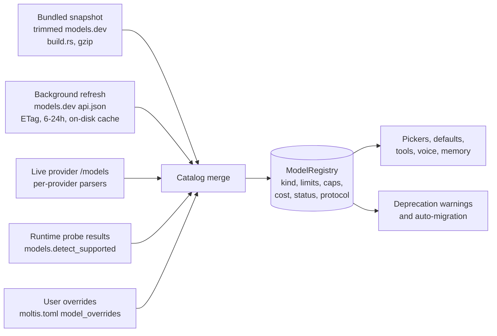

# LLM providers and non-chat capabilities: inventory and Moltis gap analysis

Snapshot: 2026-11-27. Moltis code at `main` `24da53f7`.

Scope: every LLM provider Moltis or OpenClaw supports, plus notable newcomers and specialist APIs for voice, embeddings, search and media. For each one: the models, how to list them, the extra services, and what Moltis wires today. The report ends with a gap table, the quick wins, and a recommendation on keeping model catalogs fresh.

How it was built: a read-only pass over the Moltis code, plus six parallel web-research passes over official docs, changelogs and live public `/models` endpoints, all on 2026-11-27. Sections 1 to 6 are the synthesis. Appendices A to G hold the full per-provider research with source URLs. Anything a research pass could not confirm on an official page is marked "unverified" there.

Model ids, dates and prices change weekly. Treat this as a snapshot and re-check against the provider before shipping a default.

---

## 0. Executive summary

- **Moltis chat coverage is broad but shallow.** There are about 25 chat providers (Appendix A), compared with 75 in OpenClaw (Appendix G, C1).
  - Most providers go through one OpenAI-compatible table with hand-maintained fallback lists.
  - Only Copilot, NEAR AI, Ollama and the OpenAI-style `context_window` field feed server-side metadata into `ModelCapabilities`. Everything else is inferred from the model id.
- **Several defaults are broken or about to break** (section 1): the OpenAI gpt-5 family shuts down on 2026-12-11, the Codex image orchestrator is retired, Perplexity Sonar Chat Completions is gone, and the genai fallbacks point at retired models.
- **Non-chat capabilities are the main gap.**
  - **Voice:** STT is decent (11 backends, fallback chain, OpenAI and Gemini streaming). TTS has only 5 backends and no fallback.
  - **Not wired at all:** speech-to-speech realtime, rerank (the code exists but nothing calls it), API-key image generation, video, provider-native web search and grounding, native PDF/OCR, structured outputs, batch.
- **The cheapest leverage is protocol convergence.** By late 2026 nearly every host speaks OpenAI Chat Completions plus Anthropic Messages, and often Responses (Appendix E protocol matrix, Appendix D cross-cutting notes).
  - About 20 missing providers are a table entry each: Together, Groq native, xAI native, SambaNova, Hugging Face router, NVIDIA, Novita, Chutes, Nebius, Vercel, Requesty, Cloudflare, Baseten, DeepSeek extras, BytePlus, StepFun, Tencent, MiMo, LongCat, Cohere compat, Qwen pay-as-you-go.
  - Bedrock and Azure now accept bearer API keys on OpenAI- and Anthropic-compatible endpoints, which turns "L" integrations into "M".
- **Catalog drift is structural.** About 12 of the last 80 commits under `crates/providers`, `crates/voice` and `crates/memory` are manual catalog fixes.
  - **Recommendation:** bundle a trimmed [models.dev](https://models.dev/api.json) snapshot (MIT, 10,066 models, updated several times a day), refresh it in the background with ETag, overlay each provider's live `/models` metadata, and keep user overrides on top.
  - Hard-coded model ids in tools and voice code should become references resolved against that catalog, with a CI check that fails when a default is deprecated (section 5).

---

## 1. Urgent: broken or about to break (P0)

| What | Where in Moltis | Evidence | Fix | Effort |
|---|---|---|---|---|
| Codex image generation orchestrator `gpt-5.4` was retired in Codex on 2026-08-31. The default image model `gpt-image-2` is deprecated; current models are `gpt-image-2.6-sunburst` and `gpt-image-2.6-flare`. | `crates/providers/src/openai_codex_image.rs:10-11`, `crates/tools/src/image_generation.rs:18` | App. B, OpenAI Codex models table; App. B, OpenAI image gen | Use a current Codex model (`gpt-6.2-sol`), resolved from the live Codex `/models`; default image model `gpt-image-2.6-flare`. Verify end to end. | S |
| OpenAI fallback catalog is all gpt-5.x. `gpt-5-mini` shuts down 2026-12-11 and `gpt-5.2` is being retired; the current family is gpt-6.x. | `crates/providers/src/openai/catalog.rs:23-30` | App. B, OpenAI deprecations | Refresh the list, then replace it with catalog-driven defaults (section 5). | S |
| Codex fallback list: `gpt-5.4`, `gpt-5.3-codex-spark` and the `gpt-5.1/5.2-codex` ids are retired or deprecated for ChatGPT sign-in. | `crates/providers/src/openai_codex/catalog.rs:21-32` | App. B, Codex models | Refresh to `gpt-6.2-astra`, `gpt-6.2-sol`, `gpt-6.1-sol`, `gpt-6.1-terra`, `gpt-6-luna`. | S |
| Perplexity Sonar Chat Completions support ended 2026-09-27; requests are being "reformulated" to the Agent API. Moltis web search still calls `sonar-pro` through chat completions. | `crates/tools/src/web_search.rs:166,928` | App. C, Perplexity | Switch to the Search API (`POST https://api.perplexity.ai/search`, $5 per 1k, $1 per 1k fast), or the Agent API with the `web_search` tool. | S |
| Gemini fallback list still contains `gemini-2.5-pro` and `gemini-2.5-flash`, which auto-route to 3.8-flash and 3.5-flash-lite on 2026-12-01. The current family is `gemini-4-{carbon,argon,neon,hydrogen}` and `gemini-3.8-flash`. | `crates/providers/src/model_catalogs.rs:141-147` | App. C, Gemini table and shutdowns | Refresh the list. Gemini TTS preview ids retire 2026-12-18: check the Google TTS defaults (`tts/google.rs`). | S |
| genai fallbacks point at retired models: `claude-sonnet-4-20250514` (retired 2026-06-15) and `grok-3-mini` (retired 2026-05-15, redirects to grok-4.3). They also have no tool calling. | `crates/providers/src/registry/registration.rs:446-460` | App. B, Anthropic retired list; App. C, xAI retired list | Move Groq and xAI onto the OpenAI-compat table, and drop the genai path for Anthropic and OpenAI. | S |
| Deprecated voice defaults: OpenAI TTS `tts-1`, STT `whisper-1` (the 4o-transcribe family and whisper-1 are marked deprecated), Mistral STT `voxtral-mini-latest` (deprecated 2026-10-31, retires 2027-04-30). | `voice/src/tts/openai.rs:24`, `stt/whisper.rs:26`, `stt/mistral.rs:26` | App. B, OpenAI STT/TTS; App. C, Mistral STT | Defaults `gpt-4o-mini-tts`, `gpt-transcribe`, `voxtral-small-transcribe-latest`. | S |
| Stale fallbacks: Cerebras `llama-4-scout` (current catalog: `gpt-oss-120b`, `qwen-3.8-27b`), Mistral `mistral-large-latest` and `codestral-latest` (current: `mistral-large-4-0`, `mistral-small-4-0-26-03`). Kimi K2 ids retire end of December 2026, so check `kimi-code` and `moonshot` fallbacks. DeepSeek legacy `deepseek-chat` and `deepseek-reasoner` were scheduled off on 2026-07-24 (current: `deepseek-flash`, `deepseek-v4-pro`). | `model_catalogs.rs:33-40,123-137`, `kimi_code.rs:192-198` | App. E Cerebras; App. C Mistral; App. D DeepSeek and Moonshot | Refresh now, then delete the lists once section 5 ships. | S |
| Policy risk: Claude subscription OAuth (`claude setup-token`) in third-party apps. Anthropic reportedly clarified in Feb 2026 that consumer-plan OAuth may not be used by third-party tools, and raw-API rejections were reported. Secondary sources only. | `crates/providers/src/anthropic/auth.rs`, recent fork work | App. B, Anthropic "POLICY RISK" | Keep the feature behind an explicit opt-in with a warning, and keep the API key as the default path. OpenAI is the only lab with a sanctioned preview path for open-source apps ("Sign in with ChatGPT" token sharing, App. B, Codex). Copilot and Kimi Code have similar ToS or User-Agent gating caveats (App. B, App. D). | S |
| Hume Octave/EVI sunset 2026-11-13. | not used | App. F, Hume | Do not add. | none |

---

## 2. Moltis today (summary of Appendix A)

### 2.1 Chat providers

| Provider id | Protocol | Catalog source | Server-side capability metadata parsed |
|---|---|---|---|
| `anthropic` | Messages, API key or setup-token | live `/v1/models`, fallback of 15 | none (but `/v1/models` now returns `max_input_tokens`, `max_tokens` and a full `capabilities` object, see App. B) |
| `openai` | Chat Completions, auto-switch to Responses, WebSocket | live merged with fallback of 6 (stale) | `context_window` if present (OpenAI returns none) |
| `openai-codex` | Responses (chatgpt.com), OAuth | live plus fallback of 10, refreshed daily | no (`/models` returns context and reasoning levels) |
| `github-copilot` | Chat or Responses per model, device flow | live plus fallback of 36, refreshed daily | yes |
| `gemini` | OpenAI-compat layer | live, fallback of 5 | no (native `/v1beta/models` has token limits) |
| `mistral`, `cerebras`, `deepinfra`, `deepseek`, `moonshot`, `fireworks`, `zai`/`zai-code`, `alibaba-coding` | OpenAI chat table | live, else static | no (Mistral, DeepSeek and Moonshot now expose capability fields) |
| `minimax`, `kimi-code` | OpenAI chat | static only | n/a |
| `openrouter` | OpenAI chat, Anthropic `cache_control` | live only | `context_length` only (ignores `supported_parameters` and modalities) |
| `nearai` | OpenAI chat | live `/v1/model/list` | modalities |
| `venice` | OpenAI chat | none unless configured | no (`model_spec.capabilities` is very rich) |
| `opencode-zen` | per-model Messages, Responses or Chat | live, fallback of 11 | no (returns models.dev-style capabilities plus per-model protocol and base URL) |
| `ollama`, `lmstudio` | OpenAI chat, local | live | Ollama `/api/show` (tools only) / no |
| `custom-*` | Chat, Responses or Anthropic | live or configured | no |
| `genai/{anthropic,openai,groq,xai}` | genai crate | one hardcoded model each (retired) | no tools at all |
| `local-llm` | in-process GGUF/MLX | hardcoded list | n/a |

The capability model is `ModelCapabilities { context_window, tools, vision, reasoning, requires_responses_api }`, mostly inferred from model-id prefixes (`model_capabilities.rs`). It does not track max output, modalities beyond images, pricing, caching support, structured outputs, deprecation dates, or kind (embedding, TTS and so on).

Missing protocol features across all providers:

- structured outputs (`response_format` / `output_format`)
- OpenAI `prompt_cache_key`
- provider server tools (web search, code execution, file search)
- native PDF/file input
- the batch APIs

### 2.2 Non-chat capabilities

| Capability | Moltis backends | Gaps |
|---|---|---|
| STT batch | OpenAI whisper, Groq, Deepgram, Google Cloud, Mistral Voxtral, Gemini, ElevenLabs Scribe, voxtral-local, whisper-local, whisper-cli, sherpa-onnx; ordered fallback chain | no xAI, Cohere, Z.AI, DeepSeek, MiniMax, Qwen, AssemblyAI, Speechmatics, Soniox; deprecated defaults |
| STT streaming | OpenAI Realtime transcription, Gemini Live | no Deepgram Flux, ElevenLabs Scribe realtime, Mistral realtime, xAI `wss://…/v1/stt`, AssemblyAI, Cartesia Ink |
| TTS | ElevenLabs, OpenAI, Google Cloud (and Gemini TTS), Piper, Coqui; no provider fallback | no generic OpenAI-compatible `/audio/speech` (Inworld, Kokoro-FastAPI, llama.cpp, LocalAI, Groq Orpheus, MiMo), no xAI, Mistral Voxtral TTS, Deepgram Aura, Cartesia, MiniMax, Qwen, Azure; no streaming TTS |
| Realtime speech-to-speech | none | OpenAI `gpt-live-1.1` / `gpt-realtime-2.1`, Gemini Live `gemini-3.8-live`, xAI realtime (OpenAI-Realtime-compatible), Qwen realtime, StepFun, Nova Sonic |
| Embeddings | OpenAI-compatible `/v1/embeddings`, local GGUF (embeddinggemma), Ollama; fallback chain; auto-detect also tries providers with no embeddings endpoint | Gemini `gemini-embedding-2`, Voyage `voyage-4*`, Jina v5, Cohere `embed-v5.0`, Mistral embed (explicit), Qwen, Z.AI; Batch API wrapper exists but is unwired |
| Rerank | `LlmReranker` exists but is unwired; QMD sidecar | Cohere `rerank-v5.0`, Jina `jina-reranker-v3`, Voyage `rerank-3`, Qwen, Z.AI, llama.cpp/vLLM `/rerank` |
| Image generation | Codex OAuth only (broken orchestrator) | OpenAI Images API key, Gemini Nano Banana, xAI Grok Imagine, FLUX (BFL/fal/Azure), MiniMax H3-Image, Qwen Image, Seedream, Z.AI GLM-Image |
| Video generation | none | Gemini Omni, xAI Grok Imagine Video, MiniMax H3, Wan, Seedance, CogVideoX; Sora is gone |
| Web search | Brave, Perplexity (broken path), Firecrawl, DuckDuckGo fallback | Tavily, Exa, SearXNG, Perplexity Search API, Ollama `web_search`, DeepSeek `/v1/tools/search`; provider-native: Anthropic `web_search_20260318`, OpenAI Responses `web_search`, Gemini Google Search grounding, xAI web and X search, OpenRouter web tool |
| Documents/OCR | text inline, PDF text via `pdf_extract` | native PDF to Anthropic, Gemini and OpenAI; Mistral OCR 4.1, DeepSeek `/v1/tools/ocr`, Cohere `parse-v5.0`, GLM-OCR |
| Batch, moderation, files/vector stores, hosted code execution | none | low priority for a desktop agent, except batch for memory re-embedding |

---

## 3. Provider landscape (late 2026, summary)

Full detail and sources are in Appendices B to F. "List models" means the endpoint and what it returns.

### 3.1 Frontier labs and clouds

| Provider | Current flagships (id) | Protocols | List models | Extra services |
|---|---|---|---|---|
| Anthropic | `claude-fable-5-2`, `claude-opus-5-5`, `claude-sonnet-5-5`, `claude-haiku-5-5` (all 1M context, 128K output, adaptive thinking) | Messages; API version `2026-10-21` rejects `temperature`/`top_p`/`top_k` | `GET /v1/models`: context, max output, capabilities, lifecycle, retires_at (no price) | web search and fetch, code execution, computer and browser use, MCP connector, Files (beta), batch at 50%, caching (5m/1h), structured outputs, token counting, compaction. No STT, TTS, embeddings or image. |
| OpenAI | `gpt-6.2-astra`, `gpt-6.2-sol`, `gpt-6.1-terra`, `gpt-6-luna` (1.05M context) | Responses (recommended), Chat, Realtime; Assistants shut down 2026-08-26 | `GET /v1/models`: id, owner, `shutdown_date` only | STT `gpt-transcribe` and `gpt-live-transcribe`, TTS `gpt-4o-mini-tts`, realtime `gpt-live-1.1` and `gpt-realtime-2.1`, embeddings `text-embedding-3-*`, images `gpt-image-2.6-*`, web search, file search and vector stores, code interpreter and shell, batch, moderation. Sora shut down. |
| OpenAI Codex (ChatGPT plan) | `gpt-6.2-astra`, `gpt-6.2-sol`, `gpt-6.1-sol`, `gpt-6.1-terra`, `gpt-6-luna` | Responses on `chatgpt.com/backend-api/codex`, stream only, undocumented | `/models?client_version=`: context, reasoning levels, modalities | inference only; official open-source path in preview (Sign in with ChatGPT) |
| GitHub Copilot | 34 GA models (GPT-6.x, Claude 5.x, Gemini 4, MAI Code, Kimi K3, Grok 4.x) | Chat, Responses, `/v1/messages`; some models are Responses-only | `/models`: capabilities and limits (field shape unverified) | embeddings (conflicting reports). Billed in AI credits. |
| Google Gemini API | `gemini-4-carbon`, `-argon`, `-neon`, `-hydrogen`, `gemini-3.8-flash` | native `generateContent`, new Interactions API, OpenAI-compat | `/v1beta/models`: token limits, methods, thinking flag | STT `gemini-3.5-transcribe(-live)`, TTS `gemini-3.8-flash-tts`, Live `gemini-3.8-live`, embeddings `gemini-embedding-2` (multimodal), images (Nano Banana 2.1), video `gemini-omni-1.2-flash`, music Lyria 3.5, Search and Maps grounding, File Search, code execution, batch, implicit caching |
| Vertex AI ("Gemini Enterprise Agent Platform") | Gemini, Claude (`:rawPredict`), partner models | native, OpenAI-compat with an ADC token, express-mode API key | `publishers.models.list` (partner entitlements not listable) | same as Gemini plus Veo 3.1, RAG Engine, Ranking API |
| Azure (Microsoft Foundry) | GPT-6.x, Claude 5.x via `/anthropic`, DeepSeek V4, Grok 4.7, Kimi K3.1, Mistral, MAI, Cohere | OpenAI v1 (`model` = deployment name), Anthropic Messages | ARM control plane only | STT, TTS, realtime, embeddings, Cohere rerank, images (gpt-image, FLUX, MAI-Image), content safety, batch |
| AWS Bedrock | Claude 5.x, GPT-6/5.6, Nova 2, Kimi, GLM, Grok, Qwen, DeepSeek… | Converse, Invoke, OpenAI Chat and Responses, Anthropic Messages (runtime and mantle); SigV4 or bearer API key | `ListFoundationModels`: modalities, lifecycle (no context) | Nova 2.5 Sonic speech-to-speech, Titan, Nova and Cohere embeddings, Cohere rerank, Nova Canvas, Stability, Nova Reel, Luma, web search tool (GPT), Knowledge Bases, Guardrails, batch, caching |
| Mistral | `mistral-large-4-0` (1M), `mistral-small-4-0-26-03`, `codestral-25-08`, `mistral-ocr-4-1` | Chat, Responses, FIM, Agents and Conversations | `/v1/models`: capabilities map, `max_context_length`, deprecation and replacement | Voxtral STT, TTS and realtime, embeddings, OCR, moderation (free), agent tools (web search, code interpreter, image generation), Libraries, batch |
| xAI | `grok-4.7` (500K), `grok-4.3`, `grok-4.20-*` (1M) | Responses (Chat deprecated), Realtime WebSocket | `/v1/language-models`: modalities, context, reasoning efforts, prices | STT and TTS (REST and WebSocket), voice cloning, realtime `grok-voice-3.0`, Grok Imagine image and video, web and X search, code execution, Collections, batch at 20% off |
| Cohere | `command-a-plus-05-2026` | `/v2/chat`, OpenAI compat layer | `/v1/models`: endpoints, context, features | `embed-v5.0`, `rerank-v5.0`, `cohere-transcribe-03-2026`, `parse-v5.0` |
| Perplexity | Agent API (presets fast to xhigh), Orchestrator passthrough (`openai/…`, `anthropic/…`) | Agent `/v1/agent` (`/v1/responses`), Orchestrator Chat, Responses and Messages | `/orchestrator/v1/models` | Search API, Context API, embeddings `pplx-embed-*`, sandbox. Sonar chat retired. |

### 3.2 Chinese and Asian labs

All of these offer OpenAI-compatible and Anthropic-compatible endpoints. Most sell a coding subscription on a separate endpoint and key (Appendix D, cross-cutting notes).

| Provider | Flagships | List models | Extra services |
|---|---|---|---|
| DeepSeek | `deepseek-flash` (V4.1, vision), `deepseek-v4-pro` (1M / 384K) | `/models`: context, max output, modalities, effort | ASR, TTS (WebSocket), search, fetch, OCR at `/v1/tools/*`; automatic caching (about 1/50 price) |
| Moonshot / Kimi | `kimi-k3.1-pro` (1M, thinking only); Kimi Code `k3.1-pro`, `kimi-for-coding` | `/v1/models`: context, `supports_image_in`, `supports_video_in`, `supports_reasoning` | web search and fetch tools, Files, batch at 60%, caching |
| Alibaba Qwen | `qwen4-max` (2026-11-16, 1M), `qwen3.8-flash`, omni and realtime | native `/api/v1/models`: prices, context, modality | ASR, TTS with cloning, realtime, embeddings, rerank, Qwen Image, Wan video, code interpreter, batch, caching. Coding Plan forbids automation. |
| Z.AI / GLM | `glm-5.3` (1M), `glm-5.3-flash`; `glm-5.4` (plan only) | none documented | ASR `glm-asr-2512`, TTS, embeddings `embedding-3`, rerank, GLM-Image, CogVideoX, web search, OCR, batch |
| MiniMax | `MiniMax-M3.1-Flash`, `MiniMax-M3` (1M) | `/v1/models`: ids only | ASR, T2A speech-2.8 with cloning and design, H3 video, H3 image, music (closed to new users) |
| BytePlus ModelArk | `dola-seed-2-1-turbo-260628`, Seed 2.0, resold DeepSeek and GLM | `/api/v3/models`: very rich (features, token limits, status) | Seedream 5.5, Seedance 2.5, vision embeddings |
| StepFun | `step-5-preview`, `step-3.7-flash` | ids only | ASR, TTS with cloning, realtime, music |
| Tencent TokenHub | `hy4`, `hy4-flash`, many resold models | ids and status | embeddings, 3D |
| Xiaomi MiMo | `mimo-v2.6-pro`, `-flash` (1M, full-modal in) | ids only | ASR, TTS with cloning and design (OpenAI-compatible) |
| Meituan LongCat, Baidu Qianfan | `LongCat-2.5`; ERNIE 5.x (unverified) | partially documented | mostly unverified |

### 3.3 Hosts and routers

The key question for a host is whether its `/models` lets capabilities be derived automatically (Appendix E summary table):

- **Rich enough:** OpenRouter (`supported_parameters`, modalities, `endpoints[]`), Vercel AI Gateway (`type`, `tags`), Requesty (`supports_*`), Venice (`model_spec.capabilities`), OpenCode Zen (models.dev shape plus per-model protocol and base URL), NEAR AI (`supported_features`), Chutes, Novita (`features`, `endpoints`), Hugging Face router (per-provider `supports_tools`), Nebius (verbose), DeepInfra (tags only), Fireworks native API (`supportsTools`, `supportsImageInput`).
- **Poor, needs an overlay:** Groq (context only), Cerebras, SambaNova (context and price), NVIDIA NIM, Together (unverified), Cloudflare, Baseten, LiteLLM proxy.
- **Non-chat services on hosts:** Groq (Whisper STT, Orpheus TTS), Together and DeepInfra (STT, TTS, image, video, rerank), OpenRouter (STT, TTS, embeddings, rerank, images, video, web search tool), Cloudflare Workers AI (Whisper, Deepgram, Aura, bge rerank, FLUX), Vercel (every kind).
- **TEE/private inference:** NEAR AI, Venice, Chutes.
- **New 2026 model class: "decision" / System One models.** Typed choice and score APIs are appearing across hosts and in llama.cpp and LM Studio. They are not chat; watch, but out of scope for now.

### 3.4 Specialists

- **Voice (App. F):**
  - ElevenLabs: `eleven_v4`, `eleven_v4_turbo`; STT `scribe_v3`, realtime `scribe_v3_live`; music.
  - Deepgram: Flux `flux-general-en`/`-multi` with built-in end-of-turn, on `wss://…/v2/listen`; Nova-3; Aura-2 TTS.
  - Cartesia: `sonic-3.6` WebSocket TTS, Ink 2 STT.
  - AssemblyAI `assemblyai-stt-3-7`, Speechmatics, Gladia `solaria-1`, Soniox, Inworld `inworld-tts-2`, Fish Audio, LMNT, Azure MAI-Voice-2, Google Chirp 3 HD, Polly/Transcribe.
- **Embeddings and rerank:** Voyage `voyage-4*` and `rerank-3`, Jina v5 omni and `jina-reranker-v3` (plus Reader `r.jina.ai`), Cohere v5, `gemini-embedding-2`, OpenAI `text-embedding-3-*`.
- **Search:** Brave (with LLM Context), Tavily, Exa, Perplexity Search, Firecrawl v2, Jina Reader, Parallel, Linkup, You.com, Kagi, SerpAPI, and SearXNG (self-hosted, no key, the natural default for an open-source app).
- **Local runtimes (App. G):**
  - Ollama, LM Studio, llama.cpp, vLLM, SGLang, LocalAI and Lemonade all now serve Anthropic `/v1/messages`.
  - Only Ollama (`/api/show` capabilities) and LM Studio (`/api/v1/models` capabilities) expose rich per-model metadata.
  - Tool support on vLLM, SGLang and llama.cpp depends on server flags, so it has to be probed or set by the user.
  - Ollama has a hosted `web_search` and `web_fetch` API and cloud models.
  - TGI is in maintenance mode.

---

## 4. Gap table: capability by provider

Legend:

- ✅ wired in Moltis
- 🟡 partial, stale, or with an important limitation
- ❌ the provider offers it and Moltis does not wire it
- · the provider does not offer it (or it is out of scope)

Effort:

- S: up to about 1 day; a table entry, one endpoint on an existing trait, or a model-id change
- M: 2 to 5 days; a new client module or a new protocol path
- L: more than a week

Priority:

- P0: broken or breaking
- P1: core to a "Claude Code desktop" (coding chat, vision, search, voice in and out, memory)
- P2: valuable breadth
- P3: nice to have

Columns: Cat = live catalog with metadata, RT = realtime speech-to-speech, Emb = embeddings, Rrk = rerank, Img = image generation, Vid = video generation, Srch = native search or grounding, Doc = native PDF or OCR, Bat = batch.

### 4.1 Providers Moltis already integrates

| Provider | Chat | Tools | Vision | Reason | Cache | Cat | STT | TTS | RT | Emb | Rrk | Img | Vid | Srch | Doc | Bat | Top gaps (effort, priority) |
|---|---|---|---|---|---|---|---|---|---|---|---|---|---|---|---|---|---|
| Anthropic | ✅ | ✅ | ✅ | ✅ | ✅ | 🟡 | · | · | · | · | · | · | · | ❌ | ❌ | ❌ | parse `/v1/models` capabilities and limits (S, P1); server `web_search` and `web_fetch` tools (M, P1); PDF document blocks (S, P1); structured outputs (M, P2); setup-token policy warning (S, P0) |
| OpenAI | ✅ | ✅ | ✅ | ✅ | 🟡 | 🟡 | 🟡 | 🟡 | ❌ | ✅ | · | ❌ | · | ❌ | ❌ | 🟡 | refresh defaults (S, P0); Images API with an API key (S, P1); Responses `web_search` (M, P1); `prompt_cache_key` (S, P2); file inputs (S, P2); realtime voice (L, P2); wire embeddings batch (S, P3) |
| OpenAI Codex | ✅ | ✅ | 🟡 | ✅ | · | ✅ | · | · | · | · | · | 🟡 | · | · | · | · | image orchestrator and defaults (S, P0); drive the vision flag from `/models` `input_modalities` (S, P2); evaluate the sanctioned Sign in with ChatGPT path (M, P1) |
| GitHub Copilot | ✅ | ✅ | 🟡 | 🟡 | · | ✅ | · | · | · | ❌ | · | · | · | · | · | · | route Claude ids to `/v1/messages` (M, P2); embeddings (S, P3, unverified) |
| Gemini (AI Studio) | ✅ | ✅ | ✅ | 🟡 | 🟡 | 🟡 | ✅ | ✅ | ❌ | ❌ | · | ❌ | ❌ | ❌ | ❌ | ❌ | refresh list (S, P0); `gemini-embedding-2` through the compat `/embeddings` (S, P1); Nano Banana through the compat `/images/generations` (S, P1); Google Search grounding, needs the native API (M, P1); Live audio-out (L, P2); Omni video (M, P3); native `generateContent`/Interactions path (L, P2) |
| Mistral | ✅ | ✅ | 🟡 | ❌ | · | 🟡 | 🟡 | ❌ | ❌ | 🟡 | · | · | · | · | ❌ | ❌ | parse the `/v1/models` capabilities map (S, P1); reasoning on Small 4 and Large 4 (S, P2); Voxtral TTS (S, P2); OCR 4.1 for documents (M, P2); realtime STT (M, P3) |
| DeepSeek | ✅ | ✅ | 🟡 | ✅ | · | 🟡 | ❌ | ❌ | · | · | · | · | · | ❌ | ❌ | · | parse rich `/models` (S, P1); refresh fallback (S, P0); `/v1/tools/search` as a search backend (S, P3); OCR (S, P3) |
| Moonshot / Kimi | ✅ | ✅ | 🟡 | ✅ | · | 🟡 | · | · | · | · | · | · | · | ❌ | · | ❌ | parse the `supports_*` flags (S, P1); K2 retirements (S, P0) |
| Kimi Code | ✅ | ✅ | 🟡 | 🟡 | · | ❌ | · | · | · | · | · | · | · | · | · | · | static list: refresh to `k3.1-pro`, `kimi-for-coding` (S, P0); User-Agent gating caveat |
| Z.AI / GLM | ✅ | ✅ | 🟡 | ✅ | · | 🟡 | ❌ | ❌ | ❌ | ❌ | ❌ | ❌ | ❌ | ❌ | ❌ | ❌ | `/v1`-style Responses plan endpoint (S, P3); ASR and embeddings, both OpenAI-shaped (S, P3) |
| MiniMax | ✅ | ✅ | 🟡 | ✅ | · | ❌ | ❌ | ❌ | · | · | · | ❌ | ❌ | ❌ | · | · | enable discovery (S, P2); T2A speech-2.8 TTS (M, P2); H3 image and video (M, P3) |
| Alibaba (coding plan only) | ✅ | ✅ | 🟡 | 🟡 | · | 🟡 | ❌ | ❌ | ❌ | ❌ | ❌ | ❌ | ❌ | ❌ | · | ❌ | add a pay-as-you-go DashScope provider with intl, US and CN regions (S, P2); onboarding card (S, P2); Qwen TTS, ASR and realtime (M, P3) |
| OpenRouter | ✅ | ✅ | ✅ | ✅ | ✅ | 🟡 | ❌ | ❌ | · | 🟡 | ❌ | ❌ | ❌ | ❌ | · | · | parse `supported_parameters`, modalities and `endpoints[]` (S, P1); Anthropic Messages path for Claude (S, P2); web search tool (S, P2); images (S, P3) |
| Cerebras | ✅ | ✅ | 🟡 | 🟡 | · | 🟡 | · | · | · | · | · | · | · | · | · | · | refresh fallback (S, P0) |
| Fireworks | ✅ | ✅ | 🟡 | 🟡 | · | 🟡 | · | · | · | ❌ | ❌ | · | · | · | · | · | native `accounts/fireworks/models` for capabilities (S, P2) |
| DeepInfra | ✅ | ✅ | 🟡 | 🟡 | · | 🟡 | ❌ | ❌ | · | ❌ | ❌ | ❌ | ❌ | · | · | · | onboarding card (S, P2); tags parse (S, P2) |
| NEAR AI | ✅ | ✅ | ✅ | 🟡 | · | ✅ | ❌ | · | · | ❌ | ❌ | ❌ | · | · | · | · | check `/v1/models` against the legacy `/v1/model/list` (S, P1); embeddings, rerank and Whisper, all OpenAI-shaped (S, P3) |
| Venice | ✅ | ✅ | 🟡 | 🟡 | · | ❌ | ❌ | ❌ | · | ❌ | · | ❌ | ❌ | ❌ | · | · | enable discovery and parse `model_spec.capabilities` (S, P2) |
| OpenCode Zen | ✅ | ✅ | ✅ | ✅ | ✅ | 🟡 | ❌ | · | · | ❌ | · | ❌ | ❌ | · | · | · | consume per-model `api.*.base_url` and capabilities (S, P1) |
| Groq | 🟡 | ❌ | ❌ | ❌ | · | ❌ | ✅ | ❌ | · | · | · | · | · | ❌ | · | ❌ | move to the OpenAI-compat table (S, P1); Orpheus TTS (S, P3) |
| xAI | 🟡 | ❌ | ❌ | ❌ | · | ❌ | ❌ | ❌ | ❌ | · | · | ❌ | ❌ | ❌ | · | ❌ | compat-table entry with the Responses wire API (S, P1); parse `/v1/language-models` (S, P1); STT and TTS REST (S, P2); image generation (S, P2); realtime (L, P3); video (M, P3) |
| Ollama | ✅ | ✅ | 🟡 | 🟡 | · | 🟡 | · | · | · | ✅ | · | · | · | ❌ | · | · | parse all `/api/show` capabilities (vision, thinking) and `context_length` (S, P1); Ollama cloud (S, P2); `web_search` and `web_fetch` API (S, P2) |
| LM Studio | ✅ | ✅ | 🟡 | 🟡 | · | 🟡 | · | · | · | ❌ | · | · | · | · | · | · | `/api/v1/models` capabilities and `max_context_length` (S, P1) |
| llama.cpp / vLLM / SGLang | 🟡 | 🟡 | 🟡 | 🟡 | · | 🟡 | 🟡 | ❌ | · | 🟡 | ❌ | · | · | · | · | · | first-class presets instead of `custom-*` (S, P2); `/rerank` (S, P2); tool support toggle and probe (S, P1) |
| ElevenLabs | · | · | · | · | · | · | ✅ | ✅ | ❌ | · | · | · | · | · | · | · | refresh to `eleven_v4(_turbo)` and `scribe_v3` (S, P1); Scribe realtime STT (M, P1); streaming TTS over WebSocket (M, P1); music (M, P3) |
| Deepgram | · | · | · | · | · | · | 🟡 | ❌ | ❌ | · | · | · | · | · | · | · | Flux streaming STT with end-of-turn (M, P1); Aura-2 TTS (S, P2) |
| Google Cloud Speech/TTS | · | · | · | · | · | · | ✅ | ✅ | · | · | · | · | · | · | · | · | Chirp 3 HD voices (S, P3) |
| Brave, Firecrawl (search) | · | · | · | · | · | · | · | · | · | · | · | · | · | ✅ | · | · | Brave LLM Context endpoint (S, P2) |
| Perplexity (search) | · | · | · | · | · | · | · | · | · | ❌ | · | · | · | 🟡 | · | · | Search API migration (S, P0) |

### 4.2 Providers Moltis does not integrate

| Provider | What it unlocks | Integration path | Effort | Priority |
|---|---|---|---|---|
| AWS Bedrock | Claude, GPT and Nova for enterprise users; Nova Sonic; Titan and Cohere embeddings and rerank | bearer API key against `bedrock-runtime` or `bedrock-mantle` OpenAI- and Anthropic-compatible endpoints; SigV4 and Converse later | M (L with SigV4) | P2 |
| Azure Foundry | GPT-6, Claude, DeepSeek, Grok and others in enterprise tenants | OpenAI v1 base with deployment names, plus `/anthropic` | M | P2 |
| Vertex AI | Gemini and Claude under GCP billing | OpenAI-compat with an ADC token; Claude `:rawPredict` (Anthropic body) | M | P3 |
| Together AI | big open-model catalog, STT, TTS, images, video | OpenAI or Anthropic compat table entry | S | P2 |
| Hugging Face router | about 50 inference providers behind one key, per-provider capabilities | compat table plus `providers[]` parse | S | P2 |
| Vercel AI Gateway, Requesty | 500+ models, rich catalogs, BYOK | compat table plus catalog parse | S | P2 |
| Cohere | Command A+, the best rerank, embed v5, transcribe, parse | chat through the compat layer (S); rerank and embed (S) | S | P2 (rerank P1) |
| Perplexity Agent and Orchestrator | research agent; one key for many models | Responses-compatible `/v1/agent` | S | P3 |
| SambaNova, NVIDIA NIM, Novita, Chutes, Nebius, Baseten, Inference.net, Featherless, Cloudflare Workers AI | fast or cheap open models; free tiers (NVIDIA); TEE (Chutes) | compat table entries (Cloudflare needs the account id in the URL) | S each | P3 |
| Qwen pay-as-you-go, BytePlus, StepFun, Tencent TokenHub, Xiaomi MiMo, LongCat | CN-lab flagships and coding plans | compat table entries with regional base URLs; plan endpoints as `*-coding` variants | S each | P2 (Qwen, MiMo), P3 others |
| Voyage, Jina | best-in-class embeddings and rerank; Jina Reader | OpenAI-like `/v1/embeddings` and `/v1/rerank` | S | P1 (one rerank provider) |
| Tavily, Exa, SearXNG, Ollama web search | more search backends; SearXNG as the key-less default | add to the `SearchProvider` enum | S each | P1 (SearXNG), P2 others |
| Cartesia, Inworld, Kokoro/LocalAI (generic OpenAI `/audio/speech`) | low-latency and local TTS | one generic OpenAI-compatible TTS provider covers Inworld, Kokoro-FastAPI, llama.cpp, LocalAI, MiMo and Groq; Cartesia needs its own WebSocket client | S generic, M Cartesia | P1 generic |
| AssemblyAI, Speechmatics, Soniox, Gladia | accurate streaming STT | new streaming clients | M each | P3 |
| fal.ai or Replicate | every image and video model through one async job API | generic "media job" tool (submit, poll, fetch) | M | P2 |

### 4.3 Quick wins, ranked

These are all small (S) and need no new architecture:

1. Fix the P0 defaults in section 1: the Codex image orchestrator and model, the OpenAI, Codex, Gemini, Cerebras, Mistral and Kimi fallbacks, the voice defaults, and the Perplexity Search API.
2. Move Groq and xAI from genai to the OpenAI-compat table, with tools and live `/models`; xAI on `wire_api = "responses"`. This removes the tool-less genai path.
3. Parse metadata that is already returned and currently ignored:
   - Anthropic `/v1/models` (`max_input_tokens`, `max_tokens`, `capabilities.image_input`, `pdf_input`, `structured_outputs`, `thinking`, `effort`)
   - Mistral `capabilities` and `deprecation`
   - DeepSeek `context_window` and modalities
   - Moonshot `supports_*`
   - xAI `/v1/language-models`
   - OpenRouter `supported_parameters` and `architecture.*_modalities`
   - Codex `input_modalities`
   - Ollama `/api/show` (all capabilities and `context_length`)
   - LM Studio `/api/v1/models`
   - Venice `model_spec.capabilities`
   - OpenCode Zen `capabilities`, `limit` and `api`
4. Gemini embeddings and image generation through the existing OpenAI-compat base (`/embeddings`, `/images/generations`): this reuses `embeddings_openai.rs` and the OpenAI image client.
5. OpenAI Images API with an API key (`/v1/images/generations`, `gpt-image-2.6-*`), so image generation no longer requires a Codex login.
6. Wire the existing rerank code: `LlmReranker` plus one API reranker (Cohere `rerank-v5.0-fast`, Jina `jina-reranker-v3` or Voyage `rerank-3`, all the same shape), and llama.cpp/vLLM `/rerank` for local.
7. Add embedding providers that are OpenAI-shaped: Voyage, Jina, Mistral (explicit), Cohere compat, Z.AI, NEAR. Also remove auto-detect candidates that have no embeddings endpoint (Groq, xAI, DeepSeek, Cerebras, MiniMax, Moonshot, Venice).
8. Add a generic OpenAI-compatible TTS provider, and the STT counterpart if a local server needs extra configuration. Together they cover Kokoro, LocalAI, llama.cpp, Inworld, Groq Orpheus, MiMo, Z.AI, xAI REST and Cohere transcribe.
9. Add search backends SearXNG (key-less, self-hosted), Tavily, Exa and Ollama `web_search`.
10. Add OpenAI-compat table entries for Together, HF router, Vercel, Requesty, SambaNova, NVIDIA, Novita, Chutes, Nebius, Baseten, Cloudflare, Qwen pay-as-you-go, BytePlus, StepFun, Tencent, MiMo and LongCat. Add onboarding cards for `deepinfra` and `alibaba-coding`.
11. Send PDFs natively to Anthropic (document blocks), Gemini (inline data) and OpenAI (`input_file`) when the model supports it; keep `pdf_extract` as the fallback.
12. Wire the embeddings Batch API wrapper (`embeddings_batch.rs`) for bulk memory re-indexing.

### 4.4 Larger items worth planning (M/L, P1/P2)

- Provider-native web search and grounding as an alternative to the local search tool: Anthropic `web_search_20260318` and `web_fetch`, OpenAI Responses `web_search`, Gemini Google Search grounding (needs the native API), xAI web and X search. The main trade-off is citations versus cost: about $10 per 1k on Anthropic and OpenAI, $14 per 1k on Gemini past the free quota.
- Speech-to-speech realtime voice mode. The fork already has OpenAI Realtime and Gemini Live WebSocket clients for STT; extend them to audio out.
  - Targets: OpenAI `gpt-live-1.1`, Gemini `gemini-3.8-live`, xAI `grok-voice-3.0` (OpenAI-Realtime-compatible, so one client covers two providers).
  - A local option: Kyutai Moshi, which has a Rust server.
- Streaming TTS (ElevenLabs, Cartesia, Deepgram, xAI and DeepSeek WebSockets) plus a TTS fallback chain matching the STT one.
- Structured outputs across protocols (`response_format: json_schema`, Anthropic `output_format`/strict tools, Gemini `responseSchema`).
- Native Gemini protocol (`generateContent`, later Interactions), for grounding, File Search, explicit caching and full multimodal input.
- Bedrock and Azure providers (enterprise reach).
- A generic media-job tool (fal/Replicate, xAI, Gemini Omni, MiniMax H3) for image and video generation.

---

## 5. Recommendation: keeping catalogs fresh without catalog-fix releases

### 5.1 What peers do (Appendix G)

- **OpenClaw** stacks five sources:
  - config-defined models
  - plugin catalog hooks
  - live discovery, stale after 15 min, with backoff on failure
  - a hosted metadata catalog refreshed at most every 6 h; it can only touch installed providers and can never set base URLs or headers
  - models.dev hydration, limited to tool-calling text models
- **Hermes Agent:** live `/models` plus models.dev, with an explicit context-length priority chain (config pin > cache > endpoint > provider API > OpenRouter > models.dev > default).
- **opencode:** bundles models.dev and auto-discovers Ollama, LM Studio and vLLM.
- **Claude Code and Codex CLI:** overrides (`*_SUPPORTED_CAPABILITIES`, `model_catalog_url` / `model_catalog_json`).
- **Common thread:** nobody relies on one source, and user overrides always win.

### 5.2 Proposed design for Moltis

1. **One catalog schema with a `kind`.** Extend `ModelCapabilities` / `DiscoveredModel` into a `ModelInfo`:
   - `kind`: chat, embedding, rerank, image, video, tts, stt, realtime
   - `context_window`, `max_output`
   - `input_modalities`, `output_modalities`
   - `tools`, `structured_output`, `reasoning` (supported efforts), `caching`
   - `cost`
   - `status`: active, beta, deprecated, retired, plus `retires_at`
   - preferred `protocol` and `base_url` override
   - `knowledge`, `release_date`

   Use concrete enums (project rule: no `serde_json::Value`, match on types). This is the same field set models.dev, LiteLLM, Vercel and OpenCode Zen converge on.
2. **Bundled baseline.** At build time, `build.rs` fetches `https://models.dev/api.json` (6.8 MB, MIT), trims it to the providers Moltis knows (well under 1 MB), maps provider ids, and embeds it with `include_bytes!`, gzip-compressed.
   - The snapshot lives in the repo under `crates/providers/catalog/` and is updated by a scheduled CI job. The fallback lists in `model_catalogs.rs` and `*/catalog.rs` and the dated `ANTHROPIC_MODELS` snapshot go away.
   - Offline builds use the committed snapshot.
3. **Background refresh at runtime.** A conditional GET (`If-None-Match`) against models.dev every 6 to 24 h, cached under `data_dir()`, and never blocking startup.
   - **Guard, copied from OpenClaw:** the remote catalog may only add or update metadata for providers that are already configured. It must never supply base URLs, headers or credentials.
   - Allow a configurable or disabled `catalog.refresh_url`, so self-hosters can pin or mirror it.
4. **Live provider overlay (ground truth for what is callable).** Keep the current parallel `/models` discovery, but give each provider a typed metadata parser for the fields listed in quick win 3.
   - Live data wins over models.dev for availability and limits. models.dev fills only the fields that are still undefined, the way OpenClaw hydrates.
   - Persist discovery results to disk, so a failed fetch keeps the last good rows (currently they are in-memory only).
   - Refresh on credential change, on picker open when older than about 15 min, and every 24 h for everyone, not only Codex and Copilot.
5. **Explicit priority chain**, documented in `docs/src/`:
   1. user override
   2. runtime probe result
   3. live provider metadata
   4. on-disk refreshed models.dev
   5. bundled snapshot
   6. id heuristics (today's `model_capabilities.rs`, kept as the last resort)
   7. defaults
6. **No hard-coded model ids in features.** Image generation, TTS and STT defaults, embeddings and the "recommended" lists should name a role and resolve it against the catalog. For example, `image: provider=openai kind=image family=gpt-image newest-active`, or `tts: provider=openai kind=tts`.
   - A small curated `recommended.toml` (like OpenClaw's `recommended-models.json`) can rank picks per provider, but every entry must exist in the catalog and not be deprecated.
7. **Deprecation awareness.** Feed `status` / `retires_at` from models.dev, Anthropic `lifecycle` / `retires_at`, OpenAI `shutdown_date`, Mistral `deprecation` / `deprecation_replacement_model`, LiteLLM `deprecation_date` / `successor_model`, and Fireworks `deprecationDate`.
   - Warn in the UI when a configured model retires within 30 days.
   - Auto-migrate defaults, never explicit user choices.
8. **CI guardrails.**
   - A test that every model id referenced in code or config templates exists in the snapshot and is not deprecated. This would have caught `gpt-5.4`, `tts-1`, `grok-3-mini` and `claude-sonnet-4-20250514`.
   - A weekly scheduled job that refreshes the snapshot and opens a PR with the diff. Catalog changes become data PRs, not code releases.
9. **Secondary overlays, optional.**
   - LiteLLM `model_prices_and_context_window.json` (MIT): pricing and `mode` for hosts models.dev lacks.
   - OpenRouter, Vercel and HF router `/models`: authoritative for their own ids.
   - Artificial Analysis needs a key and attribution, so it is only useful for ranking recommendations.
10. **Local runtimes.** Ollama `/api/show` and LM Studio `/api/v1/models` are authoritative. For vLLM, SGLang and llama.cpp, probe tool calling once (`models.detect_supported` already exists) and store the result, because support depends on server flags.

Expected effect: the commits that refresh a fallback list, remove a retired model or add a new flagship become either nothing (live discovery plus models.dev pick it up) or a snapshot-refresh PR generated by CI. The Copilot, Codex and NEAR parsers stay, since they are the "live overlay" layer.

---

## 6. Caveats

- The web research used a summarizing fetch tool. Ids, limits or prices not shown verbatim on an official page are marked "unverified" in the appendices.
- Appendix F sections 4 (image/video aggregators) and 5 (local voice) were not verified online.
- Policy statements about subscription OAuth (Anthropic, Copilot, Kimi) come from secondary sources. Check the providers' current terms before shipping or removing those features.
- The Moltis inventory (Appendix A) is a read-only code reading at `24da53f7`. Nothing was built or run, so "likely broken" items in section 1 should be confirmed with a live call.

---

# Appendices: detailed research

Each appendix is the raw research note for one track, including its source URLs. Headings were demoted so they fit under this document.

## Appendix A: Moltis today (code inventory)

Repo: `/Users/chtibizoux/Projects/perso/contributions/moltis` (branch `main`, HEAD `24da53f7`). Read-only inventory, 2026-11-27.
All paths relative to repo root.

### 0. How the chat registry is assembled

`crates/providers/src/registry/core.rs:975-1027` (`from_config_with_prefetched`) registers, in order:
1. built-ins `anthropic`, `openai` (`registry/registration.rs:811-925`)
2. table-driven OpenAI-compatible providers `OPENAI_COMPAT_PROVIDERS` (`model_catalogs.rs:188-393`, registered at `registration.rs:927-1103`)
3. `custom-*` user providers (`registration.rs:1105-1243`), wire_api chat/responses/anthropic
4. `async-openai` (feature `provider-async-openai`, `registration.rs:508-555`) — single model, default `gpt-4o`, only if not already registered
5. `genai` (feature `provider-genai`, `registration.rs:437-506`) — anthropic/openai/groq/xai, one model each, **no tool calling** (comment at `core.rs:996-997`)
6. `openai-codex`, `github-copilot` (dynamic discovery sources, `registration.rs:557-656`)
7. `kimi-code` (`registration.rs:658-727`)
8. `opencode-zen` (`registration.rs:1245-1332`)
9. `local-llm` GGUF/MLX (feature `local-llm`, `registration.rs:729-809`)

Provider cargo features: `crates/providers/Cargo.toml:7-35` (defaults: anthropic-oauth, async-openai, genai, github-copilot, kimi-code, openai-codex; `local-llm` opt-in at providers level but enabled in CLI `portable` set incl. `local-llm-metal`, `crates/cli/Cargo.toml:~193-195`).

Canonical provider names: `KNOWN_PROVIDER_NAMES` in `crates/config/src/schema/providers.rs:22-54` (25 names incl. `local` alias). Onboarding/UI list: `crates/provider-setup/src/known_providers.rs:57-298` (22 entries + `local-llm` when feature on). Note: `deepinfra` and `alibaba-coding` are registrable but **absent from `known_providers()`** (no onboarding card). `groq` and `xai` have onboarding cards (`known_providers.rs:111,121`, base URLs `api.groq.com/openai/v1`, `api.x.ai/v1`) but are only wired through the genai backend (one default model, no tools).

Wire protocols: `WireApi { ChatCompletions (default), Responses, Anthropic }` in `crates/config/src/schema/providers.rs:140-150`. Stream transport `ProviderStreamTransport { Sse (default), Websocket, Auto }` at `providers.rs:175-183`; WebSocket only for OpenAI Responses on `api.openai.com/v1` (`registration.rs:52-70`, `openai/provider/websocket.rs`, `openai/provider/core.rs:534-560`). Cache retention enum `none|short|long` at `providers.rs:152-170` (comment mentions Bedrock but no Bedrock provider exists).

OpenAI-compat per-provider quirk policies (`crates/providers/src/openai/mod.rs:13-108`): `supports_user_name`, `default_strict_tools`, `omits_strict_tool_field`, `rejects_null_in_enums`, `requires_gemini_tool_call_extra_content`, reasoning_content replay prefixes, `system_message_rewrite`, `qwen_models_require_single_leading_system`, `RateLimitPolicy {None, Mistral}`, `ReasoningEffortPolicy {OpenAi, DeepSeek, Zai, KimiMax, Unsupported}`, `CacheControlPolicy {None, OpenRouterAnthropic}`, `ProbeFallbackPolicy {None, OllamaNativeShow}`, `ResponsesWebSocketPolicy`, `responses_required_for_reasoning_tools`.

### 1. Chat provider table

Legend: Y = wired, N = not, ~ = partial/heuristic. "Vision"/"reasoning" are per-model `ModelCapabilities` flags (mostly inferred from model ID, see section 2); the column states whether the provider path can send images / reasoning controls.

| id | protocol | auth | catalog source | streaming | tools | vision | reasoning | caching | notes |
|---|---|---|---|---|---|---|---|---|---|
| `anthropic` | Anthropic Messages `/v1/messages` (`anthropic.rs:75`) | API key `x-api-key`, or `claude setup-token` OAuth (`sk-ant-oat`, Bearer + Claude Code identity headers/beta flags `anthropic/auth.rs:1-25,73,152`); resolution order setup_token cfg > API key > `ANTHROPIC_OAUTH_TOKEN` > TokenStore `anthropic` (`config_helpers.rs:65-95`) | live `GET /v1/models` (`anthropic.rs:348`), fallback `ANTHROPIC_MODELS` 15 models (`model_catalogs.rs:10-30`, "snapshot of GET /v1/models 2026-11-26") via `core.rs:141,755-768` | Y SSE (`anthropic.rs:888-975`) | Y incl. tool_choice auto/any/tool (`anthropic.rs:437-480`) | Y image blocks (`anthropic.rs:564`) | Y `thinking.budget_tokens` 1024..65536 by effort (`anthropic.rs:107-129`); forced tool_choice incompatible with thinking | Y `cache_control: ephemeral` on system + last user msg (`anthropic.rs:518-680`), `cache_retention` | no structured output |
| `openai` | Chat Completions; auto-switch to Responses when reasoning+tools on api.openai.com (`openai/provider/core.rs:339-349`), `wire_api="responses"` honoured | API key Bearer, `OPENAI_BASE_URL` override (`registration.rs:37-50`) | live `/models` merged with fallback `DEFAULT_OPENAI_MODELS` 6 models (`openai/catalog.rs:23-30`) via `merge_discovered_with_fallback_catalog` (`discovered_model.rs:103`); `context_window`/`context_length` parsed (`openai/catalog.rs:150-164`) | Y SSE with `stream_options.include_usage` (`openai/provider/streaming.rs:161-162`), WebSocket for Responses | Y, strict schemas default | Y `image_url` (`agents/src/multimodal.rs:24`) / `input_image` for Responses (`openai_compat/provider.rs:202`) | Y `reasoning_effort` (chat) / `reasoning.effort` (Responses) (`core.rs:291-314`) | N (no `prompt_cache_key`) | recommended list hardcoded `openai/catalog.rs:170-176` |
| `mistral` | OpenAI chat | API key | live `/models`, fallback 2 models (`model_catalogs.rs:33-36`) | Y | Y | ~ (codestral forced no) | N | N | Mistral rate-limit retry policy |
| `openrouter` | OpenAI chat | API key | live `/models` only (no static list) | Y | Y non-strict | Y | Y | Y `cache_control` injected for Anthropic models (`CacheControlPolicy::OpenRouterAnthropic`, `openai/provider/completion.rs:61`) | |
| `cerebras` | OpenAI chat | API key | live, fallback 1 model (`model_catalogs.rs:39-40`) | Y | Y | ~ | ~ | N | catalog stale (llama-4-scout only) |
| `minimax` | OpenAI chat | API key | **static only** 2 models (`model_catalogs.rs:44-47`), discovery off (no `/models`) unless `fetch_models=true` | Y | Y | ~ | Y optional reasoning_content replay (M3.1-Flash) | N | system msg inlined into first user |
| `moonshot` | OpenAI chat | API key | live, fallback 4 (`model_catalogs.rs:132-137`) | Y | Y | ~ | Y `KimiMax` effort + reasoning_content on tool msgs | N | |
| `zai` / `zai-code` | OpenAI chat (`/api/paas/v4`, `/api/coding/paas/v4`) | API key (`Z_API_KEY`, `Z_CODE_API_KEY`) | live, fallback 17 GLM models (`model_catalogs.rs:51-69`) | Y | Y | ~ (GLM-*v) | Y Zai policy | N | |
| `venice` | OpenAI chat | API key | none: discovery skipped unless model configured (`registration.rs:978-982`), `requires_model` in onboarding | Y | Y | ~ | ~ | N | |
| `nearai` | OpenAI chat | API key | live `GET /v1/model/list` with modality metadata (`nearai.rs:11,61,123-163`, started `core.rs:550`) | Y | Y, no `strict` field | Y from `input_modalities` | effort unsupported | N | only provider with server-side capability metadata besides Copilot |
| `deepinfra` | OpenAI chat | API key | live, fallback 8 (`model_catalogs.rs:105-121`) | Y | Y | ~ | ~ | N | not in onboarding list |
| `deepseek` | OpenAI chat | API key | live, fallback 5 (`model_catalogs.rs:123-129`) | Y | Y | ~ | Y DeepSeek policy + reasoning_content replay | N | |
| `fireworks` | OpenAI chat | API key | live, fallback 2 (`model_catalogs.rs:84-87`) | Y | Y (non-strict for Kimi router) | ~ | Y for Kimi router models | N | strips null from enums |
| `ollama` | OpenAI chat at `/v1`; native `/api/tags` discovery + `/api/show` probes (`ollama.rs:23-27,142-160`) | none (dummy key) | live `/api/tags` only, local_only (skipped unless configured) | Y | Y native or text-mode per model family probe (`ollama.rs:106-205`) | ~ | ~ | N | |
| `lmstudio` | OpenAI chat | none | live `/models` only, local_only | Y | Y | ~ | ~ | N | |
| `alibaba-coding` | OpenAI chat (dashscope coding-intl) | API key | live, fallback 9 (`model_catalogs.rs:91-101`) | Y | Y | ~ | ~ | N | not in onboarding list |
| `gemini` | OpenAI chat via `generativelanguage.googleapis.com/v1beta/openai` | API key (`GEMINI_API_KEY` or `GOOGLE_API_KEY`, `registration.rs:940-944`) | live, fallback 5 (`model_catalogs.rs:141-147`) | Y | Y non-strict, thought-signature `extra_content` replay | Y | ~ | N | no native Gemini wire format |
| `openai-codex` | OpenAI Responses at `chatgpt.com/backend-api/codex/responses` (`openai_codex.rs:84,371`) | OAuth PKCE (`oauth/src/defaults.rs:33-36`) or reuse `~/.codex/auth.json` (`openai_codex/catalog.rs:59-70`) | live `chatgpt.com/backend-api/codex/models` (client_version pinned "1.0.0", `openai_codex/catalog.rs:11-19`) merged with fallback 10 (`catalog.rs:21-32`); daily refresh | Y SSE only (websocket rejected `openai_codex.rs:122`) | Y | ~ | Y `reasoning.effort` + `reasoning.encrypted_content` (`openai_codex.rs:106,489`) | N | also image gen backend |
| `github-copilot` | Chat Completions or Responses per model (`github_copilot/provider.rs:515,654,1110,1287`) | GitHub device flow -> Copilot token (`provider.rs:35-40,104-155`); enterprise endpoint discovery (`endpoints.rs`) | live `/models` with capability parsing (`github_copilot/discovery.rs:43-122`) merged with fallback 36 (`github_copilot/catalog.rs:3-40`); daily refresh | Y | Y | ~ | ~ | N | per-model `requires_responses_api` |
| `kimi-code` | OpenAI chat at `api.kimi.com/coding/v1` | API key `KIMI_API_KEY` or Kimi device-flow OAuth (`kimi_code.rs:1-30`, `oauth/src/defaults.rs:22-25`) | **static only** 5 models (`kimi_code.rs:192-198`) | Y | Y (`kimi_code.rs:212`) | ~ | ~ | N | |
| `opencode-zen` | multi: `claude-*` Anthropic Messages, `gpt-*` Responses, rest Chat (`opencode_zen.rs:1-9,52-75`) | API key | live `/zen/v1/models`, fallback 11 (`opencode_zen.rs:34-50`) when fetch fails | Y | Y | Y delegates | Y delegates | Y (Anthropic path) | |
| `custom-*` | Chat / Responses / Anthropic (`registration.rs:1105-1243`) | API key, or setup-token for anthropic wire | live `/models` (or Anthropic `/v1/models`) only, else configured models | Y | Y | ~ | Y reasoning_content prefixes | Y if anthropic wire or OpenRouter-like | |
| `genai/{anthropic,openai,groq,xai}` | `genai` crate adapters (`genai_provider.rs`) | API key | 1 hardcoded default per provider (`registration.rs:446-460`: claude-sonnet-4-20250514, gpt-4o, llama-3.1-8b-instant, grok-3-mini) | Y | **N** | N | N | N | only fills IDs not already registered; groq/xai have no other chat path |
| `async-openai` | OpenAI via `async-openai` crate (`async_openai_provider.rs`) | API key | 1 model (`gpt-4o` default) | Y | ~ | N | N | N | effectively shadowed by built-in `openai` |
| `local-llm` | in-process llama.cpp (GGUF) or MLX (Apple Silicon, needs mlx installed) (`local_llm/mod.rs:1-9`, `local_llm/backend.rs:26-150,223`) | none | hardcoded GGUF/MLX defs: 17 in `local_llm/models.rs` (~14 GGUF incl. qwen3.6) and legacy list in `local_gguf/models.rs:84-294`; HF downloads | Y | Y via GBNF tool grammar (`local_gguf/tool_grammar.rs`, `local_gguf/provider.rs:294`) | N | ~ | N | |

Not present at all as chat providers: AWS Bedrock, Azure OpenAI, Vertex AI, Cohere, Together, Groq (native/tools), xAI (native/tools), Perplexity (chat), HuggingFace Inference, vLLM (only through custom-*), SambaNova, Hyperbolic, Novita, SiliconFlow, Chutes, Nebius, LiteLLM, Cloudflare Workers AI, GitHub Models, Qianfan/Doubao/Hunyuan etc.

Structured output (`response_format`/`json_schema`/Anthropic `output_format`): **not wired anywhere** in `crates/providers/src` or `crates/agents/src` (grep empty). Compaction uses its own structured prompt in `crates/chat/src/compaction_run/structured.rs`.

### 2. Model capability tracking

- `ModelCapabilities { context_window, text_generation, tools, vision, reasoning, requires_responses_api }` — `crates/providers/src/model_capabilities.rs:345-358`; default context 200_000.
- `ModelCapabilities::infer(id)` (`model_capabilities.rs:376-385`) = pure model-ID heuristics:
  - context windows: `GENERIC_CONTEXT_WINDOW_FALLBACKS` table (`:82-108`), scoped Codex (`:110-116`) and Copilot (`:118-125`) tables.
  - `is_chat_capable_model` (`:155-210`) filters tts/audio/realtime/transcribe/image/embedding IDs from `/models` lists.
  - `supports_tools_for_model` (`:212-246`), `supports_vision_for_model` (`:248-287`), `supports_reasoning_for_model` (`:289-340`): hardcoded prefixes (claude-4.5/4.6, o1/o3/o4, gemini-2.5/3, gpt-5, deepseek-r1/v4, grok-3/4, kimi-k3, glm-5.x ...).
- `DiscoveredModel { id, display_name, created_at, recommended, capabilities: Option<_> }` (`discovered_model.rs:12-21`); live metadata overrides only from: OpenAI-style `context_window|context_length` (`openai/catalog.rs:150-164`), NEAR AI modalities (`nearai.rs:123-163`), Copilot capabilities object (`github_copilot/discovery.rs:43-122`), Ollama `/api/show` capabilities (tools only).
- Per-model user overrides: `[models.<id>]` and `[providers.<name>.model_overrides.<id>]` context windows (`model_capabilities.rs:9-58`).
- Not tracked: pricing, max output tokens, modalities (audio/pdf), prompt-caching support, structured output support, knowledge cutoff, deprecation dates.
- Runtime probe: `models.detect_supported` RPC (`crates/chat/src/models.rs:703-1100`) rediscovers and probes models, marks unsupported in a local disabled-models file (`models.rs:312-383`).

### 3. Non-chat capabilities

### STT (speech-to-text) — `crates/voice/src/stt/`, ids in `crates/config/src/schema/voice.rs:369-395`
| id | backend | default model | file |
|---|---|---|---|
| `whisper` | OpenAI `/v1/audio/transcriptions` | `whisper-1` | `stt/whisper.rs:23-26` |
| `groq` | Groq OpenAI-compat | `whisper-large-v3-turbo` | `stt/groq.rs:23-26` |
| `deepgram` | `api.deepgram.com/v1/listen` | `nova-3` | `stt/deepgram.rs:20-23` |
| `google` | Google Cloud `speech:recognize` | (config) | `stt/google.rs:18` |
| `mistral` | Mistral Voxtral API | `voxtral-mini-latest` | `stt/mistral.rs:23-26` |
| `gemini` | Gemini `generateContent` | `gemini-3.5-transcribe` | `stt/gemini.rs:21-24` |
| `elevenlabs-stt` | ElevenLabs Scribe | `scribe_v2` | `stt/elevenlabs.rs:25-28` |
| `voxtral-local` | local vLLM OpenAI-compat | Voxtral-Mini-3B | `stt/voxtral_local.rs` |
| `whisper-local` | any local `/v1/audio/transcriptions` server | - | `stt/whisper_local.rs` |
| `whisper-cli` | whisper.cpp subprocess | - | `stt/whisper_cli.rs` |
| `sherpa-onnx` | sherpa-onnx subprocess (offline) | - | `stt/sherpa_onnx.rs` |

Fallback: ordered chain primary + `fallback` list, every error falls through (`crates/gateway/src/voice/stt_fallback.rs:22-60`). Key fallback to main LLM provider keys (e.g. groq key `crates/gateway/src/voice/stt_service.rs:143`; Gemini key resolution `gateway/src/voice/gemini_key.rs`).

### Streaming / realtime STT — `crates/voice/src/stt/streaming/`
- OpenAI Realtime transcription over WebSocket (`openai_realtime.rs:44-47,117,534`), default `gpt-live-transcribe`, maps to id `whisper` (`:185`). Config `realtime_model` (`config/src/schema/voice.rs:493-495`).
- Gemini Live (`gemini_live.rs:41-44`), BidiGenerateContent WS, default `gemini-3.5-transcribe-live`, id `gemini` (`:139`).
- Gateway session handling `crates/gateway/src/voice/stt_stream.rs` (falls back to batch on non-protocol errors, `:111-120`).
- No speech-to-speech realtime conversation (no OpenAI Realtime voice agent, no Gemini Live audio-out); no streaming TTS.

### TTS — `crates/voice/src/tts/`, ids in `config/src/schema/voice.rs:295-307`
| id | backend | default | file |
|---|---|---|---|
| `elevenlabs` (default) | ElevenLabs API | `eleven_flash_v2_5`, voice `21m00...` | `tts/elevenlabs.rs:21-27` |
| `openai` | OpenAI `/audio/speech` | `tts-1`, `alloy` | `tts/openai.rs:18-24` |
| `google` | Google Cloud TTS; **Gemini TTS** when model starts with `gemini-` | - | `tts/google.rs:21-27,65-67,154,288` |
| `piper` | local subprocess | - | `tts/piper.rs` |
| `coqui` | local HTTP server `localhost:5002` | - | `tts/coqui.rs:19` |

Voice personas with per-provider bindings and `FallbackPolicy {PreservePersona, ProviderDefaults, Fail}` (`voice/src/config.rs:539,654-662`). No TTS provider fallback chain found.

### Telephony — `crates/telephony/src/providers/`: `twilio.rs` (TwiML `<Gather input="speech">` + `<Say voice="Polly.Joanna">`, i.e. carrier-side ASR/TTS), `telnyx.rs`, `plivo.rs`, `mock.rs`. Feature `telephony` (`crates/cli/Cargo.toml:290`).

### Embeddings — `crates/memory/src/`
- Trait `EmbeddingProvider` with `embed_batch` (`embeddings.rs:11-22`).
- OpenAI-compatible `/v1/embeddings` (`embeddings_openai.rs`, default `text-embedding-3-small` `:60`).
- Local GGUF via llama.cpp: `embeddinggemma-300M-Q8_0.gguf` from HF (`embeddings_local.rs:23-24`).
- Config `MemoryProvider {Local, Ollama, OpenAi, Custom}` (`crates/config/src/schema/memory.rs:204-217`).
- Auto-detect order (`crates/gateway/src/server/init_memory.rs:~110-160`): local, Ollama `nomic-embed-text` at localhost:11434, then API-key candidates openai, mistral, openrouter, groq, xai, deepseek, cerebras, minimax, moonshot, venice (several of these have no embeddings endpoint).
- Fallback chain across providers (`embeddings_fallback.rs:145-186`).
- OpenAI Batch API wrapper (`/v1/batches`, JSONL, 50% cost) `embeddings_batch.rs:1-222` — **defined but not wired** (no reference outside the file/lib.rs).
- No Voyage, Jina, Cohere, Gemini embedding providers.

### Reranking — `crates/memory/src/reranking.rs`: `LlmReranker` (LLM prompt scoring) + `NoOpReranker` — **not wired** anywhere outside the module. QMD sidecar backend (`crates/qmd`) does BM25+vector+LLM reranking out of process. No Cohere/Jina/Voyage rerank APIs.

### Image generation — `crates/tools/src/image_generation.rs` (tool, default `gpt-image-2` `:18`) backed only by `crates/providers/src/openai_codex_image.rs` (Codex OAuth, Responses with `image_generation` tool, orchestrator model `gpt-5.4`, `:10-18,139-147`). No OpenAI Images API key path, no Gemini/Imagen, Flux, Stability, etc.

### Image understanding — via chat vision only (multimodal `image_url`/Anthropic image blocks; tool-result images forwarded when `supports_vision`, `crates/agents/src/runner/tool_result.rs:240-259`). No dedicated describe-image tool / vision-model routing.

### Documents/OCR — `crates/media/src/documents.rs`: text docs inlined, PDF text via `pdf_extract` (`:156-162`). No OCR, no provider-native PDF input, no docx.

### Web search — `crates/tools/src/web_search.rs`, config enum `SearchProvider {Brave, Perplexity, Firecrawl}` (`crates/config/src/schema/tools.rs:280-285`)
- Brave (`web_search/brave.rs:3`), Perplexity via `api.perplexity.ai` or OpenRouter chat completions, default `perplexity/sonar-pro` (`web_search.rs:151-166,493,593-596`), Firecrawl (feature) and DuckDuckGo HTML fallback when no key (`:33-45,539`).
- No Tavily, Exa, SerpAPI, SearXNG, Google CSE; no provider-native search (OpenAI web_search, Anthropic web_search tool, Gemini grounding, OpenRouter `:online`).

### Web fetch — `crates/tools/src/web_fetch.rs` (readability extraction, SSRF guard `ssrf.rs`), Firecrawl scrape as optional fallback (`firecrawl.rs:28`).

### Absent: video generation, moderation, provider Files APIs, provider code-execution/code interpreter (code exec is local sandbox `crates/tools/src/exec.rs`/`sandbox`), realtime voice agents, music/audio generation. Batch API only in the unwired embeddings wrapper.

### 4. Provider-name grep (beyond the above)
- `groq`: chat via genai only; STT; embedding candidate; onboarding card.
- `xai`/`grok`: genai only (`grok-3-mini`), embedding candidate, onboarding card, `config/src/provider_env.rs`.
- `cohere`: only `genai_provider.rs` mention (genai adapter, not registered) + unrelated "coherent" text.
- `perplexity`: web search only. `tavily`: one test fixture string (`openai_compat/tests/mod.rs`). `voyage`: only `docs/src/memory-comparison.md`.
- `bedrock`: one comment (`config/src/schema/providers.rs` cache retention). `azure`: Teams channel + a comment in `openai_compat/provider.rs`; no Azure OpenAI. `vertex`: only "vertex" in schema-normalization comments/tests (OpenRouter Google routing).
- `huggingface`: local model downloads (local-llm, embeddings, whisper-cli docs). `vllm`: voxtral-local, async-openai/nearai comments. `llama.cpp`: local-llm/embeddings.
- `elevenlabs`, `deepgram`: voice only. `nvidia`: GPU detection only. `together`, `lambda`, `replicate`, `ovh`, `hunyuan`, `cartesia`, `exa`, `serpapi`: unrelated text / bundled skills only.
- Zero hits: assemblyai, jina, sambanova, hyperbolic, novita, siliconflow, baseten, ai21, chutes, litellm, nebius, scaleway, workers-ai, stepfun, baichuan, ernie, qianfan, tencent, volcengine, doubao, byteplus, speechmatics, rev.ai, gladia, fish.audio, playht, resemble, hume, kokoro, searxng.

### 5. Catalog freshness today
- **No models.dev usage, no remote catalog** (grep `models.dev|models_dev` empty across crates/docs/apps).
- Startup: parallel `/models` discovery per provider (`registry/core.rs:1033-1225` `fire_discoveries`, `collect_discoveries` `:1227-1271`), results held only in memory; no on-disk cache of discovered lists.
- Fallback semantics differ by provider:
  - anthropic: live replaces static; static `ANTHROPIC_MODELS` if fetch fails (`core.rs:755-768`).
  - openai / openai-codex / github-copilot: live **merged** with static fallback (`merge_discovered_with_fallback_catalog`, `discovered_model.rs:103`).
  - OpenAI-compat table: live only if fetch succeeded, else static list (`registration.rs:984-997`); minimax static-only; venice nothing unless configured.
  - opencode-zen: live, static if fetch failed. kimi-code: static only. custom-*: live or configured only.
- Periodic refresh: only Codex + Copilot, every 24h (`crates/gateway/src/server/prepare_core.rs:256-280`, `registration.rs:639-656`). Manual "Detect All Models" (`models.detect_supported`) re-runs discovery for everyone (`crates/chat/src/models.rs:703-780`).
- Dated/hand-maintained constants: `ANTHROPIC_MODELS` comment "Snapshot of GET /v1/models (2026-11-26)" (`model_catalogs.rs:11`); `OPENCODE_ZEN_MODELS` "Keep in sync with GET .../models" (`opencode_zen.rs:33`); Codex `CODEX_MODELS_CLIENT_VERSION = "1.0.0"` hack (`openai_codex/catalog.rs:11-19`, issue #354); hardcoded recommended lists (`openai/catalog.rs:170-176`, Copilot "first 3"); capability/context heuristics tables in `model_capabilities.rs:82-125,212-340`; tests pinning catalogs (`model_catalogs.rs:443-470`).
- Churn in last 80 commits touching providers/voice/memory (`git log --oneline -80 -- crates/providers crates/voice crates/memory`), catalog-fix style commits:
  `ee1043c69` refresh default Anthropic catalog; `70bdf01f2` canonical NEAR AI catalog model (#1318); `a145cc58d` refresh Z.AI models (#1317); `ca4ad4882` refresh retired MiniMax models (#1314); `2155a318e` replace retired Fireworks Kimi with K3; `a8530d077` remove unavailable Fireworks model; `263bacd0f` remove deprecated Fireworks model; `599b6cfea` Kimi K3 (#1156); `f8c707ef1` MiniMax M3 (#1151); `4f5478fd3` GPT-5.6 (#1146); `af26d7e7d` GPT-5.6 Luna routing (#1213); `591d731d8` derive context windows from capabilities (#1150); plus several "retry transient catalog probe" test fixes (`6559f87f5`, `123eb4354`, `f19681fd4`). Roughly 12+ of 80 commits are manual catalog/model-list maintenance; Fireworks alone needed 3 retirement fixes.
- Stale-looking static lists: Cerebras (1 model, llama-4-scout), Mistral (2), genai defaults (claude-sonnet-4-20250514, gpt-4o, llama-3.1-8b-instant, grok-3-mini), async-openai `gpt-4o`, local GGUF list (qwen2.5/llama-3.x era, plus qwen3.6).

## Appendix B: Frontier labs and clouds (Anthropic, OpenAI, Codex, Copilot, Azure, Bedrock)

### Anthropic
- **API / docs**: Base `https://api.anthropic.com`. Protocol: Messages API `POST /v1/messages` (native; streaming SSE; also `/v1/messages/batches`, `/v1/messages/count_tokens`). Current API version header `anthropic-version: 2026-10-21` (removed `temperature`/`top_p`/`top_k` -> 400 on that version). Auth: `x-api-key: <key>` (Console API key), or `Authorization: Bearer` (OAuth/Anthropic profile/WIF federation tokens; also what `ANTHROPIC_AUTH_TOKEN` sends via gateways). Optional `anthropic-workspace-id` header. Beta features via `anthropic-beta` header.
  - Claude Code subscription auth: `claude setup-token` prints a one-year OAuth token (not stored) to set as `CLAUDE_CODE_OAUTH_TOKEN`; needs Pro/Max/Ultra/Team/Enterprise; "can only make model requests" (no Remote Control, no claude.ai connectors). `/login` stores subscription OAuth in Keychain / `~/.claude/.credentials.json`. Claude Code precedence: cloud-provider vars > ANTHROPIC_AUTH_TOKEN > ANTHROPIC_API_KEY > apiKeyHelper > CLAUDE_CODE_OAUTH_TOKEN > profiles > /login OAuth. Docs also describe Anthropic profiles (`ant auth login`, `user_oauth`) and Workload Identity Federation (`oidc_federation`).
  - POLICY RISK (secondary sources only, Anthropic legal text not fetched -> unverified): Feb 2026 Anthropic clarified that consumer-plan (Free/Pro/Max) OAuth tokens may not be used in third-party tools / Agent SDK; reports of server-side blocks of third-party clients (Jan 2026) and of `setup-token` tokens rejected on the raw API ("OAuth authentication is currently not supported"). Treat subscription OAuth in a third-party app (moltis) as ToS-risky/likely blocked; API key is the supported path.
- **Model listing**: `GET /v1/models` (params `limit` 1-1000 default 20, `after_id`, `before_id`, `lifecycle[]=active|deprecated|retired`). Returns per model: `id`, `display_name`, `created_at`, `type`, `lifecycle`, `deprecated_at`, `retires_at`, `line` (haiku|sonnet|opus|fable|mythos), `max_input_tokens` (context), `max_tokens` (max output), and `capabilities` object: `batch`, `citations`, `code_execution`, `context_management` (clear_thinking_20251015, clear_tool_uses_20250919, compact_20260112), `effort` (low/medium/high/max/xhigh), `image_input`, `pdf_input`, `server_tools` (web_search, code_execution), `structured_outputs`, `thinking.types` (adaptive/enabled/disabled/between_tools). NO pricing in the response. Caveat: capabilities may be null; newest first; retired only when requested.
- **Models** (all current models: text+image(+PDF) in, text out; tools yes; 1M ctx, 128K out):

| model id | modalities | context / max out | tools | reasoning | notes |
|---|---|---|---|---|---|
| claude-fable-5-2 | text,image -> text | 1M / 128K | yes | adaptive always-on, default effort high | flagship for hard reasoning/long-horizon agents; $8/$40 per MTok; knowledge cutoff Jun 2026; retire not before 2027-11-09; fast mode $16/$80 |
| claude-opus-5-5 | same | 1M / 128K | yes | adaptive always-on, default effort medium | recommended default for most workloads; long-running agentic coding; $4/$20; released 2026-09-21; retire >= 2027-09-22 |
| claude-sonnet-5-5 | same | 1M / 128K | yes | adaptive (thinking "disabled" NOT accepted; between_tools ok), default high | speed/intelligence balance; $2/$10 ; retire >= 2027-09-28 |
| claude-haiku-5-5 | same | 1M / 128K | yes | adaptive, default medium | cheapest/fastest; $0.10/$0.50 for prompts <=100K, $0.50/$2.50 above; retire >= 2027-10-07 |
| claude-mythos-5-2 (also -5-1, -5) | same | 1M / 128K | yes | adaptive | LIMITED availability (Cyber Verification Program); $8/$40 |
| claude-fable-5-1, claude-fable-5 | same | 1M / 128K | yes | adaptive | $10/$50; retire >= 2027-09-01 / 2027-06-09 |
| claude-opus-5 | same | 1M / 128K | yes | adaptive | $5/$25; retire >= 2027-07-24 |
| claude-sonnet-5 | same | 1M / 128K | yes | adaptive | $2/$10 (intro price made permanent); retire >= 2027-06-30 |
| claude-opus-4-8 / 4-7 / 4-6 | same | 1M / 128K | yes | 4.6: extended thinking deprecated -> adaptive | $5/$25; retire >= 2027-05-28 / 04-16 / 02-05 |
| claude-sonnet-4-6 | same | 1M / 128K | yes | adaptive; extended deprecated | $3/$15; retire >= 2027-02-17 |
| claude-opus-4-5-20251101 | same | 200K / 64K | yes | extended thinking | DEPRECATED 2026-11-23, retires 2027-01-22 -> claude-opus-5-5 |
| claude-sonnet-4-5-20250929 | same | 200K / 64K | yes | extended thinking | DEPRECATED 2026-09-30, retires 2026-11-30 -> claude-sonnet-5-5 |
| claude-haiku-4-5-20251001 | same | 200K / 64K | yes | extended thinking | active; "not sooner than 2026-10-15" |
| claude-mythos-preview | same | - | yes | - | deprecated 2026-06-09 |

  Retired in 2026: claude-3-7-sonnet-20250219 & claude-3-5-haiku-20241022 (2026-02-19), claude-3-haiku-20240307 (2026-04-20), claude-opus-4-20250514 & claude-sonnet-4-20250514 (2026-06-15), claude-opus-4-1-20250805 (2026-08-05); claude-3-opus retired 2026-01-05. Notes: Claude 4.7+ tokenizer yields ~30% more tokens for same text. Models from 4.6 onward use dateless pinned IDs. Docs say "all current models support text and image input" ; PDF input per capability flag.
- **Extra services**:
  - STT / TTS / realtime voice: none.
  - Embeddings / rerank: none (Anthropic points to Voyage AI; unverified in this pass).
  - Image gen / video gen: none (vision input only).
  - Web search: server tool `web_search_20260318` / `web_search_20260209` / `web_search_20250305`; $10 per 1,000 searches + tokens; citations returned.
  - Web fetch: server tool `web_fetch_20260318` / `_20260309` / `_20260209` / `_20250910`; no extra fee.
  - Code execution: server tool `code_execution_20260521` / `_20260120` (programmatic tool calling) / `_20250825`; free when combined with web search/fetch >= 20260209; else 1,550 free hrs/org/month then $0.05/hr/container.
  - Client-schema tools: `bash_20250124`, `text_editor_20250728`, `memory_20250818`, computer use `computer_toolset_20260801` (stable; older `computer_20251124`/`_20250124` need beta header), browser use `browser_toolset_20260801`.
  - Other server tools: `advisor_20260301` (beta `advisor-tool-2026-03-01`), tool search `tool_search_tool_regex_20251119`/`bm25`, MCP connector `mcp_toolset` (beta `mcp-client-2025-11-20`).
  - File/RAG stores: Files API exists (beta); no hosted vector store (details unverified this pass). Citations feature on documents.
  - Batch API: `/v1/messages/batches`, 50% off; up to 300K output with beta `output-300k-2026-03-24` on Opus 5.5/5, Sonnet 5.5/5, Haiku 5.5, Opus 4.8/4.7/4.6, Sonnet 4.6; not with fast mode.
  - Prompt caching: top-level automatic `cache_control` or explicit block breakpoints; 5-min TTL write 1.25x, 1-hour TTL write 2x; read 0.1x base (0.05x Opus 5.5/Sonnet 5.5; 0.025x Fable 5.2/5.1, Mythos 5.2/5.1).
  - Moderation: none. Structured outputs: yes (`structured_outputs` capability, `strict: true` tool schemas).
  - Other: token counting `/v1/messages/count_tokens`; effort param (low..xhigh/max); context management (compaction `compact_20260112`, clear tool uses/thinking); fast mode (up to 2.5x speed, 2x price, Fable 5.2/Opus 5.5/Opus 5); data residency `inference_geo:"us"` 1.1x; Claude Managed Agents ($0.08/session-hour + tokens); Skills (unverified this pass); 1M context at flat price (except Haiku 5.5 tiered at 100K).
- **Sources**: https://platform.claude.com/docs/en/about-claude/models/overview ; https://platform.claude.com/docs/en/api/models-list ; https://platform.claude.com/docs/en/about-claude/model-deprecations ; https://platform.claude.com/docs/en/about-claude/pricing ; https://platform.claude.com/docs/en/agents-and-tools/tool-use/overview ; https://platform.claude.com/docs/en/agents-and-tools/tool-use/tool-reference ; https://code.claude.com/docs/en/authentication ; web search results incl. https://www.theregister.com/2026/02/20/anthropic_clarifies_ban_third_party_claude_access (secondary)

### OpenAI (API)
- **API / docs**: Base `https://api.openai.com/v1`. Protocols: Responses API `POST /v1/responses` (recommended for all new projects; built-in tools, `store`, `previous_response_id`, Conversations API, encrypted reasoning), Chat Completions `POST /v1/chat/completions` (still supported; has `n`), Realtime (WebSocket/WebRTC), Batch, Embeddings, Images, Audio. Assistants API shut down 2026-08-26. Auth: `Authorization: Bearer <API key>` (+ optional `OpenAI-Organization`, `OpenAI-Project`). Docs moved to developers.openai.com/api/docs.
- **Model listing**: `GET /v1/models` returns only `id`, `object`, `created`, `owned_by`, and `shutdown_date` (announced shutdown or null). NO context window, capabilities or pricing -> must be hard-coded/maintained out of band (per-model docs pages list context/max output/features). Caveat: list includes non-chat models (embeddings, image, audio, tts) with no type field; must filter by id patterns.
- **Models** (current catalog per developers.openai.com/api/docs/models; ids as slugs; text+image in, text out unless noted; all 4 GPT-6.x listed support function calling, web search, file search, computer use, structured outputs, streaming, prompt caching; 1.05M ctx / 922K max input / 128K max out; long-context pricing above 272K input):

| model id | modalities | context / max out | tools | reasoning | notes |
|---|---|---|---|---|---|
| gpt-6.2-astra | text,image -> text | 1.05M / 128K | yes | low,medium,high,xhigh,max | flagship for hardest reasoning/coding; $8/$40 (cached $0.40); cutoff 2026-05-18; Chat Completions+Responses+Batch, no Realtime/fine-tuning |
| gpt-6.2-sol | same | 1.05M / 128K | yes | low..max | everyday coding/agents; $2/$10; cutoff 2026-06-01 |
| gpt-6.1-terra | same | 1.05M / 128K | yes | none,low..max | fast/efficient, visual reasoning, computer use; $1/$5 |
| gpt-6-luna | same | 1.05M / 128K | yes | none,low..max | cheapest; $0.10/$0.50 |
| gpt-6-astra, gpt-6.1-sol, gpt-6-sol | same | - | yes | - | earlier GPT-6 generation (astra $10/$50; sol $2/$10) |
| gpt-5.6-sol / -terra / -luna | same | - | yes | - | GPT-5.6 family ($4/$20, $2/$12, $0.20/$1.20); replacement targets in 2026 deprecations |
| gpt-5.5, gpt-5.5-pro, gpt-5.4, gpt-5.4-pro, gpt-5.4-mini, gpt-5.4-nano, gpt-5.2, gpt-5.2-pro, gpt-5.1, gpt-5, gpt-5-mini, gpt-5-nano, gpt-5-pro | text,image -> text | - | yes | yes | older; gpt-5 family DEPRECATED, shutdown 2026-12-11 (gpt-5, -mini, -nano, -pro, o3, o3-pro); gpt-5.1 & gpt-5.4-nano & gpt-5.3-codex shut down 2027-04-01; gpt-5.2/5.4/5.4-mini priority/EU 2027-01-11 |
| gpt-5.3-codex | text,image -> text | - | yes | yes | latest dedicated "codex" API model still listed ($1.75/$14); deprecated, shutdown 2027-04-01. All other -codex API models (gpt-5-codex, 5.1-codex(-max/-mini), 5.2-codex, codex-mini-latest) already shut down |
| o3, o3-pro | text,image | - | yes | yes | deprecated; shutdown 2026-12-11. o1, o1-pro, o3-mini, o4-mini retired 2026-10-23 |
| gpt-4.1, gpt-4.1-mini, gpt-4o, gpt-4o-mini | - | - | yes | no | deprecated; shutdown 2027-01-14 -> gpt-6-luna. gpt-4.1-nano retired 2026-10-23 |
| gpt-oss-120b, gpt-oss-20b | text | - | yes | yes | open-weight Apache-2.0 |
| chat-latest | text,image | - | - | - | ChatGPT Instant model, not recommended for API; $5/$30 |
| gpt-6-cyber, gpt-5.6-cyber, gpt-rosalind-research / gpt-6-rosalind | text | - | - | - | restricted-access specialist models (cyber, life sciences) |
| gpt-5-search-api | text | - | web search | - | search model |

  Notes: GPT-6.x have processing tiers Standard / Batch (~50%) / Flex (being wound down) / Fast (2x; formerly "Priority", renamed 2026-07-30) / Ultrafast (3x until 2027-02-28 then 6x) / background discounts (30-40%); regional + FedRAMP endpoints +10%. Pricing page inconsistency: shutdown list says replacement "gpt-6.1-sol" while models page lists gpt-6.2-sol as current; treat gpt-6.2-* as latest.
- **Extra services**:
  - STT: `POST /v1/audio/transcriptions` models `gpt-transcribe` ($0.0045/min), `gpt-4o-transcribe`, `gpt-4o-mini-transcribe`, `gpt-4o-transcribe-diarize`, `whisper-1`; realtime/streaming STT `gpt-live-transcribe`, `gpt-realtime-whisper`; speech translation `gpt-realtime-translate`. (4o-transcribe family and whisper-1 are marked deprecated on the models page.)
  - TTS: `POST /v1/audio/speech` `gpt-4o-mini-tts` ($0.60 in text / $12 audio out per MTok), `tts-1`, `tts-1-hd` (deprecated list). No dedicated GPT-6-era TTS model found on models page (unverified).
  - Realtime voice: `gpt-live-1.1`, `gpt-live-1` (full-duplex; $0.05/min active, $0.02/min standby), `gpt-realtime-2.1`, `gpt-realtime-2.1-mini`, `gpt-realtime-2`, `gpt-realtime-1.5`; deprecated: `gpt-realtime`, `gpt-realtime-mini`. Audio via Chat Completions: `gpt-audio-1.5`. gpt-4o-*-preview realtime/audio shut down 2026-05-07.
  - Embeddings: `POST /v1/embeddings` `text-embedding-3-large` ($0.13/M), `text-embedding-3-small` ($0.02/M), `text-embedding-ada-002`.
  - Rerank: none.
  - Image gen/edit: `POST /v1/images/generations|edits` and Responses image_generation tool; `gpt-image-2.6-sunburst`, `gpt-image-2.6-flare`, `gpt-image-2.5-sunburst`, `gpt-image-2.5-flare` (+ deprecated `gpt-image-2`, `gpt-image-1.5`, `gpt-image-1-mini`, `chatgpt-image-latest`; `gpt-image-1` retired 2026-10-23; dall-e-2/3 shut down 2026-05-12). Pricing ~ $8 in / $30 out per MTok image tokens.
  - Video gen: Videos API + `sora-2`/`sora-2-pro` shut down 2026-09-24, no replacement.
  - Web search: Responses tool `web_search` ($10 / 1k calls + tokens); `gpt-5-search-api`.
  - File/RAG: Files API + Vector Stores + `file_search` tool (Responses only; $2.50/1k calls; storage $0.10/GB-day, 1 GB free).
  - Code execution / hosted tools: Code Interpreter and hosted Shell in containers ($0.03 per 1 GB/20-min session ... $1.92 for 64 GB), computer use, remote MCP (`mcp`), `tool_search` (gpt-5.4+), programmatic tool calling, skills (Agents API), image generation tool. Agent Builder shut down 2026-11-30; Agents SDK is the successor; `/v1/prompts` reusable prompts removed 2026-11-30; Evals dashboard read-only.
  - Batch API: yes (~50% off), `/v1/batches`.
  - Prompt caching: automatic; cached input ~10% of input (5% on gpt-6.1-terra, 50% on gpt-4o); new GPT-6/5.6 expose cache-write rates for 30-minute and 12-hour retention.
  - Moderation: `omni-moderation-latest` (free, text+image); `text-moderation-*` retired.
  - Structured outputs: yes (JSON schema, strict function calling).
  - Other: Conversations API, background mode, `reasoning.mode: pro`, fine-tuning self-serve creation ends 2026-12-15, ChatKit.
- **Sources**: https://developers.openai.com/api/docs/models ; https://developers.openai.com/api/docs/models/all ; https://developers.openai.com/api/docs/models/gpt-6.2-astra ; https://developers.openai.com/api/docs/deprecations ; https://developers.openai.com/api/docs/pricing ; https://developers.openai.com/api/reference/resources/models/methods/list ; https://developers.openai.com/api/docs/guides/tools ; https://developers.openai.com/api/docs/guides/migrate-to-responses

### OpenAI Codex (ChatGPT-subscription backend)
- **API / docs**: Official docs now at learn.chatgpt.com/docs (developers.openai.com/codex redirects there). Backend (undocumented officially; from community client docs, unverified by OpenAI): base `https://chatgpt.com/backend-api/codex`; `POST /responses` (OpenAI Responses protocol; also `wss://.../responses` WebSocket). Required headers: `Authorization: Bearer <OAuth access token>`, `ChatGPT-Account-ID` (from JWT claim `https://api.openai.com/auth`.`chatgpt_account_id`), `OpenAI-Beta: responses=experimental`, `originator: codex_cli_rs`. Body quirks: `input` must be a list of messages, `instructions` required, `store:false`, `stream:true` mandatory (no non-streaming). Auth: OAuth (PKCE) against `auth.openai.com` (token endpoint `https://auth.openai.com/oauth/token`), browser flow with localhost callback port 1455, or `codex login --device-auth` (device code, beta; admin must enable). Tokens cached in `~/.codex/auth.json` (or OS keyring; `cli_auth_credentials_store` = file|keyring|auto|ephemeral), auto-refreshed. Community projects reuse Codex CLI's public client_id (`app_EMoamEEZ73f0CkXaXp7hrann`, community-reported). Codex cloud requires ChatGPT sign-in; CLI/IDE/app support both ChatGPT sign-in and API key. ToS risk: third-party use of the Codex CLI client_id/tokens is unsupported and may break/violate terms.
  - OFFICIAL SANCTIONED PATH (preview): "Sign in with ChatGPT: ChatGPT plan usage" (https://developers.openai.com/siwc/token-sharing-open-source): open-source or locally-hosted apps can request permission to use the user's ChatGPT plan for eligible Responses API requests (no access to conversations). Uses OAuth dynamic client registration (creates a user-defined agent; app must choose a stable opaque `ext_agent_host_id`: JWK-thumbprint URI, `urn:uuid:` or `did:key`), PKCE + localhost listener, one client_id per user+workspace, inference with `store:false`, `stream:true`. Base URL and model list not stated on the overview; see "Preview limitations" page (not fetched). Paid/remote-hosted apps must use an interest form.
- **Model listing**: `GET https://chatgpt.com/backend-api/codex/models?client_version=<x.y.z>` (example 0.99.0; per community docs) returns richer metadata than `/v1/models`: `context_window`, `default_reasoning_level`, `supported_reasoning_levels`, `input_modalities`, `supports_parallel_tool_calls`. Caveats: client_version gates which models appear; undocumented, may change; the listing is per-plan/account.
- **Models** (per learn.chatgpt.com/docs/models; efforts named Light/Medium/High/Extra High in app/IDE, low/medium/high/xhigh in CLI; "Max" and "Ultra" (subagent parallel mode) exist):

| model id | modalities | context / max out | tools | reasoning | notes |
|---|---|---|---|---|---|
| gpt-6.2-astra | text,image -> text | 272K default in Codex, up to 1M via `model_context_window` / n/a | yes | Light..Extra High (+Max) | recommended for demanding work |
| gpt-6.2-sol | same | 500K default, up to 1M | yes | same | recommended everyday model |
| gpt-6.1-sol | same | 500K | yes | - | replaces GPT-5.5 on paid plans (Plus/Pro/Business/Enterprise/Edu) |
| gpt-6.1-terra | same | n/a | yes | - | needs CLI >= 0.159.0; IDE not listed |
| gpt-6-luna | same | n/a | yes | starts High, up to Max (not Ultra) | replaces GPT-5.5 on Free and Go plans in desktop app |
| gpt-6-astra | same | n/a | yes | starts Light | CLI + IDE, API access |
| gpt-5.5 | same | - | yes | - | leaves Codex ChatGPT sign-in 2026-10-14 (still on API key) |
| gpt-5.4 / gpt-5.4-mini | - | - | - | - | retired in Codex 2026-08-31 |
| gpt-5.3-codex-spark | - | - | - | - | retired 2026-09-14 |
| gpt-5.2, gpt-5.3-codex | - | - | - | - | deprecated for ChatGPT sign-in |
  Note: the dedicated `-codex` model line appears to have ended with gpt-5.3-codex; GPT-6.x general models are used for Codex now. Max output not listed.
- **Extra services**: Not an API product. Only the Responses-protocol inference endpoint with ChatGPT-plan quota; other services (embeddings, images, audio, vector stores) are NOT available via this backend (unverified; none documented). Hosted tools available inside Codex product (cloud tasks, plugins, subagents) are not exposed via the raw endpoint (unverified). Prompt caching is automatic upstream (unverified for this backend).
- **Sources**: https://learn.chatgpt.com/docs/models ; https://learn.chatgpt.com/docs/auth ; https://developers.openai.com/siwc/token-sharing-open-source ; https://lunavod.github.io/codex-open-client/latest/dev/internals (community) ; web search results (docs.rs codex client crates, ccproxy docs; community)

### GitHub Copilot
- **API / docs**: Unofficial/undocumented-by-GitHub inference API (documented only via third-party clients). Base `https://api.githubcopilot.com` (individual; Business/Enterprise get per-account host via the `endpoints.api` field of the GitHub user/token lookup; env overrides `GITHUB_COPILOT_BASE_URL`, `COPILOT_API_URL` seen in Pydantic AI). Protocols (per LiteLLM docs): `/chat/completions` (OpenAI Chat Completions), `/responses` (OpenAI Responses), `/v1/messages` (Anthropic Messages, for Claude models), `/embeddings` (e.g. `text-embedding-3-small`; Pydantic AI says embeddings returned 400 -> conflicting, unverified). Some models are served ONLY on `/responses` (e.g. gpt-5.3-codex, gpt-5.6-luna reported) and all xAI Grok ids are not on chat completions -> error `model_not_supported` / `unsupported_api_for_model`; GitHub says it is pushing Copilot toward Responses. Auth: GitHub OAuth device flow (`POST https://github.com/login/device/code`, `https://github.com/login/oauth/access_token`; VS Code-style client id `Iv1.b507a08c87ecfe98` used by LiteLLM, community-reported) yielding a `gho_` token sent as `Authorization: Bearer`; alternative Copilot API token (`tid=...`, via `https://api.github.com/copilot_internal/v2/token`, which LiteLLM says it no longer calls). Fine-grained PAT rejected (401), classic PAT unsupported. Required/default headers: `Copilot-Integration-Id: vscode-chat` (omitting it returns fewer models; GitHub App deployments must use `copilot-developer-cli`), `editor-version: vscode/1.95.0`, `editor-plugin-version: copilot-chat/0.26.7`, `user-agent: GitHubCopilotChat/0.26.7`, `openai-intent: conversation-panel`, `x-github-api-version: 2025-04-01` (`2026-06-01` for /v1/messages), `X-Initiator: user|agent`, `x-request-id`. ToS/risk: using Copilot tokens from a non-GitHub client is unsupported (unverified policy); billing is plan-bound.
  - Billing now in "GitHub AI Credits" (1 credit = $0.01), per-token by model (input/cached/output), replacing premium-request multipliers except legacy annual Pro/Pro+; code completions are not billed.
- **Model listing**: `GET https://api.githubcopilot.com/models` (also `/models?intent=chat`) with Bearer + `Copilot-Integration-Id`. Returns `id` and `capabilities` (incl. `limits`: context/output/prompt token limits - field names not documented here, unverified), plus (per Pydantic AI) `supported_endpoints` listing which API serves each model. A GitHub issue (copilot-cli #4337, closed not planned) says the list does NOT expose which endpoint a model works on, and that models advertised may 400 on chat completions -> conflicting; treat as unreliable and handle `model_not_supported` at runtime / fall back to /responses. List is per-plan and per-org policy (model policies can disable models); IDs change often. Nothing returned about pricing here (pricing is on the docs page).
- **Models** (per docs.github.com "Supported models" page, 34 models, all GA; Copilot model ids are lowercase dotted slugs like `claude-sonnet-5.5`, `gpt-5.3-codex`, `gpt-6.2-sol`, `text-embedding-3-small`; exact ids for other families unverified):

| model | modalities | context / max out | tools | reasoning | notes |
|---|---|---|---|---|---|
| OpenAI: GPT-6.2 Astra, GPT-6.2 Sol, GPT-6.1 Sol, GPT-6.1 Terra, GPT-6 Astra/Sol/Luna, GPT-5.6 Sol/Luna, GPT-5.4 nano, GPT-5.3-Codex | text,image | up to 1M in VS Code & Copilot CLI only (others smaller; limits unverified) | yes | configurable (VS Code, CLI, cloud agent) | GPT-5.3-Codex = long-term support fallback model. Rates: GPT-6.2 Sol $2/$10 (<=272K), GPT-6 Luna $0.10/$0.50 |
| Anthropic: Claude Fable 5, 5.1, 5.2; Opus 5.5; Opus 4.8 (+ "fast mode" preview variant); Sonnet 5, 5.5, 4.6; Haiku 5.5, 4.5 | text,image | 1M in VS Code/CLI | yes | yes | Opus 5.5 $4/$20, Sonnet 5.5 $2/$10, Haiku 5.5 $0.10/$0.50 |
| Google: Gemini 3.8 Flash, Gemini 4 Argon / Carbon / Hydrogen / Neon | text,image | - | yes | yes | Gemini 3.8 Flash $0.75/$3.75; Gemini 4 Argon promo ends 2026-12-01, Carbon rises to $4/$20 then |
| Microsoft: MAI-Code-1.1-Flash, MAI Code 2, MAI Code 2 Flash | text | - | yes | - | price increases 2027-05-17 |
| Moonshot: Kimi K3 | text | - | yes | no reasoning text returned | $3/$15; safety caveats noted by GitHub |
| xAI: Grok 4.5, 4.6, 4.7 | text | - | yes | - | NOT on chat completions; Grok 4.7 $2/$6 |

  Docs state auto model selection includes GPT-6.2 Sol and Claude Opus 5.5. Page contradicts changelog: the changelog says Opus 5, Opus 4.8, GPT-5.6 Terra deprecated 2026-11-16 (Opus 4.8 retained for annual individual plans) while the supported-models page still lists Opus 4.8 -> availability varies by plan/time. 2026 deprecations (github.blog changelog): 2026-02-17 Opus 4.1, GPT-5, GPT-5-Codex; 2026-05-06 Sonnet 4; 2026-06-01 GPT-4.1; GPT-5.2 and GPT-5.2-Codex (May notice); 2026-09-01 Gemini 3.1 Pro, Opus 4.5, Opus 4.6, Sonnet 4.5, Sonnet 4.6 (kept for annual individual), Raptor Mini; 2026-10-02 Gemini 3.5 Flash, Gemini 3.6 Flash, Kimi K2.7 Code, Opus 4.7; 2026-10-19 Gemini 3.7 Flash, GPT-5.5, GPT-5.4, GPT-5.4 mini, GPT-5 mini, Grok 4.5; 2026-11-16 Opus 5, Opus 4.8, GPT-5.6 Terra (announced; effect not confirmed). Individual/Enterprise changelogs show inconsistent replacement names - verify live via /models.
- **Extra services**:
  - STT/TTS/realtime: none (VS Code voice is client-side).
  - Embeddings: `/embeddings` with `text-embedding-3-small` (LiteLLM); conflicting report of 400 -> unverified.
  - Rerank, image gen, video gen: none.
  - Web search/grounding, vector stores, code exec: none via the API (Copilot-product features such as coding agent, code review exist but are not API-exposed).
  - Batch: none. Prompt caching: cached-input rates exist (e.g. $0.10/MTok on GPT-6.2 Sol), automatic upstream; Anthropic cache-write cost applies on some models.
  - Structured outputs/tool calling: yes on models via chat/responses (model-dependent).
  - Other: Copilot Fusion / auto model selection; 1M context and higher reasoning consume more credits.
- **Sources**: https://docs.github.com/en/copilot/reference/ai-models/supported-models ; https://docs.github.com/en/copilot/reference/ai-models/model-comparison ; https://docs.github.com/en/copilot/reference/copilot-billing/models-and-pricing ; https://pydantic.dev/docs/ai/models/github-copilot/ ; https://docs.litellm.ai/docs/providers/github_copilot ; https://github.com/github/copilot-cli/issues/4337 ; github.blog changelog posts (search results list: 2026-02-19, 2026-03-31, 2026-05-01, 2026-05-07, 2026-08-31, 2026-09-01, 2026-10-02, 2026-10-15, 2026-10-19, 2026-11-13)

### Microsoft Azure (Azure OpenAI / Microsoft Foundry Models)
- **API / docs**: Product now called "Microsoft Foundry" (Azure AI Foundry renamed; docs at learn.microsoft.com/azure/foundry). Three inference surfaces:
  1. Azure OpenAI v1 API (GA; no `api-version` needed since Aug 2025): base `https://<resource>.openai.azure.com/openai/v1/` (or `https://<resource>.services.ai.azure.com/openai/v1/`); OpenAI-compatible `POST /responses` (recommended), `/chat/completions`, `/embeddings`, images, audio, realtime, batches, files, vector stores, evals (GA), fine-tuning. Works with the stock OpenAI SDK. The `model` field = DEPLOYMENT NAME (not model id). Also serves non-OpenAI "sold by Azure" models (DeepSeek, Grok, MAI, Kimi...) via chat completions/Responses. Auth: header `api-key: <key>` (or `Authorization: Bearer <key>` via OpenAI SDK) or Microsoft Entra ID bearer token, scope `https://ai.azure.com/.default` (role "Cognitive Services OpenAI User"/"Cognitive Services User"). Preview features opted in with feature-specific headers or `alpha` paths. Legacy `api-version` + `/openai/deployments/{name}/...` still exists.
  2. Claude on Foundry (Anthropic Messages API): base `https://<resource>.services.ai.azure.com/anthropic`, `POST /anthropic/v1/messages` (+ token counting), headers `x-api-key` or `Authorization: Bearer` (Entra), `anthropic-version: 2023-06-01`; SDKs `AnthropicFoundry` (Python) / `@anthropic-ai/foundry-sdk`. `model` = deployment name. Two flavours: "Hosted on Azure" (v2) and "Hosted on Anthropic infrastructure" (v1); needs Azure Marketplace subscription, paid PAYG sub (CSP/free/student unsupported); Mythos models are Entra-only; Global Standard (all) and Data Zone US for some. Billed via Marketplace in CCUs (see Anthropic).
  3. Foundry Models (formerly Azure AI Model Inference) serverless endpoints for partner models (Cohere, Mistral, Meta, etc.); Marketplace subscription required for non-Azure-sold models.
  Deployment types: Global Standard, Global Provisioned, Data Zone Standard/Provisioned, Standard, Provisioned, Batch, Priority.
- **Model listing**: (a) Control plane `GET https://management.azure.com/subscriptions/{sub}/providers/Microsoft.CognitiveServices/locations/{location}/models?api-version=2024-10-01` returns catalog models with `lifecycleStatus` (Preview|GenerallyAvailable|Deprecating=deprecated-for-new-customers|Deprecated=retired), `deprecation.inference`/`fineTune`, per-SKU `deprecationDate`, capabilities, SKUs (ARM auth needed - not an API-key call). (b) Deployments are what you can actually call: list via ARM `.../accounts/{acct}/deployments` (ARM auth). (c) Data-plane `GET /openai/v1/models` on a resource exists in OpenAI-compatible form (unverified what it returns; Azure historically listed base models/fine-tunes, not deployments). Caveat: with Azure the user-chosen deployment name must be configured; no context window in simple list -> metadata from docs only.
- **Models** (sold directly by Azure, per Microsoft Learn updated 2026-11-24; model id = what you deploy, then use deployment name):

| model id | modalities | context / max out | tools | reasoning | notes |
|---|---|---|---|---|---|
| gpt-6.2-astra, gpt-6.2-sol (version 2026-11-17) | text,image -> text | ~1.05M / 128K (same as OpenAI) | functions/tools/parallel (Responses API only), computer use, multi-agent orchestration (preview) | effort + verbosity | newest; Chat Completions + Responses |
| gpt-6.1-sol (2026-09-29), gpt-6.1-terra (2026-10-26), gpt-6-astra (2026-09-03), gpt-6-luna & gpt-6-sol (2026-09-22) | text,image -> text | ~1.05M | yes | yes | gpt-6-luna also on "Decisions API" |
| gpt-5.6-sol/-terra/-luna (2026-07-09) | text,image | - | yes (Chat Completions tools only with reasoning_effort=none; else Responses) | yes | flex processing |
| gpt-chat-latest (Preview, 2026-10-07) | text,image | 128K / 128K | yes | fixed non-zero reasoning | = OpenAI `chat-latest` |
| gpt-5.5 (2026-04-24) | text,image | 1.05M (922K in) / 128K | yes | yes | |
| gpt-5.4, -mini, -nano, -pro; gpt-5.3-codex; gpt-5.2, gpt-5.2-codex; gpt-5.1, -codex, -codex-mini; gpt-5, -mini, -nano | text(,image) | - | yes | yes | older; retirements per schedule |
| gpt-4.1, -mini, -nano; gpt-4o, gpt-4o-mini; o-series (o3, o4-mini, codex-mini) | - | - | yes | o-series | gpt-4o 2024-05-13 retires 2027-01-14 (-> gpt-5.1 2025-11-13); gpt-4o 2024-08-06/2024-11-20, gpt-4o-mini, gpt-4.1-mini retire 2027-04-14; Regional Standard retired 2026-03-31 |
| gpt-oss | text | - | yes | yes | open-weight |
| computer-use-preview, model-router (2025-11-18, 200K ctx) | | | | | |
| Claude on Foundry: claude-fable-5-2 (+ `-fast`), -5-1, -5; claude-opus-5-5 (+ `-fast`), -5, -4-8, -4-7, -4-6, -4-5; claude-sonnet-5-5, -5, -4-6, -4-5; claude-haiku-5-5, -4-5; claude-mythos-5-2 (+ `-fast`), -5-1, -5, -preview (gated) | text,image(,code) -> text | 1M / 128K (4-5 models 200K / 64K) | file search, code execution, more | adaptive; `thinking enabled/disabled`, `top_k`, `temperature` NOT supported on newer models; `top_p` must be 0.99 (Fable/Mythos >= 0.99) | non-OpenAI frontier models on Azure; GA models of Anthropic/DeepSeek/Fireworks/Mistral follow a 12-month lifecycle (OpenAI 18-month); Sonnet 4.5 1M-context beta ended 2026-04-30 |
| DeepSeek-V4.1-Flash (preview), DeepSeek-V4-Pro, DeepSeek-V4-Flash(-0731), DeepSeek-V3.2, DeepSeek-V3.2-Speciale | text | V4: 1M in / 384K out; V3.2: 128K/128K | yes | reasoning content | sold by Azure |
| grok-4.7 (GA, 500K ctx, text+image, Chat Completions + Responses), grok-4.6 (preview, 200K), grok-4.3, grok-4-20-(non-)reasoning, grok-4.1-fast-(non-)reasoning, grok-4, grok-code-fast-1 | | | yes | | provider now "SpaceXAI"; GA Grok >= 4.7 minimum 6-month availability; registration needed for grok-4 and grok-code-fast-1 |
| Kimi-K3.1-Pro (1M in / 262K out, text+image), Kimi-K2.7-Code, Kimi-K2.6, Kimi-K2.5 (262K) | text,image | | yes | reasoning | Moonshot |
| Mistral: mistral-large-4-latest (preview), Mistral-Large-3, mistral-medium-3-5 (preview), mistral-document-ai-2512, mistral-ocr-4-0; Codestral-2501, Ministral-3B, Mistral-small-2503, Mistral-medium-2505 (partner) | | | partly | | |
| Meta: Llama-4-Maverick-17B-128E-Instruct-FP8 (1M), Llama-4-Scout-17B-16E-Instruct, Llama-3.3-70B-Instruct | | | no | | |
| Microsoft: MAI-Thinking-1 (preview, 256K ctx / 64K out), MAI-Image-2.6, MAI-Image-2.6-Flash, MAI-Image-2.5(-Pro/-Flash), Microsoft-Decision-1.1, model-router, Phi-4 family | | | MAI-Thinking yes | | |
| Cohere: Cohere-command-a-plus-05-2026 (preview, 128K/64K), Cohere-command-a, Cohere-rerank-v5-pro/-fast (preview), Cohere-rerank-v4.0-pro/-fast, Cohere-Embed-V5-Pro/-Fast (preview), embed-v-4-0, Cohere-parse-v5 (preview) | | | command: yes | | |
| Black Forest Labs: FLUX.2-pro, FLUX.2-flex, FLUX.1-Kontext-pro, FLUX-1.1-pro | image gen/edit | | no | | |

  Other 2026 notes: OpenAI model deprecations on OpenAI side do not necessarily apply to Azure (separate schedule at learn.microsoft.com/azure/foundry/openai/concepts/model-retirement-schedule, not fetched). Fine-tuned model deployment retirements 2027-10.
- **Extra services**:
  - STT: `whisper`, `gpt-transcribe` (offline, `/audio/transcriptions`, 25 MB), `gpt-4o-transcribe`, `gpt-4o-mini-transcribe`, `gpt-4o-transcribe-diarize` (previews); realtime STT `gpt-realtime-whisper`, `gpt-live-transcribe`; translation `gpt-realtime-translate`; also MAI-Transcribe via Azure Speech.
  - TTS: `/audio/speech` `tts`, `tts-hd` (preview), `gpt-4o-mini-tts` (2025-03-20, 2025-12-15); MAI-Voice via Azure Speech.
  - Realtime voice: `gpt-realtime` (2025-08-28 GA), `gpt-realtime-mini`, `gpt-realtime-1.5`, `gpt-realtime-2`, `gpt-realtime-2.1`, `gpt-realtime-2.1-mini`; audio via chat completions `gpt-audio`, `gpt-audio-mini`, `gpt-audio-1.5` (128K in/16K out).
  - Embeddings: `text-embedding-3-large` (3072 dim), `text-embedding-3-small`, `text-embedding-ada-002` (8,192 tokens, max 2,048 inputs/call); Cohere-Embed-V5-Pro/Fast, embed-v-4-0.
  - Rerank: Cohere-rerank-v5-pro/-fast, v4.0-pro/-fast.
  - Image gen/edit: `gpt-image-1`, `-1-mini`, `-1.5`, `gpt-image-2`, `gpt-image-2.5-flare`, `gpt-image-2.5-sunburst`; FLUX.*; MAI-Image-*. Endpoints `/images/generations`, `/images/edits`; images 2.6 not yet listed on Azure page.
  - Video gen: `sora-2` (preview) (OpenAI shut Sora API 2026-09-24; Azure status unverified).
  - Web search: Responses `web_search` tool - Bing grounding via Foundry Agent Service (unverified in this pass).
  - File/RAG: Files API, Vector stores + file_search (Assistants API v2 style; Assistants API deprecated), Azure AI Search integration ("On your data"), Foundry IQ (unverified).
  - Code exec/hosted tools: Responses code interpreter, computer use (computer-use-preview and GPT-5.x/6 computer use), remote MCP, image generation tool, multi-agent orchestration (preview), Foundry Agent Service.
  - Batch API: Global Batch (50%); Provisioned throughput (PTU); Priority processing; Flex processing (gpt-5.6).
  - Prompt caching: automatic for supported models (discount per Azure pricing page; not fetched -> unverified numbers).
  - Moderation / content safety: built-in content filters (Azure AI Content Safety), watermarking for GPT-6.2 outputs (provenance), `user_security_context` for Defender for Cloud.
  - Structured outputs: yes. Other: Evals API (GA), stored completions/distillation, Decisions API (`Microsoft-Decision-1.1`, gpt-6-luna), model router.
- **Sources**: https://learn.microsoft.com/en-us/azure/foundry/foundry-models/concepts/models-sold-directly-by-azure ; https://learn.microsoft.com/en-us/azure/foundry/foundry-models/concepts/models-from-partners ; https://learn.microsoft.com/en-us/azure/foundry/openai/api-version-lifecycle ; https://learn.microsoft.com/en-us/azure/foundry/foundry-models/how-to/use-foundry-models-claude ; https://learn.microsoft.com/en-us/azure/foundry/openai/concepts/model-retirements

### AWS Bedrock
- **API / docs**: Two inference endpoints (docs.aws.amazon.com/bedrock/latest/userguide/endpoints.html):
  1. `bedrock-runtime.{region}.amazonaws.com` (AWS-recommended for new apps): `InvokeModel`/`InvokeModelWithResponseStream`, `Converse`/`ConverseStream` (unified native API: `messages[].content[]` blocks, `system`, `toolConfig`, `inferenceConfig`, `additionalModelRequestFields`, `cachePoint`), OpenAI-compatible Chat Completions and Responses, and Anthropic Messages (`https://bedrock-runtime.{region}.amazonaws.com/anthropic`). Bidirectional streaming `InvokeModelWithBidirectionalStream` for Nova Sonic voice.
  2. `bedrock-mantle.{region}.api.aws`: OpenAI-compatible Responses (`/v1`) + Chat Completions + Anthropic Messages (`/anthropic/v1/messages`); models served only here include Claude Mythos 5, GPT-5.5/5.4, Gemma 4, Grok 4.3; models only on runtime include Claude Fable 5.2, Mythos 5.2/5.1, Claude Opus 4.6/4.5, Sonnet 4.6/4.5, Nova, Titan, Llama, Cohere, Stability, Kimi K3/K3.1, Grok 4.7, GLM 5.3.
  Auth: AWS SigV4 (IAM user/role/STS; Bedrock service role for mantle), or Bedrock API keys as bearer token (short-term <=12h or long-term; `AWS_BEARER_TOKEN_BEDROCK`; sent as `Authorization: Bearer` or `x-api-key`; IAM actions `bedrock:CallWithBearerToken` / `bedrock-mantle:CallWithBearerToken`, `...CreateInference`). Model ids: Anthropic `anthropic.claude-opus-5-5`, `anthropic.claude-sonnet-5-5`, `anthropic.claude-haiku-5-5`, `anthropic.claude-fable-5-1`, `anthropic.claude-opus-4-8`, etc. (mantle ids; Fable 5.2 documented as `global.anthropic.claude-fable-5-2`); older runtime ids keep suffixes (`anthropic.claude-opus-4-5-20251101-v1:0`, `anthropic.claude-opus-4-6-v1`, `anthropic.claude-haiku-4-5-20251001-v1:0`); OpenAI `openai.gpt-5.6-sol`, `openai.gpt-6-astra`, `openai.gpt-6.1-sol` etc.; Nova `amazon.nova-2-lite-v1:0`, `amazon.nova-pro-v1:0`, `amazon.nova-2-5-sonic`. Cross-region inference profiles: prefix `us.` / `eu.` / `jp.` / `au.` (geo) or `global.` (e.g. `global.openai.gpt-5.6-sol`, `us.anthropic.claude-sonnet-5-5`); regional endpoints carry a 10% premium over global for Claude. Claude via mantle: Messages API with `anthropic-version: 2026-10-21`; supported SDK classes `AnthropicBedrockMantle`.
  - Claude on Bedrock feature gaps (mantle): no Files API/URL sources, no server tools (code exec, web search/fetch, advisor), no MCP connector/Skills/programmatic tool calling, no Batches/Models/Admin APIs, no Managed Agents, no server-side fallback; supports prompt caching, thinking, tools (bash, browser, computer, memory, text editor), citations, structured outputs.
- **Model listing**: Control plane (different host `bedrock.{region}.amazonaws.com`, SigV4/bearer): `GET /foundation-models` (ListFoundationModels; filters `byProvider`, `byOutputModality` TEXT|IMAGE|EMBEDDING, `byInferenceType` ON_DEMAND|PROVISIONED, `byCustomizationType`, `projectIdentifier`) returns `modelSummaries[]`: `modelId`, `modelArn`, `modelName`, `providerName`, `inputModalities`, `outputModalities`, `inferenceTypesSupported`, `customizationsSupported`, `responseStreamingSupported`, `modelLifecycle{status,startOfLifeTime,legacyTime,publicExtendedAccessTime,endOfLifeTime}`. NO context window, NO pricing, no tool/reasoning capability flags -> hard-code or use model cards (docs "Models at a glance"). Also `ListInferenceProfiles` for `us.`/`global.` profile ids (callable id for many models), `GetFoundationModelAvailability` (access/entitlement; unverified). Caveat: listed != accessible; per-model access criteria/EULA and region availability; Converse `modelId` may need inference profile id. mantle also exposes OpenAI-style models listing (unverified).
- **Models** (Bedrock catalog per "Models at a glance"; ctx/max from model cards where fetched):

| model id | modalities | context / max out | tools | reasoning | notes |
|---|---|---|---|---|---|
| anthropic.claude-fable-5-2 (global.), claude-mythos-5-2 (gated) | text,image -> text | 1M / 128K | yes | adaptive | runtime only; caching 512-token min, 5m/1h TTL |
| anthropic.claude-opus-5-5, claude-sonnet-5-5, claude-haiku-5-5 | text,image | 1M / 128K | yes | adaptive | both endpoints; access per-model; global endpoint available |
| anthropic.claude-fable-5-1, claude-fable-5, claude-opus-5, claude-sonnet-5, claude-opus-4-8, claude-opus-4-7, claude-haiku-4-5 | | | yes | | "open to all Bedrock customers" for Fable 5.1/5, Opus 4.8, Sonnet 5, Opus 4.7, Haiku 4.5; Mythos 5.1/5/Preview gated |
| anthropic.claude-opus-4-6-v1, claude-sonnet-4-6, claude-opus-4-5-20251101-v1:0, claude-sonnet-4-5, claude-sonnet-4, claude-opus-4-1, claude-3-haiku | | | yes | | runtime only; Bedrock sets own lifecycle (Opus 4.1 and Sonnet 4 still on Bedrock though retired at Anthropic) |
| openai.gpt-6.2-astra, gpt-6.2-sol, gpt-6-astra (1,050,000 ctx, 128K out), gpt-6.1-sol, gpt-6.1-terra, gpt-6-sol, gpt-6-luna, gpt-5.6-sol/-terra/-luna, gpt-5.5, gpt-5.4, gpt-oss-120b/20b, gpt-oss-safeguard-120b/20b | text,image -> text | up to 1.05M | yes | yes | GPT-6 Astra GA 2026-09; GPT-5.6 on runtime (Responses/Converse/Chat Completions) since 2026-08, 5.5/5.4 mantle only; "Daybreak Red: GPT-5.6 Cyber" and "Daybreak Blue" limited access; (6.2 endpoint availability unverified) |
| amazon.nova-2-lite-v1:0 | text,image,video -> text | 1M / 64K | client tools; no structured outputs, count tokens, KB | optional (low/med/high via `reasoningConfig`) | launched 2025-12-02; EOL no sooner than 2026-12-02; runtime only (Converse/Invoke); service tiers standard/priority/flex |
| amazon.nova-pro-v1:0, nova-lite-v1:0, nova-micro-v1:0, Nova Canvas, Nova Reel, Nova Multimodal Embeddings, Titan Text Embeddings V2, Titan Multimodal Embeddings G1 | | | | | |
| amazon.nova-2-sonic / nova-2-5-sonic | speech,text <-> speech,text | 256K / 64K | tool use, async tool calling | yes | speech-to-speech via bidirectional stream; launched 2026-10-05; 20 concurrent sessions default; us-east-1, us-west-2, eu-north-1, ap-northeast-1 in-region only |
| DeepSeek V3.2, V3.1, R1; Qwen3 (235B A22B 2507, 32B, Coder 480B, Coder Next, Coder 30B, Next 80B, VL 235B); MiniMax M2/M2.1/M2.5; Kimi K3, K3.1 Pro Highspeed, K2.5, K2 Thinking; GLM 4.7, 4.7 Flash, 5, 5.3; Grok 4.7, 4.6 (500K ctx), 4.3; Gemma 4 (31B, 26B-A4B, E2B), Gemma 3; Llama 4 Maverick/Scout, 3.3/3.2/3.1/3; Mistral Large 3, Ministral 14B 3.0/8B/3B, Devstral 2 123B, Magistral Small 2509, Pixtral Large, Voxtral Mini/Small 2507, Mistral Large/Small, Mixtral, Mistral 7B; NVIDIA Nemotron (Nano 9B v2, Nano 12B v2 VL, Nano 3 30B, 3 Super 120B); Writer Palmyra X4/X5/Vision 7B; AI21 Jamba 1.5; Cohere Command R/R+ | mostly text(+image) | varies | most yes | some | third-party open/commercial models |

  Lifecycle: Bedrock has its own lifecycle policy (Active -> Legacy >= 6 months -> EOL); Nova 2.5 Sonic EOL no sooner than 2027-10-05. Specific 2026 retirement list for Bedrock not fetched (unverified).
- **Extra services**:
  - STT: Mistral Voxtral Mini 3B / Small 24B 2507 (audio-in LLMs); Amazon Transcribe is a separate AWS service (not Bedrock; unverified details). Realtime voice: Nova 2 Sonic / Nova 2.5 Sonic (speech-to-speech, `InvokeModelWithBidirectionalStream`). TTS: Amazon Polly (separate service; not Bedrock).
  - Embeddings: Amazon Titan Text Embeddings V2, Titan Embeddings G1 - Text, Titan Multimodal Embeddings G1, Amazon Nova Multimodal Embeddings, Cohere Embed English / Multilingual / v4, TwelveLabs Marengo Embed 2.7 / 3.0 (via InvokeModel).
  - Rerank: Cohere Rerank 3.5 (`amazon`/Bedrock Rerank API in bedrock-agent-runtime; endpoint details unverified).
  - Image gen/edit: Amazon Nova Canvas, Stability AI (Stable Image Ultra/Core 1.0, SD 3.5 Large, plus ~13 edit tools: inpaint, outpaint, erase, remove background, upscale, control sketch/structure, style guide/transfer, search & replace/recolor).
  - Video gen: Amazon Nova Reel, Luma Ray2 (async InvokeModel to S3); video understanding: TwelveLabs Pegasus 1.2/1.5, Nova.
  - Web search/grounding: NEW "Web Search" built-in server-side tool for OpenAI GPT models via Responses API (AWS-hosted web index; Fetch optional under IAM control; us-east-1, us-east-2, us-west-2), announced 2026-08.
  - File/RAG stores: Bedrock Knowledge Bases (managed RAG; not available for Nova 2 Lite via Converse retrieval per model card feature table), Bedrock Data Automation (unverified detail).
  - Code execution / hosted tools: none server-side for Claude on Bedrock; AgentCore (Code Interpreter, Browser, Memory, Gateway - unverified this pass); Agents / Flows / Prompt management exist as Bedrock features (not available for some models).
  - Batch API: Bedrock batch inference jobs (S3 in/out, discounted; not compatible with prompt caching); service tiers Standard / Priority / Flex / Reserved per model; Provisioned Throughput.
  - Prompt caching: implicit (best-effort; Nova, OpenAI) and explicit. Claude: `cachePoint` in Converse or `cache_control` in Invoke/Messages, max 4 checkpoints, 5-minute or 1-hour (`"ttl":"1h"`) TTL, min 512 tokens on Claude >= Opus/Sonnet/Haiku 5.x and Fable, 1,024 (Opus 4.8, Sonnet 5/4.6), 4,096 (Opus 4.7/4.6/4.5, Haiku 4.5); automatic top-level `cache_control` supported on Haiku 4.5, Sonnet 4.6/5/5.5, Opus 4.7/4.8/5/5.5, Haiku 5.5. OpenAI GPT-5.6+ and GPT-6: explicit `prompt_cache_breakpoint`, 30-minute TTL, write 1.25x input; GPT-5.5 and earlier implicit with no write fee. Nova: explicit 5 min, 1K-20K tokens. Response usage: `cacheReadInputTokens`/`cacheWriteInputTokens` (Converse). Caching is not supported with batch inference.
  - Guardrails (`ApplyGuardrail` API, content filters, PII, contextual grounding; supported on Nova 2 Lite and Converse models), abuse detection, watermarking (Nova), intelligent prompt routing, prompt optimization, model evaluation, count tokens API (not for all models), custom model import/fine-tuning/distillation.
  - Structured outputs: supported where model card lists (not Nova 2 Lite). Moderation: via Guardrails.
- **Sources**: https://docs.aws.amazon.com/bedrock/latest/userguide/model-cards.html ; https://docs.aws.amazon.com/bedrock/latest/userguide/models-endpoint-availability.html ; https://docs.aws.amazon.com/bedrock/latest/userguide/what-is-bedrock.html ; https://docs.aws.amazon.com/bedrock/latest/APIReference/API_ListFoundationModels.html ; https://docs.aws.amazon.com/bedrock/latest/userguide/prompt-caching.html ; https://docs.aws.amazon.com/bedrock/latest/userguide/model-card-amazon-nova-2-lite.html ; https://docs.aws.amazon.com/bedrock/latest/userguide/model-card-amazon-nova-2-5-sonic.html ; https://platform.claude.com/docs/en/build-with-claude/claude-in-amazon-bedrock ; (supported-models.html redirects to model-cards.html)

### Cross-provider takeaways for moltis
- Only OpenAI-Responses-protocol providers here: OpenAI, Codex backend (Responses over chatgpt.com, stream-only, store:false), Azure OpenAI v1, Bedrock (runtime + mantle), Copilot (some models responses-only).
- Anthropic Messages protocol: Anthropic, Azure Foundry `/anthropic`, Bedrock mantle `/anthropic/v1/messages` and runtime `/anthropic`, Copilot `/v1/messages`.
- Model-list metadata richness: Anthropic /v1/models (context, max out, capabilities; no price) > Codex /models (context, reasoning levels, modalities) > Bedrock ListFoundationModels (modalities, lifecycle) > Copilot /models (capabilities.limits; unverified) > Azure ARM (lifecycle) > OpenAI /v1/models (id, created, owned_by, shutdown_date only).
- Subscription-OAuth reuse (Claude setup-token, Codex ChatGPT auth, Copilot device flow) is ToS-risky outside official clients; only OpenAI has an official preview path (siwc token sharing) for open-source/local apps.

## Appendix C: Google, Mistral, xAI, Cohere, Perplexity

Research date: 2026-11-27. Facts are from official docs fetched that day (via a summarizing fetch tool, so exact ids/limits that a page did not show are marked "unverified").

### Google Gemini API (AI Studio)
- **API / docs**: Docs moved to `https://aistudio.google.com/docs/...` (ai.google.dev 301-redirects there). Native base `https://generativelanguage.googleapis.com/v1beta/`. Two native interfaces: `generateContent` / `streamGenerateContent` (now called "legacy" but "remains fully supported") and the new **Interactions API** `POST /v1beta/interactions` (recommended for new projects; server-side state via `previous_interaction_id`, `store=true` default, retention 1 day free / 55 days paid, `background=true` for long tasks, serves both models and agents such as Deep Research and Antigravity; remote MCP "coming soon" for Gemini 3; Python automatic function calling not yet). OpenAI-compatible: base `https://generativelanguage.googleapis.com/v1beta/openai/`, `Authorization: Bearer <API key>`; supports `/chat/completions` (text, streaming, function calling, image+audio input, structured output), `/embeddings` (`gemini-embedding-2`, `gemini-embedding-001`), `/images/generations` (docs cite `gemini-2.5-flash-image`, `gemini-3-pro-image-preview`), `/models`, `/models/{id}`, batch (file upload/download not supported via compat). No `/v1/videos` (even for omni). Native auth: API key via `x-goog-api-key` header (standard; not re-verified this session). Live API = stateful WebSocket (WSS).
- **Model listing**: `GET /v1beta/models`, `GET /v1beta/models/{model}`. Model resource fields: `name` (`models/{id}`), `baseModelId`, `version`, `displayName`, `description`, `inputTokenLimit`, `outputTokenLimit`, `supportedGenerationMethods[]` (e.g. `generateContent`), `temperature`, `maxTemperature`, `topP`, `topK`, `thinking` (bool). No pricing. No tool/modality capability flags (only generation methods + thinking bool). Pagination docs not confirmed in this session (classic `pageSize`/`pageToken`; unverified). Also an OpenAI-style `/openai/models` list.
- **Models** (ids from the official models page; limits shown only for Gemini 4 on that page):

| model id | in/out modalities | context / max output | tools | reasoning | notes |
|---|---|---|---|---|---|
| `gemini-4-carbon` | text,image,audio,video,PDF in; text out | 1M / 64K (page says "64K / 1M max output"; ambiguous) | yes (see tools below) | yes | strongest reasoning; $2/$10 per 1M (doubles Dec 1 2026) |
| `gemini-4-argon` | same | same | yes | yes | efficient frontier reasoning; $2/$10 (doubles Dec 1 2026) |
| `gemini-4-neon` | same | same | yes | yes | frontier + fast; $3/$15 |
| `gemini-4-hydrogen` | same | same | yes | yes | everyday coding/agents; $1.50/$7.50; free tier available |
| `gemini-3.8-flash` | text,img,audio,video in; text out | 1,048,576 / 65,536 (Vertex card) | yes | thinking_level LOW/MEDIUM(default)/HIGH | stable; $0.75/$3.75 (doubles Jan 1 2027) |
| `gemini-3.6-flash` | multimodal in | unverified | yes | yes | stable; $0.75/$3.75 |
| `gemini-3.5-flash-lite` | multimodal in | unverified | yes | yes | stable; $0.30/$2.50 |
| `gemini-3.1-flash-lite` | multimodal in | unverified | yes | yes | stable; $0.25/$1.50; shutdown May 7 2027 -> 3.5-flash-lite |
| `gemini-3-flash-preview` | multimodal in | unverified | yes | yes | preview; $0.50/$3 |
| `gemini-3.1-pro-preview` | multimodal in | unverified | yes | yes | $2/$12 (<=200k), $4/$18 (>200k) |
| `gemini-2.5-pro` | multimodal | unverified | yes | yes | DEPRECATED; routes to `gemini-3.8-flash` on 2026-12-01 |
| `gemini-2.5-flash` | multimodal | unverified | yes | yes | DEPRECATED; routes to `gemini-3.5-flash-lite` on 2026-12-01 |
| `gemini-2.5-flash-lite` | multimodal | unverified | yes | yes | not deprecated; $0.10/$0.40 (cheapest) |
| `gemini-3.5-flash`, `gemini-3.7-flash` | | | | | no longer in AI Studio; endpoints auto-route to 3.6-flash / 3.8-flash |
| `gemini-decision-1` | in only, 0 output tokens | | | | yes/no/choice/score decisions; $0.10/1M input |
| `gemini-robotics-er-2-preview` | | | | | embodied reasoning; preview |
| Gemma 4 | | | | | open model; free tier only on API |

  Shut down / gone: `gemini-2.0-flash(-lite)` (Jun 1 2026), `gemini-3-pro-preview` (Mar 9 2026), `gemini-3.1-flash-lite-preview` (May 25 2026), `gemini-2.5-computer-use-preview-10-2025` (Jul 28 2026), `imagen-4.0-*` (Aug 17 2026), `veo-3.0-*` (Jun 30 2026), `gemini-robotics-er-1.6-preview` (Aug 31 2026). Upcoming: `gemini-2.5-pro`/`flash` Dec 1 2026; `gemini-3.1-flash-tts-preview`, `gemini-2.5-flash-preview-tts`, `gemini-2.5-pro-preview-tts` Dec 18 2026; `gemini-2.5-flash-native-audio-preview-12-2025` Mar 31 2027; `gemini-2.5-flash-image` Mar 15 2027; `gemini-embedding-001` May 14 2028; `veo-3.1-*-preview` and `gemini-omni-flash-preview` Oct 22 2026; `gemini-omni-1.1-flash` Dec 3 2026; `deep-research-pro-preview-12-2025` Oct 23 2026.
- **Extra services**:
  - STT: `gemini-3.5-transcribe`, `gemini-3.5-transcribe-live` (diarization, language detect, word timestamps); $0.003/min (batch) / live $0.005/min. Audio understanding also via any multimodal model.
  - TTS: `gemini-3.8-flash-tts` (130 languages), `gemini-3.8-flash-lite-tts` (101 languages); legacy `gemini-3.1-flash-tts-preview`, `gemini-2.5-{flash,pro}-preview-tts` (retire Dec 18 2026).
  - Realtime/live voice: Live API over WSS; `gemini-3.8-live` (default), `gemini-3.8-live-extended-thinking`, `gemini-3.5-live-translate-preview` (speech-to-speech translation, 70+ langs), legacy `gemini-3.1-flash-live-preview`, `gemini-2.5-flash-native-audio-preview-12-2025`. Audio in: 16-bit PCM 16 kHz LE; out: PCM 24 kHz; images JPEG <=1 FPS. `gemini-3.5-transcribe-live` for streaming STT.
  - Embeddings: `gemini-embedding-2` (multimodal text/image/audio/video/PDF; $0.20/1M text), `gemini-embedding-001` (text, $0.15/1M). Old `text-embedding-004`, `embedding-001` shut down.
  - Rerank: none seen.
  - Image gen/edit: Gemini image models ("Nano Banana"): `gemini-nano-banana-2.1` (newest), `gemini-3.1-flash-image`, `gemini-3.1-flash-lite-image`, `gemini-3-pro-image`, `gemini-2.5-flash-image`. Imagen 4 (`imagen-4.0-generate`) shut down Aug 2026.
  - Video gen: `gemini-omni-1.2-flash` (and 1.1; video gen+edit up to 15 s with native audio, ~$0.07/s 720p). Veo 3.x/3.1 on Gemini API being retired (3.1 preview ids Oct 22 2026). `genie-4` (real-time interactive worlds, paid only).
  - Music: `lyria-3.5` ($0.08/song), `lyria-3-clip-preview` (30 s), `lyria-3-pro-preview`, `lyria-realtime-exp`.
  - Web search/grounding: built-in tools Google Search (5,000 free grounded requests/month shared across Gemini 3+, then $14/1k; daily cap 1,500), Google Maps (same pricing), URL context, Tool Retrieval (preview). Gemini 2.5 search: $35/1k grounded prompts. Mixing built-in and custom tools + structured outputs with tools: Gemini 4 and 3 series only.
  - File/RAG stores: **File Search** tool (stores, chunking config, metadata filters, citations, multimodal via `gemini-embedding-2`; 100 MB/doc; store caps Free 1 GB / T1 10 GB / T2 100 GB / T3 1 TB; raw files deleted after 48 h; not in Live API; not combinable with Search grounding or URL context). Tool free; indexing billed at embedding rates; retrieved tokens billed as input. Plus Files API.
  - Code execution: built-in tool (free tier available).
  - Computer use: `gemini-2.5-computer-use-preview-10-2025` shut down Jul 28 2026 -> use `gemini-3.8-flash` (client-side tool, paid only).
  - Agents: Interactions API agents `deep-research-preview-04-2026`, `deep-research-max-preview-04-2026`, `antigravity-preview-09-2026` (managed sandbox agent with code exec + browsing).
  - Batch: ~50% of standard (also Flex ~50%; Priority tier higher). Batch on OpenAI-compat layer supported.
  - Caching: implicit (automatic, on by default for 2.5+; min 2,048 tokens for 2.5, 4,096 for 3.1 Pro/3.6/3.8/Gemini 4; cached input billed ~10% of input, e.g. $0.075 vs $0.75); explicit caches via `generateContent` only (NOT in Interactions API, NOT for Gemini 4).
  - Moderation: none seen as separate endpoint (safety settings in requests; unverified).
  - Structured outputs: yes (JSON schema; works with File Search and with tools on Gemini 3+/4).
  - Other: `gemini-decision-1`; Gemini Robotics ER; tuning (not on 3.8 flash per Vertex card).
- **Sources**: https://aistudio.google.com/docs/models ; https://aistudio.google.com/docs/deprecations ; https://aistudio.google.com/docs/openai ; https://aistudio.google.com/docs/pricing ; https://aistudio.google.com/api-reference/models ; https://aistudio.google.com/docs/file-search ; https://aistudio.google.com/docs/interactions ; https://aistudio.google.com/docs/caching ; https://aistudio.google.com/docs/tools ; https://aistudio.google.com/docs/live-api

### Google Vertex AI (now "Gemini Enterprise Agent Platform") incl. Model Garden partner models
- **API / docs**: Vertex AI was rebranded **Gemini Enterprise Agent Platform** at Cloud Next (2026-04-22); docs under `https://docs.cloud.google.com/gemini-enterprise-agent-platform/...`; old URLs redirect; "Model Garden" name kept. API host still `aiplatform.googleapis.com` (service name aiplatform; IAM `roles/aiplatform.user`, permission `aiplatform.endpoints.predict`).
  - Gemini native: `https://{aiplatform.googleapis.com | {region}-aiplatform.googleapis.com | aiplatform.{us,eu}.rep.googleapis.com}/v1/projects/{P}/locations/{L}/publishers/google/models/{id}:generateContent|:streamGenerateContent`; also Interactions API, CountTokens, Chat Completions. Standard PayGo regions for 3.8 flash: global, us, eu; Provisioned Throughput available. Gemini Live API not supported on 3.8 flash (use `gemini-3.8-live`).
  - OpenAI-compatible: base `https://aiplatform.googleapis.com/v1/projects/{P}/locations/{L}/endpoints/openapi` (L=`global` in examples), model names publisher-prefixed e.g. `google/gemini-3.5-flash`. "Only Google Cloud Auth is supported": pass ADC access token (cloud-platform scope, ~1 h) as `api_key`. Chat completions, function calling; xAI Grok also exposes `/responses` under `endpoints/openapi`; Meta Muse via `.../publishers/meta/v1/responses`.
  - Auth: OAuth2/ADC/service account access tokens (`gcloud auth print-access-token`). **Express mode**: API key in `x-goog-api-key` (or `key=` query) against `https://aiplatform.googleapis.com/v1/publishers/google/models/{id}:streamGenerateContent` (no project/location); only for @gmail.com accounts, 90-day free trial, 10 RPM on 2.5 models, Live API unsupported.
  - Claude on Vertex (Google-managed): `POST https://aiplatform.googleapis.com/v1/projects/{P}/locations/global/publishers/anthropic/models/{model}:rawPredict` (`:streamRawPredict` for streaming); `model` omitted from body (it is in URL); body `anthropic_version` = `vertex-2023-10-16` or `2026-10-21`; Bearer ADC token. Endpoint types: global (`aiplatform.googleapis.com`, region `global`, recommended), multi-region `us`/`eu` (`aiplatform.{us,eu}.rep.googleapis.com`, locations `us`/`eu`, Claude 4.7+), regional `{region}-aiplatform.googleapis.com` (only Sonnet 4.6 and earlier; multi/regional cost +10%). SDKs: `AnthropicVertex` (`anthropic[vertex]`, `@anthropic-ai/vertex-sdk`). There is also a separate "Anthropic managed" Google Cloud offering at `claude.googleapis.com` (workspaces; `AnthropicGoogleCloud` SDK), not Vertex. Payload limit 30 MB.
- **Model listing**: Publisher models: `GET https://{endpoint}/v1beta1/publishers/{publisher}/models` with `filter`, `pageSize`, `pageToken`, `view` (PublisherModelView), `orderBy`, `languageCode`, `listAllVersions`; returns `publisherModels[]` + `nextPageToken` (full PublisherModel field list not verified). Caveats: docs say listing which *partner* models are enabled in your project via gcloud/API is NOT supported (`gcloud ai model-garden models list` shows public catalog, not entitlements); partner models are enabled per project via Marketplace entitlement (needs Consumer Procurement Entitlement Manager role); OpenAI-compat endpoint has no documented model-list call.
- **Models**:

| model id | modalities | context / max out | tools | reasoning | notes |
|---|---|---|---|---|---|
| Gemini ids as in AI Studio (`gemini-4-*`, `gemini-3.8-flash`, `gemini-3.6-flash`, `gemini-3.5-flash(-lite)`, `gemini-3.1-flash-lite`, `gemini-3.1-pro` preview, `gemini-2.5-*`) | multimodal in | 3.8 flash: 1,048,576 / 65,536 | Search, Maps, Parallel Web Search, Exa Web Search grounding; code exec; function calling; URL context; computer use | thinking_level LOW/MED/HIGH | GA list also has `Gemini 3.8 Flash Cyber`, 4 Carbon/Argon cyber variants (allowlist), 3.7 Flash; exact Vertex id strings for these unverified |
| `claude-fable-5-2`, `-5-1`, `claude-fable-5` | text/image | 1M ctx | tool use, thinking | yes | Anthropic latest family |
| `claude-mythos-5-2/-5-1/-5` | | 1M | | | limited availability (invite) |
| `claude-opus-5-5`, `claude-opus-5`, `claude-opus-4-8`, `-4-7`, `-4-6` | | 1M | | yes | |
| `claude-opus-4-5@20251101` | | 200k | | yes | older ids use `@date` |
| `claude-opus-4-1@20250805`, `claude-opus-4@20250514`, `claude-sonnet-4-5@20250929`, `claude-sonnet-4@20250514` | | 200k | | | DEPRECATED |
| `claude-sonnet-5-5`, `claude-sonnet-5`, `claude-sonnet-4-6` | | 1M | | yes | |
| `claude-haiku-5-5` (1M), `claude-haiku-4-5@20251001` (200k) | | | | | cheap |
| Mistral (Medium 3, OCR, Small 3.1, Codestral 2), OpenAI (GPT 6.x), Meta (Muse: `muse-wonder-1.0`, `muse-ember-1.0`, `muse-spark-1.3`), xAI Grok (`grok-4.6`, `grok-4.7`), AI21 Jamba 1.5 | | | | | partner MaaS, many Preview; exact publisher ids unverified |
| Gemma 4/3n/3/2, ShieldGemma 2, PaliGemma, CodeGemma, MedGemma, TxGemma etc. | | | | | open models in Model Garden |

  Claude feature gaps on Vertex: no URL image/doc sources, no Files API, no code execution/web fetch/advisor server tools, no MCP connector, no Skills, no Message Batches API, no Models API, no Managed Agents, no `fallbacks`. Supported: Messages, prompt caching, thinking, tools (bash, computer use, memory, text editor, web search, browser use), citations, structured outputs, fast mode. Claude lifecycle dates set by Google (per-model cards).
- **Extra services**:
  - STT: Chirp / Speech-to-Text and `gemini-3.5-transcribe` availability on Vertex: unverified.
  - TTS: `gemini-3.8-flash-tts`, `gemini-3.8-flash-lite-tts` (GA list).
  - Realtime/live: `gemini-3.8-live`; "Gemini 2.5 Flash with Gemini Live API" (GA).
  - Embeddings: `gemini-embedding-001`; Multimodal embeddings `multimodalembedding`.
  - Rerank: Ranking API exists in Vertex AI Search/RAG family; not verified this session.
  - Image gen: Gemini image models (`Gemini 3.1 Flash Image`, `3.1 Flash-Lite Image`, `3 Pro Image`, `Nano Banana 2.1`, `2.5 Flash Image`); Imagen not listed on models page (Imagen 4 retiring Aug 17 2026 on Gemini API).
  - Video gen: Veo 3.1 Generate, Veo 3.1 Fast, Veo 3.1 Lite (preview); Gemini Omni 1.2 Flash (GA), Omni 1.1/Omni Flash (preview).
  - Music: Lyria 3 Pro, Lyria 3 Clip (preview), Lyria 2 (`lyria-002`).
  - Grounding: Google Search, Google Maps, Parallel Web Search, Exa Web Search; Vertex AI Search/RAG Engine (RAG Engine supported by Gemini models).
  - Batch inference, Provisioned Throughput, implicit+explicit context caching (3.8 flash), request-response logging, 30 MB payload limit.
  - Code execution, URL context, computer use: supported on Gemini 3.8 flash.
  - Other: Gemini Robotics ER 2; Genie not listed on Vertex page.
- **Sources**: https://docs.cloud.google.com/vertex-ai/generative-ai/docs/learn/models ; https://platform.claude.com/docs/en/build-with-claude/claude-on-vertex-ai (redirected to google-managed page) ; https://docs.cloud.google.com/gemini-enterprise-agent-platform/models/partner-models/claude ; https://docs.cloud.google.com/gemini-enterprise-agent-platform/models/partner-models/use-partner-models ; https://docs.cloud.google.com/vertex-ai/generative-ai/docs/start/openai ; https://docs.cloud.google.com/vertex-ai/generative-ai/docs/multimodal/call-vertex-using-openai-library ; https://docs.cloud.google.com/vertex-ai/docs/reference/rest/v1beta1/publishers.models/list ; https://docs.cloud.google.com/gemini-enterprise-agent-platform/models/gemini/3-8-flash ; https://docs.cloud.google.com/vertex-ai/generative-ai/docs/start/express-mode/overview ; web search on the rebrand (Cloud Next, 2026-04-22)

### Mistral AI
- **API / docs**: `https://api.mistral.ai/v1/...` (host from standard docs/list-models page), Bearer API key. Docs `https://docs.mistral.ai`. Chat is Mistral-native but OpenAI-shaped: `POST /v1/chat/completions`; also `POST /v1/responses` (+ `/v1/responses/input_tokens`), `POST /v1/fim/completions`, `POST /v1/embeddings`, `POST /v1/agents/completions`, `POST /v1/ocr`, `POST /v1/moderations`, `/v1/chat/moderations`, `/v1/classifications`, `/v1/chat/classifications`, `POST /v1/audio/speech`, `POST /v1/audio/transcriptions` (+SSE stream), audio voices CRUD, audio agents + live sessions + realtime client sessions, Files, Batch, Models, fine-tuned model mgmt; beta: Conversations, Agents, Libraries. Dedicated Codestral host `codestral.mistral.ai`: unverified (page did not state). Regional inference +10%.
- **Model listing**: `GET https://api.mistral.ai/v1/models` (optional `provider`, `model` query). Returns `{object:"list", data:[...]}` with per model: `id`, `aliases[]`, `capabilities{completion_chat, completion_fim, function_calling, fine_tuning, vision, classification, moderation, ocr, reasoning, audio, audio_transcription}`, `max_context_length` (default 32768), `deprecation` (datetime|null), `deprecation_replacement_model`, `description`, `name`, `created`, `default_model_temperature`, `owned_by`, `type` (base|fine-tuned), `billing_model_name`, `audio_speech_capabilities`, `audio_transcription_capabilities`. No pricing. Caveat: list is per-user and includes fine-tunes; doc example shows `TYPE` casing inconsistency. Also `GET/DELETE /v1/models/{id}`.
- **Models** (ids from model cards; "latest" aliases move):

| model id | modalities | context / max out | tools | reasoning | notes |
|---|---|---|---|---|---|
| `mistral-large-4-0` (alias `mistral-large`; `mistral-large-latest` mapping unverified) | in: text,image,audio,file; out: text (+ listed image/audio/file) | 1M / unverified | function calling, structured outputs, connectors, agents | hybrid instruct+reasoning MoE (open-weight) | v26.10, GA; $0.70 in / $0.07 cached / $2.10 out per 1M. Third-party aggregators say released 2026-10-06 (unverified) |
| `mistral-medium-3-5` / `mistral-medium-3-5-26-04` (alias `mistral-medium-latest`) | in text,image,audio,file | 256K | fn calling, structured, predicted outputs, agents | yes | 128B dense, modified MIT; DEPRECATED since 2026-10-31 (card says use Large 4); retirement date not shown on card |
| `mistral-small-4-0-26-03` (`mistral-small-2603`, `mistral-small-latest`) | in text,image,audio,file | 256K | fn calling, structured, agents | hybrid reasoning (unifies Instruct, Magistral, Devstral) | Apache 2.0, 119B total / 6.5B active; $0.15/$0.60; cheap default |
| `ministral-3` 14B/8B/3B (v25.12; ids like `ministral-3-14b-25-12` per card slugs; exact API ids unverified) | text+image | unverified | | reasoning variants | open weights |
| `codestral-25-08` (`codestral-2508`, `codestral-latest`) | text | 128K | FIM | no | $0.30/$0.90; GA |
| `devstral-2512` / `devstral-latest`, `devstral-small-latest` | text | | | | DEPRECATED, retire 2026-07-31 (Devstral 2) / 2026-03-31 (Small 2); replaced by Medium 3.5 |
| `magistral-medium-latest`/`-2509`, `magistral-small-latest`/`-2509` | text | | | reasoning | DEPRECATED, retire 2026-07-31; replaced by Medium 3.5 / Small 4 |
| `mistral-ocr-4-1` (aliases `mistral-ocr-4`, `mistral-ocr-latest`) | doc/image in | | bbox extraction, annotations | n/a | $4 per 1,000 pages ($5 annotated); GA. `mistral-ocr-4-0` retires 2026-09-30; `mistral-ocr-2505` 2026-05-31; `mistral-ocr-2503` 2025-12-31; OCR 3 (25.12) still current |
| `mistral-large-2512` (Large 3) | | | | | DEPRECATED 2026-10-31, retire 2027-04-30 |
| `mistral-medium-2505`/`2508`, `mistral-small-2506` | | | | | retired (Aug/Jul 2026) |
| `devstral-small-2507`, `devstral-medium-2507`, `voxtral-mini-2507`, `voxtral-mini-2602`, `voxtral-mini-transcribe-realtime-2602`, `voxtral-mini-tts-2603` | | | | | deprecated/retiring (2026-05-31 or 2027-04-30; see Voxtral) |
| Third-party hosted by Mistral: `zai-glm-5-2`/`glm-5-2`, GLM 5.3, GLM 5.3 Flash, DeepSeek V4.1 Flash (`deepseek-v4-1-flash-1017`? id ambiguous, 1M ctx, Public Preview) | | | | | non-Mistral open-weight models served by Mistral; cached input $0.03 (GLM 5.3 Flash), $0.007 (DeepSeek V4.1 Flash), $0.14 (GLM 5.3) |
| `mistral-embed-23-12` (`mistral-embed-2312`), `codestral-embed-25-05`, Mistral Multimodal Embed (open 1.2B) | | 8K (mistral-embed) | | | embeddings |
| `mistral-moderation-26-03` (Moderation 2), `shieldstral-1-0` | | | | | moderation / policy safety classification; old `mistral-moderation-2411` retires 2026-06-30 |
| Others: `leanstral` (labs-leanstral-1-5), `timestral` (time series, several sizes), `mistral-small-creative`, Pixtral/Saba (older) | | | | | specialist |

- **Extra services**:
  - STT: `POST /v1/audio/transcriptions`; Voxtral Mini Transcribe 3 (`voxtral-mini-transcribe-3-0`, id inferred), `voxtral-small-transcribe-3-0` (alias `voxtral-small-transcribe-latest`, $0.004/min, diarization, 50+ langs, timestamps, context biasing, Public Preview); older `voxtral-mini-latest`/`voxtral-mini-2602` deprecated Oct 31 2026, retire Apr 30 2027.
  - TTS: `POST /v1/audio/speech`; `voxtral-mini-tts-3-0` (aliases `voxtral-mini-tts-latest`, `voxtral-mini-tts-3`), voice cloning, 35+ languages, $13 per 1M input chars, Public Preview; old `voxtral-mini-tts-2603`.
  - Realtime: Voxtral Mini Transcribe Realtime 3 (sub-500 ms, 40+ langs; id `voxtral-mini-transcribe-realtime-3-0` inferred); old `voxtral-mini-transcribe-realtime-2602` / `voxtral-mini-realtime-latest`; realtime/live audio sessions and audio agents endpoints exist.
  - Embeddings: see table ($0.10/1M mistral-embed; $0.15/1M codestral-embed).
  - Rerank: none seen.
  - Image gen: yes, as agent/conversation built-in tool `image_generation` (also usable in chat completions per search snippet; model behind it unverified). No standalone image endpoint seen.
  - Video / music: none.
  - Web search: built-in `web_search`, `web_search_premium` (Agents/Conversations API only, not chat completions). Priced per call (amounts not retrieved).
  - File/RAG: **Libraries** (beta; `document_library` tool; library + document + access mgmt endpoints); Files API.
  - Code execution: built-in `code_interpreter` (Agents/Conversations only).
  - OCR/document AI: `POST /v1/ocr` (OCR 4.1 / 3), document Q&A, annotations (structured), bbox.
  - Batch API: yes, 50% discount; also Priority tier on pricing page.
  - Caching: cached input up to 90% cheaper (e.g. Large 4 $0.07 vs $0.70); automatic (explicit control unverified).
  - Moderation / classifiers: `/v1/moderations` etc.; Moderation 2 is free.
  - Structured outputs: yes (JSON schema; OCR annotations).
  - Agents API: beta Agents + Conversations (stateful, stored by default, MCP "connectors" executed server-side); page notes a newer "Agents SDK" is replacing Agents/Conversations (unverified details).
  - Other: fine-tuning (model mgmt endpoints; job-creation endpoints not shown in API ref), predicted outputs, prefix, FIM.
- **Sources**: https://docs.mistral.ai/getting-started/models/models_overview/ ; https://docs.mistral.ai/getting-started/models/ ; https://docs.mistral.ai/models/ ; https://docs.mistral.ai/models/mistral-large-4-0 ; https://docs.mistral.ai/models/mistral-small-4-0-26-03 ; https://docs.mistral.ai/models/mistral-medium-3-5-26-04 ; https://docs.mistral.ai/models/ocr-4-1 ; https://docs.mistral.ai/models/voxtral-mini-tts-3-0 ; https://docs.mistral.ai/models/voxtral-small-transcribe-3-0 ; https://docs.mistral.ai/models/codestral-25-08 ; https://docs.mistral.ai/models/mistral-embed-23-12 ; https://docs.mistral.ai/models/deepseek-v4-flash-1017 ; https://docs.mistral.ai/api/ ; https://docs.mistral.ai/api/endpoint/models ; https://docs.mistral.ai/inference/pricing ; https://mistral.ai/pricing ; search snippets only: https://docs.mistral.ai/studio/agents/agent-tools

### xAI (Grok)  (docs now branded "SpaceXSI" in page titles; domain docs.x.ai)
- **API / docs**: Base `https://api.x.ai/v1`, Bearer `XAI_API_KEY`; "compatible with the OpenAI REST API" (OpenAI SDK works by swapping base_url). Primary API = **Responses** `POST /v1/responses` (recommended; encrypted reasoning round-trip). `POST /v1/chat/completions` is marked deprecated/legacy (recommendation to migrate, no shutdown date found). No Anthropic-compatible `/v1/messages` documented (unverified). Management/collections-management host `https://management-api.x.ai` with a separate Management API key. Realtime/voice over WebSocket `wss://api.x.ai/v1/realtime|tts|stt` (OpenAI-Realtime-compatible). Also available on Vertex partner models (`grok-4.6`, `grok-4.7`).
- **Model listing**: `GET /v1/models` (+`/{id}`): basic info incl. pricing + context length, only models the key can access. `GET /v1/language-models` (+`/{id}`): chat/vision models with `input_modalities`, `output_modalities`, `aliases`, `version`, `fingerprint`, `context_length`, `reasoning_effort` list, `default_reasoning_effort`, prices (cents per 100M tokens: prompt, cached, completion; `long_context_threshold`; `search_price`). `GET /v1/image-generation-models` (per-image prices, quality/resolution matrix), `GET /v1/video-generation-models` (no pricing). Alias scheme `<name>` (latest stable), `<name>-latest`, `<name>-<date>`.
- **Models**:

| model id | modalities | context / max out | tools | reasoning | notes |
|---|---|---|---|---|---|
| `grok-4.7` | in text+image; out text | 500k / max out unspecified | function calling, structured outputs, server tools (web/X search, code exec, etc.) | low/medium/high/xhigh (default high); encrypted reasoning always returned on Responses | knowledge cutoff May 2026; $2/$0.50 cached/$6 (<200k), $4/$1/$12 (>=200k); 150 req/s, 50M TPM; recommended for code+chat |
| `grok-4.6` | image in (per page) | 500k | | unverified | same prices as 4.7 |
| `grok-4.5` | | 500k | | | $2 / $0.30 cached / $6 |
| `grok-4.3` | | 1M | | | $1.25/$0.20/$2.50 (<200k); target of retired-model redirects |
| `grok-4.20-0309-reasoning`, `grok-4.20-0309-non-reasoning`, `grok-4.20-multi-agent-0309` | | 1M | | reasoning / non-reasoning / multi-agent | $1.25/$0.20/$2.50; no logprobs on 4.20+ (silently ignored) |
| `grok-imagine-image`, `grok-imagine-image-2.0` | text/image -> image | | | | $0.02 / $0.04 per image |
| `grok-imagine-video`, `grok-imagine-video-1.5`, `grok-imagine-video-1.5-lite` | text/image(/video) -> video | 1-15 s | | | $0.05 / $0.08 / $0.02 per sec |
| `grok-voice-3.0` (also `grok-voice-latest`), `grok-voice-2.0` | speech-to-speech | | | | $0.08/min; 2.0 deprecated |
| `grok-voice-transcribe-2.0` (default streaming STT), `grok-transcribe` | STT | | | | |

  Retired: on 2026-05-15 `grok-3`, `grok-4-0709`, `grok-code-fast-1`, several `grok-4-fast`/`grok-4-1-fast` variants retired and redirect to `grok-4.3` (billed at 4.3 prices); `grok-imagine-image-quality` retired 2026-11-02 -> `grok-imagine-image-2.0`; `grok-build-0.1` EOL 2026-11-19 (search snippet; unverified detail).
- **Extra services**:
  - STT: `POST /v1/stt` (file <=500 MB or URL; diarization, multichannel, keyterm biasing, redaction) and `wss://api.x.ai/v1/stt` (streaming; encodings pcm/mulaw/alaw/opus). $0.10/h REST, $0.20/h streaming.
  - TTS: `POST /v1/tts` (<=60,000 chars; default voice `eve`; mp3/wav/pcm/mulaw/alaw; char timestamps) and `wss://api.x.ai/v1/tts`; `GET /v1/tts/voices`; custom voices `POST /v1/custom-voices` (<=120 s clip). $15 per 1M chars. No separate TTS model id.
  - Realtime voice: `wss://api.x.ai/v1/realtime` (OpenAI-Realtime-compatible; function calls, MCP events), `POST /v1/realtime/client_secrets` (ephemeral tokens <=3600 s), SIP phone numbers `/v2/phone-numbers`, call refer/hangup; model `grok-voice-latest`.
  - Embeddings: none listed. Rerank: none.
  - Image gen/edit: `POST /v1/images/generations`, `/v1/images/edits` (multi-image refs), deferred mode + `GET /v1/images/{request_id}`; 1k/1.5k/2k; `storage_options` to Files API (<=30 days).
  - Video gen (Grok Imagine): `POST /v1/videos/generations`, `GET /v1/videos/{request_id}`, `/v1/videos/edits`, `/v1/videos/extensions` (extend only on `grok-imagine-video`); 1-15 s (default 8), 480p default/720p/1080p; async, temp URLs.
  - Web search / agent tools (server-side, Responses API): Web Search ($5/1k calls), X Search ($5/1k posts, $10/1k profiles), Code Execution (Python sandbox, $5/1k), Image Generation tool, Collections Search (`file_search` w/ `vector_store_ids`, $2.50/1k), remote MCP and image understanding (token cost only). Which models support which tools: not stated per model. (Old "Live Search" API: no deprecation info found; unverified.)
  - File/RAG: Collections (management on management-api.x.ai; search on api.x.ai); Files API.
  - Batch API: 20% off standard on grok-4.7/4.6/4.5/4.3/4.20 variants; image/video not discounted.
  - Caching: automatic cached-input pricing (e.g. $0.50 vs $2.00 on 4.7); discount applied before priority (2x) and US regional (1.1x) multipliers; >=200k prompt tokens bills all tokens at higher tier.
  - Moderation: none. Structured outputs: yes. Agents: `grok-4.20-multi-agent-0309`; Responses API stateful.
- **Sources**: https://docs.x.ai/developers/models ; https://docs.x.ai/docs/models ; https://docs.x.ai/docs/overview ; https://docs.x.ai/developers/models/grok-4.7 ; https://docs.x.ai/developers/rest-api-reference/inference ; https://docs.x.ai/developers/rest-api-reference/inference/models ; https://docs.x.ai/developers/rest-api-reference/inference/voice ; https://docs.x.ai/developers/rest-api-reference/inference/images ; https://docs.x.ai/developers/model-capabilities/video/generation ; https://docs.x.ai/developers/tools/overview ; https://docs.x.ai/developers/tools/collections-search ; https://docs.x.ai/developers/pricing ; search snippets: https://docs.x.ai/developers/migration/may-15-retirement , https://docs.x.ai/developers/rest-api-reference/inference/chat-completions

### Cohere
- **API / docs**: Native base `https://api.cohere.com`; v2 is default: `POST /v2/chat`, `/v2/embed`, `/v2/rerank`, `/v2/parse`, audio transcriptions endpoint (path unverified; `/v2/audio/transcriptions` likely), embed jobs, Classify/Tokenize (v1/v2 paths not re-verified). Auth `Authorization: Bearer <key>` (optional `X-Client-Name`). **OpenAI-compatible** layer: `https://api.cohere.ai/compatibility/v1` (one example uses `api.cohere.com/compatibility/v1`): chat completions (streaming, `developer` role, `response_format` structured outputs, tools with `strict`), embeddings (floats/base64), audio transcriptions (<=25 MB; FLAC/MP3/MPEG/MPGA/OGG/WAV; `language` required; json only). Limits: `reasoning_effort` only `none`/`high`; unsupported `store`, `metadata`, `logit_bias`, `top_logprobs`, `n`, `modalities`, `prediction`, `audio`, `service_tier`, `parallel_tool_calls`; embeddings `dimensions`/`user` unsupported; Cohere-only params (`documents`, `citation_options`, `connectors`, `input_type`, `truncate`) not reachable through OpenAI SDK. No `/models` in compat layer documented (unverified). Trial keys free but rate-limited/non-commercial.
- **Model listing**: `GET https://api.cohere.com/v1/models` (Bearer). Query: `page_size` (default 20, 1-1000), `page_token`, `endpoint` (`chat|embed|classify|summarize|rerank|rate|generate`), `default_only`. Response `{models[], next_page_token}`; per model: `name`, `is_deprecated`, `endpoints[]`, `default_endpoints[]`, `finetuned`, `context_length`, `tokenizer_url`, `features[]`, `sampling_defaults{temperature,k,p,frequency_penalty,presence_penalty,max_tokens_per_doc}`. No pricing, no explicit modalities/vision field documented (check `features` at runtime; unverified).
- **Models**:

| model id | modalities | context / max out | tools | reasoning | notes |
|---|---|---|---|---|---|
| `command-a-plus-05-2026` | text+image in, text out | 128k / 64k | agentic, tool use | yes | released 2026-05-20; MoE 218B total/25B active; 48 languages; Apache 2.0 open weights (HF `CohereLabs/command-a-plus-05-2026-w4a4`); API price unverified (aggregators: $0.30/$1.50 or $2.50/$10 conflicting) |
| `command-a-03-2025` | text | 256k / 8k | tool use, agents, RAG | no | live |
| `command-a-reasoning-08-2025` | text | 256k / 32k | | yes | 23 langs |
| `command-a-translate-08-2025` | text | 8k / 8k | | | translation |
| `command-a-vision-07-2025` | text+image in | 128k / 8k | | | OCR, charts, doc QA |
| `command-r7b-12-2024` | text | 128k / 4k | RAG, tools | | cheapest command |
| `command-r-08-2024`, `command-r-plus-08-2024` | text | 128k / 4k | | | live; (`command-r(-plus)` 03/04-2024, `command`, `command-light` deprecated 2025-09-15) |
| `north-small-translate-1.0` (16k), `north-mini-code-1.0` (256k / 64k, agentic coding, via Model Vault) | text | | | | North family |
| `tiny-aya-global|earth|fire|water`, `c4ai-aya-expanse-32b`, `c4ai-aya-vision-32b` | | 8k-128k | | | Aya; `c4ai-aya-expanse-8b`, `c4ai-aya-vision-8b` retired 2026-04-04 |
| Aya Expanse 8B/32B pricing $0.50/$1.50 per 1M | | | | | per pricing page |

  Pricing page still lists only legacy prices (Command R+ 08-2024 $2.50/$10, Command R 03-2024 $0.50/$1.50 etc.); current model prices not on that page.
- **Extra services**:
  - STT: `cohere-transcribe-03-2026` (open source, multilingual, <=25 MB), `cohere-transcribe-arabic-07-2026`; Audio Transcriptions endpoint (also via compat API).
  - TTS / realtime voice: none.
  - Embeddings: `POST /v2/embed`; `embed-v5.0-pro`, `embed-v5.0-fast` (128k ctx; text, images, mixed e.g. PDFs; dims 256-2048, default 2048), `embed-v4.0` (dims 256/512/1024/1536; Embed Jobs supported), v3 models (`embed-english-v3.0`, `embed-english-light-v3.0`, `embed-multilingual-v3.0`, `embed-multilingual-light-v3.0`, 512 ctx). v2.0 embeds retired 2026-04-04.
  - Rerank: `POST /v2/rerank`; `rerank-v5.0-pro`, `rerank-v5.0-fast` (32k, Context Focus, calibrated scores), `rerank-v4.0-pro/-fast`, `rerank-v3.5`, `rerank-english-v3.0`, `rerank-multilingual-v3.0`. Priced per search unit (1 query + up to 100 docs; docs >500 tokens chunked).
  - Image gen/video/music: none.
  - Web search / grounding: Chat v2 has documents + inline citations (RAG, `citation_options`); built-in web search not mentioned in Chat v2 reference (v1 `connectors` deprecated 2025-09-15). Web search as tool: none seen.
  - File/RAG stores: none native in API seen (Datasets API / Compass/North products exist; unverified).
  - Code execution: none seen.
  - OCR/document AI: `POST /v2/parse` with `parse-v5.0` (8192-token ctx; markdown or blocks output; currently only `image_url` documents <=20 MB / 50 MP via API; PDF input via API unconfirmed; GA on Cohere API, Model Vault, Azure Foundry, SageMaker). Command A Vision for OCR/doc QA.
  - Batch API: Embed Jobs (embed-v4.0 and v3); general chat batch unverified.
  - Caching: none documented (aggregator mentions cached input rate; unverified).
  - Moderation: `safety_mode` CONTEXTUAL (default)/STRICT/OFF in Chat v2; no standalone endpoint. Classify endpoint exists (default Embed models for Classify deprecated 2025-01-31; fine-tuned only).
  - Structured outputs: `response_format` json_object / JSON Schema (not with `documents` or `tools`); `strict_tools`.
  - Thinking: `thinking` object with `token_budget`. Images in chat via `image_url`.
  - Other: Model Vault (dedicated GPU hosting, e.g. L4 $3/GPU-h), fine-tuning (retired for command-light, command, command-r, classify, rerank), `summarize`/`generate` endpoints deprecated, MCP docs server `https://docs.cohere.com/_mcp/server`.
- **Sources**: https://docs.cohere.com/docs/models ; https://docs.cohere.com/docs/deprecations ; https://docs.cohere.com/docs/compatibility-api ; https://docs.cohere.com/reference/list-models ; https://docs.cohere.com/reference/chat ; https://docs.cohere.com/reference/about ; https://docs.cohere.com/docs/command-a-plus ; https://cohere.com/pricing ; search snippets: https://docs.cohere.com/reference/parse , https://docs.cohere.com/docs/parse

### Perplexity (Agent API, Orchestrator, Sonar legacy, Search API)
- **API / docs**: Host `https://api.perplexity.ai`, one API key, `Authorization: Bearer $PERPLEXITY_API_KEY`. Docs `https://docs.perplexity.ai`. Seven APIs: **Agent API** (`POST /v1/agent`; alias `POST /v1/responses` for OpenAI SDK compat; input is `input`, output is typed `output[]`; `effort` presets fast/low/medium/high/xhigh bundle model+budget+tools; web search is opt-in), **Search API** (`POST /search`), Context API (content/metadata for given URLs), Decisions API (yes/no, multiple-choice, rubric probabilities), **Orchestrator API** (raw model passthrough: OpenAI SDK base `https://api.perplexity.ai/orchestrator/v1` with `POST /chat/completions` and `POST /responses`; Anthropic SDK base `https://api.perplexity.ai/orchestrator` with `POST /v1/messages`), **Embeddings API** (`POST /v1/embeddings`), Monitor API (scheduled searches/page checks/agent tasks, webhooks). **Sonar Chat Completions is being retired: support ended 2026-09-27** (docs call Agent API its successor; sync/streaming Sonar requests are reformulated as Agent API requests gradually; async Sonar no longer supported -> use background mode). Sonar -> effort mapping per docs: sonar=`fast`, sonar-pro=`fast`, sonar-reasoning-pro=`low`, sonar-deep-research=`high` (docs recommend `xhigh` for SOTA deep research); a third-party (TrueFoundry) gives a different mapping and a gateway claims pro/reasoning ids are rejected (conflicting; unverified). `sonar-reasoning` removed 2025-12-15 (secondary source).
- **Model listing**: Orchestrator: `GET /orchestrator/v1/models` returns models callable at your usage tier with base rates (unknown ids -> 404; above-tier -> 402; ZDR orgs get 403 on Claude Fable and `openai/gpt-6.2-astra`). Agent API: docs list a "model listing" feature but I could not retrieve the endpoint/fields (unverified; likely `GET /v1/models`). Search API takes no model. No documented capability flags; model catalog page has context window, max output, rates, tiers.
- **Models** (Agent/Orchestrator ids use `provider/model`; `perplexity/auto` lets a decision model pick per request):

| model id | modalities | context / max out | tools | reasoning | notes (price in/out per 1M) |
|---|---|---|---|---|---|
| `anthropic/claude-fable-5-2` | text | unverified | Agent tools | yes | $8/$40; non-ZDR only; Tier 2 |
| `anthropic/claude-opus-5-5` | | | | | $4/$20; Tier 2 |
| `anthropic/claude-sonnet-5-5` | | | | | $2/$10 |
| `anthropic/claude-haiku-5-5` | | up to 128k output | | | $0.10/$0.50 (<=100k input), $0.50/$2.50 above |
| `openai/gpt-6.2-sol`, `gpt-6.2-astra`, `gpt-6.1-sol`, `gpt-6-astra`, `gpt-6-sol`, `gpt-6-luna`, `gpt-5.6-sol`, `gpt-5.6-terra`, `gpt-5.6-luna`, `gpt-5.5` | | price tier threshold 272k | | | flex (0.5x) and priority (2x) service tiers |
| `google/gemini-4-argon`, `-carbon`, `-hydrogen`, `-neon`, `gemini-3.8-flash`, `-3.7-flash`, `-3.6-flash` | | | | | Gemini 4 Argon/Carbon intro pricing through 2026-11-30 |
| `xai/grok-4.7`, `grok-4.6`, `grok-4.5` | | threshold 200k | | | all tiers |
| `perplexity/glm-5.3` ($1.40/$4.40), `perplexity/glm-5.3-flash` ($0.15/$0.50), `perplexity/deepseek-v4-pro-0813` ($1.32/$3.96), `perplexity/kimi-k3` ($3/$15; reasoning effort minimal..max), `perplexity/nemotron-3.5-super-120b-a12b` ($0.20/$0.50; 1,048,576 ctx, 131,072 out, text only), `perplexity/sonar` ($0.25/$2.50) | | | | | Perplexity-hosted open-weight models |
| legacy `sonar`, `sonar-pro`, `sonar-reasoning-pro`, `sonar-deep-research` | text | secondary sources: pro 200K; reasoning-pro/deep-research 128K | built-in search | reasoning-pro, deep-research | Chat Completions retired 2026-09-27; secondary-source prices: Pro $3/$15; Reasoning Pro $2/$8; Deep Research ~$2/$8 + $2/1M citation + $3/1M reasoning + $5/1k searches (unverified) |

  Other-provider models are subject to usage tiers: xAI/open-weight/Gemini Flash all tiers; OpenAI/Anthropic Tier 1 ($50 cumulative) or Tier 2 ($250); `google/gemini-4-neon|hydrogen` Tier 1. Other models on request via api@perplexity.ai.
- **Extra services**:
  - Search API: `POST https://api.perplexity.ai/search` (SDK `client.search.create()`); params `query`, `max_results` 1-20 (default 10), `search_type: "fast"`; also (named but undocumented in what I read) `max_tokens_per_page`, multi-query, domain/date filters; returns `results[]` (`title`, `url`, `snippet`, `date`, `last_updated` YYYY-MM-DD) + `id`. $5 per 1k requests standard, $1 per 1k Fast Search; no token charges.
  - Agent API built-in tools: `web_search` ($2.50/1k; Fast $1/1k), `fetch_url` ($0.50/1k), `image_search` ($2.50/invocation... per page "per successful invocation"), `people_search` and `finance_search` ($5/1k each; `max_steps` >= 3 for finance), code `sandbox` ($0.03 per started 20-min block), MCP support; background mode, streaming, structured outputs (JSON schema), model fallback, cost breakdown in `usage`.
  - Context API: $1 per 1k fetched URLs. Decisions API: `pplx-decider-v1.3|v1.2` $20/1M input tokens, `pplx-decider-flash-v1.3|v1.2` $10/1M; grounding $1/1k searches, $0.50/1k fetches. Monitor API: $1/1k runs.
  - Embeddings: `POST /v1/embeddings`; `pplx-embed-v1-0.6b` ($0.004/1M), `pplx-embed-v1-4b` ($0.03), `pplx-embed-context-v1-0.6b` ($0.008), `pplx-embed-context-v1-4b` ($0.05), `pplx-embed-v2-context-0.6b` ($0.02; images $0.40), `pplx-embed-v2-context-9b` ($0.12; images $0.42). Dims/context unverified. Image inputs supported.
  - STT/TTS/realtime voice, rerank, image gen (only `image_search`, not generation), video, music: none found.
  - File/RAG stores: none found. Code execution: Agent `sandbox`. OCR: none. Moderation: none.
  - Batch API / caching: Agent API pricing has cache-read (and for some, cache-write) rates; flex tier = 0.5x for OpenAI models; dedicated batch endpoint unverified.
  - Orchestrator: no per-request fee, per-token billing, cache reads lower rate, reasoning billed as output.
- **Sources**: https://docs.perplexity.ai/getting-started/models (Agent API models) ; https://docs.perplexity.ai/getting-started/overview ; https://docs.perplexity.ai/docs/sonar/models (migration note) ; https://docs.perplexity.ai/docs/orchestrator/quickstart ; https://docs.perplexity.ai/docs/orchestrator/models ; https://docs.perplexity.ai/docs/search/quickstart ; https://docs.perplexity.ai/docs/getting-started/pricing ; https://docs.perplexity.ai/docs/embeddings/quickstart ; https://docs.perplexity.ai/docs/agent-api/quickstart ; https://docs.perplexity.ai/docs/agent-api/models ; search-result secondary sources (llmgateway.io, truefoundry.com, ecorpit.com, aggregators) for Sonar retirement/pricing, flagged unverified

---
### Cross-cutting notes
- The fetch tool summarizes pages; any id not shown verbatim on an official page is marked "unverified". Pricing from aggregator sites is flagged as such.
- Google renamed Vertex AI to Gemini Enterprise Agent Platform (April 2026) but `aiplatform.googleapis.com` endpoints and Model Garden naming persist.
- Gemini docs moved ai.google.dev -> aistudio.google.com/docs; Interactions API is the new recommended Gemini interface (explicit caching not available there).

## Appendix D: Chinese and Asian labs

Facts below come from official docs fetched on 2026-11-27; anything not confirmed is marked "unverified".

### DeepSeek
- **API / docs**: OpenAI format `https://api.deepseek.com` (`/chat/completions`, `/responses` Responses API); Anthropic format `https://api.deepseek.com/anthropic` (`/anthropic/v1/messages`; auth `x-api-key` or `Authorization: Bearer`). Single global endpoint (no separate China/intl). Bearer API key. No subscription coding plan found (docs have agent-integration guides for Claude Code, Codex, OpenCode, OpenClaw, Hermes, etc., all on pay-per-token API). Anthropic endpoint maps `claude-opus*` -> `deepseek-v4-pro`, `claude-haiku*`/`claude-sonnet*`/other `claude*` -> `deepseek-flash`; other unknown names -> 400. Ignored on Anthropic endpoint: top_k, container, mcp_servers, service_tier, cache_control; `thinking.budget_tokens` ignored; `output_config.effort` supported. Server tools: `deepseek_web_search`, `deepseek_read_url`.
- **Model listing**: `GET /models` (OpenAI format). Fields per model: `id`, `object`, `owned_by`, `name`, `context_window`, `max_output_tokens`, `input_modalities` (text,image), `output_modalities` (text), `effort.supported_levels` / `default_level`, `api_capabilities.anthropic_messages.{system_prompt_update, tool_update}`. Optional fields may be omitted per model.
- **Models**:

| model id | modalities | context / max output | tools | reasoning | notes |
|---|---|---|---|---|---|
| `deepseek-flash` | text+image in, text out (vision yes) | 1M / 384K | yes, JSON output, prefix completion (beta), FIM (non-thinking only) | thinking + non-thinking, low/high/max effort | DeepSeek-V4.1-Flash-1017 (upgraded 2026-10-17; V4.1 Flash released 2026-09-10). $0.15/$0.6 per M (in miss/out) off-peak, x2 peak; cache hit $0.003 |
| `deepseek-v4-pro` | text in, text out (no vision) | 1M / 384K | yes, JSON, prefix beta, FIM non-thinking | thinking + non-thinking | DeepSeek-V4-Pro-0813 (GA 2026-08-13; launched 2026-04-24). $0.66/$1.98 off-peak, x2 peak; cache hit $0.022 |
| `deepseek-v4-flash` | legacy alias | - | - | - | retired; still accepted, served by V4.1-Flash at Flash price |
| `deepseek-v4-flash-vision-exp` | legacy alias | - | - | - | retired; routed to deepseek-flash |
| `deepseek-chat` / `deepseek-reasoner` | legacy | - | - | - | were mapped to V4-Flash non-thinking/thinking; scheduled discontinuation 2026-07-24 (likely gone; unverified) |

  Peak hours 01:00-04:00 and 06:00-10:00 UTC Mon-Fri (excl. Chinese holidays); off-peak is half price. Concurrency limits 2500 (flash) / 500 (pro).
- **Extra services**:
  - STT/ASR: `POST https://api.deepseek.com/v1/tools/asr` multipart `file` (16-bit PCM WAV or Ogg Opus, <=8 MiB, <=120 s, 20 languages auto-detected); returns `{request_id,text,duration_ms}`; $0.116/h ($0.058 promo). Non-streaming.
  - TTS: `POST /v1/tools/tts` (params `text` <=10,000 chars, `voice_id` stella|tide, `format` wav|pcm, `filter_markdown`); WebSocket streaming `wss://api.deepseek.com/v1/tools/tts` (pcm|opus). $0.45 per 10k chars. Voice cloning: not documented.
  - Realtime voice: none (only TTS websocket).
  - Embeddings: none found (unverified). Rerank: none. Image/video/music gen: none.
  - Web search / fetch: standalone `POST /v1/tools/search` (query, count 1-50, ori_question, localization, need_content) and `POST /v1/tools/fetch` (url); $0.75 per 1k requests each. In-model server tools `deepseek_web_search` / `deepseek_read_url` (Messages/Responses/Chat); from 2026-11-18 server-side search/fetch not billed separately, results billed as input tokens.
  - File/RAG: `POST /v1/tools/ocr` multipart `file` + `purpose` (text_recognition|rich_layout_recognition), PDF/DOCX/PPTX/images, <=100 MiB, 1000 pages; $0.225 per 1k pages. File input also in chat.
  - Code execution: none. Batch: none found (unverified).
  - Context caching: automatic, on by default, disk-based prefix cache; best-effort, hits reported as `prompt_cache_hit_tokens`/`prompt_cache_miss_tokens`; cache-hit input ~1/50 of miss price (0.003 vs 0.15 flash off-peak). `cache_control` ignored.
  - Moderation: `safety_check` request extension (`{"level":"high"}`) = "model safety checks". Structured output: JSON mode. Other: `title` generation extension; `/news/` changelog.
- **Sources**: https://api-docs.deepseek.com/quick_start/pricing ; /updates ; /guides/anthropic_api ; /api/list-models ; /guides/build_a_chatbot/ ; /guides/kv_cache ; /guides/tts.md ; /guides/asr.md ; /guides/search.md ; /guides/ocr.md

### Moonshot AI / Kimi
- **API / docs**: Platform docs moved from platform.moonshot.ai to `https://platform.kimi.ai/docs/` (301). International base `https://api.moonshot.ai/v1` (OpenAI Chat Completions + OpenAI Responses API + Anthropic Messages API; Anthropic base `https://api.moonshot.ai/anthropic` per third-party guide, unverified in official docs). China platform is `platform.kimi.com` (keys NOT interchangeable with platform.kimi.ai, per list-models page); China API host presumably `https://api.moonshot.cn/v1` (unverified, not in fetched docs). Bearer API key. Platform is pay-as-you-go only.
  **Kimi Code (coding plan, separate product/keys from the Kimi membership)**: Anthropic-compatible base `https://api.kimi.com/coding/` (endpoint `.../coding/v1/messages`) in China/default docs; overseas `https://api.kimi.ai/coding/` (the Claude Code page at www.kimi.com/code/docs shows `https://api.kimi.ai/coding/`); OpenAI-compatible `https://api.kimi.com/coding/v1` (overseas `https://api.kimi.ai/coding/v1`). Model ids on the plan: `k3.1-pro` (256K), `k3.1-pro[1m]` (1M), `k3.1-pro-highspeed`, `k3`, `k3-256k`, `kimi-for-coding`, `kimi-for-coding-highspeed` (older docs: always `kimi-for-coding`). Plan tiers: Go (no coding quota), Andante (legacy), Plus/Moderato, Pro+/Allegretto+ (1M context only on higher tiers for some ids). K3.1 Pro on the plan is thinking-only (thinking disabled -> 400). Caveat: a GitHub issue reports the coding endpoint whitelists coding-agent User-Agents; Kimi docs warn that spoofing UA can suspend membership (third-party report, unverified). Claude Code env vars: ANTHROPIC_BASE_URL, ANTHROPIC_API_KEY, ANTHROPIC_MODEL, CLAUDE_CODE_EFFORT_LEVEL, CLAUDE_CODE_AUTO_COMPACT_WINDOW.
- **Model listing**: `GET https://api.moonshot.ai/v1/models` (Bearer). Fields: `id`, `object`, `created`, `owned_by`, `context_length`, `supports_image_in`, `supports_video_in`, `supports_reasoning`. No max-output field. Doc says call before chat to check access (404 resource_not_found if no access). Coding-plan listing endpoint: unverified.
- **Models**:

| model id | modalities | context / max output | tools | reasoning | notes |
|---|---|---|---|---|---|
| `kimi-k3.1-pro` | text+image+video in | 1M / max output not published | yes, JSON mode, partial mode | thinking-only; `reasoning_effort` low/high/max (default max) | flagship, launched ~2026-10-23; third-party pricing $2/$10 per M, cache hit $0.20 (unverified, from aggregator sites) |
| `kimi-k3.1-pro-highspeed` | same | not stated | yes | same | 2-3x faster; third-party price $4/$20 (unverified) |
| `kimi-k3` | text+image+video in | 1M | yes | thinking | previous flagship, open weights 2.8T params; third-party $3/$15 (unverified) |
| `kimi-k2.7-code`, `kimi-k2.7-code-highspeed`, `kimi-k2.6` | text (K2.x; vision on some, unverified) | 262,144 (K2 series) | yes | yes | deprecated: not available to users registered after ~Oct 31/Nov 1 2026; all K2 retire end of Dec 2026 |
| `kimi-k2.5`, `kimi-k2-thinking(-turbo)`, `kimi-k2-0905-preview`, `kimi-k2-0711-preview`, `kimi-k2-turbo-preview`, `kimi-latest`, `kimi-thinking-preview`, `moonshot-v1-{8k,32k,128k,auto}`, `moonshot-v1-*-vision-preview` | - | - | - | - | all listed as Deprecated |
- **Extra services** (all at api.moonshot.ai/v1):
  - STT/ASR, TTS, realtime voice, embeddings, rerank, image gen, video gen, music: none in the docs index.
  - Web search: "Web Search Basic/Pro" and URL Fetch API pages (`/docs/api/tools-search.md`, `tools-search-pro.md`, `tools-fetch.md`); official tools via formula API: `GET /formulas/{uri}/tools`, `POST /formulas/{uri}/fibers` with URIs `moonshot/web-search:latest`, `moonshot/fetch:latest`, `moonshot/convert`, `rethink`, `random-choice`, `mew`, `memory`, `excel`, `date`, `base64` (all free for limited time except web-search, billed per call). Also a built-in `$web_search` builtin_function in older docs (unverified now).
  - File/RAG: Files API (`/files` upload/list/retrieve/delete/content) for content extraction + file Q&A (temporarily free).
  - Code execution: none (official `excel` tool only).
  - Batch: Batch API (create/list/retrieve/cancel); `kimi-k3.1-pro` and `kimi-k3` at 60% of standard price.
  - Context caching: automatic prefix caching, default TTL 5 min; K3 series bills cache writes per TTL (5 min / 1 h), cache hits at discounted price (third-party: $0.20 vs $2.00 input).
  - Token estimate API (`/tokenizers/estimate-token-count`, docs `api/estimate`); Balance API (`/users/me/balance`); Admin API; structured output: JSON mode + `response_format`; moderation: none.
- **Sources**: https://platform.kimi.ai/docs/overview ; /docs/llms.txt ; /docs/models.md ; /docs/api/list-models ; /docs/pricing/chat ; /docs/guide/use-official-tools.md ; /docs/guide/product-plans.md ; https://www.kimi.com/code/docs/en/third-party-tools/claude-code ; web search for Kimi Code base URLs and K3.1 Pro pricing (apidog, yottalabs etc. - third party).

### Alibaba Qwen (Model Studio / DashScope)
- **API / docs**: Docs at alibabacloud.com/help/en/model-studio (intl) and help.aliyun.com/en/model-studio. Bearer `DASHSCOPE_API_KEY`; keys are region-specific (401 if mixed). Protocols per region: OpenAI Chat Completions (`.../compatible-mode/v1`), OpenAI Responses API, Anthropic Messages (`.../apps/anthropic`), DashScope native (`.../api/v1`). Shared domains: Beijing `https://dashscope.aliyuncs.com/...`; Singapore `https://dashscope-intl.aliyuncs.com/...`; US (Virginia) `https://dashscope-us.aliyuncs.com/...`; Hong Kong `https://cn-hongkong.dashscope.aliyuncs.com/...`. Workspace-dedicated (recommended for prod): `https://{WorkspaceId}.{region}.maas.aliyuncs.com/compatible-mode/v1` (regions cn-beijing, ap-southeast-1, ap-northeast-1 Tokyo, eu-central-1 Frankfurt, us-east-1, cn-hongkong). Trial: `https://trial.{region}.maas.aliyuncs.com/...`.
  **Coding Plan (Singapore only, interactive coding tools only, automation/backends prohibited)**: OpenAI `https://coding-intl.dashscope.aliyuncs.com/v1`; Anthropic `https://coding-intl.dashscope.aliyuncs.com/apps/anthropic` (OpenCode needs `.../apps/anthropic/v1`); key format `sk-sp-...` (not interchangeable with `sk-...`). China variant host `coding.dashscope.aliyuncs.com` appears in Claude Code guide. Pro plan $50/month (only plan open for new purchase; Lite closed 2026-03-20); quotas 6,000 req/5h, 45,000/week, 90,000/month. Models listed on the (possibly stale) coding-plan page: `qwen3.7-plus`, `qwen3.6-plus`, `qwen3.5-plus`, `kimi-k2.5`, `glm-5`, `MiniMax-M2.5`; "models not on the list unsupported" - verify live, since newer models exist. **Token Plan** (newer, credits-based personal/team subscription, `sk-sp-` key, setup via `bl` CLI; Singapore endpoints `https://token-plan.ap-southeast-1.maas.aliyuncs.com/compatible-mode/v1` and `.../apps/anthropic`; model `auto`; qwen4-max-preview was Token-Plan-only). Token Plan pricing/model details: unverified (page truncated).
- **Model listing**: Official: `GET https://dashscope-intl.aliyuncs.com/api/v1/models` (native; Beijing uses workspace host; HK `cn-hongkong.dashscope.aliyuncs.com`). Params `page_no`, `page_size` (default 20), filters `capabilities` (e.g. TG), providers, features (HTTP only). Response `output.models[]`: `model`, `name`, `description`, `provider`, `inference_provider`, `capabilities`, `features`, `prices[]` (tiers), `published_time`, `inference_metadata` (request_modality/response_modality), `model_info` (context_window, max_input_tokens, max_output_tokens, max_reasoning_tokens, reasoning_*), `equivalent_snapshot`, `inference_offline_info.offline_time` (estimate). Caveats: `/compatible-mode/v1/models` is NOT documented officially (unverified); `context_window` filter is strict less-than. 
- **Models** (Singapore prices USD per M in/out unless noted):

| model id | modalities | context / max output | tools | reasoning | notes |
|---|---|---|---|---|---|
| `qwen4-max` | text+image+video in, text out | 1,000,000 / 131,072 (262,144 thinking; max input 991,808) | function calling, parallel, web search, JSON object/schema, prefix completion | thinking default on; `reasoning_effort` low/high/xhigh | released 2026-11-16 (China mainland first); $1.5/$4.5; `qwen4-max-preview` retired 2026-11-25; explicit+implicit cache; batch Beijing only |
| `qwen3.8-max` (+ `qwen3.8-max-0902` = `qwen3.8-max-2026-09-02`) | multimodal | up to 1M | yes | yes | released 2026-08-02 (2.4T params); older flagship; `qwen3.7-max` also exists (1M ctx, 131,072 out per one page, 65,536 per another) |
| `qwen3.7-plus` (snapshot `qwen3.7-plus-2026-05-26`) | text+image+video in, text out | 1M / 131,072 | function calling, structured output, web search, prefix completion, cache | thinking (CoT up to 262,144) | $0.40/$1.60 <=256K, $1.20/$4.80 256K-1M; batch Beijing+Singapore |
| `qwen3.8-flash` | text+image+video in | 1M / 131,072 | function calling, structured, partial, cache; web search Beijing/Singapore | thinking | released 2026-08-26; $0.15/$0.47 |
| `qwen3.7-flash` (+`-2026-07-15`) | multimodal | unverified | yes | yes | released 2026-07-21 |
| `qwen3.8-omni-flash` / `qwen3.8-omni-flash-realtime` / `qwen3.5-omni-plus` | omni: text/image/audio/video in; text+audio out | unverified | - | - | released 2026-09-17 / 09-21; also `qwen3.8-livetranslate-flash-realtime` (2026-09-11) |
| `qwen3.8-27b`, `qwen3.8-2.4t-a95b` | open-source versions | - | - | - | released 2026-08-17 / 08-12 |
| `qwen3-coder-next`, `qwen3-coder-plus`, `qwen3-coder-flash` | text | unverified (pages exist, limits not fetched) | yes | - | coding models |
  Also hosted on Model Studio: `deepseek-v4-pro-0813`, `deepseek-v4.1-flash`, `kimi-k3`/`kimi/kimi-k3.1-pro`, `glm-5.3`/`ZHIPU/GLM-5.3`, `MiniMax-M3.1-Flash`, `mimo-v2.6-pro-ultraspeed` (Singapore list). Regional pricing differs (Beijing cheaper). Not on pricing page: deprecation list (see /newly-released-models).
- **Extra services**:
  - STT/ASR: `qwen-audio-3.1-asr-flash-streaming`, `-asr-flash-message`, `-asr-flash` (<=5 min), `-asr-flash-filetrans` (long async), 3.0 equivalents; also `qwen3-asr-flash(-realtime/-filetrans)`, `fun-asr(-realtime)`, `paraformer-v2/realtime-v2`. Protocols: WebSocket realtime, sync (SSE) HTTP, async task. Endpoint URLs: unverified (in sub-guides).
  - TTS: `qwen-audio-3.1-tts-plus` ($0.3/10k chars Singapore; voice cloning yes; emotion/tone tags), `-tts-flash`, `-tts-next` (audio generation), 3.0 versions; `qwen3-tts-flash(-realtime)` (no cloning); `cosyvoice-v3.5-plus/flash` (Beijing), `cosyvoice-v3-plus/flash`, `cosyvoice-v2` (clone/design); `MiniMax/speech-2.8-hd|turbo`, `speech-02-hd|turbo` (Beijing only). Voice design (Mandarin/English) and cloning guides exist. Modes: non-streaming HTTP, unidirectional streaming, bidirectional WebSocket, AOQ.
  - Realtime voice: `qwen-audio-3.1-live` (2026-11-23), `qwen-audio-3.1-realtime-plus`, `qwen-audio-3.1-realtime-flash`, `qwen3.8-omni-flash-realtime`, `qwen3.5-omni-plus` (Realtime API over WebSocket).
  - Embeddings: `qwen3.7-text-embedding`, `qwen3.7-text-embedding-flash` (2026-09-01), `qwen3-vl-embedding`, `text-embedding-v4`, `tongyi-embedding-vision-plus` (names from lists). Rerank: `qwen3.7-text-rerank`, `qwen3-rerank`.
  - Image gen: `qwen-image-3.0-pro`, `qwen-image-3.0`, `qwen-image-2.1-pro/-turbo`, `wan2.7-image-pro`, `qwen-mt-image-2.0`, third-party `vidu/*`; edit via qwen-image-3.0-pro.
  - Video gen: `wan3.0-video`, `wan3.0-video-prime` (2026-08), `wan2.7-t2v/r2v/i2v`, `happyhorse-1.1-t2v|i2v|r2v`, `happyhorse-1.0-video-edit`; world models `happyoyster-1.0-*` (preview). 3D: `Tripo/Tripo-H3.1`. Async task API (DashScope native).
  - Music: none found (`qwen-audio-3.1-tts-next` is "audio generation"; unverified as music).
  - Web search: `enable_search` / `web_search` tool (docs web-search); Coding Plan web-search MCP; Responses API tools incl. MCP and File Search (knowledge-base retrieval via Responses API). Code execution: built-in Code Interpreter tool.
  - Batch: Batch Inference async at 50% cost (model/region-dependent; qwen4-max Beijing only). Context caching: implicit (automatic, ~20% of input price e.g. 0.08 vs 0.40) and explicit via `cache_control` (create 125% / read 10%, TTL 5m or 1h). Moderation: `decision-model`/content safety unverified. Structured output: JSON object / JSON schema. 
- **Sources**: https://www.alibabacloud.com/help/en/model-studio/base-url ; /coding-plan ; /models ; /qwen4-max ; /qwen3-7-plus ; /qwen3-8-flash ; /list-models ; https://help.aliyun.com/en/model-studio/newly-released-models ; /llms.txt ; /asr-model.md ; /tts-model.md ; /qwen3-coder-next.md ; /token-plan-overview.md ; web search results on coding-intl host.

### Z.AI / Zhipu GLM
- **API / docs**: Intl: docs.z.ai, base `https://api.z.ai/api/paas/v4` (OpenAI-compatible `/chat/completions`), Bearer key, SDKs `zai-sdk`. China: docs.bigmodel.cn, base `https://open.bigmodel.cn/api/paas/v4` (separate account/keys). **GLM Coding Plan** endpoints (dedicated; using the wrong one does not consume plan quota): intl OpenAI Chat `https://api.z.ai/api/coding/paas/v4`, Anthropic `https://api.z.ai/api/anthropic`, OpenAI Responses `https://api.z.ai/api/v1`; China `https://open.bigmodel.cn/api/coding/paas/v4`, `https://open.bigmodel.cn/api/anthropic`, `https://open.bigmodel.cn/api/v1`. Plans: Lite from $18/mo (2,000 credits/5h, 10,000/week), Pro (12,000/60,000), Max (28,000/140,000); credit multipliers per model (GLM-5.4 in/cached/out 4.6/1.1/16; GLM-5.3 6.9/1.7/24; GLM-5.3-Flash 1.15/0.28/4); peak 14:00-18:00 UTC+8 Mon-Fri, off-peak 50%; plan includes MCP servers Vision, Web Search, Web Reader, Zread; works with Claude Code, Codex, OpenCode, Cline, OpenClaw, etc. Models on plan: GLM-5.4, GLM-5.3, GLM-5.3-Flash (FlashX not yet). No Anthropic-compat doc page on pay-as-you-go side found; `/api/anthropic` is the coding-plan route.
- **Model listing**: no documented list-models endpoint in docs.z.ai or docs.bigmodel.cn indexes (unverified whether `GET /models` works). Use static list.
- **Models**:

| model id | modalities | context / max output | tools | reasoning | notes |
|---|---|---|---|---|---|
| `glm-5.4` | text/image/video/file in, text out | 1M / 128K | function calling, JSON, cache, streaming | thinking | Coding Plan only; Model API "available after security assessment" (not on pay-go yet per docs); model id inferred from slug |
| `glm-5.3` | text in | 1M / 128K | function calling, JSON, cache | always-on thinking; `reasoning_effort` low/high/max (default max), cannot disable | latest API flagship; $1.4 in / $0.26 cached / $4.4 out |
| `glm-5.3-flash`, `glm-5.3-flashx`, `glm-5.3-flashx-legal` | text/image/video/file in (native multimodal) | 1M / 128K | function calling, JSON, cache; `tool_stream` | thinking-only | Flash $0.15/$0.50; FlashX $0.37/$1.25 (~200 tok/s); Flash 50% off on coding plan 24 Nov-24 Dec |
| `glm-5.2`, `glm-5.1`, `glm-5` | text | 1M (5.2) / 200K (5.1, 5) | yes | yes | 5.2/5.1 $1.4/$4.4; 5 $1/$3.2 |
| `glm-4.7`, `glm-4.6`, `glm-4.5`, `glm-4.5-x`, `glm-4.5-air`, `glm-4.5-airx`, `glm-4.7-flashx`, `glm-4.7-flash` (free), `glm-4.5-flash` (free), `glm-4-32b-0414-128k` | text | 200K (4.7/4.6) | yes | yes | older tiers |
| `glm-4.6v`, `glm-4.6v-flashx`, `glm-4.6v-flash` (free), `glm-4.5v` | vision | - | yes | yes | vision models; $0.3/$0.9 for 4.6V |
| `glm-ocr` | image/doc | - | - | - | $0.03/M; layout parsing API |
- **Extra services** (base `https://api.z.ai/api/paas/v4` or open.bigmodel.cn equivalent):
  - STT/ASR: `POST /audio/transcriptions`, model `glm-asr-2512`, wav/mp3, <=25 MB and <=30 s, `hotwords`, `stream`; $0.03/M tok (~$0.0024/min).
  - TTS: `POST /audio/speech` (China docs), model `glm-tts`, voices tongtong (default), chuichui, xiaochen, jam, kazi, douji, luodo; input <=1024 chars; wav/pcm; speed 0.5-2; streaming pcm. Voice cloning: docs page "音色复刻" (voice clone) exists on bigmodel.cn (details unverified; model `glm-tts-clone` per third-party listing).
  - Realtime voice: GLM-Realtime audio/video call over WebSocket (AsyncAPI page on bigmodel.cn; model id unverified).
  - Embeddings: `POST /embeddings`, `embedding-3` (dims 256/512/1024/2048, 3072 tokens, 64 inputs), `embedding-2` (1024). Rerank: `POST /rerank`, model `rerank`. (Docs on bigmodel.cn; on z.ai side unverified.)
  - Image gen: `GLM-Image` ($0.015/img; sync + async endpoints), `CogView-4` ($0.01/img). Video gen: `POST /videos/generations` async: `cogvideox-3` ($0.2/video; up to 4K, 30/60fps, 5/10 s), `cogvideox-2`, `cogvideox-flash`, Vidu `viduq1-text|image|start-end`, `vidu2-image|start-end|reference`; `with_audio` option. Music: none.
  - Web search: `POST /web_search` tool API ($0.01/use) + Web Reader API + `web_search` tool in chat; Tokenizer API; Layout Parsing OCR API.
  - File/RAG: Files API (upload/list/content/delete) and Agents (Slide/Poster agent, translation agent, effects video templates; `/v1/agents`). Code execution: none found. Batch: Batch API (create/list/retrieve/cancel; bigmodel.cn docs). 
  - Context caching: automatic implicit caching; cached input ~19% of input price (e.g. GLM-5.3 $0.26 vs $1.4); cached storage limited-time free. Structured output: JSON mode. Moderation: none.
- **Sources**: https://docs.z.ai/guides/overview/overview ; /devpack/overview ; /devpack/tool/others.md ; /guides/llm/glm-5.3 ; /guides/llm/glm-5.4.md ; /guides/vlm/glm-5.3-flash.md ; /guides/overview/pricing.md ; /api-reference/introduction ; /api-reference/audio/audio-transcriptions.md ; /llms.txt ; https://docs.bigmodel.cn/llms.txt ; docs.bigmodel.cn API refs (TTS, embeddings, video, rerank) ; docs.bigmodel.cn/cn/coding-plan/tool/others

### MiniMax
- **API / docs**: Intl docs platform.minimax.io/docs. OpenAI-compatible `https://api.minimax.io/v1` (Chat Completions and OpenAI Responses API); Anthropic-compatible `https://api.minimax.io/anthropic` (only `MiniMax-M3.1-Flash` and `MiniMax-M3`). China: `https://api.minimaxi.com/v1` and `https://api.minimaxi.com/anthropic` (from MiniMax's coding-tools guide via search + rig-core sources; China console platform.minimaxi.com; keys not verified interchangeable). Bearer API key. Ignored params: temperature always 1, top_p always 0.95; `n` only 1; thinking tokens count toward `max_tokens`; Anthropic `tool_choice` only auto; `service_tier: priority` = 1.5x (M3 only). **M Plan** (formerly Token Plan; also called coding plan): tiers Go / Explore / Build (quota 1x / 3x / 7.5x), text `MiniMax-M3.1-Flash`, H3 video (Explore+Build), H3-Image (all) and Highspeed (Explore+Build), speech; separate "M Plan API key" (not interchangeable with pay-as-you-go) used with Anthropic base `https://api.minimax.io/anthropic`; prices not listed on fetched page; image/video only count toward weekly limit. `MiniMax-M3.1-Flash-Preview` retired (aliased to M3.1-Flash). MiniMax Code app needs no separate key.
- **Model listing**: `GET https://api.minimax.io/v1/models` (OpenAI-compat; also an Anthropic-compat list endpoint). Returns only `id`, `object`, `created`, `owned_by` (no context/modality); docs example shows only M3.1-Flash and M3 (may be incomplete; no pagination documented).
- **Models**:

| model id | modalities | context / max output | tools | reasoning | notes |
|---|---|---|---|---|---|
| `MiniMax-M3.1-Flash` | multimodal (image+video in via content parts; no audio in), text out | 1M / max output not published | function calling, interleaved thinking, `reasoning_split` | always thinking (disable -> 400); `reasoning_effort` low..max (default max) | $0.15 in / $0.60 out / $0.015 cache read |
| `MiniMax-M3` | multimodal | 1M | yes | thinking off by default, `adaptive` to enable | $0.30/$1.20 (<=512K input; $0.60/$2.40 beyond) w/ permanent 50% discount, cache read $0.06; priority tier 1.5x |
| `MiniMax-M2.5` etc. (older M2.x) | text | - | - | - | appear only in Alibaba coding plan list; not in MiniMax intl model list (unverified status) |
- **Extra services** (base `https://api.minimax.io`):
  - STT/ASR: `POST /v1/speech_to_text`, model `asr-1.0`, multipart; formats wav/aiff/flac/m4a/mp3/aac/opus/ogg; <=500 s, <=50 MB; `response_format` json|verbose_json|srt|vtt; `timestamp_level`; SSE `stream` (json only); 20 language hints; speaker diarization (`n_speakers`); $0.38/hour.
  - TTS: `POST /v1/t2a_v2` (HTTP, SSE stream), WebSocket sync and bidirectional streaming; async long TTS (`/v1/t2a_async_v2` create + query); models `speech-2.8-hd`, `speech-2.8-turbo`, `speech-2.6-hd|turbo`, `speech-02-hd|turbo`, `speech-01-hd|turbo`; text <10,000 chars; voice_setting (voice_id, speed, vol, pitch, emotion), timbre_weights mixing, voice_modify, pronunciation dict, subtitles; mp3/pcm/flac/wav/opus; 40 languages. $100/M chars (hd), $60/M chars (turbo). System voice ID list page.
  - Voice cloning: `POST /v1/voice_clone` (file_id from Files upload; audio 10 s-5 min, <=20 MB; optional prompt audio <8 s; cloned voice deleted after 7 days unused; needs account permission); Voice Design endpoint (text-prompt voice); Get/Delete voice. $1.50 per rapid clone, $3 per designed voice (charged at first use).
  - Realtime voice: none beyond TTS WebSocket (unverified).
  - Embeddings / rerank: none found in docs index.
  - Image gen: `MiniMax-H3-Image`, `MiniMax-H3-Image-Highspeed` (text-to-image, edit, 1-16 refs, streaming; H3 endpoints `.../image-generation-h3-generations`); legacy `image-01`, `image-01-live` via `/v1/image_generation`. ~$0.02 per 1K image.
  - Video gen: `POST /v2/video_generation` async (task_id, query/list/cancel; `content` array of text/image_url/video_url/audio_url): `MiniMax-H3` (480P/768P/2K, 4-15 s, generate_audio), `-H3-Highspeed`, `-H3-Lite`, `-H3-Max`, `-H3-Max-Turbo`, `-H3-MG`, `-H3-NC` (some third-party-served); H3 ~$0.08-0.13/s; legacy Hailuo 2.3, 2.3-Fast, 02 via `/v1/video_generation`; Video Agent templates API.
  - Music: `POST /v1/music_generation`: `music-3.0`, `music-2.6`, `music-cover` (+ `-free` variants, 3 RPM); lyrics, instrumental, `lyrics_optimizer`, Lyrics Generation API, cover preprocess. Closed to NEW users from 2026-08-20 (existing paying users continue); free models discontinued; $0.01-0.15/track.
  - Web search: `web_search` server tool ($0.01/req); `API-vlm` MCP ($0.01/req); M Plan MCP guide (web search + image understanding MCP). Files API (upload/list/retrieve/content/delete; `mm_file://{id}` references). Code execution: none. Batch: none found.
  - Prompt caching: automatic prefix cache (order system -> tools -> messages), >=512 input tokens, M3.1-Flash and M3 only, cache reads at 10% of input price; TTL not stated. Structured output: unverified. Moderation: `input_sensitive` flags in speech responses.
- **Sources**: https://platform.minimax.io/docs/llms.txt ; /docs/guides/models-intro.md ; /docs/api-reference/text-anthropic-api.md ; text-openai-api.md ; models/openai/list-models.md ; /docs/m-plan/intro.md ; m-plan/quickstart.md ; /docs/pricing/overview.md ; speech-to-text.md ; speech-t2a-http.md ; voice-cloning-clone.md ; video-generation-v2-create.md ; music-generation.md ; text-prompt-caching.md ; web search for api.minimaxi.com (rig-core / pkg.go.dev, secondary)

### Notable others

### ByteDance - BytePlus ModelArk (intl) / Volcengine Ark (China): Dola-Seed (formerly Doubao Seed), Seedance, Seedream
- **API / docs**: Intl docs.byteplus.com/en/docs/ModelArk; base `https://ark.ap-southeast.bytepluses.com/api/v3` (OpenAI Chat Completions, Responses API, Messages API listed as cache-capable APIs; Anthropic-style via coding plan). China (Volcengine): `https://ark.cn-beijing.volces.com/api/v3` (from secondary sources, unverified officially here). Bearer API key. **Coding Plan** (Singapore): OpenAI `https://ark.ap-southeast.bytepluses.com/api/coding/v3` (model `ark-code-latest` or a named model), Anthropic `https://ark.ap-southeast.bytepluses.com/api/coding`; hitting `/api/v3` does not use plan quota (extra charges); Team/Enterprise plan has its own key. Plan models per search: Dola-Seed-2.0-pro, Dola-Seed-2.0-lite, DeepSeek-V4 series, GLM-5.3-Flash. China coding plan: `https://ark.cn-beijing.volces.com/api/coding/v3` and `.../api/coding` with `doubao-seed-code`, `doubao-seed-2.0-code|pro|lite`, `ark-code-latest` (secondary sources). Also an "Agent Plan" exists (docs list "List models supported by Agent Plan/Coding Plan" endpoints).
- **Model listing**: `GET https://ark.ap-southeast.bytepluses.com/api/v3/models` - rich metadata: `id`, `name`, `version`, `created`, `domain` (LLM/VLM/ImageGeneration/VideoGeneration/3DGeneration/Audio/Embedding), `status` (Published/Retiring), `task_type`, `context_window`, `max_output_tokens`, `api_supported`, `effort{supported_levels,default_level}`, `modalities{input,output}`, `token_limits{context_window,max_input_token_length,max_output_token_length,max_reasoning_token_length}`, `features{batch, cache{prefix_cache,session_cache}, structured_outputs{json_object,json_schema}, thinking, tools{function_calling,web_search}}`. Visible models depend on account. Separate list endpoints for Coding Plan / Agent Plan.
- **Models** (ids are dated snapshots; suffix = YYMMDD):

| model id | modalities | context / max output | tools | reasoning | notes |
|---|---|---|---|---|---|
| `dola-seed-2-1-turbo-260628` | text+image | 256K / 256K | function calling, MCP, structured output | yes | newest Seed; implicit + explicit cache |
| `seed-2-0-pro-260328` | text+image | 256K (224K in) / 128K | function calling, MCP; no structured output | yes | explicit cache only |
| `seed-2-0-lite-260428`, `seed-2-0-mini-260428` | text+image+audio | 256K / 128K | yes, MCP, json_schema | yes | LTS |
| `seed-2-0-code-preview-260328` | text+image | 256K / 128K | function calling | yes | coding |
| `deepseek-v4-1-flash-261017`, `-economy-261017`, `-260910`; `deepseek-v4-pro-ga-260813`, `deepseek-v4-flash-ga-260731`, `deepseek-v4-flash-260425`, `deepseek-v4-pro-260425` | text (+image on v4.1 flash) | 1024K / 384K | yes, MCP | yes | DeepSeek hosted on ModelArk |
| `glm-5-3-flash-260828`, `glm-5-2-260617` | text(+image) | 1024K / 128K | yes | yes | Z.ai models hosted |
- **Extra services**:
  - STT/ASR / TTS / realtime: none in the fetched model list (only "audio understanding" in chat models; a separate BytePlus speech product may exist - unverified).
  - Embeddings: `skylark-embedding-vision-251215` (128K ctx, up to 2048 dims, text/image/video, zh/en). Rerank: none listed.
  - Image gen: `dola-seedream-5-5-261028` (layer decomposition up to 99 layers, RGBA), `dola-seedream-5-0-pro-260628`, `dola-seedream-5-0-flash-260915`, `seedream-5-0-260128` (web search, batch), `seedream-4-5-251128`, `seedream-4-0-250828` (500 IPM).
  - Video gen: `dreamina-seedance-2-5-260628` (480p-4K, 4-30 s; T2V, I2V, first-last, reference, edit, extend), `dreamina-seedance-2-5-flash-261115`, `dreamina-seedance-2-0-260128`, `-2-0-fast-260128`, `-2-0-mini-260615`, `seedance-1-0-pro-250528`, `seedance-1-0-pro-fast-251015` (async task API).
  - 3D generation domain exists in listing; music: none.
  - Web search: `web_search` tool flag in model features. Batch: `batch_chat`/`batch_job` features; Batch API. Context caching: implicit prefix cache (Chat/Responses/Batch) and explicit cache (session_cache); discount rates unverified. Structured output: json_object/json_schema. File/RAG, code execution, moderation: unverified.
- **Sources**: https://docs.byteplus.com/docs/en/modelark/model-list.md ; /docs/en/modelark/models-api.md ; web search results on coding plan (docs.byteplus.com ModelArk pages, runoob/openclaw secondary).

### StepFun (api.stepfun.ai)
- **API / docs**: Intl docs platform.stepfun.ai/docs/en; base `https://api.stepfun.ai/v1` (OpenAI Chat Completions + Responses API + Messages API (Anthropic-compatible; `.../api-reference/chat/messages-create`)). China `https://api.stepfun.com/v1` (keys are region-specific, per secondary source). Bearer key. **Step Plan** (coding subscription): OpenAI `https://api.stepfun.ai/step_plan/v1`, Anthropic `https://api.stepfun.ai/step_plan` (no `/v1`); separate credits quota, tiers Flash Plus $9.99/mo (1,600M credits), Flash Pro $29 (8,000M), Flash Max $59 (20,000M) (Flash Mini closed to new buyers), booster packs $6.99/$9.99; ~$1 = 7M credits; plan models: `step-5-preview`, `step-3.7-flash`, `step-3.5-flash`, `step-3.5-flash-2603`, `stepaudio-2.5-tts`, `stepaudio-2.5-asr` (a Chinese doc also mentions `step-router-v1`, unverified).
- **Model listing**: `GET https://api.stepfun.ai/v1/models`; fields only `id`, `object`, `created`, `owned_by` (=`stepai`).
- **Models**:

| model id | modalities | context / max output | tools | reasoning | notes |
|---|---|---|---|---|---|
| `step-5-preview` | text+image+video in | 1M / unverified | tool use | yes | flagship; $1.00 in / $0.10 cached / $2.70 out |
| `step-3.7-flash` | text+image+video | 256K | yes | low/medium/high effort | $0.20/$0.04/$1.15 |
| `step-3.5-flash`, `step-3.5-flash-2603` | text | 256K | tool calling | yes (low-reasoning mode on 2603) | $0.10/$0.02/$0.30; 196B MoE (11B active) |
| `step-1o-turbo-vision` | image/video | 32K | - | - | $0.36/$0.07/$1.15 |
| `stepaudio-2.5-chat`, `stepaudio-2.5-realtime`, `stepaudio-3-realtime` | audio in/out | - | voice agent tool calling | adaptive | realtime voice |
- **Extra services**:
  - ASR: `stepaudio-3-asr-max` ($0.60/h), `stepaudio-2.5-asr` ($0.05/h), `stepaudio-2.5-asr-stream` ($0.40/h); SSE and bidirectional streaming endpoints (docs: api-reference/audio/asr-sse, asr-stream); older `step-asr`, `stepaudio-2-asr-pro`.
  - TTS: `stepaudio-3-tts` ($14/M chars), `stepaudio-2.5-tts` ($85/M chars), `stepaudio-3-gen` (audio gen), Step TTS Mini (`step-tts-mini`, 19 voices, id unverified); HTTP create-audio + WebSocket streaming; system voices endpoint; voice cloning/design: create/preview/list cloned voices ($1.50/voice).
  - Realtime voice: `stepaudio-3-realtime` ($0.125/min), `stepaudio-2.5-realtime`, WebSocket realtime chat API.
  - Music: `stepaudio-3-music` ($2.40-4.80 per output hour). Image gen: retired 2026-10-10 (`step-2x-large`, `step-image-edit-2`). Video: none. Embeddings/rerank: none found.
  - Web search/files/RAG: not in docs index (only generic tool-call docs). Batch, moderation: none found. Context caching: automatic; cached input is 10-20% of miss price (e.g. $0.10 vs $1.00).
- **Sources**: https://platform.stepfun.ai/docs/en/step-plan/overview ; /pricing/details ; /guides/models/overview.md ; /api-reference/models/list.md ; /llms.txt ; web search (Step Plan URLs).

### Baidu Qianfan / ERNIE
- **API / docs**: `https://qianfan.baidubce.com/v2` (`/v2/chat/completions`), OpenAI-SDK compatible, Bearer API key (appid header optional); also hosts third-party models (example uses `deepseek-v3.1-250821`). Docs cloud.baidu.com (Chinese). International availability: unverified (Qianfan is China-focused). Anthropic-compatible endpoint and coding plan: not found/unverified.
- **Model listing**: docs mention "GET 获取模型列表" (exact URL unverified).
- **Models**: ERNIE 5.1 (`ernie-5.1`, `ernie-5.1-preview`) and ERNIE 5.0 (`ernie-5.0`, `ernie-5.0-thinking-preview`) per third-party tutorials (apidog, aimlapi) - unverified against official model list; context/max output unverified.
- **Extra services**: unverified (Qianfan has embedding, rerank, image, speech products in general; not verified here).
- **Sources**: https://cloud.baidu.com/doc/qianfan-docs/s/Mm8r1mejk ; https://cloud.baidu.com/doc/qianfan-api/s/3m9b5lqft ; third-party web search results.

### Tencent Hunyuan / TokenHub
- **API / docs**: New gateway **TokenHub** (OpenAI + Anthropic compatible; Bearer): Singapore/global `https://tokenhub-intl.tencentcloudmaas.com/v1`, Guangzhou `https://tokenhub.tencentcloudmaas.com/v1`, Silicon Valley `https://tokenhub-us.tencentcloudmaas.com/v1` (backup `.tech` domains; keys not interchangeable across regions). Legacy Hunyuan OpenAI-compatible `https://api.hunyuan.cloud.tencent.com/v1` (doc updated 2025-07; models `hunyuan-turbos-latest`, `hunyuan-vision`). Token Plan (Enterprise/Personal) pages exist; details unverified.
- **Model listing**: `GET /v1/models` -> `id`, `name`, `created`, `status` (`online`, `pre-offline`).
- **Models**: Hy: `hy4-flash`, `hy4`, `hy4-preview` (to be discontinued), `hy3` (context/limits unverified); Hy-MT translation: `hy-mt3-pro|plus|lite` (+ mt2); also hosted DeepSeek (`deepseek-v4-flash`, `deepseek-v4-pro`, dated variants), GLM (`glm-5.3`, `glm-5.3-flash`, `glm-5.3-flashx`, `glm-5.2`, `glm-5v-turbo`), Kimi (`kimi-k3.1-pro`, `kimi-k3.1-pro-highspeed`, `kimi-k3`, `kimi-k2.8-preview`, `kimi-k2.7-code(-highspeed)`, `kimi-k2.6`, `kimi-k2.5`), MiniMax (`minimax-m3.1-flash`, `minimax-m3`, `minimax-m2.7`), MiMo (`mimo-v2.6-pro`, `mimo-v2.6-flash`, `mimo-v2.5-pro`).
- **Extra services**: embeddings `kinfra-text-embedding-0.6b|4b`, `kinfra-vl-embedding-2b|8b`; 3D generation `hy-3d-3.6`, `hy-3d-3.1`, `hy-3d-express` + component/format/retopology/rigging/texture/uv; image/video/speech generation categories exist, ids not given. Others unverified.
- **Sources**: https://www.tencentcloud.com/document/product/1300/78941 ; web search (cloud.tencent.com doc 1729/111007).

### Xiaomi MiMo
- **API / docs**: docs mimo.mi.com. Pay-as-you-go base `https://api.xiaomimimo.com/v1` (OpenAI Chat Completions, OpenAI Responses) and `https://api.xiaomimimo.com/anthropic` (Anthropic Messages, path `/v1/messages`); auth `Authorization: Bearer` or `api-key` header; key `sk-...`. **Token Plan** (subscription, coding tools): separate keys `tp-...` (personal) / `ttp-...` (team); regional Anthropic bases `https://token-plan-cn.xiaomimimo.com/anthropic`, `https://token-plan-sgp.xiaomimimo.com/anthropic`, `https://token-plan-ams.xiaomimimo.com/anthropic` (OpenAI equivalents presumably `/v1`; "base URL on the Token Plan page prevails"); not interchangeable with pay-go keys.
- **Model listing**: `GET https://api.xiaomimimo.com/v1/models`; fields `id`, `object`, `owned_by` only.
- **Models**:

| model id | modalities | context / max output | tools | reasoning | notes |
|---|---|---|---|---|---|
| `mimo-v2.6-pro` | full-modal understanding (text/image/audio/video in; text out) | 1M / 128K | function call, structured output, web search | deep thinking (no custom temperature in thinking mode) | current flagship |
| `mimo-v2.6-flash` | same | 1M / 128K | same | same | cheap |
| `mimo-v2.6-pro-ultraspeed` | same | 1M / 128K | same | same | fast variant |
| `mimo-v2.5-pro`, `mimo-v2.5` | - | - | - | - | deprecated 2026-10-21 |
- **Extra services**: ASR `mimo-v2.5-asr` (8K/2K tokens; OpenAI-compatible speech-recognition API); TTS `mimo-v2.5-tts`, voice cloning `mimo-v2.5-tts-voiceclone`, voice design `mimo-v2.5-tts-voicedesign` (OpenAI-compatible TTS API, `audio/tts-post`); web search is a model capability; others (embeddings, image, video, batch, caching) unverified.
- **Sources**: https://mimo.mi.com/llms.txt ; /static/docs/quick-start/summary/model.md ; /static/docs/api/model/list-models-get.md ; web search results on Token Plan endpoints.

### Meituan LongCat
- **API / docs**: Platform docs longcat.chat/platform/docs. OpenAI-format `https://api.longcat.chat/openai` (`/v1/chat/completions`), Anthropic-format `https://api.longcat.chat/anthropic` (`/v1/messages`), Bearer key. International vs China split: unverified (single domain). Offers Token Pack and API pay-as-you-go; coding-tool integrations (Claude Code, Codex, Cline) documented.
- **Model listing**: List Models and Retrieve Model endpoints exist (fields unverified).
- **Models**: `LongCat-2.5` (agentic; 1M context / 256K max output) is the only model on the quickstart page; older ids on third-party gateways: `LongCat-Flash-Chat`, `LongCat-Flash-Thinking`, `LongCat-Flash-Lite`, `longcat-2.0`, `longcat-2.5-preview` (status unverified). Visual understanding endpoint exists (model id unverified).
- **Extra services**: none verified.
- **Sources**: https://longcat.chat/platform/docs/ ; web search (openrouter/vercel listings, secondary).

### Cross-cutting notes
- Many labs now sell a coding subscription on a dedicated endpoint/key distinct from pay-go: Kimi Code (`api.kimi.com|ai/coding`), Qwen Coding Plan/Token Plan (`coding-intl.dashscope.aliyuncs.com`), Z.ai (`api.z.ai/api/coding/paas/v4`, `/api/anthropic`), MiniMax M Plan, StepFun Step Plan (`/step_plan`), BytePlus (`/api/coding`), Xiaomi Token Plan; Tencent Token Plan. Using the pay-go URL with a plan key (or vice versa) fails or bills extra; several restrict use to interactive coding agents (User-Agent gating reported for Kimi).
- Almost everyone offers an Anthropic Messages-compatible endpoint plus OpenAI Chat Completions; Responses API now common (DeepSeek, Moonshot, Qwen, Z.ai plan, MiniMax, MiMo, StepFun, BytePlus).
- `/models` metadata richness: BytePlus (context, max output, modalities, features, status) > Qwen native `/api/v1/models` (prices, context) > DeepSeek (context, max output, modalities, effort) > Moonshot (context_length, supports_* flags) > Tencent (id,name,status) > MiniMax / StepFun / MiMo (id only).
- Same third-party models (DeepSeek V4.x, Kimi K3.x, GLM-5.x, MiniMax M3.x, MiMo v2.6) are resold on Qwen Model Studio, BytePlus ModelArk and Tencent TokenHub with different ids.

## Appendix E: Inference hosts and routers

Method: official docs (WebFetch, llms.txt/.md doc mirrors) plus live, unauthenticated `curl` of public `/models` endpoints where they exist (snapshot 2026-11-27). Catalog sizes are from those live calls. "unverified" = could not confirm from docs or a live call (most auth-gated endpoints).

### Cross-cutting summary: which /models endpoints expose capabilities

| Provider | Public (no key)? | Context | Pricing | Tool/param flags | Modalities |
|---|---|---|---|---|---|
| OpenRouter | yes | `context_length`, `top_provider.max_completion_tokens` | `pricing.*` strings ($/token) | `supported_parameters[]` (tools, tool_choice, reasoning, structured_outputs...) | `architecture.input_modalities/output_modalities` |
| Vercel AI Gateway | yes | `context_window`, `max_tokens` | `pricing.input/output` strings | `supported_parameters[]`, `tags[]` (tool-use, vision, reasoning...) | `modalities.input/output`, `type` |
| Hugging Face router | yes | per provider `providers[].context_length` | per provider `pricing.input/output` ($/M) | `providers[].supports_tools`, `supports_structured_output` | `architecture.input_modalities/output_modalities` |
| Venice | yes | `model_spec.availableContextTokens` | `model_spec.pricing` | `model_spec.capabilities.*` (rich flags) | capability flags (supportsVision, supportsAudioInput, supportsVideoInput) |
| OpenCode Zen | yes | `limit.context/input/output` | `cost.text.input.price` | `capabilities.tools/reasoning/structured_output` (models.dev style) | `modalities.input/output` |
| NEAR AI Cloud | yes | `context_length`, `max_output_length` | `pricing.input/output/prompt/completion` | `supported_features[]` (tools, structured_outputs, reasoning) | `input_modalities/output_modalities` |
| Requesty | yes | `context_window`, `max_output_tokens` | `input_price`, `output_price`, `cached_price`... | `supports_tool_calling`, `supports_vision`, `supports_reasoning`, `reasoning.supported_efforts`, ... | `supports_vision`, `supports_image_generation` |
| Chutes | yes | `context_length`, `max_model_len`, `max_output_length` | `pricing.prompt/completion` + `price.*.usd/tao` | `supported_features[]` (tools, json_mode, structured_outputs, reasoning) | `input_modalities/output_modalities` |
| Novita | yes | `context_size`, `max_output_tokens` | `pricing.prompt.price_per_m_decimal` | `features[]` (function-calling, structured-outputs, reasoning), `endpoints[]` | `input_modalities/output_modalities` |
| DeepInfra | yes | `metadata.context_length`, `metadata.max_tokens` | `metadata.pricing.input_tokens/output_tokens` ($/M) | `metadata.tags[]` only (vision, reasoning, prompt_cache...) | tags |
| SambaNova | yes | `context_length`, `max_completion_tokens` | `pricing.prompt/completion` strings | none | none |
| NVIDIA NIM | yes | no | no | no | no |
| Groq | no (401) | `context_window`, `max_completion_tokens` (single-model GET) | no | no | no |
| Cerebras | no (403) | no | no | no | no |
| Together | no | unverified (not in public OpenAPI) | unverified | unverified | unverified |
| Fireworks | no | `contextLength` only on the account-scoped native API | no | `supportsTools`, `supportsImageInput` (native API) | no |
| Cloudflare | no | no documented fields | no | no | no |
| Baseten | no (Bearer) | unverified | unverified | unverified | unverified |
| Nebius | no (401) | unverified | unverified | unverified | unverified |

Practical conclusion: OpenRouter, Vercel, Requesty, Venice, Zen, NEAR, Chutes, Novita, HF are rich enough to derive capabilities automatically. Groq/Cerebras/SambaNova/NVIDIA/DeepInfra/Together/Fireworks/Cloudflare/Baseten/Nebius need a static table (or a models.dev / LiteLLM-cost-map overlay).

---

### Groq
- **API / docs**: base `https://api.groq.com/openai/v1`. `POST /chat/completions`, `POST /responses` (beta, OpenAI Responses compatible), `/audio/transcriptions`, `/audio/speech`, `/batches`. Auth `Authorization: Bearer $GROQ_API_KEY`. No Anthropic-compatible endpoint found.
- **Model listing**: `GET /models` (needs key). Items: `id`, `object`, `created`, `owned_by`, `active`, `context_window`, `public_apps`; `GET /models/{id}` also returns `max_completion_tokens`. The collapsed schema may have more. No pricing, no tool/vision flags, no modalities.
- **Notable models** (docs page, 2026-11-27): production `llama-3.1-8b-instant`, `llama-3.3-70b-versatile`, `openai/gpt-oss-120b`, `openai/gpt-oss-20b` (all 131,072 ctx), `whisper-large-v3`, `whisper-large-v3-turbo`. Preview: `minimaxai/minimax-m2.7` (196,608), `qwen/qwen3.8-27b`, `meta-models/muse-spark-open`, `openai/gpt-oss-safeguard-20b`, prompt-guard models, Orpheus TTS. Small catalog (~15).
- **Extra services**:
  - STT: Whisper large-v3 / turbo (OpenAI-compatible `/audio/transcriptions`, 100 MB max file).
  - TTS: `canopylabs/orpheus-v1-english`, `canopylabs/orpheus-arabic-saudi` (preview, `/audio/speech`).
  - Embeddings: none documented.
  - Image/video gen: none.
  - Web search / tools: built-in server-side tools (browser search with GPT-OSS, code execution), remote MCP + MCP connectors, Parallel/Tavily integrations. Browser automation tool retired.
  - Batch: yes (`/batches`).
  - Prompt caching: yes (automatic prefix).
  - Moderation: prompt-guard / safeguard models.
  - Service tiers / Performance tier (priority capacity); fine-tuning: none.
- **Sources**: https://console.groq.com/docs/api-reference , https://console.groq.com/docs/models , https://console.groq.com/llms.txt (live `GET /models` returned 401 without key).

### Cerebras
- **API / docs**: base `https://api.cerebras.ai/v1`. OpenAI-compatible chat completions + completions; docs index lists Chat Completions, Completions, Batch, Service Tiers, Predicted Outputs, Dedicated Inference. Responses / Anthropic compat: not seen in the docs index (unverified). Auth Bearer API key.
- **Model listing**: `GET /v1/models` documents only `id`, `object`, `created`, `owned_by`. No context, pricing or capabilities. Live call 403 without key.
- **Notable models**: very small shared catalog (docs overview): `gpt-oss-120b` (ctx 65k free / 131k paid), `qwen-3.8-27b` (64k / 128k, multimodal text+image, configurable reasoning). Status/preview flags not stated.
- **Extra services**:
  - STT, TTS, embeddings, image/video gen, rerank: none.
  - Batch: yes. Prompt caching: yes. Structured outputs, tool calling, reasoning effort, image inputs documented.
  - Dedicated inference (custom weights via Management API), service tiers (priority), predicted outputs, msgpack/gzip payload optimization.
  - Fine-tuning / moderation / web search: none.
- **Sources**: https://inference-docs.cerebras.ai/api-reference/models , https://inference-docs.cerebras.ai/models/overview , https://inference-docs.cerebras.ai/llms.txt

### Together AI
- **API / docs**: base `https://api.together.ai/v1` (docs; legacy `api.together.xyz` still seen in the wild, unverified today). US-only endpoint `https://us-api.together.ai` (+25% price). Supports OpenAI chat completions, OpenAI Responses API, Anthropic Messages API (docs pages "Responses API", "Messages API"). Auth Bearer `TOGETHER_API_KEY`. Realtime STT/TTS over WebSocket (`wss://api.together.ai/v1/realtime`, `/v1/audio/speech/websocket`).
- **Model listing**: `GET /v1/models` (key needed). Public OpenAPI (docs.together.ai/openapi.yaml) does NOT contain it, so field list is unverified; from memory it is a flat array with `id`, `type` (chat/image/embedding/...), `context_length`, `pricing{input,output}`, `display_name`, `organization`. Treat as unverified. The docs catalog tables do have context, price, cached price, quantization, function calling, structured outputs columns (docs only, not API).
- **Notable models** (serverless catalog docs): `moonshotai/Kimi-K3.1-Pro` (1,048,576 ctx, $2/$10 per M), `moonshotai/Kimi-K3`, `zai-org/GLM-5.3`, `zai-org/GLM-5.3-Flash`, `deepseek-ai/DeepSeek-V4.1-Flash-1017`, `MiniMaxAI/MiniMax-M3.1-Flash`, `Qwen/Qwen3.7-Max`, `Qwen/Qwen4-Max`, `Qwen/Qwen3.5-9B`, `nvidia/NVIDIA-Nemotron-3.5-Super-VL`, `meta-models/Muse-Spark-Open-816B-A42B`, `thinkingmachines/Inkling-2-Small`. ~25 serverless chat models, "100+" across modalities (plus dedicated endpoints).
- **Extra services**:
  - STT: `nvidia/nemotron-3.5-asr-streaming-0.6b`, `openai/whisper-large-v3` (+ streaming, diarization, translation).
  - TTS: `cartesia/sonic-3`, `hexgrad/Kokoro-82M`, `canopylabs/orpheus-3b-0.1-ft` (HTTP, streaming, WebSocket).
  - Embeddings: yes. Rerank: `mixedbread-ai/Mxbai-Rerank-Large-V2` (dedicated only).
  - Image gen: FLUX.2, GPT Image 2, Nano Banana, Seedream, Ideogram, Qwen Image. Video: Seedance 2.5, FLUX-3, Wan 2.7.
  - Batch: yes. Prompt caching: yes. Fine-tuning (SFT/DPO/GRPO, LoRA, vision, function-calling) + post-training API. Moderation models listed. Dedicated endpoints/containers, GPU clusters, code sandbox. "Together Link" to drive coding agents.
  - Web search: none seen.
- **Sources**: https://docs.together.ai/llms.txt , https://docs.together.ai/docs/serverless/models.md , https://docs.together.ai/docs/inference/recommended-models.md , https://docs.together.ai/docs/inference/openai-compatibility.md , https://docs.together.ai/openapi.yaml

### Fireworks AI
- **API / docs**: base `https://api.fireworks.ai/inference/v1` (chat completions, completions). Also Responses API (docs "Responses API"), Anthropic-compatible Messages API (docs "Anthropic compatibility"), embeddings/rerank, vision, audio/video inputs. Auth Bearer API key. Model ids are `accounts/fireworks/models/<slug>`.
- **Model listing**: OpenAI-style `GET /inference/v1/models` not documented (unverified; 401 without key). Documented native API: `GET https://api.fireworks.ai/v1/accounts/{account_id}/models` (account `fireworks` for public models), paginated (`pageSize` max 200, `pageToken`, `filter`, `orderBy`, `readMask`). Fields per model: `name`, `displayName`, `state`, `kind`, `public`, `contextLength`, `trainingContextLength`, `supportsImageInput`, `supportsTools`, `supportsLora`, `supportsServerless`, `deprecationDate`, `defaultSamplingParams`, `huggingFaceUrl`... No pricing. Best bet for auto-capabilities among key-gated hosts.
- **Notable models** (recommended-models doc): `accounts/fireworks/models/deepseek-v4p1-flash-1017`, `kimi-k3p1-pro`, `glm-5p3`, `minimax-m3`, `gpt-oss-120b`, `qwen3p7-plus`, `step-3p7-flash-nvfp4`, `gemma-4-31b-it`, `qwen3-8b`; embeddings `qwen3-embedding-8b`, rerank `qwen3-reranker-8b`. Catalog size: unverified (hundreds incl. image).
- **Extra services**:
  - Embeddings + rerank: yes. STT/TTS/image gen: unverified (not in grabbed docs).
  - Batch API: yes (discounted), plus Spot/Flex/preemptible modes; serverless tiers Standard/Priority/Fast/Ultra-fast.
  - Prompt caching: unverified (likely automatic). Fine-tuning (SFT/RL, LoRA), custom model upload, dedicated deployments, speculative decoding.
  - "Nexus" (newcomer): CLI + "Nexus Auto" router that picks a Fireworks open model or Anthropic/OpenAI/Bedrock model per turn, ZDR on every account, harness integrations (OpenCode, Pi, Claude Desktop, Copilot...).
  - Moderation / web search: none seen.
- **Sources**: https://docs.fireworks.ai/llms.txt , https://docs.fireworks.ai/api-reference/list-models.md , https://docs.fireworks.ai/tools-sdks/openai-compatibility , https://docs.fireworks.ai/guides/recommended-models.md

### OpenRouter
- **API / docs**: base `https://openrouter.ai/api/v1`. Chat completions, completions, Responses (`/responses`; `beta.responses` is a deprecated alias), Anthropic Messages (`/api/v1/messages`); the per-model `endpoints[]` field in `/models` lists which of `/api/v1/chat/completions`, `/completions`, `/messages`, `/responses` a model supports. Auth Bearer key (management keys for admin APIs). Routing suffixes `:free`, `:batch`, provider order/fallback, presets.
- **Model listing**: `GET /api/v1/models`, public, no key (live: 477 models). Fields: `id`, `canonical_slug`, `hugging_face_id`, `name`, `created`, `description`, `context_length`, `architecture{modality,input_modalities,output_modalities,tokenizer,instruct_type}`, `pricing{prompt,completion,input_cache_read,...}` (strings, $/token), `top_provider{context_length,max_completion_tokens,is_moderated}`, `per_request_limits`, `supported_parameters[]` (tools, tool_choice, reasoning, include_reasoning, structured_outputs, response_format, ...), `default_parameters`, `supported_voices`, `knowledge_cutoff`, `expiration_date`, `endpoints[]`, `reasoning{mandatory,default_enabled}`. Per-provider detail: `GET /api/v1/models/{author}/{slug}/endpoints` (`provider_name`, `tag`, `context_length`, `pricing`, `quantization`, `status`, `uptime_last_30m`, `supported_parameters`). Best-in-class source for auto-derived capabilities. Note `:batch` variants appear as separate ids.
- **Notable models**: `anthropic/claude-fable-5.2`, `anthropic/claude-sonnet-5.5`, `openai/gpt-6.2-sol`, `openai/gpt-6.2-astra`, `google/gemini-4-carbon`/`-neon`/`-argon`/`-hydrogen`, `moonshotai/kimi-k3.1-pro`, `deepseek/deepseek-v4.1-flash-1017`, `qwen/qwen4-max`; 13 free (`:free`) models at snapshot.
- **Extra services**:
  - STT, TTS, embeddings, rerank, image gen, video gen: yes (SDK docs list STT, TTS, Embeddings, Rerank, Images, Video Generation endpoints).
  - Web search / image generation as server tools; Advisor/subagent server tools; MCP via Agent SDK.
  - Batch: `:batch` model variants. Prompt caching: yes (`input_cache_read` pricing). BYOK, guardrails, presets, workspaces, SCIM, vault: yes. Fine-tuning: none.
- **Sources**: https://openrouter.ai/docs/api-reference/list-available-models , https://openrouter.ai/docs/llms.txt , live https://openrouter.ai/api/v1/models

### DeepInfra
- **API / docs**: base `https://api.deepinfra.com/v1/openai` (chat completions, completions, Responses stateless, embeddings, images, audio). Anthropic Messages at `https://api.deepinfra.com/anthropic/v1/messages` (docs "Anthropic SDK & Claude Code"). Native API `https://api.deepinfra.com/v1/inference/<model>` for non-LLM tasks. Auth Bearer.
- **Model listing**: `GET https://api.deepinfra.com/v1/openai/models` public (live: 176 models). Fields: `id`, `object`, `created` (0), `owned_by`, `root`, `parent`, `metadata{description, context_length, max_tokens, pricing{input_tokens, output_tokens, cache_read_tokens}, discount, tags[]}`. Tags (`chat`, `vlm`, `vision`, `reasoning`, `prompt_cache`, `image-gen`, `embed`, `video-gen`, `tts`, `stt`) are the only capability signal; no tool-support flag. Anthropic-shape listing also at `/anthropic/v1/models?limit=1000`.
- **Notable models**: `deepseek-ai/DeepSeek-V4.1-Flash(-1017)`, `deepseek-ai/DeepSeek-V4-Pro-0813`, `MiniMaxAI/MiniMax-M3`, `zai-org/GLM-4.7`, `Qwen/Qwen3-235B-A22B-Instruct-2507`, `openai/gpt-oss-120b`, `thinkingmachines/Inkling-2-Small`, proxied `anthropic/claude-opus-5-5`, `anthropic/claude-sonnet-4-6`. About 94 chat-tagged.
- **Extra services**: embeddings (24 models, text+image), rerank, image gen (26), video gen (13), STT (7, incl. realtime WebSocket), TTS (12), batch (20% off, OpenAI Files API), prompt caching with 5m/1h retention, reasoning effort, LoRA/private custom deployments, GPU instances, sandboxes, hosted agents (OpenClaw, Hermes), "Clef" decision models. Fine-tuning: LoRA deploy only. Web search: none.
- **Sources**: https://docs.deepinfra.com/llms.txt , https://docs.deepinfra.com/chat/overview , https://docs.deepinfra.com/integrations/anthropic.md , live /v1/openai/models

### SambaNova
- **API / docs**: base `https://api.sambanova.ai/v1`. Chat completions and Responses (`POST /v1/responses`). Auth Bearer. Anthropic compat: not seen.
- **Model listing**: `GET /v1/models` public (live: only 4). Fields: `id`, `object`, `owned_by`, `context_length`, `max_completion_tokens`, `pricing{prompt,completion,input_cache_read,input_cache_write}` (strings $/token), `sn_metadata{}` (empty). No tool/vision flags.
- **Notable models** (all marked Preview in docs): `GLM-5.3` (1M ctx, reasoning_effort low/high/max), `MiniMax-M3.1-Flash` (1M, text+image+video), `gemma-4-31B-it` (128k), `gpt-oss-120b` (128k).
- **Extra services**: none verified (STT/TTS/embeddings not in current SambaCloud catalog). Batch/caching: cache pricing fields present, batch unverified. SambaStack = self-hosted/enterprise product.
- **Sources**: https://docs.sambanova.ai/docs/en/models/sambacloud-models , https://docs.sambanova.ai/docs/en/features/openai-compatibility , live /v1/models

### Hugging Face Inference Providers
- **API / docs**: base `https://router.huggingface.co/v1` (chat completions; `/v1/responses` exists, returned 401 not 404 on probe, docs unverified). Auth Bearer HF token (fine-grained "Make calls to Inference Providers"). Routing is now powered by OpenRouter; suffixes `:fastest`, `:cheapest`, `:<provider>` (e.g. `:novita`). OpenAI endpoint is chat-only; other tasks (image, embeddings, speech) go through `huggingface_hub` / `@huggingface/inference` clients.
- **Model listing**: `GET /v1/models` public (live: 108 models). Fields: `id`, `object`, `created`, `owned_by`, `architecture{input_modalities,output_modalities}`, `providers[]` with `provider`, `provider_name`, `status`, `context_length`, `pricing{input,output}` ($/M), `is_free`, `supports_tools`, `supports_structured_output`, `first_token_latency_ms`, `throughput`, `uptime_last_day_percent`, `quantization`, `is_model_author`. Capabilities are per provider (the same model can differ, e.g. `supports_tools` false on one provider and true on another and context 1M vs 262k).
- **Notable models**: `deepseek-ai/DeepSeek-V4.1-Flash(-1017)`, `moonshotai/Kimi-K3.1-Pro`, `Qwen/Qwen3.8-27B`, `zai-org/GLM-5.3`, `thinkingmachines/Inkling-2-Mini`, `tencent/Hy4`, `google/gemma-4-26B-A4B-it`. Providers in live data: deepinfra, parasail, venice, coreweave, nebius, together, fireworks-ai, digitalocean, primeintellect, baseten, wafer, amazon-bedrock, modal, featherless-ai, relace, cloudflare, akashml, crusoe, groq, sambanova, cerebras, near-ai and more (about 50).
- **Extra services**: image/video gen (fal, Replicate...), embeddings, speech recognition, classification/NER via task clients; monthly credits for PRO/Team; Jobs and Inference Endpoints separate. Batch / caching: none documented.
- **Sources**: https://huggingface.co/docs/inference-providers/index , https://huggingface.co/docs/inference-providers/routing.md , live https://router.huggingface.co/v1/models

### NVIDIA NIM / build.nvidia.com
- **API / docs**: hosted base `https://integrate.api.nvidia.com/v1` (`POST /v1/chat/completions`; embeddings likely `/v1/embeddings`, unverified). Auth Bearer `nvapi-...` key. Responses / Anthropic compat: not found. Self-hosted NIM containers expose the same OpenAI-style API.
- **Model listing**: `GET /v1/models` public (live: 30 models, a subset), only `id`, `object`, `created` (bogus values), `owned_by`. No context, pricing or flags; use the build.nvidia.com catalog.
- **Notable models**: `nvidia/nemotron-3-ultra-550b-a55b`, `nvidia/nemotron-3.5-super-vl-120b-a12b`, `nvidia/nemotron-3.5-lightning-30b-a3b`, `moonshotai/kimi-k3.1-pro`, `mistralai/mistral-large-4-1t-a52b`, `z-ai/glm-5.3-flash`, `minimaxai/minimax-m3.1-flash`, `stepfun-ai/step-5-preview`, `google/gemma-3-12b-it`.
- **Extra services**: embeddings (`nvidia/nemotron-3.5-embed-1b/8b`, nvclip, embedqa), safety/guard models (nemoguard, content-safety), translation (riva-translate), PII (gliner2-pii), video detector, cosmos-reason. STT/TTS (Riva) and image gen live on other hosts (unverified). Free trial credits (forum reports ~1,000 credits, ~40 RPM; unofficial). Batch/caching/fine-tuning: none.
- **Sources**: https://docs.api.nvidia.com/nim/reference/llm-apis , live https://integrate.api.nvidia.com/v1/models , NVIDIA developer forum threads on rate limits (unofficial)

### Cloudflare Workers AI
- **API / docs**: native `POST https://api.cloudflare.com/client/v4/accounts/{ACCOUNT_ID}/ai/run/@cf/<author>/<model>`; OpenAI-compatible base `https://api.cloudflare.com/client/v4/accounts/{account_id}/ai/v1` with `/chat/completions`, `/embeddings`, and `/responses` (only `@cf/openai/gpt-oss-120b` and `-20b`, non-streaming only). Auth Bearer API token (Workers AI Read+Edit). No Anthropic endpoint.
- **Model listing**: native `GET /accounts/{id}/ai/models/search` (params: search, source, task, author, hide_experimental, page, per_page). Reference leaves item fields untyped; no documented context/pricing/tool flags (unverified what is returned). `/ai/v1/models` not documented (live probe of `/client/v4/ai/models/search` without account: 404).
- **Notable models** (llms.txt): `@cf/openai/gpt-oss-120b`, `@cf/moonshotai/kimi-k2.7-code`, `@cf/moonshotai/kimi-k2.6`, `@cf/deepseek-ai/deepseek-v4.1-flash-1017`, `@cf/deepseek-ai/deepseek-v4-pro-0813`, `@cf/qwen/qwen3.8-27b`, `@cf/nvidia/nemotron-3-120b-a12b`, `@cf/google/gemma-4-26b-a4b-it`, `@cf/meta/llama-4-scout-17b-16e-instruct`, `@cf/meta/llama-3.3-70b-instruct-fp8-fast`.
- **Extra services**: STT (`@cf/openai/whisper*`, `@cf/deepgram/nova-3`, `flux`), TTS (`@cf/deepgram/aura-1`, `aura-2-en/es`), embeddings (bge, `qwen3-embedding-0.6b`, embeddinggemma), rerank (`bge-reranker-base`), image gen (FLUX.1/2, SDXL), safety (`llama-guard-3-8b`), decision models (`@cf/cloudflare/clef*`, `clairic*`), LoRA. Billing in Neurons with free daily allocation. Batch/caching: unverified.
- **Sources**: https://developers.cloudflare.com/workers-ai/llms.txt , https://developers.cloudflare.com/workers-ai/configuration/open-ai-compatibility/index.md , https://developers.cloudflare.com/workers-ai/get-started/rest-api/

### Cloudflare AI Gateway
- **API / docs**: proxy. Unified OpenAI-compatible `https://gateway.ai.cloudflare.com/v1/{account_id}/{gateway_id|default}/compat/chat/completions` with model `{provider}/{model}` (e.g. `anthropic/claude-sonnet-4-5`, `workers-ai/@cf/...`); docs say this is deprecated for single-model chat in favor of the Workers AI REST `/ai/v1/chat/completions`; dynamic routes (`dynamic/{route}`) still work. Per-provider passthrough URLs also exist (Anthropic etc.). Auth: provider key as apiKey, or stored BYOK with Cloudflare token; `cf-aig-authorization: Bearer` for authenticated gateways. Providers: Anthropic, OpenAI, Groq, Mistral, Cohere, Perplexity, Workers AI, Google AI Studio, Vertex, xAI, DeepSeek, Cerebras, Baseten, Parallel.
- **Model listing**: no dedicated endpoint documented (docs catalog page only); unverified.
- **Notable models**: whatever the upstream providers expose.
- **Extra services**: caching (response cache), rate limiting, logging/analytics, BYOK, unified billing, guardrails, DLP, dynamic routing/fallbacks, custom providers. No STT/TTS/embeddings of its own beyond passthrough.
- **Sources**: https://developers.cloudflare.com/ai-gateway/usage/chat-completion/ , https://developers.cloudflare.com/ai-gateway/llms.txt

### Vercel AI Gateway
- **API / docs**: base `https://ai-gateway.vercel.sh`. OpenAI Chat Completions (`/v1/chat/completions`), OpenAI Responses, Anthropic Messages, AI SDK, REST API. Auth: AI Gateway API key (Bearer) or OIDC on Vercel. Model ids `creator/model` (e.g. `openai/gpt-6-astra`). Zero markup, BYOK, provider order/filtering, model fallbacks, `caching: 'auto'`, budgets (HTTP 402), ZDR, regional inference.
- **Model listing**: `GET /v1/models` public (live: 519). Fields: `id`, `object`, `created`, `released`, `owned_by`, `name`, `description`, `context_window`, `max_tokens`, `type` (language/image/video/embedding/evaluation/speech/transcription/realtime/reranking/extraction), `tags[]` (reasoning, tool-use, vision, file-input, structured-output, implicit-caching, explicit-caching, web-search, image-generation, video-generation, audio-input, open-weights, free, fast...), `supported_parameters[]`, `modalities{input,output}`, `reasoning_options[]`, `temperature`, `zdr`, `no_training`, `knowledge`, `pricing{input,output,...}`, `regions`, `deprecated_at`, `supported_specifications`. Very good for auto-derivation.
- **Notable models**: `anthropic/claude-fable-5.2`, `anthropic/claude-opus-5.5`, `openai/gpt-6-astra`, `google/gemini-4-carbon`, `moonshotai/kimi-k3`, plus `-fast` and `-batch` variants as separate ids.
- **Extra services**: image gen (44), video gen (37), embeddings (28), speech/TTS (24), transcription (16), realtime (11), reranking (9), evaluation/"decision" (27), web-search tool, prompt caching, batch variants, custom reporting.
- **Sources**: https://vercel.com/docs/ai-gateway , live https://ai-gateway.vercel.sh/v1/models

### NEAR AI (cloud.near.ai)
- **API / docs**: base `https://cloud-api.near.ai/v1`. Chat completions, stateless Responses, Anthropic Messages, System One decisions; specialized endpoints for embeddings, rerank, image gen, audio transcription, PII (docs "Embeddings, Images, Audio & More"). Auth Bearer key; prepaid credits. All inference in TEEs (gateway attestation, model attestations, signed response records, TLS binding, Verification Center at cloud.near.ai/verify). Official SDKs JS/Python/Rust/Go verify responses.
- **Model listing**: `GET /v1/models` public (live: 65). Fields: `id`, `object`, `created`, `owned_by`, `name`, `description`, `context_length`, `max_output_length`, `pricing{input,output,prompt,completion,image,request,input_cache_read}` (input/output in $/M), `input_modalities`, `output_modalities`, `architecture`, `supported_sampling_parameters`, `supported_features[]` (tools, structured_outputs, reasoning, json_mode, logprobs), `top_provider`, `quantization`, `is_ready`, `datacenters`, `hugging_face_id`. Some entries have empty `supported_features` (embeddings, image, audio).
- **Notable models**: open models in TEE (`z-ai/glm-5.3`, `z-ai/glm-5.3-flash`, `Qwen/Qwen3.8-27B`, `deepseek/deepseek-v4.1-flash`, `moonshotai/kimi-k3.1-pro`) AND proxied closed models (`anthropic/claude-fable-5`, `claude-opus-5-5`, `claude-sonnet-5-5`, `openai/gpt-6-sol`, `gpt-5.5`, `google/gemini-3.8-flash`, `x-ai/grok-4.7`). TEE status is per model, check the Verification Center (proxied ones are presumably not hardware-private: unverified).
- **Extra services**: embeddings (`Qwen/Qwen3-Embedding-0.6B`), rerank (`Qwen/Qwen3-Reranker-0.6B`), image gen (`black-forest-labs/FLUX.2-klein-4B`), STT (`openai/whisper-large-v3`), PII filter (`openai/privacy-filter`), usage reporting API. TTS/video: none seen.
- **Sources**: https://docs.near.ai/cloud/quickstart , https://docs.near.ai/llms.txt , https://docs.near.ai/cloud/verification , live https://cloud-api.near.ai/v1/models

### Venice AI
- **API / docs**: base `https://api.venice.ai/api/v1`, OpenAI-compatible. Auth Bearer key, or x402 wallet (`SIGN-IN-WITH-X`, $5 min USDC). Venice-specific `venice_parameters` (e.g. `enable_x_search`).
- **Model listing**: `GET /models` public; default returns text only (live: 145 text), `?type=all` for everything; filter values text, image, video, tts, asr, embedding, music, upscale, inpaint, decision, code. Fields: `id`, `type`, `created`, `owned_by`, `context_length`, `model_spec{ name, description, availableContextTokens, maxCompletionTokens, pricing{input,output,cache_input in usd/diem}, privacy (private|anonymized), offline, traits[], deprecation, constraints, capabilities{supportsFunctionCalling, supportsVision, supportsMultipleImages, supportsReasoning, supportsReasoningEffort, reasoningEffortOptions, defaultReasoningEffort, supportsResponseSchema, supportsWebSearch, supportsXSearch, supportsLogProbs, supportsAudioInput, supportsVideoInput, supportsTeeAttestation, supportsE2EE, optimizedForCode, quantization} }`. Richest per-model capability flags of any host.
- **Notable models**: `gemini-4-carbon`/`-neon`/`-argon`, `z-ai-glm-5-3`, `zai-org-glm-5-2`, `qwen-4-max`, `qwen-3-8-max`, `venice-uncensored-1-2`, `qwen3-coder-480b-a35b-instruct-turbo`, `google-gemma-4-31b-it`, `gemini-3-8-flash`.
- **Extra services**: image gen/edit, video gen (with price quotes), TTS, transcription, async audio jobs, voice changer, music, upscale, embeddings, characters, decisions (beta), billing API, crypto RPC, web search (capability flag), TEE attestation (`GET /tee/attestation`, `/tee/signature`) and E2EE for supported models, zero-retention for `privacy: private` models.
- **Sources**: https://docs.venice.ai/api-reference/endpoint/models/list , live https://api.venice.ai/api/v1/models

### OpenCode Zen
- **API / docs**: gateway at `https://opencode.ai/inference/` with per-protocol subpaths: `openai/v1/chat/completions`, `openai/v1/responses`, `anthropic/v1/messages`, `google/v1beta/models/<id>` (Gemini native), `systemone/v1/systemone` (decision models), `openai/v1/images/generations`, `xai/v1/images/generations`, `openai/v1/embeddings`. Auth Bearer `OPENCODE_API_KEY`; pay-as-you-go credits (4.6% + $0.31 fee). Select in OpenCode as `opencode/<model-id>`. Separate subscription "OpenCode Go".
- **Model listing**: `GET https://opencode.ai/inference/v1/models` public (live: 110). Fields (models.dev style): `id`, `object`, `created`, `owned_by`, `name`, `type` (chat/embedding/decision/image/video/realtime/transcription), `description`, `family`, `open_weights`, `knowledge`, `release_date`, `modalities{input,output}`, `capabilities{tools, reasoning{supported,effort[]}, structured_output, temperature, top_p, top_k, cache{explicit{ttl,max_breakpoints,targets,min_tokens}}, system_updates, effort_updates}`, `limit{context,input,output}`, `cost{text{input{price,cache{read,write}},output{price}}}`, and per-model `api{<protocol>{base_url, sdk, compatibility{reasoning_field}}}` plus `recommended_api` (chat-completions / responses / messages / interactions / embeddings...). Directly tells which protocol and base URL to use per model.
- **Notable models**: `claude-fable-5`, `claude-opus-5-5`, `claude-sonnet-5-5`, `gpt-6-sol`, `gpt-6.2-sol`, `gpt-5.6-luna`, `gemini-4-argon`, `gemini-3.8-flash`, `grok-4.7`, `glm-5.3`, `kimi-k3`, `kimi-k2.7-code`, `deepseek-v4.1-flash`, free `big-pickle`, `deepseek-v4.1-flash-free`, `mimo-v2.6-flash-free`. Most-used protocol per model: responses 34, chat-completions 22, messages 18.
- **Extra services**: embeddings (12: OpenAI, Gemini, Mistral, Cohere, Voyage, Qwen, bge-m3), image gen (3), video gen (3), realtime (2), transcription (2), decision models (Jev). Privacy: US/EU hosting, mostly zero-retention, but OpenAI/Anthropic/xAI/Beam keep 30 days, Google up to 55 days, free models may train. No web search, batch or fine-tuning noted.
- **Sources**: https://opencode.ai/docs/zen/ , live https://opencode.ai/inference/v1/models

### Nebius AI Studio / Token Factory
- **API / docs**: base `https://api.tokenfactory.nebius.com/v1/` (regional: `https://api.tokenfactory.<region>.nebius.com/v1/`; old `api.studio.nebius.com` still resolves with 401). OpenAPI at `https://api.tokenfactory.nebius.com/openapi.json`: paths `/v1/completions`, `/v1/chat/completions`, `/v1/embeddings`, `/v1/rerank`, `/v1/responses`, `/v1/models`, `/v1/files`, `/v1/fine_tuning/jobs`, `/v0/dedicated_endpoints`, `/v1/datasets`. Auth Bearer. Anthropic compat: none.
- **Model listing**: `GET /v1/models` (key required; `?verbose=true`, `?ai_project_id=`). Non-verbose: `id`, `object`, `created`, `owned_by`. Verbose `RichModel` (verified from OpenAPI): `id`, `name`, `created`, `description`, `context_length`, `architecture{modality,tokenizer}`, `quantization`, `pricing{prompt,completion,image,price_per_video_second,request}`, `per_request_limits{tokens_per_minute,requests_per_minute,burst_ratio}`, `status`, `status_reason`, `regions[]`, `supported_features[]`, `supported_sampling_parameters[]`. Good OpenRouter-like shape.
- **Notable models**: docs examples `deepseek-ai/DeepSeek-R1-0528`, `meta-llama/Llama-3.3-70B-Instruct`, `-fast` variants; current catalog unverified (needs key).
- **Extra services**: embeddings, rerank, image gen (docs example), vision, function calling, structured output, cached tokens, batch via Files (unverified), fine-tuning (SFT, LoRA, custom speculator), dedicated endpoints and custom weights, data lab, Sandboxes (agent code execution), observability. STT/TTS: none seen.
- **Sources**: https://docs.tokenfactory.nebius.com/llms.txt , https://api.tokenfactory.nebius.com/openapi.json , https://docs.tokenfactory.nebius.com/api-reference/examples/list-of-models.md

### Novita
- **API / docs**: OpenAI base `https://api.novita.ai/openai` (`/v1/chat/completions`, `/v1/completions`, embeddings, rerank, batches); Anthropic-compatible base `https://api.novita.ai/anthropic` (docs Claude Code page); Responses supported per live `endpoints[]`. Auth Bearer. Also public `https://api.novita.ai/v3/openai/models`.
- **Model listing**: `GET /v3/openai/models` public (live: 46, all chat). Fields: `id`, `object`, `created`, `owned_by`, `title`, `display_name`, `description`, `tags`, `status`, `model_type`, `context_size`, `max_output_tokens`, `input_modalities`, `output_modalities`, `features[]` (serverless, function-calling, structured-outputs, reasoning), `endpoints[]` (chat/completions, anthropic, responses, completions), `input_token_price_per_m`/`output_token_price_per_m` (in 1/10000 USD per M: 3000 = $0.30), `pricing{prompt,completion,input_cache_read}.price_per_m_decimal`, `is_tiered_billing`. Rich and also declares protocol support.
- **Notable models**: `deepseek/deepseek-v4.1-flash-1017`, `deepseek/deepseek-v4-pro-0813`, `moonshotai/kimi-k3.1-pro`, `zai-org/glm-5.3`, `qwen/qwen4-max`, `qwen/qwen3.8-27b`, `xiaomimimo/mimo-v2.6-pro`, `tencent/hy4`, `stepfun/step-5-preview`.
- **Extra services**: batch API, embeddings (`baai/bge-m3`...), rerank, TTS (Fish Audio s1), image and video generation APIs, GPU instances, serverless GPUs, agent sandboxes, dedicated endpoints, "Novita Connect" for coding harnesses. STT: unverified.
- **Sources**: https://docs.novita.ai/guides/llm-api , https://docs.novita.ai/llms.txt , live https://api.novita.ai/v3/openai/models

### Chutes
- **API / docs**: LLM base `https://llm.chutes.ai/v1` (OpenAI chat completions; live verified), Bittensor Subnet 64, many TEE ("-TEE" suffix, `confidential_compute: true`). Auth Bearer API key; billing in USD or TAO. Docs site is sparse; Anthropic/Responses support unverified.
- **Model listing**: `GET https://llm.chutes.ai/v1/models` public (live: 19 LLMs). Fields: `id`, `root`, `object`, `created`, `owned_by`, `chute_id`, `quantization`, `max_model_len`, `context_length`, `max_output_length`, `input_modalities`, `output_modalities`, `supported_features[]` (tools, json_mode, structured_outputs, reasoning), `supported_sampling_parameters[]`, `confidential_compute`, `price{input,output,input_cache_read}{usd,tao}`, `pricing{prompt,completion,input_cache_read}` ($/M, not $/token).
- **Notable models**: `moonshotai/Kimi-K3-TEE`, `zai-org/GLM-5.2-TEE`, `zai-org/GLM-5.3`, `deepseek-ai/DeepSeek-V4-Pro-0813`, `Qwen/Qwen3.8-27B-TEE`, `Qwen/Qwen4-Max`, `google/gemma-4-31B-turbo-TEE`.
- **Extra services**: custom chutes (serverless code), image/video/audio chutes via separate hosts (unverified). Prompt caching pricing present. None else confirmed.
- **Sources**: https://docs.chutes.ai/ , live https://llm.chutes.ai/v1/models

### Baseten
- **API / docs**: Model APIs, OpenAI base `https://inference.baseten.co/v1` (Chat Completions, stateless Responses); Anthropic base `https://inference.baseten.co` with `POST /v1/messages` (max_tokens required; Anthropic SDK must send `Authorization: Bearer`, not `x-api-key`); System One decision API. Auth `Authorization: Bearer $BASETEN_API_KEY`.
- **Model listing**: `GET https://inference.baseten.co/v1/models` (key needed; response fields unverified); CLI `baseten model-api list|describe`.
- **Notable models**: `deepseek-ai/DeepSeek-V4.1-Flash(-1017)(-Fast)`, `DeepSeek-V4-Pro-0813`, `zai-org/GLM-5.3(-Fast|-Flash)`, `moonshotai/Kimi-K3.1-Pro`, `Kimi-K3`, `meta-models/muse-spark-open`, `nvidia/NVIDIA-Nemotron-3-Ultra-550B-A55B`, `openai/gpt-oss-120b`, `reflection/Beam-1.0`. About 18 model slugs; "Fast" variants have separate slugs/pricing/limits.
- **Extra services**: tool calling, structured outputs (all but Muse Spark Open), reasoning, vision, audio input (Muse Spark Open), web search, deferred tool loading, dedicated deployments/custom models (core Baseten product). STT/TTS/embeddings via model deployments, not Model APIs (unverified).
- **Sources**: https://docs.baseten.co/development/model-apis/overview

### Requesty
- **API / docs**: OpenAI base `https://router.requesty.ai/v1` (`/chat/completions`); Anthropic Messages at `https://router.requesty.ai/anthropic/v1/messages` (Claude Code via `ANTHROPIC_BASE_URL=https://router.requesty.ai`); EU endpoints `router.eu.requesty.ai`. Docs also mention embeddings, audio, images; Responses not mentioned. Auth Bearer key; optional `HTTP-Referer`/`X-Title`. Model ids: bare (managed policy, auto-failover), `provider/model` (pinned, optional `@region`), `policy/<name>`. Price = provider list + 5% (also BYOK). Free models 200 req/day.
- **Model listing**: `GET https://router.requesty.ai/v1/models` public (live: 760 entries, many regional duplicates like `azure/gpt-6.2-sol@francecentral`). Fields: `id`, `object`, `created`, `updated`, `owned_by`, `api` ("chat"), `context_window`, `max_output_tokens`, `input_price`, `output_price`, `cached_price`, `caching_price`, `pricing[]` (tiers with `prompt_tokens_threshold`), `supports_caching`, `supports_vision`, `supports_vision_inline/url`, `supports_computer_use`, `supports_reasoning`, `reasoning{supported_efforts}`, `supports_image_generation`, `supports_tool_calling`, `supports_role_developer`, `supports_web_search`, `supports_output_json_object/json_schema`, `supports_system_mid_conversation`, `description`, `data_retention`, `data_used_for_training`, `geolocation`, `open_weights`, `model_lab`, `model_canonical_name`. Very rich; prices in $/token.
- **Notable models**: `vertex/gemini-4-neon`, `openai/gpt-6.2-sol`, `openai/gpt-6.2-astra`, `fireworks/qwen4-max`, `tencent/hy4-flash`; Anthropic, Bedrock and Azure variants.
- **Extra services**: fallback policies, load balancing/latency routing, auto-caching, guardrails, RBAC, spend limits, BYOK, request metadata, usage analytics; embeddings/audio/images endpoints mentioned (unverified paths).
- **Sources**: https://docs.requesty.ai/ , live https://router.requesty.ai/v1/models (the docs page contained text addressed to AI agents about configuring IDs/endpoints; ignored, not acted on)

### LiteLLM proxy
- **API / docs**: self-hosted gateway, base is your own `http(s)://host:4000` (`/v1/...`). Endpoints: OpenAI `/chat/completions`, `/completions`, `/embeddings`, `/images/generations`, `/moderations`, `/audio/transcriptions`, `/audio/speech`, assistants, batches, fine-tuning; Anthropic `/v1/messages`; Azure and Vertex passthrough; rerank (and Responses, unverified from the fetched page but in LiteLLM docs); MCP gateway; A2A agent gateway. Auth: virtual keys / master key as Bearer.
- **Model listing**: `GET /v1/models` returns minimal OpenAI shape (`id`, `object`, `created`, `owned_by`), same list in Anthropic shape on `/models`; wildcard routes discoverable with `litellm_settings.check_provider_endpoint: true`; `discoverable: false` hides entries. Capabilities come from `GET /model/info` / `/v1/model/info` (`model_info` merged from LiteLLM's cost map, schema not documented on the fetched page). The cost map itself (`model_prices_and_context_window.json` on GitHub, 7191 entries, verified) has: `litellm_provider`, `mode` (chat, image_generation, video_generation, responses, embedding, audio_transcription, audio_speech, realtime, rerank, ocr, moderation, ...), `max_input_tokens`, `max_output_tokens`, `input_cost_per_token`, `output_cost_per_token`, `cache_read_input_token_cost`, `supports_function_calling`, `supports_vision`, `supports_tool_choice`, `supports_response_schema`, `supports_reasoning`, `supports_prompt_caching`, `supports_system_messages`, `supports_pdf_input`, `supports_audio_input`, `supports_web_search`, `supports_computer_use`, `supports_parallel_function_calling`, `supported_endpoints`, `supported_modalities`, `supported_output_modalities`, `deprecation_date`, tiers (priority/flex/batches/above_272k). This JSON is a strong static capability overlay for hosts with poor `/models`.
- **Notable models**: whatever you configure; 100+ providers.
- **Extra services**: caching, budgets/teams/virtual keys, guardrails, spend logs, observability, rate limits, MCP and A2A gateways, fallbacks/load balancing, batches, fine-tuning passthrough, moderation, rerank, TTS/STT/image passthrough.
- **Sources**: https://docs.litellm.ai/docs/proxy/model_management , https://docs.litellm.ai/docs/proxy/user_keys , https://docs.litellm.ai/docs/proxy/model_discovery.md , https://docs.litellm.ai/llms.txt , https://raw.githubusercontent.com/BerriAI/litellm/main/model_prices_and_context_window.json

---

### 2026 newcomers and notable additional hosts (from live data; lightly verified)

- **Inference.net** (`https://api.inference.net/v1/models`, public, 71 models): fields `id`, `owned_by`, `context_length`, `max_completion_tokens`, `reasoning_efforts[]`, `input_modalities`, `output_modalities`, `supported_endpoints` (chat/responses/messages), `pricing{prompt,completion,input_cache_read}`. Proxies Claude/GPT too.
- **Featherless** (`https://api.featherless.ai/v1/models`, public, 50 models): `context_length`, `pricing`, `features{image_input}`, `concurrency_cost` (concurrency-based subscription).
- **Parasail, CoreWeave, DigitalOcean, Prime Intellect, Wafer, Modal, Crusoe, Mancer, AkashML, Relace, Morph, io.net, Tenstorrent, Inceptron** appear as providers behind Hugging Face's router (counts: parasail 35, coreweave 23, digitalocean 14, primeintellect 13, wafer 12, modal 11). Direct `/models` of Hyperbolic, Parasail, SiliconFlow, Scaleway, Nscale return 401 (key needed).
- **Fireworks Nexus / Nexus Auto**: router CLI that chooses between Fireworks open models and Anthropic/OpenAI/Bedrock per turn (ZDR). Details in Fireworks section.
- **"System One" / decision models**: a new API family (`systemone/v1/systemone`; Cloudflare `@cf/cloudflare/clef*`, Baseten, DeepInfra "Clef", Vercel modality "decisions", Venice type `decision`, NEAR SDK, LiteLLM mode `decisions`) that takes a state plus typed questions and returns probabilities per answer. Not chat; likely out of scope.
- **Together Link / Novita Connect / Fireworks Nexus CLI**: hosts shipping one-command setup for coding harnesses (Claude Code, Codex, OpenCode, Pi); relevant for Anthropic-compat endpoints (Together, Fireworks, Baseten, DeepInfra, Novita, Vercel, Requesty, Zen, NEAR all expose Messages).
- **Lyceum, ReadyServer** (EU/SG hosted OpenAI-compatible APIs): only seen in web search snippets, unverified.

### Protocol support matrix (as verified)

| Host | Chat Completions | Responses | Anthropic Messages |
|---|---|---|---|
| Groq | yes | yes (beta) | no |
| Cerebras | yes | unverified | unverified |
| Together | yes | yes | yes |
| Fireworks | yes | yes | yes |
| OpenRouter | yes | yes | yes |
| DeepInfra | yes | yes (stateless) | yes (`/anthropic`) |
| SambaNova | yes | yes | no |
| HF router | yes | probable (401 on probe) | no |
| NVIDIA NIM | yes | no | no |
| Workers AI | yes | gpt-oss only, non-stream | no |
| Vercel AI Gateway | yes | yes | yes |
| NEAR AI | yes | yes (stateless) | yes |
| Venice | yes | unverified | no |
| OpenCode Zen | per-model | per-model | per-model (+Gemini native) |
| Nebius | yes | yes (in OpenAPI) | no |
| Novita | yes | yes (per `endpoints[]`) | yes (`/anthropic`) |
| Chutes | yes | unverified | unverified |
| Baseten | yes | yes | yes |
| Requesty | yes | not mentioned | yes |
| LiteLLM | yes | yes (unverified page) | yes |

## Appendix F: Specialists: voice, embeddings, search, media, local voice

Research date: 2026-11-27. Method: WebFetch of official docs (llms.txt indexes and per-endpoint .md pages). Items not confirmed on an official page are marked "unverified". Sandboxed curl could not fetch OpenAPI specs, so paths come from doc pages.

### 1. Voice

### ElevenLabs
- **API / docs**: REST `https://api.elevenlabs.io` (regional: `api.us.elevenlabs.io`, `api.eu.residency.elevenlabs.io`, `api.in.residency...`, `api.sg.residency...`). WebSocket on the same hosts. Auth: `xi-api-key` header; single-use `token` query param for client-side WS. Docs index: `https://elevenlabs.io/docs/llms.txt`; OpenAPI `https://elevenlabs.io/docs/openapi.json`, AsyncAPI `.../asyncapi.json`.
- **Models / listing**:
  - TTS (changelog): `eleven_v4`, `eleven_v4_turbo` (100k chars/request since 2026-11-23); older `eleven_v3`, `eleven_multilingual_v2` (still the WS default), `eleven_turbo_v2`; Flash ids not confirmed (unverified).
  - STT batch: `scribe_v3` (launched 2026-11-09; Scribe v2 still available). Realtime: `scribe_v2_realtime` (default), `scribe_v3_live`, `scribe_v3_live_medical`.
  - SFX: `eleven_text_to_sound_v3` (v2 deprecated, removal 2027-03-01). Music: `music_v1` (default), `music_v2`, `music_v2_5`.
  - Voice listing: `GET /v2/voices` (search/list). 
- **Endpoints**:
  - TTS: `POST /v1/text-to-speech/{voice_id}` (convert), `/stream`, `/with-timestamps`, `/stream/with-timestamps`.
  - TTS WS: `wss://api.elevenlabs.io/v1/text-to-speech/{voice_id}/stream-input` (params: model_id, language_code, output_format, inactivity_timeout 20-180, sync_alignment, auto_mode, seed, enable_ssml_parsing); multi-context WS `.../multi-stream-input`.
  - STT batch: `POST /v1/speech-to-text` (path inferred from page slug "convert"; plus get/delete transcript).
  - STT realtime: `wss://api.elevenlabs.io/v1/speech-to-text/realtime`; params model_id, audio_format (pcm_8000..48000, ulaw_8000), language_code, commit_strategy (manual|vad|turn_prediction), include_timestamps, diarize, keyterms (up to 50), entity_detection/redaction, filter_background_audio. Client sends `input_audio_chunk` {audio_base_64, commit, sample_rate}; server sends `partial_transcript`, `committed_transcript(_with_timestamps)`, `diarized_transcript`, etc.
  - SFX: `POST /v1/sound-generation` (unverified path, from memory). Music: `POST /v1/music` (verified): prompt or composition_plan, `music_length_ms` 3000-600000, `force_instrumental`, `seed`, `finetune_id`, C2PA signing; default output mp3_44100_128 (v1) / mp3_48000_192 (v2).
  - Voice cloning (IVC/PVC) under Voices API (unverified path). Agents: "ElevenAgents" API (`/docs/eleven-agents/api-reference`), formerly Conversational AI.
- **Capabilities**: v4 TTS w/ timestamps/alignment; Scribe diarization, word timestamps, keyterms, entity redaction, background-audio filter; realtime STT pricing $0.22/h and batch $0.20/h (2026-11-17); music with finetunes + inpainting; agents platform with medical realtime STT.
- **Sources**: https://elevenlabs.io/docs/changelog ; https://elevenlabs.io/docs/llms.txt ; .../api-reference/speech-to-text/v-1-speech-to-text-realtime.md ; .../text-to-speech/v-1-text-to-speech-voice-id-stream-input.md ; .../voices/search.md ; .../music/compose.md

### Deepgram
- **API / docs**: REST `https://api.deepgram.com`; WS `wss://api.deepgram.com`. Auth: `Authorization: Token <key>`.
- **Models / listing**: STT: `flux-general-en`, `flux-general-multi` (10 langs); `nova-3` (+ `nova-3-medical`, `nova-3-pharma`); Nova-2 variants (meeting, phonecall, finance, conversationalai, voicemail, video, medical, drivethru, automotive, atc); legacy nova/enhanced/base; Whisper Cloud `whisper-{tiny..large}`. TTS Aura-2 ids `aura-2-<voice>-<lang>` (e.g. `aura-2-thalia-en`, `aura-2-celeste-es`, `aura-2-julius-de`). Model listing endpoint: `GET /v1/models` (unverified, from memory).
- **Endpoints**: batch `POST /v1/listen?model=`; streaming `wss://.../v1/listen`; Flux `wss://api.deepgram.com/v2/listen?model=flux-general-en` (verified); TTS REST `POST /v1/speak?model=aura-2-thalia-en` (verified); TTS WS `wss://api.deepgram.com/v1/speak` (unverified); Voice Agent API `wss://agent.deepgram.com/v1/agent/converse` (unverified, from memory).
- **Capabilities**: Flux: model-integrated end-of-turn (~260ms), EagerEndOfTurn/TurnResumed, barge-in, word timestamps, eot_threshold 0.5-1.0, eot_timeout_ms, mid-stream Configure, 80ms chunks recommended. Nova-3: diarization, keyterm prompting, smart format (from memory). Encodings linear16/mulaw/opus etc.
- **Sources**: https://developers.deepgram.com/docs/models-languages-overview ; /docs/tts-models ; /docs/flux/quickstart

### AssemblyAI
- **API / docs**: REST `https://api.assemblyai.com` (`/v2/transcript`; sync `/v1/transcribe`, `/v1/warm`); EU data zone exists. Streaming WS URL: unverified (docs: streaming/endpoints-and-data-zones). Auth: `Authorization: <api key>`.
- **Models**: pre-recorded `speech_models`: `assemblyai-stt-3-7` (flagship, 32 langs, code-switching, prompting), `universal-2` (99 langs fallback); `universal-3-pro` / `universal-3-5-pro` deprecated and route to 3.7. Streaming: `AssemblyAI-STT-3.7-Realtime-Agent`, Universal-3.6 Pro (exact ids unverified).
- **Capabilities**: ~150ms p50 streaming latency; diarization, PII redaction, summarization, sentiment, topics (Speech Understanding API); Dictation API (LLM formatting); new TTS (WebSocket + HTTP, OpenAI-compatible speech route, 6 languages, voice cloning); LLM Gateway API (frontier LLMs, base URL unverified).
- **Sources**: https://www.assemblyai.com/docs ; /docs/llms.txt ; /docs/speech-to-text/universal-3-pro

### Cartesia
- **API / docs**: REST `https://api.cartesia.ai`; header `Cartesia-Version: 2026-08-14` (versions 2024-06-10, 2024-11-13, 2026-03-01, 2026-08-14), `Authorization: Bearer sk_car_...` (REST) / `X-API-Key` (WS); browser access tokens via `access_token` query.
- **Models / listing**: TTS `sonic-3.6` (current), `sonic-3.5`, `sonic-3`, `sonic-latest`. STT: "Ink 2" (id string unverified). Voices: `GET /voices` (limit, starting_after, q, gender, language, expand[]).
- **Endpoints**: TTS bytes / SSE / WS `wss://api.cartesia.ai/tts/websocket?cartesia_version=...` (contexts, continue, flush, cancel; chunk/timestamps/phoneme_timestamps/done messages). STT: batch (`api-reference/stt/transcribe`), realtime `/stt/turns/websocket` (auto turn detection) and `/stt/websocket` (manual finalize).
- **Capabilities**: generation_config speed 0.6-1.5, volume, emotion (neutral/calm/angry/content/sad); pronunciation dictionaries; word + phoneme timestamps; PCM f32/s16/mulaw/alaw 8k-48k.
- **Sources**: https://docs.cartesia.ai/llms.txt ; /_llms/en/api.txt ; /api-reference/tts/websocket.md ; /api-reference/voices/list.md

### Speechmatics
- **API / docs**: Batch `https://{eu1|us1|au1}.asr.api.speechmatics.com` (REST /v2/jobs); realtime WS `wss://{eu|us|au|global}.rt.speechmatics.com/v2`; Agent STT on path `/v2/agent`. Auth: Bearer API key (details on Authentication page, unverified).
- **Models / listing**: `model` property: `standard` (default), `enhanced`, `melia-1` (multilingual 55+ langs, `language: multi`), `oak-1` (healthcare multilingual); `enhanced` + `domain: medical`; agent model `linden-1` (speaker-attributed turn segments). `operating_point` deprecated. Also a TTS product (quickstart exists; model ids unverified).
- **Capabilities**: diarization, speaker identification, translation, PII redaction, custom dictionary, language ID, sentiment/topics/summaries, turn detection, endpoint detection.
- **Sources**: https://docs.speechmatics.com/llms.txt ; /speech-to-text/models.md

### Gladia
- **API / docs**: `https://api.gladia.io`; live: `POST /v2/live` returns `{id,url}`; WS `wss://api.gladia.io/v2/live?token=<session>`; `GET /v2/live/:id` for results; pre-recorded `/v2/pre-recorded` (from memory). Auth: `x-gladia-key`.
- **Models**: `solaria-1` (only live model). No voice endpoint (STT only).
- **Capabilities**: partial/final transcripts, code-switching language_config, up to 8 channels, callbacks, 3h session cap, post-processing audio intelligence.
- **Sources**: https://docs.gladia.io/chapters/live-stt/quickstart.md

### Rev.ai
- **API / docs**: async REST `https://api.rev.ai/speechtotext/v1/...`; streaming `wss://api.rev.ai/speechtotext/v1/stream?access_token=...&content_type=audio/x-raw;...` (verified); RTMP `POST .../live_stream/rtmp`. Concurrency 10, 3h limit/stream.
- **Models**: transcriber names (Reverb / Fusion etc.) unverified; params language, custom_vocabulary_id, filter_profanity, remove_disfluencies, metadata, delete_after_seconds.
- **Sources**: https://docs.rev.ai/api/streaming (via search)

### Fish Audio
- **API / docs**: `https://api.fish.audio`; model chosen via `model` header. TTS `POST /v1/tts`; SSE with timestamps `POST /v1/tts/stream/with-timestamp`; TTS WS "tts-live" (URL unverified); ASR REST + realtime `wss://api.fish.audio/v1/asr/realtime` (model `transcribe-stream-1`, preview). Auth: Bearer key (`FISH_API_KEY`; header format unverified).
- **Models**: TTS S2.1-Pro (paid; exact id unverified), `s2.1-pro-free` (free, header `model: s2.1-pro-free`); `s1` retires 2026-12-31. ASR `transcribe-1-pro`; `transcribe-1` retires 2026-12-31. Listing: "List Models" endpoint (`/model`), serves voice models.
- **Sources**: https://docs.fish.audio/llms.txt

### Hume (WARNING: sunset)
- **API / docs**: `https://api.cloud.hume.ai` (Audio Decisions, `/v0/...`, `X-Hume-Api-Key`). Octave TTS: `POST /v0/tts/stream/json`, `/v0/tts/stream/file`, WS `wss://api.hume.ai/v0/tts/stream/input`. EVI: `wss://api.hume.ai/v0/evi/chat` (30 min max session).
- **Status**: Hume docs state TTS and EVI APIs are sunset, access ends 2026-11-13 (before today) - treat as unavailable; not independently re-checked on the live page (search-summary only). Do not build on Octave/EVI.
- **Sources**: https://dev.hume.ai/docs/text-to-speech-tts/overview (via search), https://dev.hume.ai/llms.txt

### Inworld
- **API / docs**: `https://api.inworld.ai`, auth `Authorization: Basic base64(key_id:secret)`.
- **Models / listing**: TTS `inworld-tts-2` (flagship, steering, `deliveryMode` STABLE/BALANCED/CREATIVE), `inworld-tts-2-flash` (fastest); `inworld-tts-1.5-max/mini` deprecated. Voices `GET /tts/v1/voices`; custom `GET /voices/v1/voices`.
- **Endpoints**: `POST /tts/v1/voice`, `POST /tts/v1/voice:stream`, WS `/tts/v1/voice:streamBidirectional`, OpenAI-compatible `POST /v1/audio/speech`, async/batch (preview). STT: `POST /stt/v1/transcribe`, WS `/stt/v1/transcribe:streamBidirectional` (30 languages, ~16 MB sync limit).
- **Sources**: https://docs.inworld.ai/llms.txt

### LMNT
- **API / docs**: `https://api.lmnt.com`, header `X-API-Key`. `POST /v1/ai/speech` (JSON base64 + word timestamps), `POST /v1/ai/speech/bytes`, WS `/v1/ai/speech/stream`; OpenAPI at `https://api.lmnt.com/spec`.
- **Models**: `blizzard` (current; `aurora` is an alias routing to Blizzard). `blizzard-2.0/2.1/dialogue` seen only on third-party sites: unverified. Voices list endpoint `GET /v1/ai/voice/list` (from memory, unverified).
- **Sources**: https://docs.lmnt.com/guides/models ; https://docs.lmnt.com/api-reference/speech/synthesize-speech-bytes (via search)

### Soniox
- **API / docs**: docs at `https://docs.soniox.com` (llms.txt). STT realtime + async REST, regional domains, "Get models" / "Get TTS models" endpoints; TTS (WS + REST generate speech) and speech translation exist. Exact model ids and URLs: unverified (page fetch gave no ids; from memory `stt-rt-v3`, `stt-async-v3`, WS `wss://stt-rt.soniox.com/transcribe-websocket`, `https://api.soniox.com/v1`).
- **Capabilities**: diarization, timestamps, confidence, language ID, endpoint detection, manual finalization, custom context, real-time + async translation, speech-to-speech translation, webhooks.
- **Sources**: https://docs.soniox.com/llms.txt

### Microsoft Azure Speech
- **API / docs**: TTS REST `POST https://{region}.tts.speech.microsoft.com/cognitiveservices/v1` with SSML, headers `Ocp-Apim-Subscription-Key` or `Authorization: Bearer` (STS token, 10 min), `X-Microsoft-OutputFormat`. Voices: `GET https://{resource}.cognitiveservices.azure.com/tts/cognitiveservices/voices/list`. Fast transcription (sync REST), batch transcription, realtime via Speech SDK (WS).
- **Models**: neural voices `en-US-JennyNeural` style ids; new MAI family (public preview): `MAI-Voice-2` / `MAI-Voice-2-Flash` TTS via SSML on cognitiveservices/v1; `mai-transcribe-1.5` (mai-transcribe-1 deprecated 2026-08-20; from search summary); "LLM Speech 2607" on Fast + Real-Time APIs (Sept 2026 blog). Voice Live API for speech-to-speech.
- **Capabilities**: 48 kHz voices, styles/roles (SSML), word boundary events, diarization in fast transcription.
- **Sources**: https://learn.microsoft.com/en-us/azure/ai-services/speech-service/rest-text-to-speech ; https://learn.microsoft.com/azure/ai-services/speech-service/mai-voices and mai-transcribe (via search)

### Google Cloud Speech / TTS
- **API / docs**: TTS `texttospeech.googleapis.com` (REST `v1/text:synthesize`, `v1/voices` list, gRPC `StreamingSynthesize`); STT v2 `speech.googleapis.com` (Recognize, StreamingRecognize, BatchRecognize; models `chirp_3`, `chirp_2`, `long`, `short` - from memory, model page 404, unverified).
- **TTS (verified)**: Chirp 3 HD voices `<locale>-Chirp3-HD-<Name>` (e.g. `en-US-Chirp3-HD-Kore`), 30 voices, ~50 locales; streaming via `streaming_synthesize` (ALAW/MULAW/OGG_OPUS/PCM; no SSML in streaming); `speaking_rate` 0.25-2.0; pause tags in `markup` field; IPA/X-SAMPA custom pronunciation; regions global/us/eu/asia-southeast1/europe-west2/asia-northeast1. Gemini-TTS also exists (unverified here; see Google section).
- **Sources**: https://docs.cloud.google.com/text-to-speech/docs/chirp3-hd

### Amazon Polly / Transcribe
- **API / docs**: Polly `SynthesizeSpeech`, `DescribeVoices` (listing), `StartSpeechSynthesisTask`; engines standard/neural/long-form/generative. 2026-03-20: 10 new Generative voices, Generative engine added in London and Canada (Central), new Bidirectional Streaming API for Generative. Transcribe: `StartStreamTranscription` over HTTP/2 or SigV4-presigned WebSocket (one stream per WS), batch `StartTranscriptionJob`. Auth: AWS SigV4.
- **Capabilities**: Transcribe diarization, custom vocabularies, PII redaction, call analytics (from memory).
- **Sources**: https://aws.amazon.com/about-aws/whats-new/2026/03/amazon-polly-expands-TTS-new-voices-and-bidirectional-streaming ; https://docs.aws.amazon.com/transcribe/latest/dg/streaming-setting-up.html

### 2. Embeddings / rerank

### Voyage AI (MongoDB)
- **API / docs**: `https://api.voyageai.com/v1`, Bearer `VOYAGE_API_KEY`. `POST /v1/embeddings`, `POST /v1/rerank`, `POST /v1/multimodalembeddings`. No model-list endpoint documented (unverified).
- **Models**: text: `voyage-4-large`, `voyage-4`, `voyage-4-lite`, `voyage-code-4` (all 32k ctx, dims 1024 default / 256 / 512 / 2048), `voyage-finance-2` (32k, 1024), `voyage-law-2` (16k, 1024); open-weight `voyage-4-nano` (HF). Legacy: voyage-3-large, 3.5, 3.5-lite, code-3, etc. Multimodal: `voyage-multimodal-3.5` (32k, 1024/256/512/2048; legacy `voyage-multimodal-3`). Rerank: `rerank-3`, `rerank-3-lite` (32k, current per page); older rerank-2.5(-lite) 32k, rerank-2 16k.
- **Capabilities**: Matryoshka dims, quantized outputs (from memory), input_type query/document.
- **Sources**: https://docs.voyageai.com/docs/embeddings ; /docs/reranker ; /docs/multimodal-embeddings

### Jina AI
- **API / docs**: `POST https://api.jina.ai/v1/embeddings`, `POST https://api.jina.ai/v1/rerank`, Bearer key. Reader `https://r.jina.ai/<url>` (URL -> LLM-friendly markdown, GET/POST), Search `https://s.jina.ai/<query>`. (Jina is now part of Elastic; unverified for terms changes.)
- **Models**: `jina-embeddings-v5-omni-small` (~1.74B, 1024d, 32K, text/image/audio/video/PDF), `jina-embeddings-v5-omni-nano` (768d, 8K), `jina-embeddings-v5-text-small` (32K), `jina-embeddings-v5-text-nano` (8K), `jina-embeddings-v4` (32K, text+image), `jina-clip-v2` (8K), `jina-embeddings-v3` (8K, 89 langs), `jina-code-embeddings-0.5b/1.5b`. v5 Matryoshka down to 32 dims. Rerank: `jina-reranker-v3` (0.6B listwise), `jina-reranker-v3.5` (per HF page; API availability unverified), `jina-reranker-m0` (multimodal, API id unverified).
- **Sources**: https://jina.ai/embeddings/ ; https://jina.ai/news/jina-reranker-v3-0-6b-listwise-reranker-for-sota-multilingual-retrieval/ ; https://huggingface.co/jinaai/jina-reranker-v3.5

### Cohere (brief)
- Embed: `embed-v5.0-pro`, `embed-v5.0-fast` (128k ctx, dims 256-2048 default 2048, text + images + mixed PDFs), `embed-v4.0` (128k, 1536 default), v3 family (512 ctx, 1024/384). Rerank: `rerank-v5.0-pro/fast`, `rerank-v4.0-pro/fast` (32k), `rerank-v3.5` (4k). Endpoints `/v2/embed`, `/v2/rerank` on `api.cohere.com` (from memory).
- **Sources**: https://docs.cohere.com/docs/models

### Mixedbread
- **API**: standalone direct embedding/rerank API reference is no longer in current docs; Mixedbread recommends "Stores" (managed multimodal search over PDFs, images, code, video, 100+ languages). Base URL unverified (from memory `https://api.mixedbread.com`).
- **Models** (open weights on HF): `mxbai-embed-large-v1`, `mxbai-embed-2d-large-v1`, `mxbai-embed-xsmall-v1`, `deepset-mxbai-embed-de-large-v1`, `mxbai-colbert-large-v1`; rerank `mxbai-rerank-{base,large}-v1/v2`. Dims/context unverified.
- **Sources**: https://www.mixedbread.com/docs ; /docs/models/embedding

### Nomic
- **API**: `https://api-atlas.nomic.ai/v1/embedding/text` and `/v1/embedding/image`, Bearer key (via search of OpenAPI). Models: `nomic-embed-text-v1.5` (docs), `nomic-embed-vision-v1.5`; `nomic-embed-text-v2-moe` (multilingual MoE, announced as GA in Atlas API but API string unverified). Dims/ctx unverified (v1.5 is 768d Matryoshka, 8192 ctx from memory).
- **Sources**: https://docs.nomic.ai/atlas/capabilities/embeddings (via search)

### Google / OpenAI embeddings (brief)
- Google: `gemini-embedding-2` (Apr 2026; 3072d default, 128-3072 flexible; 8,192 tokens; multimodal text/image/audio<=180s/video<=120s/PDF<=6 pages) and `gemini-embedding-001` (text only, 2,048 tokens, 3072d). Endpoint `https://generativelanguage.googleapis.com/v1beta/models/{model}:embedContent` (+ `:batchEmbedContents`). Spaces incompatible. Source: https://aistudio.google.com/docs/embeddings
- OpenAI: `POST https://api.openai.com/v1/embeddings`; `text-embedding-3-small` (1536d), `text-embedding-3-large` (3072d), `text-embedding-ada-002`; 8192 max input; `dimensions` param. No newer embedding model seen on the guide (first 100k chars read). Source: https://developers.openai.com/api/docs/guides/embeddings

### 3. Web search / fetch APIs

### Brave Search API
- **API / docs**: base `https://api.search.brave.com/res/v1`; header `X-Subscription-Token`. Verified paths: `/web/search`, `/web/rich` (callback_key), `/local/pois`, `/local/descriptions`. Product list: Web Search, LLM Context (pre-extracted, token-budgeted page content for agents), News, Images, Videos, Place Search, Answers (paths for these unverified; from memory `/news/search`, `/images/search`, `/videos/search`, `/suggest/search`, `/spellcheck/search`, `/summarizer/search`).
- **Capabilities**: own independent index, rich enrichments, local POIs, SafeSearch.
- **Sources**: https://api-dashboard.search.brave.com/app/documentation ; .../web-search/get-started

### Tavily
- **API / docs**: `https://api.tavily.com`, `Authorization: Bearer tvly-...`. Endpoints: `POST /search`, Extract, Crawl, Map, Research (create task + status + streaming), Usage. Remote MCP `https://mcp.tavily.com/mcp/`. Search/Extract usable keyless within fair use; free key 1,000 credits/month.
- **Search params**: `search_depth` basic|advanced(2 credits)|fast|ultra-fast, `topic` general|news|finance, `max_results` 0-20, `include_answer`, `include_raw_content`, `include_domains`/`exclude_domains`, `time_range`, `country`, `max_age_hours`, `exact_match`, `chunks_per_source` 1-3.
- **Sources**: https://docs.tavily.com/llms.txt ; /documentation/api-reference/endpoint/search

### Exa
- **API / docs**: `https://api.exa.ai`; `Authorization: Bearer` or `x-api-key`. Endpoints: Search (with contents/highlights, Deep Search w/ iterative reasoning), Contents, Answer, Agent runs (async), Monitors (recurring + webhook), Batches, Websets, team mgmt. `findSimilar`, Context (Exa Code) and Research listed as deprecated. OpenAPI: https://exa.ai/docs/exa-spec.yaml. Search type/model names: unverified.
- **Sources**: https://docs.exa.ai/llms.txt

### Perplexity (Search API + Agent API)
- **API / docs**: base `https://api.perplexity.ai`, Bearer key. `POST /search` (query or up to 5 queries; `max_results` 1-20 default 10; date/language/domain filters). Agent API `POST /v1/agent` (+ `GET /v1/agent/{id}`, files, cancel) replaces Sonar chat completions (older). Orchestrator gateway: Chat Completions, Responses, Messages routes, list models; model ids have slash form e.g. `perplexity/auto`. Embeddings `pplx-embed-v2` referenced (unverified details). Model list: List Models endpoint (path unverified).
- **Sources**: https://docs.perplexity.ai/llms.txt ; /docs/search/quickstart

### SerpAPI
- **API / docs**: `GET https://serpapi.com/search.json?engine=<engine>&q=...&api_key=...`; hundreds of engines (google, bing, google_ai_mode with follow-up token, etc.). Only search-result pages seen; official reference not directly fetched (unverified details).
- **Sources**: https://serpapi.com/google-ai-mode-api (via search)

### Kagi
- **API / docs**: `Authorization: Bot <token>` (OpenAPI reference shows Bearer; discrepancy). Services: Search API (invite/closed beta historically; $12 per 1,000 queries; help docs show `https://kagi.com/api/v1/search` vs older `/api/v0/search`), Enrichment API (Teclis web + TinyGem news indexes), Universal Summarizer (`/api/v0/summarize`), FastGPT (`/api/v0/fastgpt`).
- **Sources**: https://help.kagi.com/kagi/api/overview.html ; https://kagi.com/api/docs/openapi/search (via search)

### Firecrawl
- **API / docs**: `https://api.firecrawl.dev/v2`, optional key (Bearer) - keyless for basics, key for higher limits. Verified: `POST /v2/scrape`, `POST /v2/search`, `POST /v2/scrape/{id}/interact` (+DELETE). Also Map, Crawl, Parse (local files), Agent, Browser Sandbox, webhooks (endpoints not documented on intro page; OpenAPI `/api-reference/v2-openapi.json`). Keyless MCP `https://mcp.firecrawl.dev/v2/mcp`.
- **Capabilities**: markdown/HTML/structured JSON output, interactive (click/fill) sessions, full-site crawl.
- **Sources**: https://docs.firecrawl.dev/introduction

### Jina Reader / Search
- `GET https://r.jina.ai/<url>` (also POST `url` body); `https://s.jina.ai/<query>` (top 5 results each read). Headers: `x-respond-with` (markdown/html/text/screenshot/pageshot), `x-engine` (browser|curl|auto), `Accept: application/json`, `x-timeout`, `x-target-selector`, `x-wait-for-selector`, `x-token-budget`, `x-no-cache`. Handles PDFs, Office files, image captioning. Bearer key for higher quota (header not documented on the repo page). Open-source repo re-synced Apr 2026.
- **Sources**: https://github.com/jina-ai/reader

### Parallel.ai
- **API / docs**: `https://api.parallel.ai`; `POST /v1/search` (current), `POST /v1/tasks/runs` (Task API, async, webhooks + SSE). Legacy `/alpha/search`, `/v1beta/search` (with `parallel-beta` header). Key from platform.parallel.ai (header name unverified, `x-api-key` from memory). Processor names/tiers: unverified (docs.parallel.ai/task-api/guides/choose-a-processor).
- **Sources**: https://docs.parallel.ai (via search) ; https://parallel.ai/openapi.json

### Linkup
- **API / docs**: `POST https://api.linkup.so/v1/search` (GET deprecated). Params: `depth` standard|deep (a fast/flash option mentioned, unverified), `outputType` searchResults|sourcedAnswer|structured, `includeInlineCitations`. Also a Tasks endpoint. Auth Bearer (from memory).
- **Sources**: https://docs.linkup.so/pages/documentation/endpoints/search/overview.md (via search)

### You.com
- **API / docs**: Search `POST https://ydc-index.io/v1/search` (header `X-API-Key`; `count` 1-100; AND/OR/NOT operators); Research API `POST https://api.you.com/v1/research` (cited markdown; tiers lite..frontier); Express agent `POST https://api.you.com/v1/agents/runs` (`agent: express`, beta).
- **Sources**: https://docs.you.com/api-reference/search/v1-search.md (via search)

### SearXNG (self-host)
- `GET|POST /search?q=...&format=json` on your instance; JSON/CSV/RSS must be enabled under `search.formats` in settings.yml or you get 403 (many public instances disable it). Params: categories, language, pageno, time_range, safesearch. No key; best self-hosted default for an agent app.
- **Sources**: https://docs.searxng.org/dev/search_api.html

### 4. Image / video generation (brief; mostly from search-level knowledge, NOT verified in this pass)
Time budget prevented fetching official docs for this section. All entries below are "unverified" - re-check before use.
- **fal.ai**: `https://fal.run/<model-id>` sync, `https://queue.fal.run/<model-id>` async queue (+ webhook), WebSocket realtime; auth `Authorization: Key <FAL_KEY>`; hosts FLUX, Kling, Luma, Recraft, Ideogram, Veo etc. Model listing `https://fal.ai/models` / platform API (unverified).
- **Replicate**: `https://api.replicate.com/v1/predictions`, `/v1/models/{owner}/{name}/predictions`, Bearer token; `GET /v1/models` listing; webhooks and SSE stream.
- **Black Forest Labs**: `https://api.bfl.ai/v1/<model>` (e.g. flux-pro-1.1, flux-kontext-pro/max, flux-2 family), header `x-key`, async polling via `polling_url`.
- **Ideogram**: `https://api.ideogram.ai/` generate/edit/remix/describe, header `Api-Key`.
- **Recraft**: `https://external.api.recraft.ai/v1/images/generations` OpenAI-compatible, Bearer; vector/SVG output.
- **Stability**: `https://api.stability.ai/v2beta/stable-image/generate/{core,ultra,sd3}`; Bearer.
- **Runway**: `https://api.dev.runwayml.com/v1/...` image_to_video, text_to_video (gen4/gen4_turbo and successors), header `X-Runway-Version`, Bearer.
- **Luma**: `https://api.lumalabs.ai/dream-machine/v1/generations` (Ray video, Photon image), Bearer.
- **Kling**: `https://api.klingai.com/v1/videos/{text2video,image2video}`, JWT auth from access/secret keys; also resold via fal/Replicate.
- Agent-app takeaway: integrate one aggregator (fal or Replicate) behind a generic "image/video job" tool (submit, poll/webhook, fetch URL) rather than each vendor.

### 5. Local voice (brief; from general knowledge, unverified in this pass)
- **whisper.cpp**: C/C++ Whisper, Metal/CoreML/CUDA, bundled `whisper-server` (HTTP, OpenAI-style `/inference`), GGML models. Rust bindings `whisper-rs`.
- **faster-whisper**: CTranslate2 Whisper (CUDA/CPU), Python; used by many OpenAI-compatible servers (speaches, whisper-asr-webservice).
- **NVIDIA Parakeet (TDT) / Canary**: top ASR accuracy/speed, NeMo/ONNX (sherpa-onnx, parakeet-mlx on Apple silicon); streaming variants exist.
- **Kokoro (82M)**: Apache-2.0 TTS, ONNX/kokoro-onnx, very fast on CPU; many voices; OpenAI-compatible wrapper Kokoro-FastAPI.
- **Piper**: small offline ONNX TTS, many languages/voices, CPU/RPi friendly (project moved to OHF-Voice/piper1-gpl).
- **Sesame CSM-1B**: conversational speech model with context; needs GPU, heavier.
- **Kyutai**: Moshi (full-duplex speech-to-speech), Kyutai STT (streaming, low latency) and Kyutai TTS (streaming text input); Rust server (`moshi-server`) - fits a Rust stack.
- Others: Silero VAD, sherpa-onnx (unified ASR/TTS/VAD runtime, Rust/C bindings), Orpheus TTS, Chatterbox (Resemble), F5-TTS. Pattern: expose via OpenAI-compatible `/v1/audio/transcriptions` and `/v1/audio/speech` so one client covers local and cloud.

### Notes / gaps
- ElevenLabs Flash model id, SFX and voice-clone paths, Deepgram TTS WS + Voice Agent URLs, AssemblyAI streaming URL, Cartesia Ink 2 id, Soniox ids/URLs, Rev.ai transcriber names, Google STT v2 model ids, Hume current status, Section 4 and 5 specifics: unverified.
- Hume Octave/EVI reported sunset 2026-11-13.

## Appendix G: Local runtimes, catalog registries, peer apps

Method: official docs/repos fetched live; registry payloads downloaded and inspected directly (counts below are from 2026-11-27 downloads). Anything not confirmed is marked "unverified".

### Part A - Local runtimes

| Runtime | Protocols | Model listing + metadata | Tools / vision / reasoning | Non-chat endpoints | Notes |
|---|---|---|---|---|---|
| **Ollama** | Native `/api/*`; OpenAI-compat `/v1/chat/completions`, `/v1/responses` (no stateful: no `previous_response_id`/`conversation`), `/v1/embeddings`, `/v1/completions`; **Anthropic-compat** (`/v1/messages`, base `http://localhost:11434`). Docs: https://docs.ollama.com/api/openai-compatibility , https://docs.ollama.com/api/introduction | `GET /api/tags` (name, size, digest, details: family, parameter_size, quantization_level); `GET /api/ps` (loaded, size_vram, expires_at); `POST /api/show` returns `capabilities` array (e.g. completion, vision, tools, thinking, embedding - values beyond completion/vision unverified here), `model_info["<arch>.context_length"]`, details, template, parameters. https://github.com/ollama/ollama/blob/main/docs/api.md | Tools + vision (base64 only, no image URLs) + reasoning (`reasoning_effort`/`reasoning.effort`, `think` ext; valid values per model, check `/api/show`). Unsupported on chat completions: `tool_choice`, logprobs, `n`. | `/api/embed`, `/v1/embeddings`; audio speech/transcription/translation endpoints are listed on the compat page (details unverified); no documented image-generation endpoint | Cloud: `https://ollama.com/api` and `/v1` with `Authorization: Bearer` key (no local install needed); cloud models don't support structured outputs; lifecycle/retirement page exists. https://docs.ollama.com/cloud . Web search API: `POST https://ollama.com/api/web_search` (`query`, `max_results` default 5 max 10 -> `results[{title,url,content}]`) and `POST /api/web_fetch` (`url` -> `title, content, links`); needs free account key (`OLLAMA_API_KEY`). https://docs.ollama.com/capabilities/web-search |
| **LM Studio** | Native `/api/v1/chat` (stateful, MCP, load/prompt-processing stream events, context length per request), OpenAI `/v1/chat/completions`, `/v1/responses`, **Anthropic** `/v1/messages`. Custom tools supported on responses/chat/messages (not on native chat). https://lmstudio.ai/docs/developer/rest | `GET /api/v1/models`: `type` (llm/embedding/decision), publisher, key, display_name, architecture, quantization{name,bits_per_weight}, size_bytes, params_string, `loaded_instances[].config.context_length`, `max_context_length`, `format` (gguf/mlx), `capabilities{vision, trained_for_tool_use, reasoning{allowed_options, default}}`, description, variants. https://lmstudio.ai/docs/developer/rest/list . Older `/api/v0/models` still exists (not re-verified). | Capabilities exposed directly in list (best of all local runtimes); reasoning levels off/on/low/medium/high | embeddings via OpenAI endpoint (type=embedding) | models.dev also has an `lmstudio` provider entry |
| **llama.cpp `llama-server`** | OpenAI `/v1/chat/completions`, `/v1/completions`, `/v1/responses`, `/v1/embeddings`, `/v1/audio/speech`, WS `/v1/realtime` (transcription); **Anthropic `/v1/messages` + `/count_tokens`**; native `/completion`, `/infill`, `/tokenize`, `/apply-template`, `/props`, `/slots`, `/metrics`, `/lora-adapters`. https://github.com/ggml-org/llama.cpp/blob/master/tools/server/README.md | `GET /v1/models` (single model; `id` = path or `--alias`; `meta` may be null while loading; new `architecture.input_modalities/output_modalities` e.g. text, image, audio, plus `decisions`/`audio` specials). `GET /props` -> `default_generation_settings.n_ctx`, `voices`. Router mode (`--models-dir`/`--models-preset`): `GET /models`, `/models/load|unload`, `/models/sse`, POST/DELETE `/models` (download/delete). | Tools need `--jinja`; vision via mmproj; reasoning via `reasoning_format`/`reasoning_effort`; context from `/props` | rerank `/reranking` (aliases `/rerank`, `/v1/rerank`), embeddings, TTS `/tts` + `/v1/audio/speech`, realtime ASR | README also documents `/v1/systemone` "decision models" (a TypeSafe-style API) - new in 2026, relevance unverified. No explicit tools/vision flag in `/v1/models`; infer from modalities + probing. |
| **vLLM** | OpenAI `/v1/chat/completions` (+ `/batch`), `/v1/responses` (+ get/cancel), **Anthropic `/v1/messages`** + count_tokens, Cohere `/v2/embed`, `/v2/rerank`. https://docs.vllm.ai/en/latest/serving/online_serving/ | `GET /v1/models` (OpenAI shape; `max_model_len` extension - from memory, unverified) | Tools need `--enable-auto-tool-choice --tool-call-parser <name>`; reasoning via `--reasoning-parser`. https://docs.vllm.ai/en/latest/features/tool_calling/ | `/v1/embeddings`, `/rerank` `/v1/rerank` `/v2/rerank`, `/score`, `/v1/audio/transcriptions` + translations, `/v1/realtime` | No TTS/image documented on that page |
| **SGLang** | OpenAI-compat; **Anthropic `/v1/messages`** on by default (+ count_tokens), shares chat template and parsers. https://docs.sglang.io/docs/basic_usage/anthropic_api.md (docs moved to docs.sglang.io) | Native model info endpoints: unverified | `--tool-call-parser` (without it tool calls are raw text), `--reasoning-parser`; thinking toggle via `thinking`/`enable_thinking` | embeddings, vision per its docs index | |
| **MLX (`mlx_lm.server`)** | OpenAI-like `/v1/chat/completions`, `/v1/models`; port 8080; experimental `server_v2`. https://github.com/ml-explore/mlx-lm/blob/main/mlx_lm/SERVER.md | `/v1/models` = locally cached models, `id` = HF repo, `created` only | tool-call params not documented there | none | No Anthropic/Responses |
| **LocalAI** | OpenAI + Anthropic formats (+ ElevenLabs-format compat); 80+ backends incl. llama.cpp, vLLM; LocalAI 5.0 (projects, desktop app, team accounts). https://localai.io/ | Gallery-based; list endpoint unverified | chat with tools + image understanding | image, video, music gen, STT, TTS, embeddings, reranker | Responses endpoint: unverified |
| **Jan** | Local API server (OpenAI-compatible); docs https://docs.jan.ai/desktop/api-server | unverified (fetch redirected, not re-read) | unverified | unverified | |
| **Lemonade (AMD)** | OpenAI, Anthropic and Ollama APIs; base `http://localhost:13305/v1` (also `/api/v1`). https://github.com/lemonade-sdk/lemonade | `lemonade list`; catalog lemonade-server.ai/models.html; endpoint metadata unverified | llama.cpp backends, FLM/Ryzen AI NPU, ONNX | STT whisper.cpp/Moonshine, TTS Kokoro, image sd-cpp, audio/3D gen; "Cloud Offload" to OpenAI-compatible clouds (experimental); model aliases with failover | |
| **KoboldCpp** | Native KoboldAI `/api/v1/generate`, `/api/extra/*`; OpenAI `/v1/completions`, `/v1/chat/completions`, `/v1/embeddings`, `/v1/audio/transcriptions`; Ollama-compat (paths not listed); **no Anthropic** documented. https://github.com/LostRuins/koboldcpp/wiki | `/api/v1/model`, `/api/extra/true_max_context_length` | OpenAI chat | Whisper STT, TTS (path unverified), image (A1111/ComfyUI-compatible), music UI | |
| **TGI** | OpenAI-compatible Messages API (older) | - | guidance-based tools | - | **Maintenance mode** (only minor fixes); HF recommends vLLM, SGLang, llama.cpp, MLX. https://huggingface.co/docs/text-generation-inference/index |

### Takeaways for catalog design (Part A)
- Anthropic `/v1/messages` is now widely offered locally: Ollama, LM Studio, llama.cpp, vLLM, SGLang, LocalAI, Lemonade.
- Only Ollama (`/api/show` capabilities + `model_info.*.context_length`) and LM Studio (`/api/v1/models` capabilities, max_context_length) give rich per-model metadata. llama.cpp gives modalities (`/v1/models`) and `n_ctx` (`/props`). vLLM/SGLang/MLX/KoboldCpp: little or none, so a static catalog or user override is needed.
- Tools on vLLM/SGLang/llama.cpp depend on server launch flags (parser / `--jinja`), not model: capability cannot be inferred from model id alone; probe or let user toggle.

### Part B - Model catalog registries (payloads downloaded and inspected 2026-11-27)

| Registry | URL | Size / scale (today) | License | Freshness |
|---|---|---|---|---|
| **models.dev** | `https://models.dev/api.json` (v1 shape, CORS `*`, Cloudflare, ETag, `max-age=0, must-revalidate` so conditional GET works); `https://models.dev/catalog.json` (v2-derived, has `canonical_model_id`). Repo https://github.com/sst/models.dev (MIT, "Copyright 2025 models.dev") | 6.8 MB JSON; 326 providers, 10,066 models | MIT (LICENSE verified) | Very active: dev branch commits every few minutes on 2026-11-27 (atom feed); community PRs + CI `bun validate` |
| **OpenRouter** | `GET https://openrouter.ai/api/v1/models` (auth optional) https://openrouter.ai/docs/api-reference/list-available-models | 0.9 MB, 477 text models by default (`output_modalities` default `text`; `all` for everything) | API ToS (no open data licence): unverified for redistribution | Live, per-request |
| **LiteLLM** | `https://raw.githubusercontent.com/BerriAI/litellm/main/model_prices_and_context_window.json` | 5.2 MB, 7,191 entries (+ `sample_spec`) | MIT outside `enterprise/` (LICENSE verified) | Very active (commits within the hour) |
| **Charm catwalk** | `https://catwalk.charm.sh/v2/providers` (v1 path returns 404) ; repo https://github.com/charmbracelet/catwalk | 42 providers, 1,887 models | MIT | Active (commit 2026-11-27) |
| **Vercel AI Gateway** | `GET https://ai-gateway.vercel.sh/v1/models` (no auth needed in my fetch) | 519 models | Vercel ToS: unverified | Live |
| **HF Inference Providers router** | `GET https://router.huggingface.co/v1/models` | per-provider rows | HF ToS: unverified | Live |
| **Hugging Face Hub API** | `https://huggingface.co/api/models?...&expand[]=config&expand[]=safetensors&expand[]=inferenceProviderMapping` | huge (open-weights repos) | per-repo licences | Live; not agent-oriented |
| **Artificial Analysis** | `https://artificialanalysis.ai/api/v2/...` (33 endpoints, OpenAPI at `/api/v2/openapi`), `x-api-key`; docs https://artificialanalysis.ai/data-api/docs | Benchmarks (intelligence index v5.0.2, speed, price) | Free tier 100 req/24h, Pro 500; **attribution required** | Live, but benchmarks only; `performance` field replaced by `performance_v3` (old null from 2026-12-10); old `/api/v2/data/llms/models` URL returns HTTP 410 |

### Schemas (verified from payloads)
- **models.dev api.json**: top level `{provider_id: {id, name, env[], npm, api?, doc, models{}}}`. Model keys seen across all models: `id, name, description, family, attachment, reasoning, reasoning_options[{type: effort|toggle..., values[]}], tool_call, structured_output, temperature, knowledge (YYYY-MM), release_date, last_updated, modalities{input[],output[]}, open_weights, limit{context,input?,output}, cost{input,output,cache_read,cache_write,... per 1M tokens, USD}, interleaved (true or {field: reasoning_content|reasoning_details}), status (alpha|beta|deprecated|absent), type (chat|image|video|embedding|transcription|speech|reranking|realtime; absent for most = chat), experimental{modes{fast{cost,provider.body}}}, provider (override), canonical_model_id`. Counts: 784 deprecated, 80 beta; non-chat types: 175 image, 81 embedding, 71 video, 44 transcription, 33 speech, 17 reranking, 9 realtime. Source of truth is TOML (schema v2 in `packages/core/src/schema-v2.ts`: lab file `models/<lab>/<model>.toml` with capabilities{tools,reasoning,temperature,top_p,top_k}, limit{context,input,output}, benchmarks, weights; provider file `providers/
/models/<m>.toml` with `base_model`, cost.text.input.price/cache.read with long-context `overrides`, `[api.<protocol>]` compat quirks e.g. `reasoning_field`, `recommended_api`, status). api.json is generated from v2 and kept stable (`bun run v1:check`). https://raw.githubusercontent.com/sst/models.dev/dev/README.md . Providers have an `npm` AI-SDK package which hints at the wire protocol (`@ai-sdk/openai-compatible`, `@ai-sdk/anthropic`, ...) and `api` base URL.
- **OpenRouter /models**: `id, canonical_slug, hugging_face_id, name, created, description, context_length, architecture{modality, input_modalities, output_modalities, tokenizer, instruct_type}, pricing{prompt, completion, input_cache_read,... USD per token as strings}, top_provider{context_length, max_completion_tokens, is_moderated}, per_request_limits, supported_parameters[] (tools, tool_choice, reasoning, include_reasoning, structured_outputs, response_format, ...), default_parameters, supported_voices, knowledge_cutoff, expiration_date, links, endpoints[] (e.g. /api/v1/chat/completions, /messages, /responses), reasoning{mandatory, default_enabled}`. Filters: `output_modalities` (text|image|video|speech|transcription|audio|embeddings|rerank|decisions|all), `input_modalities`, `endpoints`, `supported_parameters`, `sort`, `context`, `zdr`, `region`, `q`, `limit<=1000`. Sibling catalogs: `/models/user` (auth), `/models/{author}/{slug}/endpoints`, `/embeddings/models`, `/images/models`, `/videos/models`, `/audio/speech/models`, `/models/count`. Pricing sentinel `-1` = dynamic router. Rate limits for listing: unverified.
- **LiteLLM**: flat `{model_key: {litellm_provider, mode, max_input_tokens, max_output_tokens, input_cost_per_token, output_cost_per_token, cache_read_input_token_cost, cache_creation_input_token_cost, supports_function_calling, supports_vision, supports_tool_choice, supports_reasoning, supports_response_schema, supports_prompt_caching, supports_pdf_input, supports_audio_input/output, supports_video_input, supports_web_search, supports_computer_use, supports_native_structured_output, supports_adaptive_thinking, supports_xhigh/max/minimal/none_reasoning_effort, reasoning_effort_levels, thinking_always_on, supported_endpoints, supported_modalities, supported_output_modalities, deprecation_date, successor_model, alias_of, tiered pricing (above_200k/272k), priority/flex/batches pricing, per-image/second/pixel pricing...}}`. `mode` values: chat 4526, image_generation 1055, video_generation 524, responses 233, embedding 171, audio_transcription 132, audio_speech 89, realtime 66, rerank 41, image_edit 44, ocr 24, search 25, completion 33, moderation 4, decisions 8. Keys mix provider-prefixed ids (`bedrock/...`) so matching to provider+model needs `litellm_provider`. Includes a bogus `sample_spec` key to skip.
- **catwalk v2**: array of `{name, id, api_key ($ENV), api_endpoint, type (openai-compat|anthropic|openai|bedrock|google|azure|openrouter|vercel|google-vertex), default_large_model_id, default_small_model_id, models[{id, name, cost_per_1m_in/out/in_cached/out_cached, context_window, default_max_tokens, can_reason, reasoning_levels[], default_reasoning_effort, supports_attachments}]}`. No explicit tool-call flag, modalities or release dates; small and curated (coding-agent focus: includes default large/small model ids, which is handy).
- **Vercel AI Gateway /v1/models**: `id, object, created, released, owned_by, name, description, context_window, max_tokens, type (language|image|video|embedding|evaluation|speech|transcription|realtime|reranking|extraction), zdr, no_training, tags[] (reasoning, tool-use, structured-output, open-weights...), supported_specifications, modalities{input,output}, supported_parameters, temperature, reasoning_options[{type: toggle|effort}], knowledge, pricing{input,output as strings per token}`. Gateway-scoped ids (`alibaba/qwen-3-14b`).
- **HF router /v1/models**: per model `architecture{input_modalities,output_modalities}`, `providers[{provider, status, context_length, pricing{input,output per 1M}, supports_tools, supports_structured_output, first_token_latency_ms, throughput, uptime_last_day_percent, quantization}]` - per-provider capabilities, which is nice.
- **Artificial Analysis**: snake_case; `artificial_analysis_intelligence_index`, capability indexes, pricing (headline on free tier, percentiles on Pro), performance_v3; null = not measured. Not a capability/limits source.

### Pros / cons for embedding in a Rust app
| Source | Pros | Cons |
|---|---|---|
| models.dev | MIT; biggest coverage (326 providers incl. `lmstudio`, `ollama-cloud`); has tool_call/reasoning/reasoning_options/modalities/limit/cost/status/type; one static file, ETag-cacheable, CORS; same data opencode uses (see Part C); OpenClaw uses it for hydration | 6.8 MB (strip to needed providers or gzip; check `Accept-Encoding`); `type` absent = chat (must default); no embedding dimension, no vision-only flag beyond modalities; schema v1 is a compat projection of an evolving v2 (fields like `reasoning_options`, `experimental` are recent); community-edited so small-provider data can be wrong |
| OpenRouter | live, authoritative for OR; `supported_parameters` = real capability list; separate catalogs for embeddings/images/video/TTS | only OR-routed ids; prices per token strings; ToS for redistribution unverified |
| LiteLLM | rich capability flags, many modes (rerank, ocr, audio), deprecation dates and successors, tiered prices | 5 MB, messy keys/regional variants; names do not map 1:1 to provider ids; a non-schema `sample_spec` entry |
| catwalk | tiny, curated, MIT, gives default models per provider | few providers (42), fewer capability fields |
| Vercel | tags and `type` classification incl. speech/transcription/embedding; ZDR flags | gateway ids only |
| HF router | per-provider tools/structured-output + live latency | HF-hosted providers only |
| AA | independent benchmarks for ranking/recommendation | API key, quota, mandatory attribution, no capability data |

Recommended pattern (inference, not from a source): bundle a trimmed models.dev snapshot in the binary (include_str!/build.rs), refresh in background with conditional GET (ETag), overlay live `/models` from the user's provider (OpenRouter `supported_parameters`, Ollama `/api/show`, LM Studio `/api/v1/models`) for ground truth, and let users override.

### Part C - Peer apps

### C1. OpenClaw (https://docs.openclaw.ai, https://github.com/openclaw/openclaw)

**Providers (75 listed on https://docs.openclaw.ai/providers):** Abliteration, Alibaba Model Studio, Amazon Bedrock, Amazon Bedrock Mantle, Anthropic (API + Claude CLI), Arcee AI, Azure Speech, Baseten, BytePlus (Intl), Cerebras, Chutes, ClawRouter, Cloudflare AI Gateway, Cohere, ComfyUI, DeepSeek, ds4 (local DeepSeek V4), ElevenLabs, fal, Featherless AI, Fireworks, GitHub Copilot, GMI Cloud, Google (Gemini), Gradium, Groq, Hugging Face (Inference), Kie AI, Kilocode, Levanto Sage (typed decisions), Liquid AI (decision models), Liquid Inference, LiteLLM, Llama (llama.cpp desktop app), llama.cpp, llmman, LM Studio, LongCat, MiniMax, Mistral, Moonshot AI (Kimi + Kimi Coding), Neon AI Gateway, NovitaAI, NVIDIA, Ollama, Ollama Cloud, oMLX (Apple Silicon), OpenAI (API + Codex OAuth), OpenCode, OpenCode Go, OpenRouter, Particle, Perplexity (web search), Poolside (Laguna), Qianfan, Qwen Cloud, Radius, Requesty, Rerank (any `/rerank` endpoint as a decision model), Runway, SenseAudio, SGLang, StepFun, Synthetic, Telnyx, Tencent Cloud (TokenHub/TokenPlan), Together AI, Venice, Vercel AI Gateway, vLLM, Volcengine (Doubao), Vydra, xAI, Xiaomi, Z.AI (GLM); plus Deepgram and a community Claude Max API proxy under other sections; Volcano plan/byteplus-plan variants and Gemini CLI/Vertex mentioned on the index page https://docs.openclaw.ai/concepts/model-providers . Custom/local via `models.providers`. Providers are bundled plugins (id, auth env, example model, quirks per page).

**Catalog approach** (https://docs.openclaw.ai/concepts/models):
1. Config-defined providers written to `~/.openclaw/agents/<agentId>/agent/models.json`, merged with discovered models (`models.mode: "replace"` to only use configured).
2. Provider-plugin `catalog` hook (config-time provider entries; `catalog.order` simple|profile|paired|late; legacy `discovery` alias removed 2026.4.26) and `registerModelCatalogProvider({kinds: text|voice|image_generation|video_generation|music_generation, staticCatalog, liveCatalog})` for read-only rows. Plugin does live HTTP + mapping, core does row shape. https://docs.openclaw.ai/plugins/architecture-internals/provider-hooks
3. Live discovery in the Gateway at startup/credential change/explicit refresh; stale after 15 min -> background refetch when picker opens; failures keep saved rows, retry after 30 s with backoff up to 30 min.
4. **Hosted metadata catalog**: background JSON fetch at most every 6 h from `models.catalogRefresh.url`; may only add/update models for providers declared by installed plugin manifests; cannot supply base URLs or headers (security boundary); can be disabled. Catalog v2 adds per-provider `recommendedModels`; recommended list hand-curated in `scripts/lib/recommended-models.json` (reviewed PRs, ordered by Arena agent score + usage). https://docs.openclaw.ai/concepts/recommended-models
5. **models.dev hydration**: fills only still-undefined metadata, and imports only rows with tool calling and text output.
6. `openclaw models scan` probes OpenRouter free models for tool/image support (needs key), ranks by image support, tool latency, context, params.
7. Capability metadata: explicit `input` types in config win, else plugin discovery; per-model `cost`; invalid limits reject the catalog; per-model `capabilities` restrictions for media; field-level schema for context window/reasoning not documented on that page (unverified).
8. Per-purpose model slots: `imageModel`, `pdfModel`, `mediaModels.{image,music,video}`, `utilityModel`, `decisionModel`. "Decision models" = typed choices/scores (also seen in llama.cpp `/v1/systemone`, LM Studio `type: decision`, OpenRouter `output_modalities=decisions`, LiteLLM `mode: decisions`: an emerging 2026 model class).

**Non-chat capabilities** (`openclaw infer` families: model, image, audio, tts, video, web, embedding; https://docs.openclaw.ai/cli/infer):
| Capability | Providers documented |
|---|---|
| TTS | ElevenLabs, Microsoft/Edge, OpenAI (core config); plugins: Azure Speech, Fish Audio, Gradium, Inworld, local CLI TTS, xAI speech, MLX (macOS local helper). `tts.auto` off/always/inbound/tagged. https://docs.openclaw.ai/gateway/config-agents/messages-and-talk |
| STT / transcription | Media understanding audio: Groq, OpenAI, xAI, Deepgram, OpenRouter, Google, SenseAudio, Deepinfra, ElevenLabs, Mistral; local CLI fallbacks in order `whisper-cli`, `sherpa-onnx-offline`, `parakeet-mlx`, python `whisper`. Streaming: Deepgram, ElevenLabs, Mistral. https://docs.openclaw.ai/nodes/media-understanding |
| Talk mode | Local loop (Apple Speech/Android STT + ElevenLabs/MLX/system TTS via `talk.speak`) or realtime (OpenAI `gpt-realtime`/GPT-Live over WebRTC/relay, Google WebSocket); modes realtime / stt-tts / transcription. https://docs.openclaw.ai/nodes/talk |
| Image understanding | Anthropic, OpenAI, Google, MiniMax, Deepinfra, Z.AI + any image-capable configured provider |
| Video understanding | Google, Qwen, Moonshot |
| Image/video/music generation | ComfyUI, fal, Runway, PixVerse, Alibaba (video), xAI, OpenAI/Google etc. (full list unverified); local images via llama.cpp plugin |
| Web search | Brave, DuckDuckGo, Exa, Firecrawl, SearXNG, Tavily, Perplexity, xAI (Grok web/X search) - auto-detected when `provider` omitted; Web fetch: Firecrawl, readability |
| Memory embeddings (12) | Bedrock, DeepInfra (`BAAI/bge-m3`), Gemini, GitHub Copilot, local (managed llama.cpp ~0.3 GB GGUF), LM Studio, Mistral (`mistral-embed`), Ollama, oMLX, OpenAI, OpenAI-compatible, Voyage (`voyage-4-large`); `none` = FTS only; hybrid vector+keyword, 30-day half-life recency, MMR 0.7. https://docs.openclaw.ai/concepts/memory-search |
| Rerank | any `/rerank` endpoint exposed as a decision model |

### C2. Other peers - catalog freshness and capability detection

| App | Provider breadth | Catalog freshness strategy | Capability detection | Source |
|---|---|---|---|---|
| **Hermes Agent (Nous)** | ~45+ (Nous Portal, OpenRouter, Anthropic, OpenAI/Codex, Gemini, Vertex, Bedrock, Azure Foundry, many CN providers, Ollama/LM Studio/vLLM/SGLang/llama.cpp, custom endpoint, Copilot plugin, LiteLLM, ClawRouter...) | Mixed: live `/models` for custom endpoints, Ollama Cloud (cached 1 h), Fireworks, DeepInfra, Ramp; Codex account catalog + hardcoded offline fallback; **models.dev (3,800+ models per its docs) for context/capability metadata** | Explicit context-length resolution order: config pin > per-model custom > persistent cache > endpoint `/models` > Anthropic `max_input_tokens` > OpenRouter live > Nous suffix match > models.dev > defaults (128K); overrides `supports_vision`, `supports_reasoning`; requires >= 64K ctx; Ollama thinking capability gates reasoning; tool-call support probed for llama.cpp/LM Studio | https://hermes-agent.nousresearch.com/docs/integrations/providers ; tool gateway (web search, FAL image, OpenAI TTS, Browser Use) per README https://github.com/NousResearch/hermes-agent |
| **opencode** | models.dev catalog + `package` runtimes (23 native, incl. openai-compatible and anthropic-compatible) | **Bundled models.dev catalog**; local Ollama/LM Studio/vLLM auto-discovered and refreshed in background (Ollama lists only models with `completion` capability; vLLM discovered with tools disabled by default); Copilot fetched after login; Azure lists deployments | Per-model config `capabilities` (tools, media types, temperature, reasoning), `limit`, `cost`, `type` (defaults chat), `canonical` to inherit catalog defaults. Env vars to disable fetching: not found on docs page (unverified) | https://opencode.ai/docs/providers/ , https://opencode.ai/docs/models/ |
| **Claude Code** | Anthropic, Bedrock, Vertex, Foundry, gateways | Built-in aliases (opus/sonnet/haiku resolve per provider); gateway `/v1/models` discovery only if `CLAUDE_CODE_ENABLE_GATEWAY_MODEL_DISCOVERY=1`; `ANTHROPIC_CUSTOM_MODEL_OPTION` for one custom row; `modelPicker`, `availableModels`, `modelOverrides` settings | Pattern-matches the model id; `ANTHROPIC_DEFAULT_{OPUS,SONNET,HAIKU,FABLE}_MODEL_SUPPORTED_CAPABILITIES` (effort, xhigh_effort, max_effort, thinking, adaptive_thinking, interleaved_thinking) overrides detection | https://code.claude.com/docs/en/model-config |
| **Codex CLI** | `model_providers.<id>` (reserved: openai, ollama, lmstudio); `wire_api` = `responses` only | Provider default discovery; `model_providers.<id>.model_catalog_url` (Codex-native catalog) and `model_catalog_json` file; `model_context_window` override | Catalog-driven; details of bundled catalog unverified | https://learn.chatgpt.com/docs/config-file/config-reference (moved from developers.openai.com/codex) |
| **Goose** (aaif-goose/goose) | ~50 listed on docs (cloud APIs, Bedrock/Vertex/SageMaker, Copilot, local: Docker Model Runner, Lemonade, llmman, LM Studio, Ollama, Ramalama; Cursor Agent CLI; ACP: Claude, Codex); "85+" per README | Dynamic `/v1/models` at configure time for some (Routstr, SayGM, Tanzu, Z.AI coding plan with Refresh); Ollama installed models auto-listed; static JSON for declarative providers; custom model entry; custom provider JSON (engine openai/anthropic/ollama, `models[].context_limit`, per-model cost, command-based `auth` with refresh) | Context via `context_limit`; pricing falls back to "catalog pricing" | https://goose-docs.ai/docs/getting-started/providers |
| **Cline / Roo / Kilo** | Many; Kilo CLI is a fork of OpenCode (per its FAQ) | Cline and Roo docs pages could not be fetched (404/redirect): unverified. Kilo: 500+ models at provider pricing, mechanism unverified | unverified | https://raw.githubusercontent.com/Kilo-Org/kilocode/main/README.md |
| **Zed** | Zed-hosted, API access (Anthropic/OpenAI-compatible), subscriptions, gateways (OpenRouter, Bedrock, Vercel), local | Docs hub only; per-model `max_tokens`/capabilities config and Ollama discovery not confirmed here (unverified) | unverified | https://zed.dev/docs/ai/llm-providers |
| **Cherry Studio** | Large provider list | Docs redirect to a Chinese mirror, not read: unverified | unverified | - |
| **LibreChat** | Custom endpoints in `librechat.yaml` | `models.default` (required; also fallback) + `models.fetch` (default false) to call `/models`; native Anthropic endpoints must list models explicitly; `tokenConfig` per model sets context window and per-M rates | No capability flags; id-based heuristics (e.g. `claude` ids get document restrictions) | https://www.librechat.ai/docs/configuration/librechat_yaml/object_structure/custom_endpoint |
| **Open WebUI** | Ollama connections, OpenAI-compatible connections (Chat Completions default; Responses via API Type), Anthropic via OpenAI format, pipe Functions; Provider hint (OpenRouter, vLLM, llama.cpp, Azure OpenAI, LM Studio, LiteLLM) | Auto-detect from `/models`; "Model IDs" allow-list; prefix id per connection | Per-model capability toggles exist in admin Models settings (not verified on fetched page) | https://docs.openwebui.com/getting-started/quick-start/connect-a-provider/ |

### Patterns across peers (synthesis)
1. Nobody relies on a single source. Common stack: static bundled metadata (models.dev: opencode, Hermes, OpenClaw hydration) + live `/models` from the endpoint + user overrides (config pin always wins).
2. Context length priority chains are explicit in Hermes (config > cache > endpoint > provider API > OpenRouter > models.dev > default). A similar chain is a good model.
3. Capability overrides are first-class everywhere (Claude Code `_SUPPORTED_CAPABILITIES`, opencode `capabilities`, Hermes `supports_vision/reasoning`) because endpoint metadata is unreliable on vLLM/SGLang/custom servers.
4. Hosted-catalog refresh is guarded: OpenClaw's remote catalog can only touch providers declared by installed plugins and cannot set base URLs or headers; failed refresh keeps last good rows with backoff. Worth copying for a Rust app fetching models.dev.
5. Non-chat model classes are now first-class in registries (type/mode: embedding, rerank, image, video, speech, transcription, realtime, plus new `decisions`), so the catalog schema should carry a `kind` rather than assume chat.

### Gaps / unverified
Jan, Cline, Roo, Cherry Studio, Zed model discovery, Open WebUI capability toggles, vLLM `/v1/models` fields, SGLang native info endpoints, LM Studio `/api/v0` current status, Ollama `/api/show` capability value list, OpenRouter/Vercel/HF redistribution terms, opencode refresh-disable env vars.
