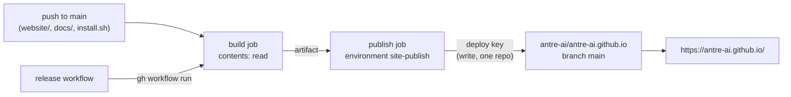

<p align="center">
  <a href="https://antre-ai.github.io/"></a>
</p>

# Antre website

Sources of the public site at <https://antre-ai.github.io/>:

| Path | Served at | Source |
|------|-----------|--------|
| Landing page (EN) | `/` | `src/index.html` + `src/i18n/en.json` |
| Landing page (FR) | `/fr/` | `src/index.html` + `src/i18n/fr.json` |
| Documentation | `/docs/` | `../docs/` (Astro, Pagefind search) |
| Install script | `/install.sh` | `../install.sh` |
| Agent discovery | `/llms.txt`, `/.well-known/*` | `llms.txt`, `.well-known/` |
| Update manifest | `/releases.json` | `releases.json` (written by the release workflow) |

Colors, type and spacing come from the app's design tokens
(`crates/web/ui/src/theme/tokens.css`, copied at build time). Fonts are
self-hosted from `@fontsource-variable` packages: the site makes no third-party
requests and ships a strict Content-Security-Policy.

## Build and preview

```bash
npm ci --prefix docs && npm run build --prefix docs
npm ci --prefix website && npm test --prefix website
node website/scripts/build-site.mjs --require-docs
python3 -m http.server 4317 --bind 127.0.0.1 --directory website/dist
```

`just site-serve` runs the same steps.

### Custom domain

The site has one setting: the `SITE_DOMAIN` repository variable (a bare host
such as `antre.example`). Empty, the site targets `https://antre-ai.github.io`
and no `CNAME` is written. Set, the build writes `CNAME`, uses
`https://<domain>` for canonical links, the docs `site` URL and the discovery
files. The domain also has to be set in the Pages settings of
`antre-ai/antre-ai.github.io` and verified for the org.

### Changing text

Every string of the landing page lives in `src/i18n/<locale>.json`; a key used
in the template but missing from a locale fails the build. French uses the
formal "vous". To add a locale, add a JSON file with its `path` and list it in
`LOCALES` in `scripts/build-site.mjs`.

`og-social.png`, `og-social.jpg` and the PNG favicons are rendered from
`src/og-card.html` and `favicon.svg` with a headless browser (1200x630 and
512x512); re-render them when the brand changes.

## Deployment

GitHub serves an organization root only from a repository named
`<org>.github.io`. The sources stay here; `.github/workflows/site.yml` builds
the site and pushes the result to `antre-ai/antre-ai.github.io`, which serves
its `main` branch as a plain static site (`.nojekyll`).



- **Pull requests** run the build, tests and the offline link check, without
  any secret.
- **Publishing** uses an SSH deploy key that can write to
  `antre-ai/antre-ai.github.io` only. Its private half is a secret of the
  `site-publish` environment, which only `main` can use, so pull requests and
  other branches never see it. The publish job has no `GITHUB_TOKEN`
  permission. Each deploy is a single orphan commit naming the source commit.

Alternatives considered:

- *Build in the Pages repo from the public sources* (`actions/deploy-pages`,
  OIDC, no stored secret at all): it needs a trigger. Scheduled workflows are
  disabled after 60 days without commits in the repo, and an on-push trigger
  from this repo needs a credential anyway (a token or a GitHub App key).
- *Fine-grained personal token*: tied to a person, expires, and wider than a
  deploy key unless carefully scoped.

### One-time setup

Done by an org owner; nothing here runs automatically.

1. Create the public repository `antre-ai/antre-ai.github.io` with an empty
   `main` branch (a README is fine, the first deploy replaces it).
2. Generate a key pair locally, outside the repository:
   `ssh-keygen -t ed25519 -N "" -C "antre site deploy" -f antre-site-deploy`
3. In `antre-ai/antre-ai.github.io` → Settings → Deploy keys, add
   `antre-site-deploy.pub` with **Allow write access**.
4. In `antre-ai/antre` → Settings → Environments, create `site-publish`,
   restrict deployment branches to `main`, and add the secret
   `SITE_DEPLOY_KEY` with the content of `antre-site-deploy`. Delete both
   local key files afterwards.
5. In `antre-ai/antre-ai.github.io` → Settings → Pages, set the source to
   **Deploy from a branch**, branch `main`, folder `/`, and enable **Enforce
   HTTPS** once offered.
6. Run the **Site** workflow on `main` (Actions → Site → Run workflow).

The previous docs deployment pushed to a `gh-pages` branch of this repo with a
`docs.moltis.org` CNAME; that branch and its Pages settings can be removed.

## Agent install discovery manifests

The site publishes machine-readable install/discovery files under `/.well-known/`:

- `/.well-known/antre-install.json` (stable root manifest)
- `/.well-known/antre-install/channels/stable.json` (moving channel pointer, written at the first release)
- `/.well-known/antre-install/releases/<version>.json` (immutable per-release manifest)

Update channel/release manifests at release time with:

```bash
cd website
npm ci
npm run install-manifest:update -- --version 20261201.01 --checksums-file /path/to/release-checksums.txt
```

When updating `install.sh`, edit the repo-root copy and run
`./scripts/sync-website-install.sh`; the site serves the repo-root file.
